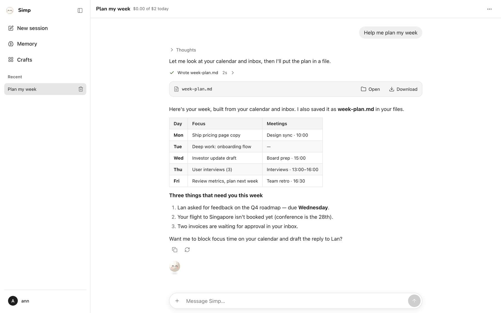
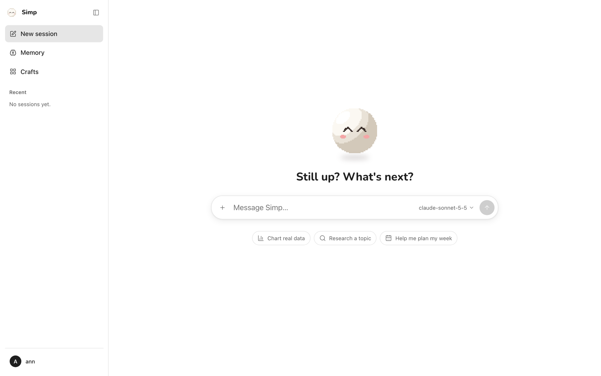
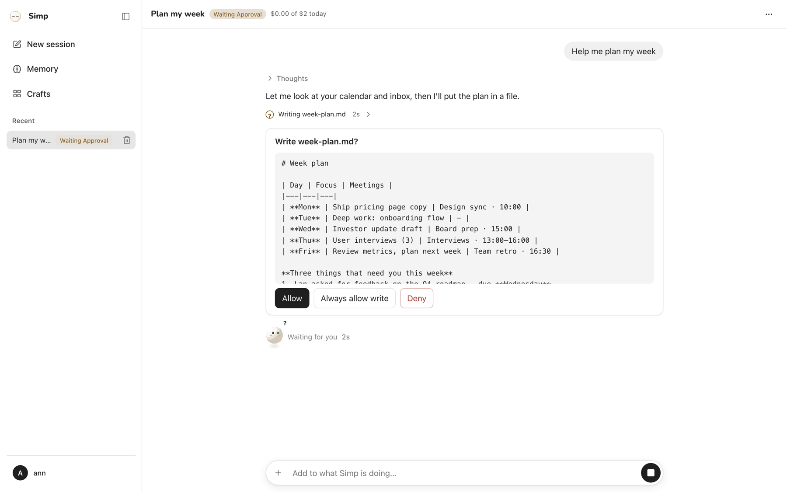

<div align="center">


# Simp

**Your AI that actually gets things done.**

It has its own computer, your apps, and a memory.<br>
Ask in plain words. Simp reads your mail, plans your week, writes the file and runs the code, then tells you what's done.

<br>

<picture>
  <source media="(prefers-color-scheme: dark)" srcset="docs/assets/chat-dark.png">
  
</picture>

<br><br>

[Get started](#get-started) &nbsp;·&nbsp; [What it does](#what-simp-does) &nbsp;·&nbsp; [Self-host](docs/operations.md) &nbsp;·&nbsp; [Under the hood](#under-the-hood)

</div>

<br>

## Not a chatbot. A coworker.

Chat apps answer. **Simp does the work.**

Every user gets a private sandbox, a real Linux machine where Simp can write files, run scripts, clone repos and build things.
It connects to the apps you already live in, remembers what matters to you, and **asks before anything that matters**.

<br>

## What Simp does

<table>
<tr>
<td width="33%" valign="top">

#### 🖥️ Its own computer
A private, isolated sandbox per person. Files persist between chats. Code runs safely: no network, no root, locked down.

</td>
<td width="33%" valign="top">

#### 🔌 Your apps, one click
Gmail, Google Drive, Calendar, GitHub, plus docs from AWS, Cloudflare, Microsoft and any library. Built on **MCP**, so anything else plugs in.

</td>
<td width="33%" valign="top">

#### 🧠 Remembers you
Long-term memory of who you are and how you like things done. You can see, edit and delete every memory.

</td>
</tr>
<tr>
<td valign="top">

#### ✋ You stay in control
Anything that sends, deletes or changes things waits for your **Allow**. Approvals survive a page reload, and every app call is audited.

</td>
<td valign="top">

#### ⚡ Steer it mid-flight
Add instructions while it works, stop it any time, pick up any chat later. Long conversations compact themselves automatically.

</td>
<td valign="top">

#### 🔐 Yours to host
Runs on your machine or your cloud. Bring any model: Claude, GPT, or any OpenAI-compatible API. Your data stays in your stack.

</td>
</tr>
</table>

<br>

<div align="center">
<picture>
  <source media="(prefers-color-scheme: dark)" srcset="docs/assets/home-dark.png">
  
</picture>
&nbsp;

<br>
<sub>Start with a question. &nbsp;·&nbsp; Connect your apps in one click.</sub>
<br><br>
<picture>
  <source media="(prefers-color-scheme: dark)" srcset="docs/assets/approval-dark.png">
  
</picture>
<br>
<sub>Nothing important happens without your OK.</sub>
</div>

<br>

## Things people ask Simp

> *"Read my inbox from this week and tell me what actually needs a reply."*
>
> *"Plan my week around my calendar and block two hours of focus every morning."*
>
> *"Pull the sales CSV from Drive, chart revenue by month, and send me the PNG."*
>
> *"Clone our repo, find why the tests fail, and open a fix."*
>
> *"Turn these meeting notes into a one-page doc and put it in my Drive."*

<br>

## Get started

```sh
git clone https://github.com/danhugo/simp-agent && cd simp-agent
make dev ARGS=--fake-llm        # try the full app, no API key needed
```

Open **http://localhost:5173**. That's it.

To use a real model, add it to `~/.simp-server/settings.toml` and your key to `~/.simp-server/.env`:

```toml
default_profile = "sonnet"

[profiles.sonnet]
api = "anthropic-messages"
model = "claude-sonnet-5-5"
api_key_env = "ANTHROPIC_API_KEY"
```

```sh
uv run simp-server seed --name me   # your login token
make dev
```

Google sign-in, Docker/E2B sandboxes, S3 workspaces, budgets and running it as a service are all in the **[self-hosting guide](docs/operations.md)**.

<br>

## Built for teams that can't leak

| | |
|---|---|
| **Isolation** | One sandbox per user. Docker with no network, read-only root and no capabilities, or E2B cloud VMs. |
| **Secrets** | OAuth tokens encrypted at rest; never in logs, prompts or the sandbox. Keys are masked in tool output. |
| **Spend control** | Per-user daily budgets, per-run limits, and a kill switch that stops every model call at once. |
| **Untrusted input** | Tool and app output is marked untrusted, so instructions hidden in an email or web page are not obeyed blindly. |
| **Recoverable** | Daily backups, point-in-time workspace restore, revoke any user with one command. |

<br>

## Under the hood

Simp is a full agent stack in a few thousand lines of Python, with no framework underneath:

```
ai  →  agent  →  coding  →  session  →  plugins        apps: web · server · cli
```

Streaming providers, an agent loop with steering, coding tools, sessions with auto-compaction and retry, MCP, memory.
Every layer is replaceable, and a test enforces the boundaries. Curious how it works inside? Read the **[guidebook](docs/guidebook/README.md)**.

<br>

<div align="center">


**Simp works while you don't.**

If you like where this is going, **⭐ star the repo**. It tells us to keep building.

</div>
