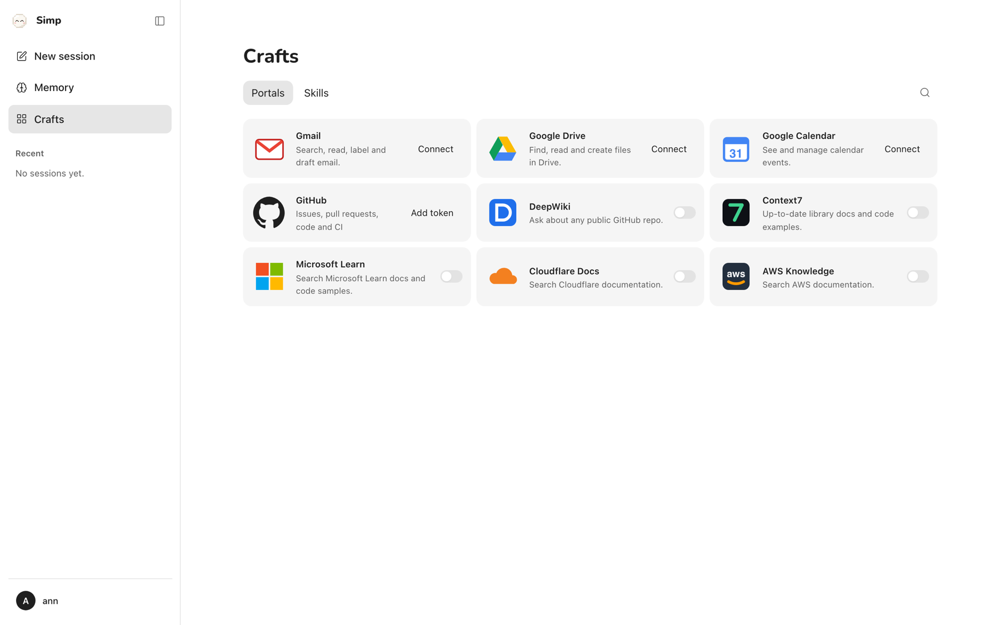

<div align="center">


# Simp

**You talk. It does the rest.**

<br>

<picture>
  <source media="(prefers-color-scheme: dark)" srcset="docs/assets/chat-dark.png">
  
</picture>

<sub>"Help me plan my week." Done, and saved to a file.</sub>

<br><br>

<picture>
  <source media="(prefers-color-scheme: dark)" srcset="docs/assets/home-dark.png">
  
</picture>

<sub>Just ask.</sub>

<br><br>



<sub>Your mail, calendar, Drive and GitHub. One click each.</sub>

<br><br>

<picture>
  <source media="(prefers-color-scheme: dark)" srcset="docs/assets/approval-dark.png">
  
</picture>

<sub>It always asks before doing anything big.</sub>

<br><br>

```sh
git clone https://github.com/danhugo/simp-agent && cd simp-agent && make dev ARGS=--fake-llm
```

[Self-host guide](docs/operations.md) · ⭐ Star if you want more

</div>
