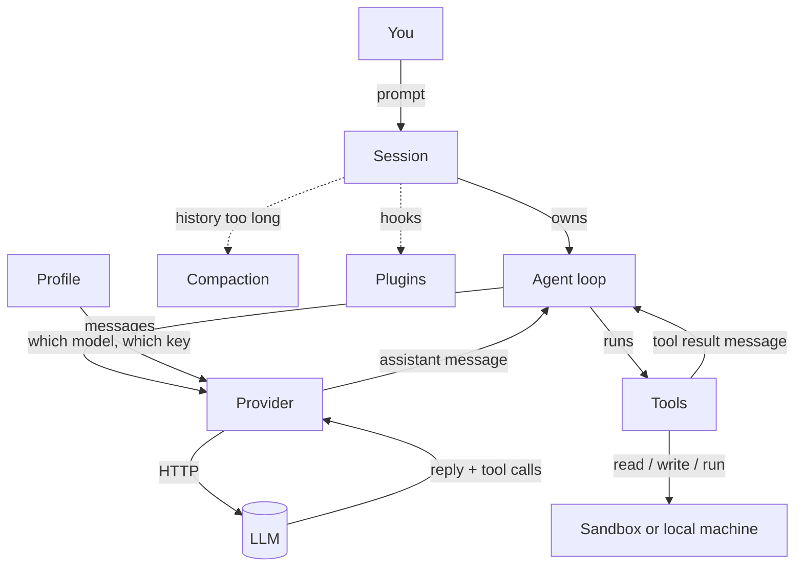
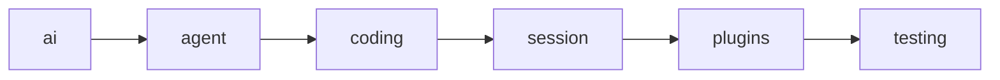

# 00 — Introduction and core ideas

> **Who this is for:** everyone (user, operator, developer).
> **What you need first:** nothing. This is the first chapter.
> **What you will learn:** what simp-agent is and is not, its three apps, the eight core ideas
> every other chapter uses, and how to read this book.
> **Code paths covered:** `packages/simp_agent/src/simp_agent/` (all layers, overview only), `apps/cli`,
> `apps/server`, `apps/web`, `README.md`, `docs/ROADMAP.md`.
> **Verified at commit:** `d74b7ee`.

## 1. What simp-agent is

simp-agent is a small **coding agent**. You give it a task in plain words ("add a test for
`parse_date`"). It asks a large language model (LLM) what to do. The model answers with text
and with requests to use [tools](glossary.md#tool): read a file, edit a file, run a shell
command. simp-agent runs those tools, sends the results back to the model, and repeats until
the model says it is done.

It comes in two parts:

- **A Python library**, `packages/simp_agent`. This is the engine. It has a small core and
  clear places where you can plug in new things.
- **Three apps built on the library:**

| App | Folder | What it is | Main reader |
|---|---|---|---|
| CLI | `apps/cli` (command `simp-agent`) | Chat in your terminal, on your own machine. | User |
| Server | `apps/server` (command `simp-server`) | A multi-user web server for a small team on one machine. | Operator |
| Web UI | `apps/web` | A React app in the browser. It talks to the server. | User |

The CLI and the server both use the same library class, `AgentSession`. So the agent
behaves the same in the terminal and in the browser; only the outside is different.

## 2. What simp-agent is not

Knowing the limits saves you time:

- **Not a cloud product.** The server is built for one machine and a small team. There is no
  Kubernetes, multi-region or billing (planned for Stage 5 in the [ROADMAP](../ROADMAP.md)),
  and replicas were dropped while the server stays on one machine.
- **Not a model.** simp-agent does not contain an LLM. It calls one through a
  [provider](glossary.md#provider). You need an API key, or a fake model for testing.
- **Not full of features.** The core is kept small on purpose. New abilities (MCP, skills,
  memory, sub-agents) are planned as [plugins](glossary.md#plugin) in Stage 4, not as core code.

**Why so small?** The ROADMAP rule for every stage is: *keep the core small and stable;
everything new plugs in.* A small core is easy to read, easy to test, and lets you swap a
provider or a sandbox without rewriting the rest.

## 3. The core ideas in one picture

Eight words come back in every chapter. Here is how they fit together. Each word links to
its one definition in the [glossary](glossary.md).



In words:

1. A [**session**](glossary.md#session) is one conversation. It keeps the full
   [history](glossary.md#history) and saves it, so you can come back later.
2. Inside the session runs the [**agent loop**](glossary.md#agent-loop). It sends the
   [system prompt](glossary.md#system-prompt) and [messages](glossary.md#message) to the model, gets a reply, runs any tools the model asked
   for, and goes again. One pass of "call the model, then run its tools" is a
   [turn](glossary.md#turn).
3. A [**provider**](glossary.md#provider) is the adapter that speaks one LLM API. simp-agent
   has three built in: Anthropic Messages, OpenAI Chat Completions, and OpenAI Responses.
4. A [**profile**](glossary.md#profile) is a named group of settings: which API, which model,
   which base URL, which environment variable holds the key.
5. [**Tools**](glossary.md#tool) are what the model can *do*. The library ships seven:
   `read`, `write`, `edit`, `bash`, `grep`, `find`, `ls`.
6. Tools act on an [execution environment](glossary.md#execution-environment). In the CLI
   that is your own machine. On the server it is a [**sandbox**](glossary.md#sandbox): a
   separate folder (or Docker container) for each session.
7. When the history gets close to the model's limit, [**compaction**](glossary.md#compaction)
   replaces old messages with a summary, so the conversation can keep going.
8. A [**plugin**](glossary.md#plugin) adds behaviour without changing the core. Example:
   `plan_mode` blocks `write`, `edit` and `bash` so the model can only plan.

### A small example

You type: *"What does `utils.py` do?"* Here is what happens, step by step:

```mermaid
sequenceDiagram
    participant You
    participant Loop as Agent loop
    participant LLM
    participant Tool as read tool
    You->>Loop: user message "What does utils.py do?"
    Loop->>LLM: system prompt + messages + tool list
    LLM-->>Loop: assistant message: tool call read(path="utils.py")
    Loop->>Tool: run read
    Tool-->>Loop: tool result message (file text)
    Loop->>LLM: messages + tool result
    LLM-->>Loop: assistant message: "It has two helpers..." (no tool calls)
    Loop-->>You: done
```

There were two turns. The loop stopped because the last reply had no tool calls. That is
the rule: **the loop runs until the model stops asking for tools** (see `agent_loop` in
`packages/simp_agent/src/simp_agent/agent/__init__.py`).

## 4. How the library is built (short view)

The library is split into layers. Each layer may import only the layers to its left. A test
(`packages/simp_agent/tests/test_layers.py`) checks this, so the rule cannot drift.



| Layer | One-line job |
|---|---|
| `ai` | Message types and `stream()`, which sends them to a provider. |
| `agent` | The generic agent loop, tools, execution environments, compaction helpers. Knows nothing about coding. |
| `coding` | The seven coding tools, the system prompt, and loading `AGENTS.md` / `CLAUDE.md`. |
| `session` | `AgentSession`: auto-compaction, retry on errors, saving history, tool approval, plugins. |
| `plugins` | Two example plugins: `redact_secrets` and `plan_mode`. |
| `testing` | `FakeProvider` (a scripted model) and `EnvConformance` (checks an environment). |

**Why layers?** Each layer can be understood and tested alone. The `agent` layer can run any
kind of agent, not only a coding one; the coding parts sit on top. The full story is in
chapter 30 (Architecture).

## 5. How to read this book

The book has four parts. Read Part 0 (this chapter and the next), then only the part for
your role. Parts link back to what they need.

| Part | Chapters | For | Start here if you want to... |
|---|---|---|---|
| 0 Start here | 00–01 | Everyone | understand the ideas and run it once |
| 1 Using simp-agent | [10](10-cli.md)–13 | User | chat in the terminal or browser |
| 2 Running the server | 20–27 | Operator | host it for a small team |
| 3 Inside simp-agent | 30–38 | Developer | change the library or write a plugin |

Some habits of this book:

- **Every term is defined once**, in the [glossary](glossary.md). The first time a chapter
  uses a term, it links there.
- **Every chapter header** says who it is for, what to read first, which code it covers, and
  the commit it was checked against. If the code has moved on since that commit, trust the code.
- **Each topic has one home chapter.** Other chapters link to it instead of repeating it.
- Chapter tags: [T] tutorial (learn by doing), [H] how-to (solve one task),
  [R] reference (look things up), [E] explanation (understand why). This chapter is [E].
- Book changes are listed in the [changelog](changelog.md).

The full outline is in the [guidebook README](README.md).

---

**Next:** [01 Quick start](01-quick-start.md) — run the CLI in two minutes, or the web UI with `make dev`.

**Built on by:** every chapter. The ideas here are used most in [10](10-cli.md) (The CLI),
11 (The web UI), 23 (Sandboxes), 30 (Architecture) and 31 (How one turn flows).
