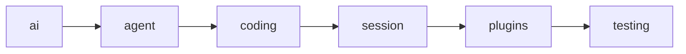
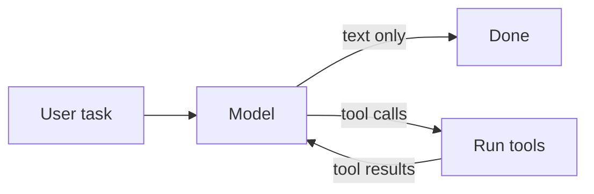
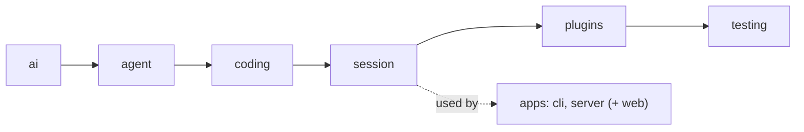
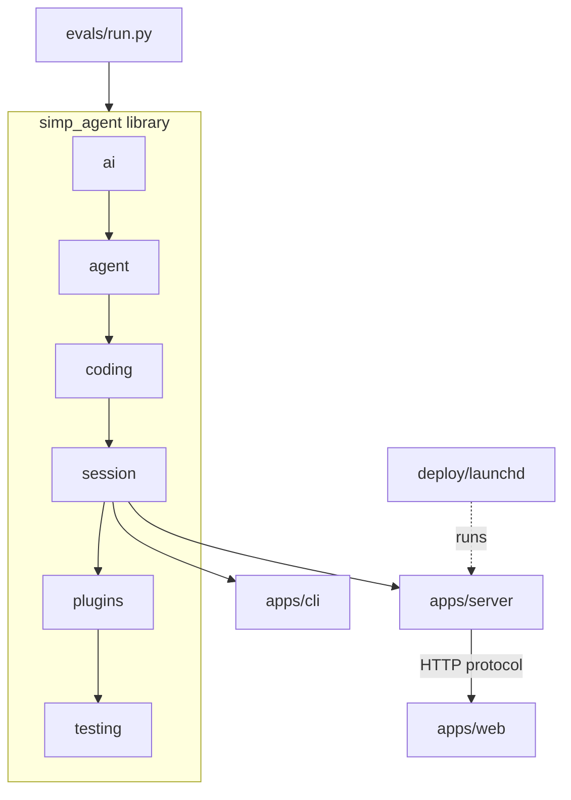

# 00 Overview: what we build

**Goal:** See the whole of simp-agent before building it piece by piece.

**Builds on:** — (start here) · **Next:** [01 Part 1 big picture](01-part-1-ai.md)

## Where we are



Nothing is built yet. This chapter is the map: what simp-agent is, its six layers, and the order we build them in.

Code in this chapter (commit `2fc2776`):

- `packages/simp_agent/tests/test_layers.py` — `LAYERS`, `APPS`, `test_layers`

## What simp-agent is

simp-agent is a small **[coding agent](glossary.md#coding-agent)**. You give it a task in plain words, like "write `fizzbuzz.py`". It asks a language model what to do. The model answers with text, or with **[tool calls](glossary.md#tool-call)** such as "read this file" or "run this command". simp-agent runs those tools, sends the results back to the model, and repeats until the model says it is done.

That repeat is the heart of every coding agent:



Everything else in this book exists to make this loop **safe**, **testable**, **long-lived** and **usable** from a terminal or a browser.

The project has three kinds of code:

| Part | Folder | What it is |
|---|---|---|
| The library | `packages/simp_agent/src/simp_agent/` | The agent itself. No UI, no server. |
| The apps | `apps/cli/`, `apps/server/`, `apps/web/` | Ways to use the library: a terminal app, an HTTP server, a browser client. |
| Checks and running | `evals/`, `deploy/` | Real tasks that measure the agent, and files to run the server on one machine. |

## The layer map

The library is split into six **[layers](glossary.md#layer)**. Each layer is one folder under `packages/simp_agent/src/simp_agent/`:



Read the arrow as "is used by". `ai` is used by `agent`, `agent` by `coding`, and so on.

| Layer | What it holds (real names) |
|---|---|
| `ai` | Message types (`UserMessage`, `AssistantMessage`, `ToolCall`, ...), `stream()`, `register_provider()`, and the real providers in `ai/providers/`. |
| `agent` | `agent_loop()`, the `Agent` class, `AgentTool`, the `ExecutionEnv` protocol and `LocalEnv` (`agent/env.py`), compaction helpers. |
| `coding` | The coding tools (`make_tools()` in `coding/tools.py`), `system_prompt()`, `load_context_file()`. |
| `session` | `AgentSession`: owns an `Agent` and adds retry, compaction, overflow recovery, saving (`SessionStore`) and plugins (`PluginAPI`). |
| `plugins` | Two built-in plugins, `RedactSecrets` and `PlanMode`, and `build_plugins()`. |
| `testing` | `FakeProvider`, `FakeEnv` and `EnvConformance`: helpers for tests. |

### The one rule: import only downward

A layer may import the layers to its left, never the ones to its right. And the library never imports the apps. So `ai` knows nothing about tools, and `agent` knows nothing about files on disk or about sessions.

**Why?** Each layer can be understood and tested alone. When you read chapter 07 (the loop), you do not need to know about sessions. When something breaks in `ai`, you know nothing above it caused the bug. And you can replace a top part (for example, the CLI) without touching the core. The cost: some features (like approval or saving) are split across layers, so you must know which layer owns what; the table above is that guide.

This rule is not just a promise. A test checks it on every run.

## Test it: the layer test

`packages/simp_agent/tests/test_layers.py` reads every `.py` file in the library, finds its imports with Python's `ast` module, and fails if a file imports a layer to its right, or an app (`simp_cli`, `simp_server`):

```text
LAYERS = ai, agent, coding, session, plugins, testing    // left to right
APPS   = simp_cli, simp_server

FUNCTION test_layers():
    bad = empty list
    FOR EACH .py file in the library:
        src = the layer this file sits in (or none)
        FOR EACH import in the file:
            IF it imports an app:
                ADD "imports app ..." to bad
                go to next import
            dst = the layer it imports (or none)
            IF dst is none OR src == dst:
                go to next import                   // same layer, or not ours: fine
            IF src is none OR dst is to the RIGHT of src:
                ADD "imports dst" to bad            // forbidden direction
    FAIL the test if bad is not empty
```

Real code: [packages/simp_agent/tests/test_layers.py](../../packages/simp_agent/tests/test_layers.py) (`test_layers`)

Note two details:

- "dst is to the RIGHT of src" (in the code: `LAYERS.index(dst) > LAYERS.index(src)`) is the forbidden case.
- A file that sits in no layer (`src is None`, for example the package's top `__init__.py`) may not import any layer at all.

Run it:

```sh
uv run pytest packages/simp_agent/tests/test_layers.py -q
```

If you add `from ..session import AgentSession` inside `agent/`, this test fails and prints the file name. That is the point: the layer map stays true as the code grows.

## The apps on top

The apps use the library; they are never used by it.

- **CLI** (`apps/cli/`, package `simp_cli`): a terminal app. It uses only `AgentSession`. Chapter 24.
- **Server** (`apps/server/`, package `simp_server`): runs sessions for many users over HTTP. Key classes in `server.py`: `Run`, `SessionManager`, the `Sandbox`, `Store` and `Auth` protocols. Chapters 25–29.
- **Web client** (`apps/web/`): a TypeScript browser app. It talks to the server through the protocol; its types are generated into `protocol.gen.ts`. Chapter 30.



## The build path

We build in the same order as the layers: bottom first. Each chapter adds one capability on top of the last one, and each chapter has a test.

| Part | Chapters | What you have at the end |
|---|---|---|
| 1 · Talk to a model (`ai`) | [02](02-pick-clean.md)–[05](05-label-test.md) | Pick + Clean (with the message types), Translate + Send, Parse, Label + a fake model for tests. |
| 2 · The loop (`agent`) | [07](07-agent-loop.md)–[10](10-hooks-approval.md) | A loop that runs tools, sends events, can be stopped, steered and checked. |
| 3 · Coding (`coding`) | [12](12-exec-env.md)–[15](15-evals.md) | A safe place to touch files, real coding tools, a system prompt, evals. |
| 4 · Sessions (`session`, `plugins`) | [17](17-session.md)–[22](22-profiles-plugins.md) | Saved conversations, plugins, retry, compaction, overflow recovery, profiles. |
| 5 · Apps | [24](24-cli.md)–[31](31-system-tests-deploy.md) | CLI, server, transport, store, limits, Docker sandbox, web client, deploy. |
| Wrap-up | [32](32-limits-choices-extend.md) | Why it is built this way, where it stops, how to extend it. |

**Why bottom first?** Every chapter can then be tested with what already exists. Chapter 05 builds `FakeProvider` at the end of Part 1 on purpose: with a fake model, every later chapter can test the loop, tools and sessions without a network or an API key.

## Capability table

Which chapter adds which feature, and in which layer it lives:

| Feature | Chapter | Where in the code |
|---|---|---|
| Message types | 02 | `ai` |
| Real providers (Translate + Send) | 03 | `ai/providers/` |
| Parse into one message | 04 | `ai` |
| Label + fake model for tests | 05 | `ai`, `testing` (`FakeProvider`) |
| Agent loop | 07 | `agent` (`agent_loop`) |
| Events and abort | 08 | `agent` |
| Steering | 09 | `agent` (`Agent`) |
| Hooks and approval | 10 | `agent`, `session` |
| Execution environment | 12 | `agent/env.py` |
| Coding tools | 13 | `coding/tools.py` |
| System prompt | 14 | `coding` |
| Evals | 15 | `evals/` |
| Sessions and saving | 17 | `session` |
| Plugins | 18 | `session` (`PluginAPI`) |
| Retry | 19 | `session` |
| Compaction | 20 | `agent/compaction.py`, `session` |
| Context overflow | 21 | `session` |
| Profiles, built-in plugins | 22 | `session/profile.py`, `plugins` |
| CLI | 24 | `apps/cli` |
| Server run, transport, store, limits | 25–28 | `apps/server` |
| Docker sandbox | 29 | `apps/server/sandboxes` |
| Web client | 30 | `apps/web` |
| System tests, deploy | 31 | `apps/web/e2e`, `deploy/` |

## The running examples

Each Part uses small examples that fit its layer:

- Part 1 (02–05) sends one prompt about a `README` to a model.
- Part 2 ([07](07-agent-loop.md)) has the loop read `README.md` and answer.
- Part 3 ([13](13-coding-tools.md)) edits `a.txt` and `shape.py` with the real tools; [15](15-evals.md) then meets fizzbuzz as an eval task.

From Part 4 on, the book follows one task, taken from the real eval file `evals/tasks/fizzbuzz.toml`:

```toml
prompt = """Write fizzbuzz.py with a function fizzbuzz(n) that returns a list of strings for 1..n:
"Fizz" for multiples of 3, "Buzz" for multiples of 5, "FizzBuzz" for both, else the number."""
```

The same file has a `check` that imports `fizzbuzz` and asserts the result, so we know when the agent got it right.

We follow this task as the system grows:

- In Part 3 the eval ([15](15-evals.md)) runs it and checks `fizzbuzz.py`.
- In Part 4 the conversation is saved and can be resumed.
- In Part 5 you type the task in a terminal or a browser.

**Builds on:** — · **Next:** [01 Part 1 big picture](01-part-1-ai.md)
