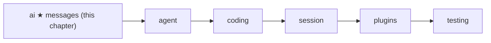
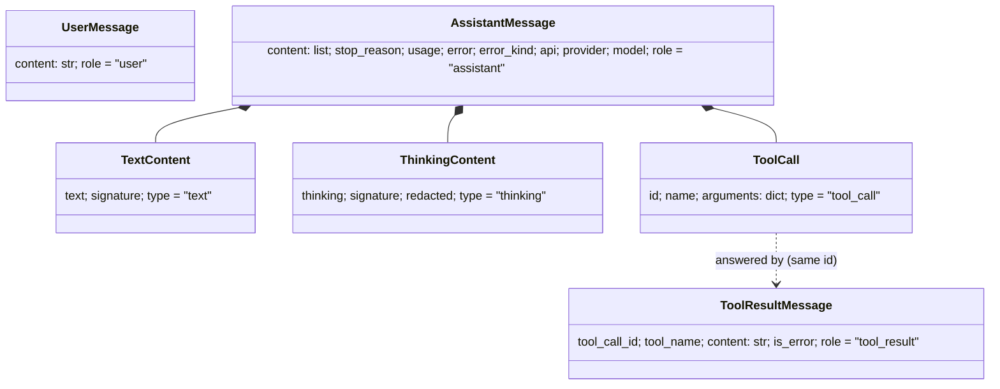
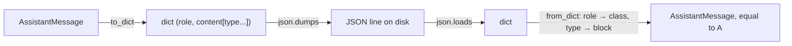

# 01 Part 1 · Messages

**Goal:** Define the message types every other part passes around.

**Builds on:** [00 Overview](00-overview.md) · **Next:** [02 A fake provider](02-fake-provider.md)

## Where we are



We start at the far left of the [layer map](00-overview.md#the-layer-map): the `ai` layer. Before we can call a model, run a tool, or save a chat, we need one thing all of them share: the **[message](glossary.md#message)**.

Code in this chapter (commit `2fc2776`):

- `packages/simp_agent/src/simp_agent/ai/__init__.py` — `TextContent`, `ThinkingContent`, `ToolCall`, `UserMessage`, `AssistantMessage`, `ToolResultMessage`, `to_dict`, `from_dict`
- `packages/simp_agent/tests/test_reasoning.py`, `packages/simp_agent/tests/test_compaction_serialize.py` — round-trip tests

## The problem

A conversation with a coding agent is a list of turns:

1. The user says "write `fizzbuzz.py`".
2. The model answers with some text and a [tool call](glossary.md#tool-call): `write(path="fizzbuzz.py", ...)`.
3. The agent runs the tool and gets a result: "wrote 12 lines".
4. The model reads the result and answers "Done."

Every later part touches this list. [Providers](glossary.md#provider) (ch [04](04-providers.md)) turn it into the format of one vendor API. The loop (ch [05](05-agent-loop.md)) adds to it. Sessions (ch [13](13-session.md)) save it to disk and load it back. The server (ch [20](20-server-run.md)) sends it to a browser.

So the list needs a shape that is:

- **the same for every vendor** — Anthropic and OpenAI use different JSON, but the rest of our code should not care;
- **typed** — code can ask "is this a tool result?" without guessing;
- **easy to save** — turn it into JSON and back, with nothing lost.

## Naive version

The quick way is plain dicts, like most vendor examples:

```python
history = [
    {"role": "user", "content": "write fizzbuzz.py"},
    {"role": "assistant", "content": "Sure.",
     "tool_calls": [{"id": "c1", "name": "write", "args": {"path": "fizzbuzz.py"}}]},
    {"role": "tool", "id": "c1", "content": "wrote 12 lines"},
]

def tool_calls(msg):
    return msg.get("tool_calls", [])

for m in history:
    for call in tool_calls(m):
        print(call["name"], call["arguments"])   # KeyError: 'arguments'
```

It saves to JSON for free, but it breaks fast:

- One place writes `"args"`, another reads `"arguments"`. Nothing catches it until runtime.
- The assistant text is one string, so there is no room for the model's thinking, or for text *between* two tool calls, in the order the model gave them.
- There is nowhere to put "why did the model stop?" or "how many tokens did this cost?".
- The shape is close to one vendor. A second vendor means `if vendor == ...` all over the code.

## Step by step: from naive to real

We fix the dict version one problem at a time. Each step is small.

**Step 1 — a class per kind of message.** Typos like `args`/`arguments` must fail early. A dataclass checks field names when the object is built:

```python
@dataclass
class ToolCall:
    id: str
    name: str
    arguments: dict

ToolCall("c1", "write", args={})   # TypeError right here, not later
```

**Step 2 — content is a list of blocks.** One string cannot keep "think, text, tool call, more text" in order. So `AssistantMessage.content` becomes a list of `TextContent | ThinkingContent | ToolCall`.

**Step 3 — room for "why it stopped" and "what it cost".** We add `stop_reason`, `usage`, `error` and `error_kind` to `AssistantMessage`. Now the loop can tell a normal end from a failure.

**Step 4 — a tag on every class.** Dataclasses are not JSON. `dataclasses.asdict` turns them into dicts, but to come back we must know *which* class a dict was. So each class gets a fixed `role` (messages) or `type` (blocks), and `from_dict` reads it.

**Step 5 — our own shape, not a vendor's.** Nothing in these classes is Anthropic or OpenAI JSON. Each provider translates at the edge (ch [04](04-providers.md)).

The result is the real code below.

## Real design

simp-agent uses small Python **dataclasses**. Each one has a fixed `role` (or `type`) field, so it can always tell what it is, even after a trip through JSON.



### The three messages

**User message** — what the person typed. Just a string:

```python
@dataclass
class UserMessage:
    content: str
    role: Literal["user"] = "user"
```

**Tool result** — the answer to one tool call:

```python
@dataclass
class ToolResultMessage:
    tool_call_id: str
    tool_name: str
    content: str
    is_error: bool = False
    role: Literal["tool_result"] = "tool_result"
```

`tool_call_id` links the result to the `ToolCall` that asked for it. Every vendor API needs this link. `is_error` tells the model "this failed" — for example, an unknown tool, bad arguments, a call the user denied, or a call cut off by `length` — so it can try again instead of the whole agent crashing.

**Assistant message** — what the model said. This is the rich one:

```python
@dataclass
class AssistantMessage:
    content: list = field(default_factory=list)  # TextContent | ThinkingContent | ToolCall
    stop_reason: str = "stop"  # stop | tool_use | length | error | aborted
    usage: dict = field(default_factory=lambda: {"input": 0, "output": 0})
    error: str | None = None
    error_kind: str | None = None  # "fatal" | "budget" | "policy" = never retried (see is_retryable)
    api: str = ""  # set by stream(): who produced it, decides what can be replayed
    provider: str = ""
    model: str = ""
    role: Literal["assistant"] = "assistant"

    def text(self) -> str:
        return "".join(c.text for c in self.content if isinstance(c, TextContent))

    def tool_calls(self) -> list[ToolCall]:
        return [c for c in self.content if isinstance(c, ToolCall)]
```

Why each field is there:

- `content` is a **list of blocks**, not a string. A model can think, write text, call a tool, write more text, call another tool — all in one answer. The list keeps that order.
- `stop_reason` says why the model stopped: `stop`, `tool_use`, `length`, `error` or `aborted`. Note: the loop in ch [05](05-agent-loop.md) decides "run tools?" from `tool_calls()`, not from `tool_use`. It uses `stop_reason` for the special cases: `error` and `aborted` end the turn (ch [06](06-events-abort.md), [15](15-retry.md)); on `length` the tool calls are cut off, so they are not run and each gets an error result.
- `usage` ([usage](glossary.md#usage)) counts input and output tokens. Compaction uses it to estimate size (ch [16](16-compaction.md)).
- `error` and `error_kind` hold what went wrong. A provider never raises; it returns an assistant message with `stop_reason="error"` instead (ch [04](04-providers.md)). `error_kind` of `"fatal"`, `"budget"` or `"policy"` means "do not retry". The function that reads it is `is_retryable`, built in ch [04](04-providers.md#error-classification-is_retryable-is_context_overflow) and used by retry in ch [15](15-retry.md).
- `api`, `provider`, `model` record who wrote the message. `stream()` fills them in. They matter when you switch models mid-chat: some thinking blocks can only be sent back to the same model (ch [04](04-providers.md)).
- `text()` and `tool_calls()` are small helpers so callers do not loop over blocks by hand.

### The three content blocks

```python
@dataclass
class TextContent:
    text: str
    signature: str | None = None
    type: Literal["text"] = "text"

@dataclass
class ThinkingContent:
    thinking: str
    signature: str | None = None
    redacted: bool = False
    type: Literal["thinking"] = "thinking"

@dataclass
class ToolCall:
    id: str
    name: str
    arguments: dict
    type: Literal["tool_call"] = "tool_call"
```

- `TextContent` is normal text shown to the user.
- `ThinkingContent` is the model's reasoning before it answers. `signature` is a value from the vendor that we cannot read or change; we only keep it and send it back unchanged. `redacted` marks thinking the vendor hid from us. Ch [04](04-providers.md) explains how these are replayed.
- `ToolCall` is one request to run a tool. `arguments` is already a parsed `dict`, not a JSON string. Ch [03](03-stream-parser.md) shows how streamed pieces become this dict.

### Two history entries that are not messages

Two more types live in the same list, but are **never sent to the model**:

```python
@dataclass
class CompactionEntry:
    summary: str
    first_kept_index: int
    read_files: list = field(default_factory=list)
    modified_files: list = field(default_factory=list)
    role: Literal["compaction"] = "compaction"

@dataclass
class CustomEntry:
    type: str
    data: dict = field(default_factory=dict)
    role: Literal["custom"] = "custom"
```

- A **[compaction entry](glossary.md#compaction-entry)** marks "everything before `first_kept_index` is now replaced by `summary`". We only ever add to the end of the history; old messages are not deleted or changed. Ch [16](16-compaction.md) builds this.
- A **[custom entry](glossary.md#custom-entry)** is a place for plugins to keep their own data in the history, so it is saved and comes back on resume. Ch [14](14-plugins.md) uses it.

They have a `role` too, so they save and load just like messages. Before a request is sent, `transform_messages()` skips both (ch [04](04-providers.md#transform_messages-clean-history-before-sending)).

### Going to JSON and back

Saving needs two functions:

```python
def to_dict(m) -> dict:
    """Any message or CompactionEntry -> JSON-safe dict."""
    return dataclasses.asdict(m)


def from_dict(d: dict):
    d = dict(d)
    cls = {"user": UserMessage, "assistant": AssistantMessage, "tool_result": ToolResultMessage, "compaction": CompactionEntry,
           "custom": CustomEntry}[d["role"]]
    if cls is AssistantMessage:
        types = {"text": TextContent, "thinking": ThinkingContent, "tool_call": ToolCall}
        d["content"] = [types[c["type"]](**c) for c in d["content"]]
    return cls(**d)
```

`to_dict` is one line because `dataclasses.asdict` already walks nested dataclasses. All fields are strings, numbers, bools, lists or dicts, so the result goes straight into `json.dumps`.

`from_dict` is the reverse. It reads `role` to pick the class. For an assistant message it also reads each block's `type` to rebuild the blocks. This is why every class carries its own `role` or `type`: the data says what it is.



One nice side effect: **old saved files still load.** A field added later has a default value, so a dict without it still builds. For example, a compaction entry saved before `read_files` existed loads with `read_files == []`.

The CLI uses exactly this pair to save sessions as JSON lines (`apps/cli/src/simp_cli/__init__.py`):

```python
f.write(json.dumps(to_dict(entry)) + "\n")
...
return [from_dict(json.loads(line)) for line in self.path.read_text().splitlines() if line.strip()]
```

### Packing a request: Tool, Context, Model

Three more small dataclasses in the same file describe one call to a model. Ch [02](02-fake-provider.md) needs them right away:

```python
@dataclass
class Tool:
    name: str
    description: str
    parameters: dict  # JSON schema

@dataclass
class Context:
    system_prompt: str
    messages: list
    tools: list = field(default_factory=list)

@dataclass
class Model:
    id: str = "claude-sonnet-5-5"
    provider: str = "anthropic"
    max_tokens: int = 8192
    context_window: int = 200000
    api: str = "anthropic-messages"  # anthropic-messages | openai-completions | openai-responses
    base_url: str | None = None
    api_key_env: str | None = None  # env var holding the key
    compat: dict = field(default_factory=dict)
```

- `Tool` tells the model what a tool is called, what it does, and its arguments as a JSON schema. It holds no code; the code to run it comes in ch [05](05-agent-loop.md).
- **[Context](glossary.md#context)** is everything sent in one request: system prompt, message list, tools.
- `Model` says which model to call. `api` picks the provider code; `context_window` is used by compaction. Ch [04](04-providers.md) explains `api`, `base_url`, `api_key_env` and `compat`.

These are not saved in history, so they have no `role` and no `from_dict` support.

## Test

Two real tests check the round trip. From `tests/test_reasoning.py`:

```python
def test_from_dict_old_and_new():
    old = {"role": "assistant", "content": [{"type": "text", "text": "x"}], "stop_reason": "stop",
           "usage": {"input": 1, "output": 2}, "error": None}
    assert ai.from_dict(old).content == [TextContent("x")]
    new = asst([ThinkingContent("t", "s"), TextContent("x", '{"id": "m"}')])
    assert ai.from_dict(json.loads(json.dumps(ai.to_dict(new)))) == new
```

The first half loads an old dict with no `api`, `provider` or `signature` fields. The second half goes all the way through real JSON text and checks the message comes back **equal** — dataclasses compare field by field, so `==` is a full check.

From `tests/test_compaction_serialize.py`:

```python
def test_entry_roundtrip_and_old_format():
    e = CompactionEntry("s", 3, ["r"], ["m"])
    assert from_dict(to_dict(e)) == e
    assert from_dict({"role": "compaction", "summary": "s", "first_kept_index": 3}).read_files == []
```

Run them:

```bash
cd packages/simp_agent
uv run pytest -q tests/test_reasoning.py::test_from_dict_old_and_new \
  tests/test_compaction_serialize.py::test_entry_roundtrip_and_old_format
# 2 passed
```

No model is needed. Messages are plain data, so they are the easiest part to test.

> **Why this way?**
> - **Our own types, not a vendor's.** The rest of the code speaks one format. Each provider translates at the edge (ch [04](04-providers.md)). Adding a vendor means one new provider, not changes everywhere.
> - **Dataclasses, not plain dicts.** Field names are checked when an object is built, and editors can help. But they still turn into dicts in one line, so we lose nothing on saving.
> - **Dataclasses, not a library like pydantic.** No extra dependency in the lowest layer. We do not validate on load; the data was written by us.
> - **A `role`/`type` tag on everything.** One small lookup table in `from_dict` is all the loading code we need.
> - **Cost:** `from_dict` trusts its input. An unknown `role` raises `KeyError`, and a stray field raises `TypeError`. That is fine for files we wrote ourselves.

## Exercises

1. Build an `AssistantMessage` with a `ThinkingContent`, a `TextContent` and a `ToolCall`. Pass it through `to_dict`, `json.dumps`, `json.loads` and `from_dict`. Check that the result `==` the start.
2. Add a new field `note: str = ""` to `UserMessage` in your own copy. Does an old saved dict without `note` still load? Why?

## Recap

- A chat is a list of `UserMessage`, `AssistantMessage` and `ToolResultMessage`.
- An assistant message holds an ordered list of blocks: `TextContent`, `ThinkingContent`, `ToolCall`, plus `stop_reason`, `usage`, error info and who wrote it.
- A `ToolResultMessage` answers one `ToolCall` by `tool_call_id`.
- `Tool`, `Context` and `Model` describe one request to a model.
- `CompactionEntry` and `CustomEntry` live in the same history but are never sent to the model.
- `to_dict` / `from_dict` turn any of them into JSON-safe dicts and back; old files still load thanks to defaults.

**Builds on:** [00 Overview](00-overview.md) · **Next:** [02 A fake provider](02-fake-provider.md) — now that we have messages, we make a fake model that returns them, so we can test without a real API.

**Built on by:** [03](03-stream-parser.md) (builds an `AssistantMessage` from a stream) · [04](04-providers.md) (translates messages per vendor, `transform_messages`) · [05](05-agent-loop.md) (reads `stop_reason`, adds tool results) · [13](13-session.md) (saves history) · [14](14-plugins.md) (`CustomEntry`) · [16](16-compaction.md) (`CompactionEntry`)
