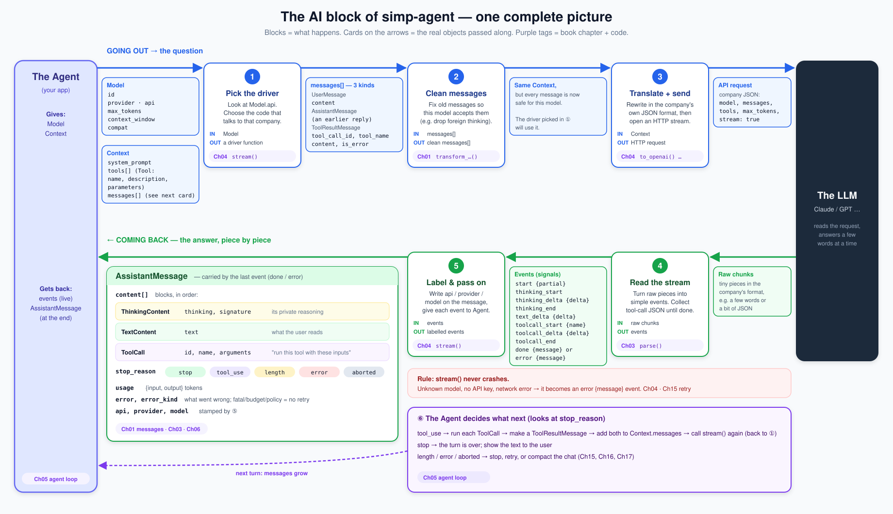

# 01 Part 1 big picture: the AI layer

**In one sentence:** Part 1 builds `ai.stream()`: one call that sends our question to a model and gives the answer back piece by piece.

Read this page before [02](02-pick-clean.md). Come back to it any time you get lost in [02](02-pick-clean.md)–[05](05-label-test.md). It adds no new facts. The plain walk-through comes first; the map (picture and tables) is at the end.

## Example: the user asks about a file

The user types in the app: **"What is in README.md?"**

The model lives on a server of a model company, like Anthropic or OpenAI. We call that company the [vendor](glossary.md#vendor). Each vendor has its own web API with its own JSON format. Our app should not care about these formats. It wants one call that works for every vendor, and one shape of answer.

That call is `ai.stream()`. Part 1 builds it. Below we follow the one question through it, block by block.

## Walk the question through `ai.stream()`

At each step: where the thing comes from, who does it, and what it is. Then the code name. Paths are under `packages/simp_agent/src/simp_agent/`.

**The question goes in.** The app (in Part 2, the [agent loop](glossary.md#agent-loop)) puts the user's text in a `UserMessage`. It packs everything the model must see into a [Context](glossary.md#context): a system prompt, the list of messages (here one), and the tools the model may ask for (here one tool, `read`). It also says which model to use with a [Model](glossary.md#model) object. Its `api` field names the vendor's API format, here `"anthropic-messages"`. Then it calls `ai.stream(model, context, api_key=...)`.

**1. Pick the provider.** `ai.stream()` must find the code that talks to this vendor. That code is a [provider](glossary.md#provider): an async function that takes the model, the context and the key, and yields events. (Its exact shape is a [stream function](glossary.md#stream-function).) The providers sit in a dict that maps an `api` string to a provider: the [provider registry](glossary.md#provider-registry), named `_PROVIDERS` in `ai/__init__.py`. `ai.stream()` looks up `"anthropic-messages"` and gets the Anthropic provider. Built in [02](02-pick-clean.md#1-pick-_providers-register_provider).

**2. Clean the messages.** Old messages may not suit this model. For example, a reply that failed, or thinking written by another vendor's model. `transform_messages()` makes a clean copy of the list for this model, and `ai.stream()` puts it in a new `Context`. Our one user message has nothing to fix, so it passes through. Built in [02](02-pick-clean.md#2-clean-transform_messages).

**3. Translate.** Now `ai.stream()` hands the clean `Context` to the provider. The provider rewrites our message and our `read` tool in Anthropic's JSON. For example, the tool's `parameters` become `input_schema`. Built in [03](03-translate-send.md#3-translate-our-messages--vendor-format).

**4. Send.** The provider opens one HTTP stream to Anthropic with the API key. Raw chunks start to arrive. Built in [03](03-translate-send.md#4-send-call-the-api).

**5. Parse.** The provider turns the raw chunks into our own small [stream events](glossary.md#stream-event), one for each piece, and fills one [AssistantMessage](glossary.md#assistantmessage) as it goes. Here the model wants to read the file, so we get `start`, then `toolcall_start {name: "read"}`, some `toolcall_delta` events (each holds a [delta](glossary.md#delta): a small piece of the JSON), `toolcall_end`, and last `done`. The final message holds one [ToolCall](glossary.md#tool-call) `read` with `arguments={"path": "README.md"}`, and `stop_reason="tool_use"`. Built in [04](04-parse.md).

**6. Label.** Back in `ai.stream()`, each event that carries a message gets three labels written on that message: `api`, `provider` and `model`. Then `ai.stream()` passes the event on to the app. Built in [05](05-label-test.md#the-entry-point-stream-runs-1-2-6).

**The answer comes out.** The app reads the events as they come (to show words live) and keeps the message from the last event. Part 1 ends here. The model did not answer yet; it asked for a tool. The agent loop ([07](07-agent-loop.md)) runs `read`, adds the reply and a `ToolResultMessage` to the messages, and calls `ai.stream()` again. This time Parse yields `text_delta` events and `done` with `stop_reason="stop"`, and the [run](glossary.md#run-agent) ends.

**When something goes wrong.** `ai.stream()` never raises. If the `api` is unknown, the key is missing, or the network fails, the app gets an `error` event. Its message has `stop_reason="error"`. A missing key is caught before the provider even starts: the built-in entries in `_PROVIDERS` check for a key first.

## What each chapter builds

Steps 1, 2 and 6 happen in `ai.stream()` itself. Steps 3, 4 and 5 happen inside the provider. So the chapters go:

- **[02 Pick + Clean](02-pick-clean.md)** sets the shape of a provider (`(model, context, api_key) → events`, never raises), the registry (step 1) and `transform_messages()` (step 2).
- **[03 Translate + Send](03-translate-send.md)** builds steps 3 and 4 of the real providers, one file per vendor.
- **[04 Parse](04-parse.md)** builds step 5 for all three providers. The Anthropic one takes the final message from Anthropic's Python library (`get_final_message()`) instead of building it in `parse()`.
- **[05 Label + test](05-label-test.md)** builds `ai.stream()` around them (step 6), and `FakeProvider`: a provider that skips steps 3–5 and plays a scripted reply, to test without a real model.

## Map for later

Now the same steps with the real names. Use this as a reference when you read the chapters.

### The picture

Read the top row left to right (the question goes out), then the bottom row right to left (the answer comes back). Blocks are steps. Cards on the arrows are the data passed between steps. Purple tags say which chapter builds the block.

### The blocks

| # | Block | IN | OUT | Code (file · function) | Chapter |
|---|---|---|---|---|---|
| 1 | Pick the provider | `Model` | a provider | `ai/__init__.py` · `stream()`, `_PROVIDERS` | [02](02-pick-clean.md#1-pick-_providers-register_provider) |
| 2 | Clean | `Context.messages` | clean messages (in a new `Context`) | `ai/__init__.py` · `transform_messages()` | [02](02-pick-clean.md#2-clean-transform_messages) |
| 3 | Translate | `Context` | vendor request | `ai/providers/*.py` · `_to_anthropic()`, `to_openai()`, `to_input()` + `request()`; tools inside `stream()` | [03](03-translate-send.md#3-translate-our-messages--vendor-format) |
| 4 | Send | vendor request | raw chunks | `ai/providers/*.py` · `stream()` | [03](03-translate-send.md#4-send-call-the-api) |
| 5 | Parse | raw chunks | events | `ai/providers/*.py` · `parse()` (Anthropic: `stream()` adds `start` and the last `done`/`error`) | [04](04-parse.md) |
| 6 | Label | events | labelled events | `ai/__init__.py` · `stream()` | [05](05-label-test.md#the-entry-point-stream-runs-1-2-6) |

### The objects

| Object | Fields | Meaning |
|---|---|---|
| [Model](glossary.md#model) | `id`, `provider`, `api`, `max_tokens`, `context_window`, `base_url`, `api_key_env`, `compat` | Which model to call, and how. `api` picks the provider. |
| [Context](glossary.md#context) | `system_prompt`, `messages`, `tools` | Everything sent in one request. |
| [Tool](glossary.md#tool) | `name`, `description`, `parameters` (JSON schema) | A tool the model may ask to call. |
| [Message](glossary.md#message) | `UserMessage(content)`, `AssistantMessage`, `ToolResultMessage(tool_call_id, tool_name, content, is_error)` | One entry in the chat. |
| [AssistantMessage](glossary.md#assistantmessage) | `content[]`, `stop_reason`, `usage`, `error`, `error_kind`, `api`, `provider`, `model` | The model's reply. `content` holds `TextContent`, `ThinkingContent`, `ToolCall` blocks in order. |
| [ToolCall](glossary.md#tool-call) | `id`, `name`, `arguments` | "Run this tool with these inputs." |
| [Stream event](glossary.md#stream-event) | `start`, `text_delta`, `thinking_*`, `toolcall_*`, `done`, `error` | One signal from the stream. The last one (`done`/`error`) holds the final message. |
| [Delta](glossary.md#delta) | a small string | One piece of text, thinking or tool-call JSON inside a `*_delta` event. |
| [Usage](glossary.md#usage) | a dict: `input`, `output`; the two OpenAI providers also add `reasoning` (already counted in `output`, info only) | Token counts of one call. |

## Builds on / Next

- Builds on: [00 Overview](00-overview.md).
- Chapters: [02 Pick + Clean](02-pick-clean.md) · [03 Translate + Send](03-translate-send.md) · [04 Parse](04-parse.md) · [05 Label + test the pipeline](05-label-test.md).
- Next: [02 Pick + Clean](02-pick-clean.md).
