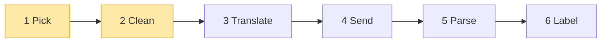

# 01 Part 1 · Pick + Clean

**Goal:** Pick the right code for a model, and clean the chat history before it is sent.

**Builds on:** [00 Overview](00-overview.md) · **Next:** [02 Translate + Send](02-translate-send.md) · **Lookup:** [every `ai` object, field by field](ref-objects.md)

## Where we are



**Builds:** blocks 1, 2 · **IN:** `Model`, `Context` · **OUT:** a stream function, clean `messages`

Big picture of Part 1: [part-1-ai](01-0-part-1-ai.md).

Code in this chapter (commit `2fc2776`):

- `packages/simp_agent/src/simp_agent/ai/__init__.py` — `Model`, `Context`, `_PROVIDERS`, `register_provider`, `_builtin`, `transform_messages`, `_thinking`
- `packages/simp_agent/tests/test_openai.py` — `test_dispatch_by_api`
- `packages/simp_agent/tests/test_reasoning.py` — `test_transform_thinking_same_vs_other_model`

## The problem

We use the same example as the [Part 1 big picture](01-0-part-1-ai.md#example-the-user-asks-about-a-file). The user types **"What is in README.md?"**. Claude thinks for a moment and asks to run the `read` tool. Then the app stops before the tool result is saved; for example, it crashes. Later the user opens the chat again, switches the model to GPT, and types **"Just tell me the title."**

Now the app must send this history to a model. Two things stand in the way. First, Claude and GPT come from different [vendors](glossary.md#vendor) (the companies that run the models), and each vendor has its own API. Something must **pick** the right code for GPT. Second, the history is broken for GPT: the `read` call has no result, and Claude's thinking carries a proof that only Claude can check. Every vendor's API rejects a call without a result with a 400 error. So something must **clean** the history first.

This chapter builds those two blocks. Neither one talks to a model yet. They only prepare.

## IN: Model and Context

Both blocks take two small objects. We show only the fields they use; every field is in [ref-objects](ref-objects.md#request-objects-tool-context-model).

A **`Model`** says which model to call. In our example its `id` is `"gpt-5"` and its `api` is `"openai-responses"` (the other choices are `"anthropic-messages"` and `"openai-completions"`). Its `provider` field, here `"openai"`, is just a name for messages and keys; it is not our provider code. Other fields hold `max_tokens`, `context_window`, `base_url`, `api_key_env` and `compat`.

`api` names the **API format** to speak. It is the field Pick reads. So a local vLLM server is `provider="vllm", api="openai-completions", base_url="http://..."`. Profiles (ch [18](18-profiles-plugins.md)) fill these fields from config.

A **[Context](glossary.md#context)** holds everything sent in one request: the `system_prompt` text, the `messages` (the chat so far), and the `tools` the model may call (each with a name, a description and a JSON schema).

Pick does not look inside the `Context`. Clean is the first block that opens `messages`.

## 1 Pick: `_PROVIDERS`, `register_provider`

**Job:** from `model.api`, find the code that talks to this model. **IN:** `Model`. **OUT:** a stream function.

That code is a [provider](glossary.md#provider). In this book, "vendor" is the company and "provider" is our code for its API. The rest of the code speaks only our own message types, so a new vendor is one new provider and one dict entry.

### Naive version

The simple way is an `if` chain inside the loop. If `model.api` is `"anthropic-messages"`, import the anthropic SDK, make a client, build Anthropic messages, stream and parse. Else if it is `"openai-responses"`, do the same with the openai SDK. Else raise an error.

This has three problems. We name them and fix each one.

**The closed list.** Every new vendor means editing the loop, and a user cannot add their own. The fix is a table. The key is `model.api`, and the value is the provider. Pick just looks it up. A new vendor is one new row, and users can add their own row without touching the library.

**The heavy import.** This file imports both SDKs, so both must be installed even if you use only one. The fix is to import a provider's SDK only the first time it is called. If you only use Anthropic, `import openai` never runs.

**The crash.** A raised exception (network down, bad key) stops the whole loop. The fix: never raise. Send an `error` event instead, like a normal reply. Each provider catches its own errors this way. Pick adds two more: an unknown `api` and a missing API key.

### Real code

The table is the [provider registry](glossary.md#provider-registry), a plain dict named `_PROVIDERS`:

Real code: [packages/simp_agent/src/simp_agent/ai/__init__.py](../../packages/simp_agent/src/simp_agent/ai/__init__.py) (`register_provider`)

It starts with three entries: `"anthropic-messages"`, `"openai-completions"` and `"openai-responses"`. Each value is `_builtin(...)` with the module name (`"anthropic"`, `"openai_completions"`, `"openai_responses"`). `register_provider(api, stream_fn)` just sets `_PROVIDERS[api] = stream_fn`.

In our example, `model.api` is `"openai-responses"`, so Pick gets the third entry. The lookup runs in `stream()`, shown in [ch 04](04-label-test.md#the-entry-point-stream-runs-1-2-6). If the `api` is not in the dict, `stream()` sends an `error` event "Unknown api: ..." instead of raising. That fixes part of the crash.

The built-in entries come from `_builtin`. It fixes the heavy import and the missing key:

Real code: [packages/simp_agent/src/simp_agent/ai/__init__.py](../../packages/simp_agent/src/simp_agent/ai/__init__.py) (`_builtin`)

`_builtin(module)` returns a stream function. When it is called with `(model, context, opts)`, it does this:

1. If `opts` has no `api_key`, it sends one `error` event ("no API key for provider ...", `error_kind="fatal"`) and stops. Providers never read the environment; the app passes the key.
2. Only now it imports `providers/<module>`.
3. It sends on every event from that module's `stream(model, context, opts)`.

The late import has a second reason: the provider modules import `Model`, `AssistantMessage` and others from `ai`, so importing them at the top of `ai` would be a circular import. The value `error_kind="fatal"` tells retry (ch [15](15-retry.md)) that trying again will not help.

### OUT: the shape of a model call

Pick returns a function. Every provider has the same shape, and we call it a **[stream function](glossary.md#stream-function)** (`stream_fn` in the code). The rule is written on `register_provider`. We show it because these two lines are the whole contract every provider must follow:

```python
def register_provider(api: str, stream_fn) -> None:
    """stream_fn(model, context, api_key=None) -> async iterator of events. Must not raise."""
```

So a stream function takes a `Model` and a `Context`. It yields **events**: small dicts with a `"type"` key ([stream events](glossary.md#stream-event); ch [03](03-parse.md) lists them all). Its last event is `done` or `error`, and that event carries the final `AssistantMessage`. It never raises, because errors become an `error` event.

A stream function does blocks 3–5 (Translate, Send, Parse) for one vendor. Ch [02](02-translate-send.md) and [03](03-parse.md) build the real ones. The loop takes this function as a setting, so a test can swap in a fake one (ch [04](04-label-test.md#why-a-fake)).

## 2 Clean: `transform_messages`

**Job:** fix the history so the chosen model accepts it. **IN:** `context.messages` and the `Model`. **OUT:** clean `messages`. Cleaning runs here, in one place, so no provider has to repeat it.

### What is inside `messages`

A **[message](glossary.md#message)** is one of three kinds. (Every field, and how history is saved to JSON: [ref-objects](ref-objects.md).) A `UserMessage` holds what the person typed (`content`). An `AssistantMessage` holds what the model said: `content` is a list of blocks, plus `stop_reason`, `api`, `provider`, `model` and more. A `ToolResultMessage` is the answer to one tool call: `tool_call_id`, `tool_name`, `content` and `is_error`.

An assistant message's `content` is a list of **blocks**, in the order the model gave them. There are three kinds: `TextContent(text, signature)` is normal text, `ThinkingContent(thinking, signature, redacted)` is the model's reasoning, and `ToolCall(id, name, arguments)` is a request to run a tool.

A **signature** is proof that only the vendor can check. For Anthropic it is the thinking signature. For OpenAI Responses it is the whole reasoning item as JSON, and on a text block it is the message id. A thinking block can also be **redacted**: Anthropic encrypted it, so it has no readable words at all.

A `ToolResultMessage` answers the `ToolCall` with the same id. The history can also hold two entries that are **not** messages. A [compaction entry](glossary.md#compaction-entry) (ch [16](16-compaction.md)) is a summary that replaces old messages. A [custom entry](glossary.md#custom-entry) (ch [14](14-plugins.md)) is plugin data that is saved but never sent.

Here is our example history, as the app has it:

```text
1  UserMessage("What is in README.md?")
2  AssistantMessage(model "claude-sonnet-5-5", stop_reason "tool_use", content = [
       ThinkingContent("User wants README...", signature = "Ev0B..."),
       ToolCall(id "t1", name "read", arguments {"path": "README.md"}),
   ])
3  UserMessage("Just tell me the title.")
```

### What can be broken

Four things in a history can make the vendor reject it, or make no sense to send:

**Markers.** Compaction and custom entries live in the history, but they are not messages, so they must never be sent.

**Failed turns.** An assistant message with `stop_reason` `"error"` or `"aborted"` is often half-written, so it is better not to send it.

**Orphan tool calls.** An [orphan tool call](glossary.md#orphan-tool-call) is a `ToolCall` with no `ToolResultMessage` after it. Message 2 in our example has one: `t1`.

**Foreign thinking.** Anthropic signs its thinking, and OpenAI Responses encrypts it. Only the same model can read it back. Message 2 holds Claude's signed thinking, and now we send it to GPT.

The naive way sends the history as it is and gets the 400. The real fix is to clean the history **once**, in `ai.stream`, before any provider gets it.

### Real code

`transform_messages(messages, model)` makes one pass over the history. It keeps two things as it goes: `out`, the clean list, and `pending`, a dict of the tool calls that still wait for a result (`id -> name`). A small inner function, `flush()`, adds one `ToolResultMessage(..., "No result provided", is_error=True)` for each call in `pending`, then empties `pending`.

Real code: [packages/simp_agent/src/simp_agent/ai/__init__.py](../../packages/simp_agent/src/simp_agent/ai/__init__.py) (`transform_messages`)

For each message `m`, in order:

1. A compaction or custom entry is skipped. These are markers, never sent.
2. A tool result removes its call from `pending` and goes to `out`.
3. Any other message first calls `flush()`: the calls before `m` got no result.
4. An assistant message with `stop_reason` `"error"` or `"aborted"` is skipped. Otherwise its tool calls become the new `pending`, and if a model is given, `m` becomes a copy whose content is `_thinking(m, model)`.
5. `m` goes to `out`.

At the end, `flush()` runs one last time.

Follow our example. Message 1 is a user message: `pending` is empty, so `flush()` adds nothing, and message 1 goes to `out`. Message 2 is an assistant message that did not fail. `pending` becomes `{"t1": "read"}`, its blocks are fixed by `_thinking` (next section), and the copy goes to `out`. Message 3 is not a tool result, so `flush()` runs first. It adds `ToolResultMessage("t1", "read", "No result provided", is_error=True)` before message 3. Now every call has a result, and the vendor accepts the history.

The copy is made with `dataclasses.replace`, so the saved history never changes. Only the list sent to the model is clean.

### Thinking: who can read it back

`_thinking(m, model)` decides what to do with each block of an old assistant message. First it asks one question: did the exact model we call now write `m`? It compares `m`'s labels with the model: `same` is true only if `m.provider`, `m.api` and `m.model` equal `model.provider`, `model.api` and `model.id`.

Block 6 Label writes those labels on every answer (ch [04](04-label-test.md)). In our example, message 2 has `"claude-sonnet-5-5"` and we call `"gpt-5"`, so `same` is false.

The rule is short. The same model gets its blocks back as they are, with their proof. Another model gets only the readable words, as plain text blocks. A model never accepts another vendor's thinking block, but every model accepts a text block.

Real code: [packages/simp_agent/src/simp_agent/ai/__init__.py](../../packages/simp_agent/src/simp_agent/ai/__init__.py) (`_thinking`)

The table at the end of this section gives the rule for every kind of block. Tool calls and plain text blocks are always kept as they are.

In our example, the thinking block is not redacted and `same` is false, so the first check fails. It has words, so GPT gets `TextContent("User wants README...")`, without the signature. The tool call is added as it is. The clean history GPT gets is:

```text
UserMessage("What is in README.md?")
AssistantMessage([TextContent("User wants README..."), ToolCall("t1", "read", ...)])
ToolResultMessage("t1", "read", "No result provided", is_error=True)
UserMessage("Just tell me the title.")
```

If the user had stayed on Claude, `same` would be true, and the signed thinking block would go back unchanged.

| Block | Same model | Other model |
|---|---|---|
| redacted thinking | kept | dropped |
| thinking with a signature | kept | text with its words (dropped if no words) |
| thinking, no signature, with words | kept | text with its words |
| thinking, no words, no signature | dropped | dropped |
| text with a signature | kept | text, signature dropped |

**Builds on:** [00 Overview](00-overview.md) · **Next:** [02 Translate + Send](02-translate-send.md) — the provider turns the clean messages into one vendor's JSON and sends them.

**Built on by:** [02](02-translate-send.md) · [03](03-parse.md) · [04](04-label-test.md) (`ai.stream` runs Pick and Clean) · [05](05-agent-loop.md) · [13](13-session.md) · [14](14-plugins.md) (`CustomEntry`) · [16](16-compaction.md) (`CompactionEntry`)

**OUT →** the picked stream function and the clean `messages` are the IN of block 3 Translate (ch 02).
