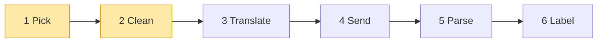

# 01 Part 1 · Pick + Clean

**Goal:** Pick the right code for a model, and clean the chat history before it is sent.

**Builds on:** [00 Overview](00-overview.md) · **Next:** [02 Translate + Send](02-translate-send.md) · **Lookup:** [every `ai` object, field by field](ref-objects.md)

## Where we are



**Builds:** blocks 1, 2 · **IN:** `Model`, `Context` · **OUT:** a stream function, clean `messages`

Big picture of Part 1: [part-1-ai](part-1-ai.md).

Code in this chapter (commit `2fc2776`):

- `packages/simp_agent/src/simp_agent/ai/__init__.py` — `Model`, `Context`, `_PROVIDERS`, `register_provider`, `_builtin`, `transform_messages`, `_thinking`
- `packages/simp_agent/tests/test_openai.py` — `test_dispatch_by_api`
- `packages/simp_agent/tests/test_reasoning.py` — `test_transform_thinking_same_vs_other_model`

## The problem

We start at the far left of the [layer map](00-overview.md#the-layer-map): the `ai` layer. The [agent loop](glossary.md#agent-loop) (ch [05](05-agent-loop.md)) wants to say "ask the model" and not care which vendor answers. Two things stand in the way:

- **Vendors differ.** Anthropic and OpenAI speak different APIs (ch [02](02-translate-send.md) shows how). Something must **pick** the right code for this model.
- **History can be broken.** A turn may have ended with an error, or a tool call may have no result because the user stopped the run. Every vendor rejects that. Something must **clean** the history first.

Neither block talks to a model yet. They only prepare.

## IN: Model and Context

Both blocks take two small objects. We show only the parts these blocks use; every field is in [ref-objects](ref-objects.md#request-objects-tool-context-model).

**`Model`** says which model to call:

```text
Model:
    id       = "claude-sonnet-5-5"
    api      = "anthropic-messages"   // anthropic-messages | openai-completions | openai-responses
    provider = "anthropic"            // just a name, for messages and keys
    ...                               // max_tokens, context_window, base_url, api_key_env
    compat   = {}                     // small per-server switches; Translate reads them (ch 02)
```

`api` is the **API format** to speak, not the vendor. That is the field Pick reads. So a local vLLM server is `provider="vllm", api="openai-completions", base_url="http://..."`. Profiles (ch [18](18-profiles-plugins.md)) fill these fields from config.

**[Context](glossary.md#context)** is one box: everything sent in one request.

```text
Context:
    system_prompt   // text
    messages        // the chat so far
    tools           // what the model may call: name, description, JSON schema
```

Pick does not look inside the `Context`. Clean is the first block that opens `messages`, so we open them [there](#what-is-inside-messages).

## 1 Pick: `_PROVIDERS`, `register_provider`

**Job:** from `model.api`, find the code that talks to this model. **IN:** `Model`. **OUT:** a stream function.

### Naive version

The naive way is an `if` chain in the loop:

```text
FUNCTION ask(model, context, api_key):
    IF model.api is "anthropic-messages":
        IMPORT the anthropic SDK
        make a client, build anthropic messages, stream, parse
    ELSE IF model.api is "openai-completions":
        IMPORT the openai SDK
        make a client, build openai messages, stream, parse
    ELSE:
        RAISE an error   // crashes the loop
```

Where it breaks:

- Every new vendor means editing the loop. A user cannot add their own vendor.
- Both SDKs must be installed to import this file, even if you use one.
- A raised exception (network down, bad key) crashes the loop. The [stream function](glossary.md#stream-function) rule says "never raise" (explained below).

### From naive to real

The naive version has three problems. We fix them one at a time.

**Problem 1: adding a vendor means editing the loop.** Fix: keep a table. The key is `model.api`; the value is the function that talks to that vendor. Pick just looks it up:

```text
"anthropic-messages" -> function for Anthropic
"openai-completions" -> function for OpenAI
```

A new vendor is one new row. Users can add their own row too, without touching the library.

**Problem 2: you must install every SDK.** Fix: import a vendor's SDK only the first time that vendor is called. For example, if you only use Anthropic, `import openai` never runs, so the OpenAI SDK does not need to be installed.

**Problem 3: one error crashes the loop.** Fix: never raise. Send an error event, just like a normal reply. Each vendor function catches its own errors (network down, bad key) this way. Pick adds two more:

```text
api not in the table  -> error event "Unknown api: my-api"
no API key            -> error event "no API key ...", marked fatal (trying again will not help)
```

The real code below does exactly these three things.

### Real code

**Fix 1 — the table.** The [provider registry](glossary.md#provider-registry) is a plain dict from `api` string to stream function (`ai/__init__.py`). The lookup itself runs in `stream()`, shown in [ch 04](04-label-test.md#the-entry-point-stream-runs-1-2-6).

Real code: [packages/simp_agent/src/simp_agent/ai/__init__.py](../../packages/simp_agent/src/simp_agent/ai/__init__.py) (`register_provider`)

```text
_PROVIDERS = {
    "anthropic-messages" -> _builtin("anthropic"),
    "openai-completions" -> _builtin("openai_completions"),
    "openai-responses"   -> _builtin("openai_responses"),
}

FUNCTION register_provider(api, stream_fn):
    // stream_fn(model, context, api_key) gives events and must not raise
    _PROVIDERS[api] = stream_fn
```

`register_provider` lets anyone add or replace an `api` without touching the library. If `model.api` is not in the dict, `stream()` sends an error event "Unknown api: ..." instead of raising (fix 3).

**Fix 2 and fix 3 — `_builtin`.** The built-ins go through `_builtin`:

Real code: [packages/simp_agent/src/simp_agent/ai/__init__.py](../../packages/simp_agent/src/simp_agent/ai/__init__.py) (`_builtin`)

```text
FUNCTION _builtin(module):
    RETURN a stream function that, WHEN called with (model, context, opts):
        IF no api_key in opts:   // providers never read env; the app passes the key
            SEND event {error, message with error "no API key for provider ...", error_kind "fatal"}
            STOP
        IMPORT providers/<module> now   // late import: avoids a circular import
        FOR EACH event from that module's stream(model, context, opts):
            SEND the event
```

The late import is fix 2. It also avoids a circular import: the providers import `Model`, `AssistantMessage` and friends from `ai`. The missing-key check is fix 3: `error_kind="fatal"` tells retry (ch [15](15-retry.md)) not to try again for nothing.

### OUT: the shape of a model call

Pick returns a function; here is its shape. In simp-agent a model call is a plain async function. We call it a **[stream function](glossary.md#stream-function)** (`stream_fn` in the code). The contract is written on `register_provider` in `ai/__init__.py`:

```python
def register_provider(api: str, stream_fn) -> None:
    """stream_fn(model, context, api_key=None) -> async iterator of events. Must not raise."""
```

So a stream function:

- takes a `Model` and a [context](glossary.md#context) (system prompt, messages, tools — see [above](#in-model-and-context));
- yields **events**: small dicts with a `"type"` key ([stream events](glossary.md#stream-event); ch [03](03-parse.md) lists them all);
- ends with a `done` or `error` event that carries the final `AssistantMessage`;
- never raises. Errors become an `error` event.

A stream function does blocks 3–5 (Translate, Send, Parse) for one vendor. Ch [02](02-translate-send.md) and [03](03-parse.md) build the real ones. Ch [04](04-label-test.md) builds a fake one for tests.

The loop takes this function as a setting, so a test can swap in a fake (ch [04](04-label-test.md#why-a-fake)).

## 2 Clean: `transform_messages`

**Job:** fix the history so every vendor accepts it. **IN:** `context.messages` and the `Model`. **OUT:** clean `messages`.

### What is inside `messages`

Clean is the first block that looks inside the chat, so we open it now — only as deep as Clean needs. (Every field, and how history saves to JSON: [ref-objects](ref-objects.md).)

A **[message](glossary.md#message)** is one of three kinds:

```text
UserMessage(content)                            // what the person typed
AssistantMessage(content = list of blocks,      // what the model said
                 stop_reason, api, provider, model, ...)
ToolResultMessage(tool_call_id, tool_name,      // the answer to one tool call
                  content, is_error)
```

An assistant message's `content` is a **list of blocks**, in the order the model gave them:

```text
TextContent(text, signature)                    // normal text
ThinkingContent(thinking, signature, redacted)  // the model's reasoning
ToolCall(id, name, arguments)                   // a request to run a tool
```

A `ToolResultMessage` answers the `ToolCall` with the same id. The history may also hold two markers that are **not** messages: a [compaction entry](glossary.md#compaction-entry) (ch [16](16-compaction.md)) and a [custom entry](glossary.md#custom-entry) (ch [14](14-plugins.md)).

### What can be broken

- **Markers.** Compaction and custom entries live in history but must never be sent.
- **Failed turns.** An assistant message with `stop_reason` `error` or `aborted` is often half-written.
- **Orphan tool calls.** A `ToolCall` with no `ToolResultMessage`. Every vendor rejects this with a 400 error.
- **Thinking is not portable.** Anthropic signs its thinking; OpenAI Responses encrypts it. Only the same model can read it back.

(One more problem is not about history: errors come back as plain strings, and the loop must decide retry, compact or give up. Ch [04](04-label-test.md) solves it.)

The naive way sends history as-is and gets the 400. The fix: clean **once**, in `ai.stream`, before any provider — so no provider repeats it.

### Real code

`transform_messages(messages, model)` does one pass over the history:

Real code: [packages/simp_agent/src/simp_agent/ai/__init__.py](../../packages/simp_agent/src/simp_agent/ai/__init__.py) (`transform_messages`)

```text
FOR EACH message m in messages:
    IF m is a compaction or custom entry:   // history markers, never sent
        SKIP it
    IF m is a tool result:
        REMOVE its call from pending
        ADD m to out
        NEXT
    flush()   // add "No result provided" for each call still in pending
    IF m is an assistant message:
        IF m.stop_reason is error or aborted:
            SKIP it
        pending = the tool calls in m (id -> name)
        IF a model is given:
            m = a COPY of m with content = _thinking(m, model)
    ADD m to out
flush()
```

- `pending` remembers tool calls still waiting for a result. When the next non-result message comes (or the end), `flush()` adds a `ToolResultMessage(..., "No result provided", is_error=True)` for each one. Now every call has a result, and the vendor accepts the history.
- It uses `dataclasses.replace`, so the saved history is never changed. Only the copy sent to the model is.

### Thinking: who can read it back

**A scenario.** Last turn, Claude "thought" before it answered. That thinking is saved in the history. Now we send the whole history again. Two cases:

- We send it to the **same** Claude again.
- The user switched to GPT in the middle of the session, so we send it to **another** model.

The same old message must be cleaned in a different way for each case. `_thinking(m, model)` does this.

**What `same` means.** `same` is true when the old message `m` was written by the exact model we call now: same provider, same api and same model id. It is *not* about the kind of block. We know who wrote `m` from its stamps (written by block 6 Label, ch [04](04-label-test.md)).

**The words we need:**

- A **thinking block** is `ThinkingContent(thinking, signature, redacted)`. Its words are in `thinking`; "has words" means `thinking` is not empty.
- **Signature** = vendor proof. The vendor made it, and only the vendor checks it. It is an Anthropic signature, or (for OpenAI Responses) the whole reasoning item as JSON.
- **Redacted** = Anthropic encrypted thinking. It has no readable words at all, only data that Claude can open.
- A **text block** is a normal `TextContent`, the same kind of block as an answer. A model never accepts another vendor's thinking block, but every model accepts a text block. So for another model we put the thinking words into a text block (plain text), in the same place in the message.

Real code: [packages/simp_agent/src/simp_agent/ai/__init__.py](../../packages/simp_agent/src/simp_agent/ai/__init__.py) (`_thinking`)

```text
same = (m.provider, m.api, m.model) equal (model.provider, model.api, model.id)
out = new empty list
FOR EACH block c in m.content:
    IF c is a thinking block:
        IF c is redacted:
            IF same: ADD c to out                  // send as it is
            // else skip: no words, the other model cannot open it
        ELSE IF same AND c has a signature:
            ADD c to out                           // send as it is, with its signature
        ELSE IF c has words:
            IF same: ADD c to out
            ELSE: ADD a text block with c's words to out   // thinking becomes plain text
        // else (empty thinking block): skip
    ELSE IF c is a text block with a signature AND not same:
        // e.g. an OpenAI Responses text block (signature = its message id), user switched to Claude
        ADD a text block without the signature to out      // same words, no id
    ELSE:
        ADD c to out                               // send as it is
RETURN out
```

The real code joins the first two checks into one `if c.redacted or (same and c.signature)` with `if same` inside; same result.

`transform_messages` then makes a **copy** of `m` with `content = out` (`dataclasses.replace`). The saved history is not changed; only the copy is sent.

**A worked example.** An old GPT message (api `openai-responses`) has three blocks:

```text
m.content = [
    ThinkingBlock("User wants README…", signature = <reasoning item JSON>),
    TextBlock("Let me read the file.", signature = {"id": "msg_1"}),
    ToolCall(read),
]
```

- Send to the **same GPT**: `same` is true. Every block is added as it is. `out` = the same three blocks, with their signatures.
- Send to **Claude**: `same` is false. The thinking block has a signature but is not redacted, and it has words, so it becomes a text block with the same words. The text block has a signature, so it loses it. The tool call is added as it is.

```text
out = [TextBlock("User wants README…"), TextBlock("Let me read the file."), ToolCall(read)]
```

**Branch 1 is about thinking blocks.** For the same model, we send the thinking block back as it is, with its signature. For another model, we put its words into a text block and drop the signature. A redacted thinking block has no words, so for another model it is dropped. A thinking block with no signature and no words is always dropped.

**Branch 2 is about text blocks, not thinking blocks.** OpenAI Responses puts the message id and phase on a text block as a `signature`. Another model does not know this id. So for another model we send a text block with the same words and no signature. For the same model the block is sent as it is.

| Block | Same model | Other model |
|---|---|---|
| redacted thinking block | kept as is | dropped (no words, cannot open it) |
| thinking block with a signature | kept as is | text block with its words, signature dropped (dropped if it has no words) |
| thinking block, no signature, has words | kept | text block with its words |
| thinking block, no signature, no words | dropped | dropped |
| text block with a signature | kept as is | text block, signature dropped |

In one line: the same model gets its blocks back with their proof; another model gets only the readable words, in text blocks.

## Test

No real model is needed. `test_dispatch_by_api` (`tests/test_openai.py`) checks Pick and Clean together. It puts a fake in place of the real OpenAI stream function:

Real code: [packages/simp_agent/tests/test_openai.py](../../packages/simp_agent/tests/test_openai.py) (`test_dispatch_by_api`)

```text
TEST dispatch_by_api:
    seen = empty list
    fake provider WHEN called with (model, ctx):
        ADD (model.api, ctx.messages) to seen
        SEND event {done}
    PUT fake in place of openai_completions.stream
    history = [user "u", assistant with tool call "a" and no result]
    RUN ai.stream with api "openai-completions" and key "k"
    CHECK seen[0] api is "openai-completions"
    CHECK last message seen is "No result provided"   // transform_messages ran first
```

The history ends with an orphan tool call. The provider sees a "No result provided" result added for it.

`test_transform_thinking_same_vs_other_model` (`test_reasoning.py`) checks the thinking table above.

Run them:

```bash
cd packages/simp_agent
uv run pytest -q tests/test_openai.py::test_dispatch_by_api \
  tests/test_reasoning.py::test_transform_thinking_same_vs_other_model
# 2 passed
```

> **Why this way?**
> - **Our own types, not a vendor's.** The rest of the code speaks one format. Each provider translates at the edge (ch [02](02-translate-send.md)). Adding a vendor means one new provider, not changes everywhere.
> - **A dict, not an `if` chain, for Pick.** A new vendor is one entry, and users add their own with `register_provider`.
> - **Clean once, for every provider.** `transform_messages` runs before any provider, so no provider repeats it, and the saved history is never changed.

## Exercises

1. Call `transform_messages` on `[UserMessage("u"), AssistantMessage([ToolCall("1", "read", {})])]`. What is the last message of the result, and why?
2. Register your own stream function for a new `api` name with `register_provider`, and call `ai.stream` with a `Model` that uses it. What happens if you use an `api` name nobody registered?
3. Make an assistant message with a signed `ThinkingContent`, stamped by model A. Run `transform_messages` with model A, then model B. What changes?

## Recap

- IN: a `Model` (its `api` picks the code; `provider` is just a name) and a `Context` (system prompt + messages + tools).
- **Pick:** `Model.api` picks a stream function from the `_PROVIDERS` dict. `register_provider` adds your own. Built-ins are imported lazily, and refuse to run without an `api_key` (`error_kind="fatal"`).
- A model call is a **stream function**: `(model, context, api_key=None)` → async events, ending with `done` or `error`, never raising.
- Messages are user, assistant (a list of text / thinking / tool-call blocks) and tool result.
- **Clean:** `transform_messages` drops markers and failed turns, and adds "No result provided" for orphan tool calls. The same model gets its thinking back as it is; another model gets only the readable words as plain text (redacted thinking is dropped).

**Builds on:** [00 Overview](00-overview.md) · **Next:** [02 Translate + Send](02-translate-send.md) — the stream function turns the clean messages into one vendor's JSON and sends them.

**Built on by:** [02](02-translate-send.md) (translates messages per vendor) · [03](03-parse.md) (builds an `AssistantMessage` from a stream) · [04](04-label-test.md) (`ai.stream` runs Pick and Clean; the fake follows the stream-function shape) · [05](05-agent-loop.md) (reads `stop_reason`, adds tool results) · [13](13-session.md) (saves history, see [ref-objects](ref-objects.md#going-to-json-and-back)) · [14](14-plugins.md) (`CustomEntry`) · [16](16-compaction.md) (`CompactionEntry`)

**OUT →** the picked stream function and the clean `messages` are the IN of block 3 Translate (ch 02).
