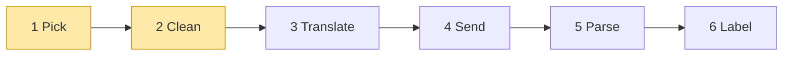
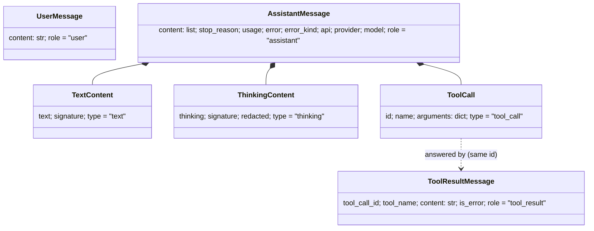
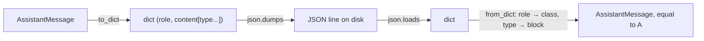

# 01 Part 1 · Pick + Clean

**Goal:** Pick the right code for a model, and clean the chat history before it is sent.

**Builds on:** [00 Overview](00-overview.md) · **Next:** [02 Translate + Send](02-translate-send.md)

## Where we are



**Builds:** blocks 1, 2 · **IN:** `Model`, `Context` · **OUT:** a stream function, clean `messages`

Big picture of Part 1: [part-1-ai](part-1-ai.md).

We start at the far left of the [layer map](00-overview.md#the-layer-map): the `ai` layer. Its job, in one line: take a **Model** and a **Context**, ask the model, and give back its answer. The first two blocks do not talk to any model yet. **Pick** finds the code that knows how to talk to this model. **Clean** fixes the chat history so the model will accept it.

Both blocks read the two objects that ride the first arrow: the `Model` and the `Context`. The `Context` holds the chat, and the chat is a list of **[messages](glossary.md#message)**. So we meet the messages first, then `Tool`, `Context` and `Model`, then the two blocks.

Code in this chapter (commit `2fc2776`):

- `packages/simp_agent/src/simp_agent/ai/__init__.py` — `TextContent`, `ThinkingContent`, `ToolCall`, `UserMessage`, `AssistantMessage`, `ToolResultMessage`, `to_dict`, `from_dict`, `Tool`, `Context`, `Model`, `_PROVIDERS`, `register_provider`, `_builtin`, `transform_messages`, `_thinking`
- `packages/simp_agent/tests/test_reasoning.py`, `packages/simp_agent/tests/test_compaction_serialize.py` — round-trip tests
- `packages/simp_agent/tests/test_openai.py` — `test_dispatch_by_api`

## IN: the messages

### The problem

A conversation with a coding agent is a list of turns:

1. The user says "write `fizzbuzz.py`".
2. The model answers with some text and a [tool call](glossary.md#tool-call): `write(path="fizzbuzz.py", ...)`.
3. The agent runs the tool and gets a result: "wrote 12 lines".
4. The model reads the result and answers "Done."

Every later part touches this list. [Providers](glossary.md#provider) (ch [02](02-translate-send.md)) turn it into the format of one vendor API. The loop (ch [05](05-agent-loop.md)) adds to it. Sessions (ch [13](13-session.md)) save it to disk and load it back. The server (ch [20](20-server-run.md)) sends it to a browser.

So the list needs a shape that is:

- **the same for every vendor** — Anthropic and OpenAI use different JSON, but the rest of our code should not care;
- **typed** — code can ask "is this a tool result?" without guessing;
- **easy to save** — turn it into JSON and back, with nothing lost.

### Naive version

The quick way is plain dicts, like most vendor examples:

```text
history = list of plain dicts:
    {role "user",      content "write fizzbuzz.py"}
    {role "assistant", content "Sure.", tool_calls [{id "c1", name "write", args {...}}]}
    {role "tool",      id "c1", content "wrote 12 lines"}

FOR each message m in history:
    FOR each call in m.tool_calls (or empty):
        PRINT call.name, call.arguments   // crash: the key is "args", not "arguments"
```

It saves to JSON for free, but it breaks fast:

- One place writes `"args"`, another reads `"arguments"`. Nothing catches it until runtime.
- The assistant text is one string, so there is no room for the model's thinking, or for text *between* two tool calls, in the order the model gave them.
- There is nowhere to put "why did the model stop?" or "how many tokens did this cost?".
- The shape is close to one vendor. A second vendor means `if vendor == ...` all over the code.

### Step by step: from naive to real

We fix the dict version one problem at a time. Each step is small.

**Step 1 — a class per kind of message.** Typos like `args`/`arguments` must fail early. A dataclass checks field names when the object is built:

```text
ToolCall = record with fields: id, name, arguments

ToolCall("c1", "write", args = {})   // error right here: no field "args"
```

Real code: [ai/\_\_init\_\_.py](../../packages/simp_agent/src/simp_agent/ai/__init__.py) — `ToolCall`

**Step 2 — content is a list of blocks.** One string cannot keep "think, text, tool call, more text" in order. So `AssistantMessage.content` becomes a list of `TextContent | ThinkingContent | ToolCall`.

**Step 3 — room for "why it stopped" and "what it cost".** We add `stop_reason`, `usage`, `error` and `error_kind` to `AssistantMessage`. Now the loop can tell a normal end from a failure.

**Step 4 — a tag on every class.** Dataclasses are not JSON. `dataclasses.asdict` turns them into dicts, but to come back we must know *which* class a dict was. So each class gets a fixed `role` (messages) or `type` (blocks), and `from_dict` reads it.

**Step 5 — our own shape, not a vendor's.** Nothing in these classes is Anthropic or OpenAI JSON. Each provider translates at the edge (ch [02](02-translate-send.md)).

The result is the real code below.

### Real design

simp-agent uses small Python **dataclasses**. Each one has a fixed `role` (or `type`) field, so it can always tell what it is, even after a trip through JSON.



#### The three messages

**User message** — what the person typed. Just a string:

```python
@dataclass
class UserMessage:
    content: str
    role: Literal["user"] = "user"
```

**Tool result** — the answer to one tool call:

```python
@dataclass
class ToolResultMessage:
    tool_call_id: str
    tool_name: str
    content: str
    is_error: bool = False
    role: Literal["tool_result"] = "tool_result"
```

`tool_call_id` links the result to the `ToolCall` that asked for it. Every vendor API needs this link. `is_error` tells the model "this failed" — for example, an unknown tool, bad arguments, a call the user denied, or a call cut off by `length` — so it can try again instead of the whole agent crashing.

**Assistant message** — what the model said. This is the rich one:

```text
AssistantMessage = record:
    content     = list of TextContent | ThinkingContent | ToolCall, in model order
    stop_reason = stop | tool_use | length | error | aborted   (default stop)
    usage       = {input 0, output 0}
    error, error_kind = none     // error_kind fatal | budget | policy = never retried
    api, provider, model = ""    // set by stream(): who produced this message
    role = "assistant"

text():       JOIN the text of every TextContent block
tool_calls(): RETURN only the ToolCall blocks
```

Real code: [ai/\_\_init\_\_.py](../../packages/simp_agent/src/simp_agent/ai/__init__.py) — `AssistantMessage`

Why each field is there:

- `content` is a **list of blocks**, not a string. A model can think, write text, call a tool, write more text, call another tool — all in one answer. The list keeps that order.
- `stop_reason` says why the model stopped: `stop`, `tool_use`, `length`, `error` or `aborted`. Note: the loop in ch [05](05-agent-loop.md) decides "run tools?" from `tool_calls()`, not from `tool_use`. It uses `stop_reason` for the special cases: `error` and `aborted` end the turn (ch [06](06-events-abort.md), [15](15-retry.md)); on `length` the tool calls are cut off, so they are not run and each gets an error result.
- `usage` ([usage](glossary.md#usage)) counts input and output tokens. Compaction uses it to estimate size (ch [16](16-compaction.md)).
- `error` and `error_kind` hold what went wrong. A provider never raises; it returns an assistant message with `stop_reason="error"` instead (ch [02](02-translate-send.md)). `error_kind` of `"fatal"`, `"budget"` or `"policy"` means "do not retry". The function that reads it is `is_retryable`, built in ch [04](04-label-test.md#extra-error-classification-is_retryable-is_context_overflow) and used by retry in ch [15](15-retry.md).
- `api`, `provider`, `model` record who wrote the message. `stream()` fills them in (block 6 Label, ch [04](04-label-test.md)). They matter when you switch models mid-chat: some thinking blocks can only be sent back to the same model ([Clean](#thinking-who-can-read-it-back), below).
- `text()` and `tool_calls()` are small helpers so callers do not loop over blocks by hand.

#### The three content blocks

```python
@dataclass
class TextContent:
    text: str
    signature: str | None = None
    type: Literal["text"] = "text"

@dataclass
class ThinkingContent:
    thinking: str
    signature: str | None = None
    redacted: bool = False
    type: Literal["thinking"] = "thinking"

@dataclass
class ToolCall:
    id: str
    name: str
    arguments: dict
    type: Literal["tool_call"] = "tool_call"
```

- `TextContent` is normal text shown to the user.
- `ThinkingContent` is the model's reasoning before it answers. `signature` is a value from the vendor that we cannot read or change; we only keep it and send it back unchanged. `redacted` marks thinking the vendor hid from us. [Clean](#thinking-who-can-read-it-back) (below) explains how these are replayed.
- `ToolCall` is one request to run a tool. `arguments` is already a parsed `dict`, not a JSON string. Ch [03](03-parse.md) shows how streamed pieces become this dict.

#### Two history entries that are not messages

Two more types live in the same list, but are **never sent to the model**:

```python
@dataclass
class CompactionEntry:
    summary: str
    first_kept_index: int
    read_files: list = field(default_factory=list)
    modified_files: list = field(default_factory=list)
    role: Literal["compaction"] = "compaction"

@dataclass
class CustomEntry:
    type: str
    data: dict = field(default_factory=dict)
    role: Literal["custom"] = "custom"
```

- A **[compaction entry](glossary.md#compaction-entry)** marks "everything before `first_kept_index` is now replaced by `summary`". We only ever add to the end of the history; old messages are not deleted or changed. Ch [16](16-compaction.md) builds this.
- A **[custom entry](glossary.md#custom-entry)** is a place for plugins to keep their own data in the history, so it is saved and comes back on resume. Ch [14](14-plugins.md) uses it.

They have a `role` too, so they save and load just like messages. Before a request is sent, `transform_messages()` skips both ([2 Clean](#2-clean-transform_messages), below).

#### Going to JSON and back

Saving needs two functions:

```text
FUNCTION to_dict(m):
    RETURN dataclasses.asdict(m)        // walks nested blocks for us

FUNCTION from_dict(d):
    pick the class from d["role"]:
        user -> UserMessage, assistant -> AssistantMessage,
        tool_result -> ToolResultMessage, compaction -> CompactionEntry,
        custom -> CustomEntry
    IF the class is AssistantMessage:
        FOR EACH block in d["content"]:
            pick the block class from block["type"]:
                text -> TextContent, thinking -> ThinkingContent, tool_call -> ToolCall
            rebuild the block from its fields
    RETURN the class built from the fields of d
```

Real code: [packages/simp_agent/src/simp_agent/ai/__init__.py](../../packages/simp_agent/src/simp_agent/ai/__init__.py) (`to_dict`, `from_dict`)

`to_dict` is one line because `dataclasses.asdict` already walks nested dataclasses. All fields are strings, numbers, bools, lists or dicts, so the result goes straight into `json.dumps`.

`from_dict` is the reverse. It reads `role` to pick the class. For an assistant message it also reads each block's `type` to rebuild the blocks. This is why every class carries its own `role` or `type`: the data says what it is.



One nice side effect: **old saved files still load.** A field added later has a default value, so a dict without it still builds. For example, a compaction entry saved before `read_files` existed loads with `read_files == []`.

The CLI uses exactly this pair to save sessions as JSON lines (`apps/cli/src/simp_cli/__init__.py`):

```text
append(entry):  write json.dumps(to_dict(entry)) as one new line
load():         FOR EACH non-empty line: from_dict(json.loads(line))
```

Real code: [apps/cli/src/simp_cli/__init__.py](../../apps/cli/src/simp_cli/__init__.py) (`JsonlStore.append`, `JsonlStore.load`)

## IN: packing a request: Tool, Context, Model

Three more small dataclasses in the same file describe one call to a model. They are the IN of block 1:

```python
@dataclass
class Tool:
    name: str
    description: str
    parameters: dict  # JSON schema

@dataclass
class Context:
    system_prompt: str
    messages: list
    tools: list = field(default_factory=list)

@dataclass
class Model:
    id: str = "claude-sonnet-5-5"
    provider: str = "anthropic"
    max_tokens: int = 8192
    context_window: int = 200000
    api: str = "anthropic-messages"  # anthropic-messages | openai-completions | openai-responses
    base_url: str | None = None
    api_key_env: str | None = None  # env var holding the key
    compat: dict = field(default_factory=dict)
```

- `Tool` tells the model what a tool is called, what it does, and its arguments as a JSON schema. It holds no code; the code to run it comes in ch [05](05-agent-loop.md).
- **[Context](glossary.md#context)** is everything sent in one request: system prompt, message list, tools.
- `Model` says which model to call. `context_window` is used by compaction.

These are not saved in history, so they have no `role` and no `from_dict` support.

### The `Model`

A model says which **API format** to speak, not only which vendor. `compat` holds a few known keys:

```text
compat = empty dict    // openai: include_usage, max_tokens_field, supports_finish_reason
                       // all: reasoning_effort; anthropic: thinking_budget
```

`api` picks the code. `provider` is just a name (for messages and keys). So a local vLLM server is `provider="vllm", api="openai-completions", base_url="http://..."`. `compat` holds small per-server switches, so odd servers need a setting, not a new provider (ch [02](02-translate-send.md) shows each switch). Profiles (ch [18](18-profiles-plugins.md)) fill these fields from config.

## The shape of a model call

Pick returns a function, so first we fix what that function looks like. In simp-agent a model call is a plain async function. We call it a **[stream function](glossary.md#stream-function)** (`stream_fn` in the code). The contract is written on `register_provider` in `ai/__init__.py`:

```python
def register_provider(api: str, stream_fn) -> None:
    """stream_fn(model, context, api_key=None) -> async iterator of events. Must not raise."""
```

So a stream function:

- takes a `Model` and a [context](glossary.md#context) (system prompt, messages, tools — see [above](#in-packing-a-request-tool-context-model));
- yields **events**: small dicts with a `"type"` key ([stream events](glossary.md#stream-event); ch [03](03-parse.md) lists them all);
- ends with a `done` or `error` event that carries the final `AssistantMessage`;
- never raises. Errors become an `error` event.

A stream function does blocks 3–5 (Translate, Send, Parse) for one vendor. Ch [02](02-translate-send.md) and [03](03-parse.md) build the real ones. Ch [04](04-label-test.md) builds a fake one for tests.

The loop does not call a provider by name. It takes the function as a setting. In `agent/__init__.py`:

```text
LoopConfig.stream_fn = ai.stream   // tests put a fake here
```

Real code: [agent/\_\_init\_\_.py](../../packages/simp_agent/src/simp_agent/agent/__init__.py) — `LoopConfig.stream_fn`

That one line is why a fake is easy (ch [04](04-label-test.md)). The default is the real `ai.stream`; a test passes something else.

## Pick and Clean: the problem

We want the [agent loop](glossary.md#agent-loop) (ch [05](05-agent-loop.md)) to say "ask the model" and not care which vendor answers. Vendors differ a lot (ch [02](02-translate-send.md) shows how). On top of that, **history can be broken.** A turn may have ended with an error, or a tool call may have no result (the user stopped the run). Every vendor rejects a tool call with no result. And **thinking is not portable.** Anthropic signs its thinking. OpenAI Responses encrypts it. Only the same model can read it back.

### Naive version

The naive way is an `if` chain in the loop:

```text
FUNCTION ask(model, context, api_key):
    IF model.api is "anthropic-messages":
        IMPORT the anthropic SDK
        make a client, build anthropic messages, stream, parse
    ELSE IF model.api is "openai-completions":
        IMPORT the openai SDK
        make a client, build openai messages, stream, parse
    ELSE:
        RAISE an error   // crashes the loop
```

Where it breaks:

- Every new vendor means editing the loop. A user cannot add their own vendor.
- Both SDKs must be installed to import this file, even if you use one.
- A raised exception (network down, bad key) crashes the loop. The [stream function](glossary.md#stream-function) rule says "never raise".
- It sends the history as-is, so an orphan tool call gives a 400 error from the vendor.

### Step by step: from naive to real

**Step 1 — a dict instead of `if`.** Map `model.api` to a stream function. A new vendor is one new entry; users add theirs with `register_provider`.

```text
_PROVIDERS = a table: api name -> stream function
fn = LOOK UP model.api in _PROVIDERS
```

**Step 2 — import late.** Each entry imports its SDK only on the first call (`_builtin`), so you need only the SDK you use.

**Step 3 — never raise.** An unknown `api`, or a missing key for a built-in provider, becomes an `error` event. Each provider catches its own errors the same way (ch [02](02-translate-send.md)).

**Step 4 — clean history once.** Before calling any provider, `ai.stream` runs `transform_messages`, so an orphan tool call gets a "No result provided" result instead of a 400 error.

**Step 5 — read errors.** `is_context_overflow` and `is_retryable` turn an error string into "compact", "retry" or "give up" (ch [04](04-label-test.md)).

The real code puts all five in `ai.stream` and a few helpers. This chapter builds steps 1–4; ch [04](04-label-test.md) shows `ai.stream` itself and step 5.

## 1 Pick: `_PROVIDERS`, `register_provider`

The [provider registry](glossary.md#provider-registry) is a plain dict from `api` string to stream function (`ai/__init__.py`). The lookup itself runs in `stream()`, shown in [ch 04](04-label-test.md#the-entry-point-stream-runs-1-2-6).

Real code: [packages/simp_agent/src/simp_agent/ai/__init__.py](../../packages/simp_agent/src/simp_agent/ai/__init__.py) (`register_provider`)

```text
_PROVIDERS = {
    "anthropic-messages" -> _builtin("anthropic"),
    "openai-completions" -> _builtin("openai_completions"),
    "openai-responses"   -> _builtin("openai_responses"),
}

FUNCTION register_provider(api, stream_fn):
    // stream_fn(model, context, api_key) gives events and must not raise
    _PROVIDERS[api] = stream_fn
```

`register_provider` lets anyone add or replace an `api` without touching the library. The built-ins go through `_builtin`:

Real code: [packages/simp_agent/src/simp_agent/ai/__init__.py](../../packages/simp_agent/src/simp_agent/ai/__init__.py) (`_builtin`)

```text
FUNCTION _builtin(module):
    RETURN a stream function that, WHEN called with (model, context, opts):
        IF no api_key in opts:   // providers never read env; the app passes the key
            SEND event {error, message with error "no API key for provider ...", error_kind "fatal"}
            STOP
        IMPORT providers/<module> now   // late import: avoids a circular import
        FOR EACH event from that module's stream(model, context, opts):
            SEND the event
```

Two things here, both with a reason:

- **Lazy import.** The provider module is imported only on the first call. The providers import `Model`, `AssistantMessage` and friends from `ai`, so importing them at the top of `ai` would be a circular import. It also means `import anthropic` happens only when you use Anthropic.
- **No key, no call.** Providers never read environment variables. The app passes `api_key`. A missing key is an `error` event with `error_kind="fatal"`, so retry (ch [15](15-retry.md)) does not try again for nothing.

## 2 Clean: `transform_messages`

`transform_messages(messages, model)` does one pass over the history:

Real code: [packages/simp_agent/src/simp_agent/ai/__init__.py](../../packages/simp_agent/src/simp_agent/ai/__init__.py) (`transform_messages`)

```text
FOR EACH message m in messages:
    IF m is a compaction or custom entry:   // history markers, never sent
        SKIP it
    IF m is a tool result:
        REMOVE its call from pending
        ADD m to out
        NEXT
    flush()   // add "No result provided" for each call still in pending
    IF m is an assistant message:
        IF m.stop_reason is error or aborted:
            SKIP it
        pending = the tool calls in m (id -> name)
        IF a model is given:
            m = a COPY of m with content = _thinking(m, model)
    ADD m to out
flush()
```

- [Compaction entries](glossary.md#compaction-entry) and [custom entries](glossary.md#custom-entry) are skipped. They live in history but are never sent.
- Assistant turns with `stop_reason` `error` or `aborted` are dropped. They are often half-written.
- `pending` remembers tool calls still waiting for a result. When the next non-result message comes (or the end), `flush()` adds a `ToolResultMessage(..., "No result provided", is_error=True)` for each one. Now every call has a result, and the vendor accepts the history.
- It uses `dataclasses.replace`, so the saved history is never changed. Only the copy sent to the model is.

### Thinking: who can read it back

Some models "think" before they answer. We keep that as `ThinkingContent(thinking, signature, redacted)`. The `signature` is vendor proof: an Anthropic signature, or the whole OpenAI Responses reasoning item as JSON. A **redacted** block has no readable text at all.

`_thinking(m, model)` decides what to send back, using the stamps (written by block 6 Label, ch [04](04-label-test.md)):

Real code: [packages/simp_agent/src/simp_agent/ai/__init__.py](../../packages/simp_agent/src/simp_agent/ai/__init__.py) (`_thinking`)

```text
same = (m.provider, m.api, m.model) equal (model.provider, model.api, model.id)
FOR EACH block c in m.content:
    IF c is thinking:
        IF c is redacted OR (same AND c has a signature):
            IF same: ADD c          // else drop: the other model cannot verify it
        ELSE IF c has text:
            ADD c if same, else ADD it as plain text
    ELSE IF c is text with a signature AND not same:
        ADD plain text without the signature
    ...
```

| Thinking block | Same model | Other model |
|---|---|---|
| signed or redacted | kept as is | dropped (it cannot verify it) |
| unsigned, with text | kept | turned into plain text |
| unsigned, empty | dropped | dropped |

This matters when the user switches model in the middle of a session: the new model still sees what the old one thought, as text, and never gets a signature it would reject.

## Test

No model is needed. Messages are plain data, so they are the easiest part to test. Two real tests check the round trip. From `tests/test_reasoning.py`:

```python
def test_from_dict_old_and_new():
    old = {"role": "assistant", "content": [{"type": "text", "text": "x"}], "stop_reason": "stop",
           "usage": {"input": 1, "output": 2}, "error": None}
    assert ai.from_dict(old).content == [TextContent("x")]
    new = asst([ThinkingContent("t", "s"), TextContent("x", '{"id": "m"}')])
    assert ai.from_dict(json.loads(json.dumps(ai.to_dict(new)))) == new
```

The first half loads an old dict with no `api`, `provider` or `signature` fields. The second half goes all the way through real JSON text and checks the message comes back **equal** — dataclasses compare field by field, so `==` is a full check.

From `tests/test_compaction_serialize.py`:

```python
def test_entry_roundtrip_and_old_format():
    e = CompactionEntry("s", 3, ["r"], ["m"])
    assert from_dict(to_dict(e)) == e
    assert from_dict({"role": "compaction", "summary": "s", "first_kept_index": 3}).read_files == []
```

`test_dispatch_by_api` (`tests/test_openai.py`) checks Pick and Clean together. It puts a fake in place of the real OpenAI stream function:

Real code: [packages/simp_agent/tests/test_openai.py](../../packages/simp_agent/tests/test_openai.py) (`test_dispatch_by_api`)

```text
TEST dispatch_by_api:
    seen = empty list
    fake provider WHEN called with (model, ctx):
        ADD (model.api, ctx.messages) to seen
        SEND event {done}
    PUT fake in place of openai_completions.stream
    history = [user "u", assistant with tool call "a" and no result]
    RUN ai.stream with api "openai-completions" and key "k"
    CHECK seen[0] api is "openai-completions"
    CHECK last message seen is "No result provided"   // transform_messages ran first
```

The history ends with an orphan tool call. The provider sees a "No result provided" result added for it.

`test_transform_thinking_same_vs_other_model` (`test_reasoning.py`) checks the thinking table above.

Run them:

```bash
cd packages/simp_agent
uv run pytest -q tests/test_reasoning.py::test_from_dict_old_and_new \
  tests/test_compaction_serialize.py::test_entry_roundtrip_and_old_format \
  tests/test_openai.py::test_dispatch_by_api \
  tests/test_reasoning.py::test_transform_thinking_same_vs_other_model
# 4 passed
```

> **Why this way?**
> - **Our own types, not a vendor's.** The rest of the code speaks one format. Each provider translates at the edge (ch [02](02-translate-send.md)). Adding a vendor means one new provider, not changes everywhere.
> - **Dataclasses, not plain dicts.** Field names are checked when an object is built, and editors can help. But they still turn into dicts in one line, so we lose nothing on saving.
> - **Dataclasses, not a library like pydantic.** No extra dependency in the lowest layer. We do not validate on load; the data was written by us.
> - **A `role`/`type` tag on everything.** One small lookup table in `from_dict` is all the loading code we need.
> - **Cost:** `from_dict` trusts its input. An unknown `role` raises `KeyError`, and a stray field raises `TypeError`. That is fine for files we wrote ourselves.
> - **A dict, not an `if` chain, for Pick.** A new vendor is one entry, and users add their own with `register_provider`.
> - **Clean once, for every provider.** `transform_messages` runs before any provider, so no provider repeats it, and the saved history is never changed.

## Exercises

1. Build an `AssistantMessage` with a `ThinkingContent`, a `TextContent` and a `ToolCall`. Pass it through `to_dict`, `json.dumps`, `json.loads` and `from_dict`. Check that the result `==` the start.
2. Add a new field `note: str = ""` to `UserMessage` in your own copy. Does an old saved dict without `note` still load? Why?
3. Call `transform_messages` on `[UserMessage("u"), AssistantMessage([ToolCall("1", "read", {})])]`. What is the last message of the result, and why?

## Recap

- A chat is a list of `UserMessage`, `AssistantMessage` and `ToolResultMessage`.
- An assistant message holds an ordered list of blocks: `TextContent`, `ThinkingContent`, `ToolCall`, plus `stop_reason`, `usage`, error info and who wrote it.
- A `ToolResultMessage` answers one `ToolCall` by `tool_call_id`.
- `Tool`, `Context` and `Model` describe one request to a model. `Model.api` picks the code; `provider` is just a name.
- `CompactionEntry` and `CustomEntry` live in the same history but are never sent to the model.
- `to_dict` / `from_dict` turn any of them into JSON-safe dicts and back; old files still load thanks to defaults.
- A model call is a **stream function**: `(model, context, api_key=None)` → async events, ending with `done` or `error`, never raising.
- **Pick:** `Model.api` picks a stream function from the `_PROVIDERS` dict. `register_provider` adds your own. Built-ins are imported lazily, and refuse to run without an `api_key` (`error_kind="fatal"`).
- **Clean:** `transform_messages` drops markers and failed turns, and adds "No result provided" for orphan tool calls. Signed thinking goes back only to the same model; other models get it as plain text.

**Builds on:** [00 Overview](00-overview.md) · **Next:** [02 Translate + Send](02-translate-send.md) — the stream function turns the clean messages into one vendor's JSON and sends them.

**Built on by:** [02](02-translate-send.md) (translates messages per vendor) · [03](03-parse.md) (builds an `AssistantMessage` from a stream) · [04](04-label-test.md) (`ai.stream` runs Pick and Clean; the fake follows the stream-function shape) · [05](05-agent-loop.md) (reads `stop_reason`, adds tool results) · [13](13-session.md) (saves history) · [14](14-plugins.md) (`CustomEntry`) · [16](16-compaction.md) (`CompactionEntry`)

**OUT →** the picked stream function and the clean `messages` are the IN of block 3 Translate (ch 02).
