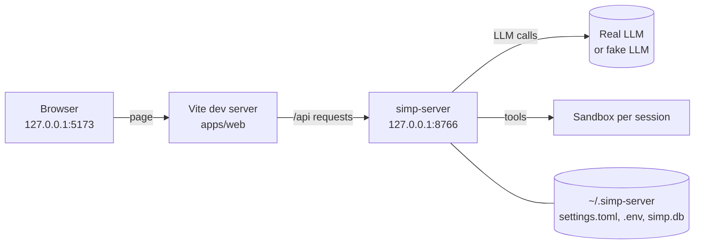

# 01 — Quick start

> **Who this is for:** everyone who wants to run simp-agent once, fast.
> **What you need first:** [00 Introduction and core ideas](00-introduction.md) (the words
> *session*, *tool*, *profile*, *sandbox*).
> **What you will learn:** two ways to have your first chat — in the terminal (Path A) or in
> the browser (Path B) — and how to try the browser path with no API key.
> **Code paths covered:** `apps/cli/src/simp_cli/__init__.py`, `apps/cli/src/simp_cli/repl.py`,
> `apps/server/src/simp_server/server.py` (`load_settings`, `take_keys`, `main`),
> `apps/server/src/simp_server/fakellm.py`, `Makefile`, `apps/web/src/App.tsx`.
> **Verified at commit:** `d3d03f6`.

## 1. Pick a path

| | Path A: CLI | Path B: web |
|---|---|---|
| Where you chat | your terminal | your browser |
| Where tools run | your own machine, in the current folder | a [sandbox](glossary.md#sandbox) per session |
| You need | `uv`, an API key | `uv`, Node + `pnpm`, an API key *or* nothing (fake model) |
| Time | about 2 minutes | about 5 minutes |

**No API key?** Take Path B with the [fake LLM](glossary.md#fake-llm) (section 4). The CLI has
no fake model, so it always needs a real key.

## 2. Get the code (both paths)

You need [uv](https://docs.astral.sh/uv/). It installs the right Python (3.13+) for you.

```sh
git clone <repo-url> simp-agent
cd simp-agent
uv sync
```

`uv sync` installs the library and both Python apps (`simp-agent` and `simp-server`) into
`.venv`. Check it worked:

```sh
uv run simp-agent --help
```

You should see `usage: simp-agent [-h] [--profile PROFILE] ...`.

## 3. Path A — chat in the terminal

### 3.1 Give it a key

With no settings, the CLI uses Anthropic and the model `claude-sonnet-5-5`. It reads the key
from the `ANTHROPIC_API_KEY` environment variable:

```sh
export ANTHROPIC_API_KEY=sk-ant-...
```

**Why an environment variable?** Keys never live in a settings file. A
[profile](glossary.md#profile) only names the variable that holds the key (`api_key_env`).
This way you can share settings without sharing secrets.

If you forget the key, you get `Error: no API key for provider anthropic`. A wrong key gives
an error with `401` and `invalid x-api-key`.

> Using OpenAI or another server instead? You need a profile, or flags such as `--api`,
> `--model` and `--context-window`. See chapter [10](10-cli.md).

### 3.2 Make a practice folder

The CLI's [tools](glossary.md#tool) work on **the folder you start it in**, on your real
machine. So for a first try, use an empty folder:

```sh
mkdir -p /tmp/try-simp && cd /tmp/try-simp
echo 'def add(a, b): return a + b' > utils.py
```

You are now outside the repo, so tell `uv` where the project is with `--project`:

```sh
uv run --project ~/simp-agent simp-agent -p "What does utils.py do? One sentence."
```

(Change `~/simp-agent` to where you cloned it.)

This is [print mode](glossary.md#print-mode): one task, the answer is printed, the program
ends. You will see lines like these (the model's words will differ):

```text
[session 53cbd108]
> read: utils.py
It defines add(a, b), which returns the sum of a and b.
```

The line `> read: utils.py` means the model used the `read` tool. `read` is safe, so it ran
without asking.

### 3.3 See tool approval

Now ask for a change:

```sh
uv run --project ~/simp-agent simp-agent -p "Add a docstring to add() in utils.py"
```

The model wants to use `edit` (or `write`), which changes files. So the CLI stops and asks:

```text
? edit: utils.py
Allow? [y/N/a]
```

Type `y` to allow once, `a` to allow this tool for the rest of the session, or press Enter
to deny. **Why ask?** `write`, `edit` and `bash` can change or delete things on your machine;
approval keeps you in control. (`--yes` skips the question — only use it when you trust the
task. Details in [chapter 10](10-cli.md).)

### 3.4 Chat back and forth

Run it with no task to open the [REPL](glossary.md#repl) (an interactive chat):

```sh
uv run --project ~/simp-agent simp-agent
```

```text
simp-agent | session a020c48c | /help
>
 claude-sonnet-5-5 | session a020c48c | ~0 tokens | idle
```

Type a message and press Enter. Type `/help` to see the commands, `/exit` to quit.

### 3.5 Where your chat went

Every [session](glossary.md#session) is saved right away, one line per
[message](glossary.md#message), in:

```text
~/.simp-agent/sessions/<folder-name>/<session-id>.jsonl
```

`<folder-name>` is the folder you started in, with `/` turned into `-` (for example
`private-tmp-try-simp` on macOS, where `/tmp` is really `/private/tmp`). To go on with the
latest session in this folder, add `-c`. [Chapter 10](10-cli.md#6-sessions-where-they-are-saved) covers this.

## 4. Path B — chat in the browser

The browser path has two programs: the **server** (`simp-server`, Python, port 8766) and
the **web UI** (`apps/web`, a Vite dev server, port 5173). `make dev` starts both. The web UI
sends every `/api` request on to the server.



### 4.1 One-time setup

You also need [Node.js](https://nodejs.org/) and [pnpm](https://pnpm.io/). From the repo root:

```sh
cd apps/web && pnpm install && cd ../..
```

The server keeps everything in its **home folder**: `~/.simp-server` (or the folder in
`$SIMP_SERVER_HOME`). Three files matter now:

| File | What it holds |
|---|---|
| `settings.toml` | profiles and other settings (you write it) |
| `.env` | model keys (you write it; only needed for a real model) |
| `simp.db` | users and sessions (the server makes it) |

### 4.2 Add a profile

**The server needs at least one profile, even with the fake model.** Without one, creating a
session fails with `unknown profile None; have []`.

**No key (fake model):**

```sh
mkdir -p ~/.simp-server
cat > ~/.simp-server/settings.toml <<'EOF'
[profiles.fake]
api = "fake"
model = "fake"
EOF
```

**Real model (Anthropic example):**

```sh
mkdir -p ~/.simp-server
cat > ~/.simp-server/settings.toml <<'EOF'
[profiles.claude]
api = "anthropic-messages"
model = "claude-sonnet-5-5"
api_key_env = "ANTHROPIC_API_KEY"
EOF
echo 'ANTHROPIC_API_KEY=sk-ant-...' > ~/.simp-server/.env
```

**Why a `.env` file?** The server reads keys from `.env` (and from its own environment), then
removes them from its environment. So commands that run inside a sandbox can never see them.
All profile settings are in chapter 21 (Configuration reference).

### 4.3 Make a user

```sh
uv run simp-server seed --name me
```

It prints one line: your [access token](glossary.md#access-token), for example
`E_kieJS1YC-kRIF1...` (43 characters). **Copy it now** — it is shown only once. (If
you lose it, `uv run simp-server rotate --name me` prints a new one. Chapter 22 covers users.)

### 4.4 Start it

With the fake model:

```sh
make dev ARGS=--fake-llm
```

With a real model:

```sh
make dev
```

Wait for both of these lines:

```text
Uvicorn running on http://127.0.0.1:8766 (Press CTRL+C to quit)
  ➜  Local:   http://127.0.0.1:5173/
```

What `make dev` does, in order:

1. If Docker is running, it builds the sandbox image (`simp-sandbox:latest`; slow the first
   time only) and uses `DockerSandbox`. Without Docker it uses `LocalSandbox` — a plain
   folder, fine for one person on their own machine. Chapter 23 explains the difference.
2. It starts `simp-server run --port 8766` (plus your `ARGS`).
3. It starts the web UI on port 5173.

With a profile that has no prices you will also see a warning:
`profile fake has no prices: its calls cost $0 and never hit a budget`. That is fine for now
(chapter 24 covers budgets). Press `Ctrl-C` to stop both programs.

### 4.5 Log in and chat

Open <http://127.0.0.1:5173/>. On the login page, paste your token in the **Token** box
(under "Or paste an access token") and press **Sign in**.

Press **New session** and type a message. With the fake model:

| You type | Fake reply |
|---|---|
| `hello` | `Echo: hello` |
| `tool please` | asks to run `bash` (`echo hi-from-tool`); press **Allow**; then `Tool said: hi-from-tool` |
| `slow test` | a long reply that streams in slowly (good for trying the Stop button) |

The `tool` example shows [tool](glossary.md#tool) approval in the browser: **Allow**,
**Always** or **Deny**, the same three choices as the CLI's `y`, `a` and `N`. The command
runs in that session's sandbox, not in your terminal.

With a real model, chat as you would in the CLI. The difference is that the files the agent
sees are in the session's own folder, `~/.simp-server/workspaces/<session_id>`, not your
current folder.

## 5. What you did

- **Path A:** ran the CLI in print mode and in the REPL; saw tool approval; found where the
  session is saved.
- **Path B:** wrote a profile, made a user, started server + web with `make dev`, logged in
  with a token, and chatted — with a real or fake model.

Both paths run the same `AgentSession` inside (see [00](00-introduction.md#1-what-simp-agent-is)),
so the agent behaves the same; only the outside differs.

---

**Next:**
- Chat in the terminal every day → [10 The CLI](10-cli.md).
- Use the browser → [11 The web UI](11-web.md).
- Run the server for a team (Docker sandbox, several users, budgets) → 20 Operator tutorial.

**Back:** [00 Introduction and core ideas](00-introduction.md).

**Built on by:** [10](10-cli.md) (The CLI), [11](11-web.md) (The web UI), 20 (Operator tutorial), 33 (Developer tutorial).
