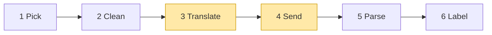

# 02 Part 1 · Translate + Send

**Goal:** Turn our clean messages into one vendor's JSON, and open a stream to that vendor.

**Builds on:** [01 Pick + Clean](01-pick-clean.md) · **Next:** [03 Parse](03-parse.md)

## Where we are



**Builds:** blocks 3, 4 · **IN:** `Model`, clean `Context`, `api_key` · **OUT:** raw chunks

Big picture of Part 1: [part-1-ai](part-1-ai.md).

In [01](01-pick-clean.md), Pick chose a [stream function](glossary.md#stream-function) by `model.api`, and Clean fixed the history. Now we go inside the stream function. It has three jobs: **Translate** our messages into the vendor's JSON, **Send** them over HTTP, and **Parse** what comes back. This chapter does the first two, for all three built-in [providers](glossary.md#provider). Parse is ch [03](03-parse.md).

Code in this chapter (commit `2fc2776`):

- `packages/simp_agent/src/simp_agent/ai/providers/openai_completions.py` — `to_openai`, `stream`
- `packages/simp_agent/src/simp_agent/ai/providers/openai_responses.py` — `to_input`, `request`
- `packages/simp_agent/src/simp_agent/ai/providers/anthropic.py` — `_to_anthropic`, `thinking_params`

## Problem

Vendors differ a lot:

| | OpenAI Chat Completions | OpenAI Responses | Anthropic Messages |
|---|---|---|---|
| System prompt | first message, role `system` | first input item, role `system` or `developer` | separate `system` field |
| Tool call | `tool_calls` on the assistant message | `function_call` item | `tool_use` block |
| Tool result | role `tool`, one per result | `function_call_output` item | `tool_result` block inside a **user** turn |
| Thinking | `reasoning_content` text (read only, never sent back) | encrypted `reasoning` item | signed `thinking` block |

**A real example.** Take one small chat in our format. The assistant turn has the common mix: some thinking, a short text, then a tool call.

```text
system:    "You are a coding agent."
user:      "What is in README.md?"
assistant: content = [
             Thinking("User wants the file; call read", signature=...),
             Text("Let me read it."),
             ToolCall(id="call_1", name="read", arguments={"path": "README.md"}),
           ]
tool:      ToolResultMessage(tool_call_id="call_1", content="# simp-agent ...")
```

We send it back to the SAME model that wrote the assistant turn. (For another model, Clean in [chapter 1](01-pick-clean.md) already turned signed thinking into plain text and dropped redacted thinking, so there is no thinking block to translate.) The `signature` is whatever that vendor's parser saved when the answer came in: none for Chat Completions, the whole reasoning item as JSON for Responses, an opaque string for Anthropic. To keep it simple we write the tool call id as `call_1` for all three.

Here is the SAME chat as each vendor wants it. We built each one by following the real code (`to_openai`, `to_input`, `_to_anthropic`). We show only the chat part; fields like `model` and `tools` are cut.

OpenAI Chat Completions (`messages=to_openai(...)`):

```jsonc
"messages": [
  {"role": "system", "content": "You are a coding agent."},        // system = first message
  {"role": "user", "content": "What is in README.md?"},            // content is a plain string
  {"role": "assistant", "content": "Let me read it.",              // only the text; the thinking is DROPPED
   "tool_calls": [{"id": "call_1", "type": "function",
     "function": {"name": "read",
                  "arguments": "{\"path\": \"README.md\"}"}}]},    // arguments is a STRING of JSON
  {"role": "tool", "tool_call_id": "call_1",
   "content": "# simp-agent ..."}                                   // tool result = its own role "tool"
]
```

Plainly: Chat Completions does **not** send thinking back. `to_openai` reads only `m.text()` (text blocks joined) and `m.tool_calls()`; the thinking block is skipped. If the turn had no text, `content` would be `null`.

OpenAI Responses (`input=to_input(...)`):

```jsonc
"input": [
  {"role": "system", "content": "You are a coding agent."},        // system = first item ("developer" for reasoning models)
  {"role": "user",
   "content": [{"type": "input_text", "text": "What is in README.md?"}]},  // text is a typed part
  {"type": "reasoning", "id": "rs_...", "encrypted_content": "...", ...},  // the saved reasoning item = json.loads(Thinking.signature), sent as-is
  {"type": "message", "role": "assistant", "status": "completed",
   "id": "msg_...", "phase": "...",                                 // id and phase come from json.loads(Text.signature)
   "content": [{"type": "output_text", "text": "Let me read it.", "annotations": []}]},
  {"type": "function_call", "call_id": "call_1", "name": "read",
   "arguments": "{\"path\": \"README.md\"}"},                      // tool call = its own item; arguments a STRING
  {"type": "function_call_output", "call_id": "call_1",
   "output": "# simp-agent ..."}                                    // tool result = its own item
]
```

Here one assistant turn becomes three separate items. The thinking signature is the whole reasoning item as JSON, so `to_input` just loads it and puts it back. If the text has no signature, the id is made up (`msg_pi_<i>`) and there is no `phase`. In real Responses chats our tool call id is `call_1|fc_...` (see below), and then the `function_call` item also gets `"id": "fc_..."`.

Anthropic Messages (`system=...`, `messages=_to_anthropic(...)`):

```jsonc
"system": "You are a coding agent.",                                // system = separate field, not a message
"messages": [
  {"role": "user", "content": [{"type": "text", "text": "What is in README.md?"}]},
  {"role": "assistant", "content": [                               // ONE turn, three blocks, same order
    {"type": "thinking", "thinking": "User wants the file; call read",
     "signature": "..."},                                           // signed thinking goes back with its signature
    {"type": "text", "text": "Let me read it."},
    {"type": "tool_use", "id": "call_1", "name": "read",
     "input": {"path": "README.md"}}]},                             // tool call = block; input is an OBJECT, not a string
  {"role": "user", "content": [
    {"type": "tool_result", "tool_use_id": "call_1",
     "content": "# simp-agent ...", "is_error": false}]}            // tool result = block inside a USER turn
]
```

If the thinking was redacted, the block is `{"type": "redacted_thinking", "data": signature}` instead. If it has no signature (for example the answer was aborted), it is sent as a plain `text` block.

The assistant turn side by side:

| Our block | OpenAI Chat Completions | OpenAI Responses | Anthropic Messages |
|---|---|---|---|
| Thinking | dropped, not sent | saved `reasoning` item (from `signature`), own item | `thinking` block with `signature` (redacted → `redacted_thinking`) |
| Text | `content` string | `message` item, `id`/`phase` from text `signature` | `text` block |
| Tool call | `tool_calls` entry, `arguments` as JSON string | `function_call` item, `arguments` as JSON string | `tool_use` block, `input` as object |

One chat, three very different shapes. This is why we need block 3 Translate.

And sending can fail in many ways: network down, bad key, a 529 "overloaded". The [stream function](glossary.md#stream-function) rule says "never raise", so every failure must become an `error` event.

## 3 Translate: our messages → vendor format

Each provider has one function that turns our message list into its vendor's format. You already saw the result for one chat in the [real example](#problem) above. This table puts the rules side by side, row by row:

| | Chat Completions (`to_openai`) | Responses (`to_input`) | Anthropic (`_to_anthropic`) |
|---|---|---|---|
| System prompt | first message, role `system` | first item, role `system` (`developer` when reasoning is on) | not a message: separate `system=` field |
| Tool call | entry in `tool_calls`, `arguments` as JSON string | own `function_call` item, `arguments` as JSON string | `tool_use` block, `input` as object |
| Tool result | one `role: "tool"` message per result | one `function_call_output` item per result | `tool_result` block inside a **user** turn |
| Thinking sent back | no, dropped | yes: saved `reasoning` item from `signature` | yes: `thinking` block with `signature` (redacted → `redacted_thinking`; unsigned → plain `text`) |
| Special rule | `content: null` when only tool calls | `call_id\|item_id` split; text `signature`; role `developer` | merge same-role turns |

Each special rule, and why it is there:

**Chat Completions: `content` can be `null`.**

- *Normal:* the assistant says something, so `content` is the text: `{"role": "assistant", "content": "Done."}`.
- *Often the model only acts:* you say "Read README.md", it calls `read` with no words (thinking is dropped). We send `"content": null` next to `"tool_calls"`. Why: `null` means "said nothing"; some servers reject `""` there.
- *Rare: no words and no tool call* (the model only thought, then hit the token limit). We still send the turn so the history keeps its user/assistant order: `{"role": "assistant", "content": ""}`.

```text
content = text IF text is not blank, ELSE null IF tool calls, ELSE ""
```

**Responses: three small tricks.**

*Two ids in one string.*

- *Normal:* a tool call needs one id to link it to its result: `call_1`.
- *Responses gives two:* `call_id` (links call and result) and the item id `fc_...` (names the item). Our `ToolCall` has only one `id`, so we store both: `"call_1|fc_abc"`.
- *Sending back:* split at `|`. `call_id` goes on `function_call` and `function_call_output`; `fc_abc` goes back as `"id"` only for the same model.

```text
call_id, _, item_id = id.partition("|")   // no "|" → item_id is empty
```

*Text signature.*

- *Normal:* text is just text.
- *Responses:* each answer is a `message` item with its own `id` (and sometimes a `phase`). When we send the old answer back, it should keep that same id. So the parser saves `{"v": 1, "id": "msg_...", "phase": ...}` in `TextContent.signature`.
- *No signature* (the text came from another vendor): we make up an id, `msg_pi_<i>`, and send no `phase`.

```text
id = signature.id IF signature, ELSE "msg_pi_<i>"
```

*Role `developer`.*

- *Normal:* the system prompt goes in with role `system`.
- *Reasoning model* (a reasoning effort is set): OpenAI wants role `developer` for it, so we use that.

```text
role = "developer" IF reasoning effort set, ELSE "system"
```

**Anthropic: merge turns.**

- *Normal:* Anthropic needs user and assistant turns to take turns: user, assistant, user, ...
- *The model calls 3 tools:* each tool result becomes its own **user** turn, so we get 3 user turns in a row. Anthropic rejects that:

```jsonc
{"role": "assistant", "content": [ tool_use call_1, tool_use call_2, tool_use call_3 ]},
{"role": "user", "content": [ tool_result call_1 ]},
{"role": "user", "content": [ tool_result call_2 ]},
{"role": "user", "content": [ tool_result call_3 ]}
```

- *What we do:* join same-role turns that sit next to each other, so the 3 results become one user turn:

```jsonc
{"role": "assistant", "content": [ tool_use call_1, tool_use call_2, tool_use call_3 ]},
{"role": "user", "content": [ tool_result call_1, tool_result call_2, tool_result call_3 ]}
```

Real code: [packages/simp_agent/src/simp_agent/ai/providers/anthropic.py](../../packages/simp_agent/src/simp_agent/ai/providers/anthropic.py) (`_to_anthropic`)

```text
IF this turn has the same role as the last one: add its content to the last one, ELSE add it as a new turn
```

## 4 Send: call the API

Now each provider starts a streaming call with its SDK (`stream=True` for OpenAI, `client.messages.stream(...)` for Anthropic). The SDK is imported inside `stream`, so you only need the SDK you use. The request settings differ, again row by row (`compat` = small per-server switches on the `Model`; all keys in [ref-objects](ref-objects.md#request-objects-tool-context-model)):

| | Chat Completions | Responses | Anthropic |
|---|---|---|---|
| Request switches | `compat`: `max_tokens_field`, `include_usage` | `store: false`, `max_output_tokens` at least 16 | no switches: always sends `max_tokens`, `system`, `tools` |
| Thinking on | `compat.reasoning_effort` → `reasoning_effort` | `compat.reasoning_effort` → `reasoning: {effort, summary: "auto"}` | `thinking_params(model)`: `thinking_budget` or `reasoning_effort` |
| Reasoning kept between calls | no (thinking is not sent back) | `include: ["reasoning.encrypted_content"]` | the signed `thinking` block itself |

**Chat Completions.** Some servers want `max_completion_tokens`, some fail on `stream_options`. `compat` handles that with a setting, not code:

Real code: [packages/simp_agent/src/simp_agent/ai/providers/openai_completions.py](../../packages/simp_agent/src/simp_agent/ai/providers/openai_completions.py) (`stream`)

```text
kw[ compat "max_tokens_field" or "max_tokens" ] = model.max_tokens
IF compat include_usage (default yes):
    kw.stream_options = {include_usage: true}
IF compat reasoning_effort is set:
    kw.reasoning_effort = that value
```

**Responses.** We send `store: false`. Why: we keep the whole history ourselves and send it every time, so OpenAI should keep nothing. But then a reasoning model cannot see its own past reasoning. So we ask for `include: ["reasoning.encrypted_content"]`: OpenAI sends the reasoning item back encrypted, we save it in `ThinkingContent.signature`, and `to_input` sends it back next time.

Real code: [packages/simp_agent/src/simp_agent/ai/providers/openai_responses.py](../../packages/simp_agent/src/simp_agent/ai/providers/openai_responses.py) (`request`)

```text
kw = {model id, input = to_input(model, system prompt, messages), stream: true,
      store: false, max_output_tokens: at least 16}
IF the model has a reasoning effort:
    kw.reasoning = {effort, summary: "auto"}
    kw.include   = ["reasoning.encrypted_content"]   // so we can send it back later
```

**Anthropic.** `thinking_params(model)` turns thinking on. `compat.thinking_budget` gives a fixed token budget (older models); `compat.reasoning_effort` gives adaptive thinking with an effort level. Neither set: no thinking.

Real code: [packages/simp_agent/src/simp_agent/ai/providers/anthropic.py](../../packages/simp_agent/src/simp_agent/ai/providers/anthropic.py) (`thinking_params`)

**Same for all three: errors become events.** Every provider wraps the call in `try`/`except`, so a network error, a bad key or a 529 becomes an `error` [stream event](glossary.md#stream-event), not an exception. (Small difference: Anthropic puts the error on the partial message it was building, so any text so far is kept; the OpenAI providers send a new empty message.) In `openai_completions.py`:

```text
TRY:
    chunks = WAIT for client.chat.completions.create(...)
    FOR EACH event from parse(chunks, compat): SEND it on
IF any exception:
    SEND event {error, AssistantMessage(stop_reason = error, error = the text of the exception)}
```

Real code: [packages/simp_agent/src/simp_agent/ai/providers/openai_completions.py](../../packages/simp_agent/src/simp_agent/ai/providers/openai_completions.py) (`stream`)

The one exception: the SDK `import` sits just before the `try`, so a missing SDK raises `ImportError` — the only case that breaks "never raise".

We split `parse` out of `stream` so tests can feed it plain objects with no network and no SDK client.

## Test

No real model or key is needed. The tests replace the SDK with a fake.

- `test_message_conversion` (`test_openai.py`) — `to_openai` output shape.
- `test_compat_params` (`test_openai.py`) — `compat` changes the request keys.
- `test_http_error_is_event` (`test_openai.py`) makes `AsyncOpenAI` raise a connection error. The stream yields an `error` event, not an exception. (The same test also checks the error classifiers built in ch [04](04-label-test.md).)
- `test_responses_replay_order_and_ids` (`test_reasoning.py`) — Responses replay: reasoning items and ids go back the same.

```bash
cd packages/simp_agent
uv run pytest -q tests/test_openai.py::test_message_conversion tests/test_openai.py::test_compat_params \
  tests/test_openai.py::test_http_error_is_event tests/test_reasoning.py::test_responses_replay_order_and_ids
```

> **Why this way**
>
> We pick the provider by **API format** (`model.api`), not by vendor. Many vendors and local servers speak the OpenAI format, so three providers cover almost all of them, and `compat` handles the small differences.
>
> Each provider only converts, sends and parses. A provider never raises and never reads the environment, so the loop has one rule (read the last event) and the app stays in control of keys.

## Exercises

1. Call `to_openai` on a history with an assistant turn that has only a tool call, then its tool result. What is the assistant's `content`, and what role does the result get?
2. Make a `Model(api="openai-completions", compat={"max_tokens_field": "max_completion_tokens", "include_usage": False})`. Which request keys change?

## Recap

- Each provider converts our messages to its own format; Anthropic merges same-role turns so user and assistant alternate.
- `compat` holds small per-server switches (`max_tokens_field`, `include_usage`, `reasoning_effort`, `thinking_budget`), so odd servers need a setting, not new code.
- OpenAI Responses keeps nothing on the server (`store: False`); we save the encrypted reasoning item in `ThinkingContent.signature` and send it back.
- `stream` sends the request and turns every exception into an `error` event.

**Builds on:** [01 Pick + Clean](01-pick-clean.md) · **Next:** [03 Parse](03-parse.md) — the server answers in many small chunks; next we glue them into one message.

**OUT →** raw chunks from the vendor are the IN of block 5 Parse — the parser is in [ch 03](03-parse.md).
