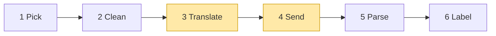
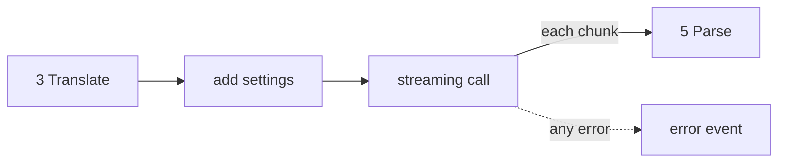

# 02 Part 1 · Translate + Send

**Goal:** Turn our clean messages into one vendor's JSON, and open a stream to that vendor.

**Builds on:** [01 Pick + Clean](01-pick-clean.md) · **Next:** [03 Parse](03-parse.md)

## Where we are



**Builds:** blocks 3, 4 · **IN:** `Model`, clean `Context`, `api_key` · **OUT:** raw chunks

Big picture of Part 1: [part-1-ai](01-0-part-1-ai.md).

Code in this chapter (commit `2fc2776`):

- `packages/simp_agent/src/simp_agent/ai/providers/openai_completions.py` — `to_openai`, `stream`
- `packages/simp_agent/src/simp_agent/ai/providers/openai_responses.py` — `to_input`, `request`
- `packages/simp_agent/src/simp_agent/ai/providers/anthropic.py` — `_to_anthropic`, `thinking_params`

## Problem

The user asks "What is in README.md?". The model thinks, says "Let me read it.", and calls `read`. The tool runs. Now the history holds four messages, and we must send them to the model again:

```text
system:    "You are a coding agent."
user:      "What is in README.md?"
assistant: [Thinking("User wants the file; call read", signature=...),
            Text("Let me read it."),
            ToolCall(id="call_1", name="read", arguments={"path": "README.md"})]
tool:      ToolResultMessage(tool_call_id="call_1", content="# simp-agent ...")
```

At the end of [01](01-pick-clean.md), Pick gave us a [stream function](glossary.md#stream-function) for `model.api`, and Clean fixed this history. Now we go inside the stream function. Its first two jobs are the topic here: **Translate** the messages into the [vendor](glossary.md#vendor)'s JSON, and **Send** them. Its third job, Parse, is [03](03-parse.md). We have one [provider](glossary.md#provider) (the code for one API format) per format, and each one does all three jobs. We pick by API format, not by vendor: many vendors and local servers speak the OpenAI format, so three providers cover almost all of them.

Why can't we send one JSON for all? Because the three APIs want this same chat in three different shapes. Here it is as each one wants it (only the chat part; `model`, `tools` and other fields are cut):

```jsonc
// OpenAI Chat Completions: messages=to_openai(...)
[{"role": "system", "content": "You are a coding agent."},
 {"role": "user", "content": "What is in README.md?"},
 {"role": "assistant", "content": "Let me read it.",               // no thinking
  "tool_calls": [{"id": "call_1", "type": "function",
    "function": {"name": "read", "arguments": "{\"path\": \"README.md\"}"}}]},  // a STRING of JSON
 {"role": "tool", "tool_call_id": "call_1", "content": "# simp-agent ..."}]

// OpenAI Responses: input=to_input(...)
[{"role": "developer", "content": "You are a coding agent."},     // "developer": a reasoning model
 {"role": "user", "content": [{"type": "input_text", "text": "What is in README.md?"}]},
 {"type": "reasoning", "id": "rs_1", "encrypted_content": "..."},   // one turn becomes
 {"type": "message", "role": "assistant", "id": "msg_68a1", ...},   // three separate items
 {"type": "function_call", "call_id": "call_1", "name": "read", "arguments": "{\"path\": \"README.md\"}"},
 {"type": "function_call_output", "call_id": "call_1", "output": "# simp-agent ..."}]

// Anthropic: system="You are a coding agent.", messages=_to_anthropic(...)
[{"role": "user", "content": [{"type": "text", "text": "What is in README.md?"}]},
 {"role": "assistant", "content": [                                 // one turn, three blocks
   {"type": "thinking", "thinking": "User wants the file; call read", "signature": "..."},
   {"type": "text", "text": "Let me read it."},
   {"type": "tool_use", "id": "call_1", "name": "read", "input": {"path": "README.md"}}]},  // an OBJECT
 {"role": "user", "content": [                                      // tool result inside a USER turn
   {"type": "tool_result", "tool_use_id": "call_1", "content": "# simp-agent ...", "is_error": false}]}]
```

The system prompt is a message in two of them and a separate field in the third. Thinking goes back in two of them and not at all in the first. Tool arguments are a string in two and an object in the third. This is the job of block 3, Translate.

Sending has a problem of its own: the network can fail, the key can be bad, the vendor can be busy. The stream function never raises, so each of these must become an `error` event. A provider also never reads the environment; the app passes `api_key`, so the app stays in control of keys. That is block 4, Send.

## 3 Translate: our messages → vendor format

Each provider has one function for this: `to_openai`, `to_input` and `_to_anthropic`. Most of the work is renaming fields. Below are only the rules that are not a rename, from the simplest API to the hardest.

### Chat Completions (`to_openai`)

This API has one JSON message per turn, and the system prompt is just the first message.

**Thinking is dropped.** This API has no field to send thinking back, so `to_openai` keeps only the text and the tool calls of an assistant turn. (It is the only provider that does this; this is the one place we explain it.)

**Tool arguments are a JSON string.** `arguments` holds `json.dumps(c.arguments)`, not an object. Anthropic wants an object, so the two are easy to mix up.

**`content` is `null` when the model only acts.** Often the model calls a tool and says nothing. Then we send `"content": null` next to `tool_calls`, because some servers reject `""` there. The full rule:

```text
content = text IF text is not blank, ELSE null IF there are tool calls, ELSE ""
```

The last case is rare: the model only thought, then hit the token limit. With the thinking dropped, nothing is left, but we still send `{"role": "assistant", "content": ""}` so the history keeps its user/assistant order.

**One `tool` message per result.** Each tool result is its own message with role `tool`, linked to its call by `tool_call_id`. Three parallel calls give three `tool` messages.

### Responses (`to_input`)

Responses is harder, because we must send old answers back exactly as OpenAI made them. To see why, look at how this API works.

In Responses, an answer is a list of [items](glossary.md#item-responses), and each item has an `id`: a reasoning item (`rs_...`), a text item called `message` (`msg_...`), and a tool call item `function_call` (`fc_...`, plus a separate `call_id`). The reasoning item is encrypted: we cannot read it, we can only send it back. OpenAI pairs each reasoning item with the item that came right after it, by their ids. So when we send the history back to the same model, each item must keep its old id.

Responses can also keep the chat on its side (`store: true`; next time you send only the new message). We do **not** use this. We send `store: false`, so OpenAI forgets everything after each call, and we send the whole history each time. Why: the history must be ours, so we can save it, compact it, or send it to another model. The cost is the id rule above.

Our objects have no id field for text and only one id field for a tool call. Three ideas make the ids fit.

**Reasoning is saved whole.** When the answer came in, Parse saved the whole reasoning item, as JSON, in `ThinkingContent.signature`. `to_input` loads it and puts it back as its own item. No signature means nothing is sent.

**Two ids in one string.** A tool call has two ids here: `call_id` links the call to its result, and the item id `fc_...` names the item. Our `ToolCall` has one `id` field, so Parse packs both into it: `"call_1|fc_abc"`. Translate splits it again with `id.partition("|")`. The result item only ever gets `call_id`. The call item gets the item id back as `"id"`, but only when it still means something:

```text
call_id, _, item_id = id.partition("|")
IF item_id AND NOT (same API and vendor, but another model):
    IF same API and vendor: id = item_id, with "fc_" added in front if it is missing
    ELSE:                   id = "fc_" + hash(item_id)
```

Another model on the same API gets no `"id"`, because only the old model knows it. A message from a different API gets a new id made from the old one: `hash` is the first 16 hex characters of the SHA-256 of the old id (Python's `hashlib`), for example `"fc_93985a942abc4d6a"`. The same old id always gives the same new id, and it is short and safe for OpenAI. Each `call_id`, and an item id from the same API, also goes through `_id_part`: it turns any character that is not a letter, digit, `_` or `-` into `_`, cuts the id to 64 characters (OpenAI's limit), and strips `_` from the end.

**The text id lives in the signature.** A `message` item has an `id`, and sometimes a `phase` (`commentary` for talk in the middle of work, `final_answer` for the last answer). `TextContent` has no id field, so Parse borrows its `signature` field and saves `{"v": 1, "id": ..., "phase": ...}` there. Translate sends the same `id` and `phase` back. If there is no signature (the text came from Claude, or Clean removed it for another model), Translate makes up an id and sends no `phase`, because a wrong guess is worse than none:

```text
i = place of the message in the history, n = place of the text in that message (from 0)
id = signature.id IF signature, ELSE "msg_pi_<i>" IF n == 0, ELSE "msg_pi_<i>_<n>"
IF len(id) > 64: id = "msg_" + hash(id)
```

**The `developer` role.** For an OpenAI reasoning model (`compat.reasoning_effort` is set and is not `"none"`), the system prompt goes with role `developer` instead of `system`. That is the name OpenAI wants for app instructions on these models.

### Anthropic (`_to_anthropic`)

Each turn is a list of typed blocks, and the system prompt goes in a separate `system=` field, not in the messages.

**Signed thinking goes back with its signature.** Anthropic checks the signature, so a signed `thinking` block goes back as it was. Redacted thinking goes back as `{"type": "redacted_thinking", "data": signature}`. Thinking with no signature (for example, the answer was stopped) cannot be sent back as thinking, so it is sent as a plain `text` block. Blank unsigned thinking is skipped.

**Tool calls are `tool_use` blocks** with `input` as a real object.

**Same-role turns are merged.** A tool result is a `tool_result` block inside a **user** turn. So when the model calls three tools, we get three user turns in a row. Anthropic rejects that: user and assistant must take turns. So at the end `_to_anthropic` joins each turn with the one before it if they have the same role:

```text
IF this turn has the same role as the last one: add its blocks to the last one, ELSE add it as a new turn
```

The three results become one user turn with three `tool_result` blocks.

### The tool list

The model must also know which tools exist. Our `read` tool is `name`, `description` and `parameters` (a JSON schema). All three vendors take the list in a parameter called `tools`, but each wraps one tool in a different shape:

| Vendor | One tool in `tools` |
|---|---|
| Chat Completions | `{"type": "function", "function": {"name", "description", "parameters"}}`: one extra `function` layer |
| Responses | `{"type": "function", "name", "description", "parameters"}`: flat |
| Anthropic | `{"name", "description", "input_schema"}`: no `type`, and `parameters` is renamed `input_schema` |

The JSON schema itself (`{"type": "object", "properties": {"path": …}}`) is the same for all three; only the wrapper changes.

Real code: [openai_completions.py](../../packages/simp_agent/src/simp_agent/ai/providers/openai_completions.py), [openai_responses.py](../../packages/simp_agent/src/simp_agent/ai/providers/openai_responses.py), [anthropic.py](../../packages/simp_agent/src/simp_agent/ai/providers/anthropic.py) — where `tools` is built.

## 4 Send: call the API

Translate gave us the messages. What else goes in the request, and what if the call fails? Send does three things, in the same order in all three providers: it adds the other settings, opens a streaming call, and turns every error into an event.



### Settings

The settings come from the [model](glossary.md#model): `model.max_tokens`, and `model.compat`, a small dict of switches for one server (all keys in [ref-objects](ref-objects.md#request-objects-tool-context-model)). Each request answers three questions, and each API asks them in its own words.

| Question | Chat Completions | Responses | Anthropic |
|---|---|---|---|
| How long may the answer be? | `max_tokens`, or the key named in `compat.max_tokens_field` (e.g. `max_completion_tokens`) | `max_output_tokens = max(16, model.max_tokens)`; very small values are refused | `max_tokens` |
| Turn thinking on? | `reasoning_effort` = `compat.reasoning_effort` as is, even `"none"` | if effort is set and not `"none"`: `reasoning: {effort, summary: "auto"}` | `thinking_params(model)`: a budget or adaptive thinking |
| Keep the reasoning for next turn? | no way to | `include: ["reasoning.encrypted_content"]`, sent with `reasoning` | nothing to ask; the signed block is enough |

`summary: "auto"` asks OpenAI for a readable summary of the thinking, which Parse shows as thinking text. The `include` key is needed because of `store: false`: OpenAI keeps nothing, so it must send us the encrypted reasoning item. Parse saves it in `ThinkingContent.signature`, and that is where the saved reasoning that Translate sends back comes from.

`thinking_params` picks one of two ways. `compat.thinking_budget` gives a fixed token budget (older models) and also sends the header `anthropic-beta: interleaved-thinking-2025-05-14`, so the model can think between tool calls. `compat.reasoning_effort` gives "adaptive" thinking with an effort level (newer models). If both are set, the budget wins. If neither is set, or effort is `"none"`, there is no thinking.

```jsonc
{"thinking": {"type": "enabled", "budget_tokens": 8000}}                // thinking_budget = 8000
{"thinking": {"type": "adaptive"}, "output_config": {"effort": "high"}}  // reasoning_effort = "high"
```

One more switch: Chat Completions sends token counts in a stream only if we ask with `"stream_options": {"include_usage": true}`. We ask by default; `compat.include_usage = false` turns it off for servers that fail on this key. The other two APIs always send counts.

### Streaming call

Each provider calls its vendor's SDK: `client.chat.completions.create(**kw)`, `client.responses.create(**kw)`, or `client.messages.stream(...)` for Anthropic. Each chunk that comes back (for Anthropic, each SDK event) goes straight to `parse` ([03](03-parse.md)). `parse` is a separate function so tests can feed it plain objects, with no network.

### Errors become events

What if the call fails? Every provider wraps it in `try`/`except` and turns the exception into an `error` [stream event](glossary.md#stream-event). In `openai_completions.py`:

```text
TRY:
    chunks = WAIT for client.chat.completions.create(...)
    FOR EACH event from parse(chunks, compat): SEND it on
IF any exception:
    SEND {error, AssistantMessage(stop_reason = error, error = the text of the exception)}
```

Anthropic puts the error on the message it was already building, so text received so far is kept. The OpenAI providers send a new, empty message. The SDK `import` sits just before the `try`, so you only need the SDK you use; a missing SDK raises `ImportError`, the one case that breaks "never raise".

**Builds on:** [01 Pick + Clean](01-pick-clean.md) · **Next:** [03 Parse](03-parse.md) — the raw chunks from the vendor are the IN of block 5 Parse, which glues them into one message.
