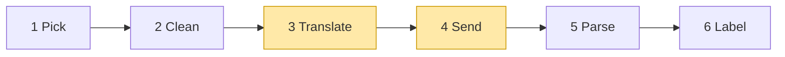

# 02 Part 1 · Translate + Send

**Goal:** Turn our clean messages into one vendor's JSON, and open a stream to that vendor.

**Builds on:** [01 Pick + Clean](01-pick-clean.md) · **Next:** [03 Parse](03-parse.md)

## Where we are



**Builds:** blocks 3, 4 · **IN:** `Model`, clean `Context`, `api_key` · **OUT:** raw chunks

Big picture of Part 1: [part-1-ai](part-1-ai.md).

In [01](01-pick-clean.md), Pick chose a [stream function](glossary.md#stream-function) by `model.api`, and Clean fixed the history. Now we go inside the stream function. It has three jobs: **Translate** our messages into the vendor's JSON, **Send** them over HTTP, and **Parse** what comes back. This chapter does the first two, for all three built-in [providers](glossary.md#provider). Parse is ch [03](03-parse.md).

Code in this chapter (commit `2fc2776`):

- `packages/simp_agent/src/simp_agent/ai/providers/openai_completions.py` — `to_openai`, `stream`
- `packages/simp_agent/src/simp_agent/ai/providers/openai_responses.py` — `to_input`, `request`
- `packages/simp_agent/src/simp_agent/ai/providers/anthropic.py` — `_to_anthropic`, `thinking_params`

## Problem

A real example shows how much vendors differ. Take one small chat in our format. The assistant turn has the common mix: some thinking, a short text, then a tool call.

```text
system:    "You are a coding agent."
user:      "What is in README.md?"
assistant: content = [
             Thinking("User wants the file; call read", signature=...),
             Text("Let me read it."),
             ToolCall(id="call_1", name="read", arguments={"path": "README.md"}),
           ]
tool:      ToolResultMessage(tool_call_id="call_1", content="# simp-agent ...")
```

We send it back to the SAME model that wrote the assistant turn. (For another model, Clean in [chapter 1](01-pick-clean.md) already turned signed thinking into plain text and dropped redacted thinking, so there is no thinking block to translate.) The `signature` is whatever that vendor's parser saved when the answer came in: none for Chat Completions, the whole reasoning item as JSON for Responses, an opaque string for Anthropic. To keep it simple we write the tool call id as `call_1` for all three.

Here is the SAME chat as each vendor wants it. We built each one by following the real code (`to_openai`, `to_input`, `_to_anthropic`). We show only the chat part; fields like `model` and `tools` are cut.

OpenAI Chat Completions (`messages=to_openai(...)`):

```jsonc
"messages": [
  {"role": "system", "content": "You are a coding agent."},        // system = first message
  {"role": "user", "content": "What is in README.md?"},            // content is a plain string
  {"role": "assistant", "content": "Let me read it.",              // only the text; the thinking is DROPPED
   "tool_calls": [{"id": "call_1", "type": "function",
     "function": {"name": "read",
                  "arguments": "{\"path\": \"README.md\"}"}}]},    // arguments is a STRING of JSON
  {"role": "tool", "tool_call_id": "call_1",
   "content": "# simp-agent ..."}                                   // tool result = its own role "tool"
]
```

OpenAI Responses (`input=to_input(...)`):

```jsonc
"input": [
  {"role": "system", "content": "You are a coding agent."},        // system = first item ("developer" for reasoning models)
  {"role": "user",
   "content": [{"type": "input_text", "text": "What is in README.md?"}]},  // text is a typed part
  {"type": "reasoning", "id": "rs_...", "encrypted_content": "...", ...},  // the saved reasoning item = json.loads(Thinking.signature), sent as-is
  {"type": "message", "role": "assistant", "status": "completed",
   "id": "msg_...", "phase": "...",                                 // id and phase come from json.loads(Text.signature)
   "content": [{"type": "output_text", "text": "Let me read it.", "annotations": []}]},
  {"type": "function_call", "call_id": "call_1", "name": "read",
   "arguments": "{\"path\": \"README.md\"}"},                      // tool call = its own item; arguments a STRING
  {"type": "function_call_output", "call_id": "call_1",
   "output": "# simp-agent ..."}                                    // tool result = its own item
]
```

Here one assistant turn becomes three separate items. The thinking signature is the whole reasoning item as JSON, so `to_input` just loads it and puts it back. If the text has no signature, the id is made up (`msg_pi_<i>`) and there is no `phase`. In real Responses chats our tool call id is `call_1|fc_...` (see below), and then the `function_call` item also gets `"id": "fc_..."`.

Anthropic Messages (`system=...`, `messages=_to_anthropic(...)`):

```jsonc
"system": "You are a coding agent.",                                // system = separate field, not a message
"messages": [
  {"role": "user", "content": [{"type": "text", "text": "What is in README.md?"}]},
  {"role": "assistant", "content": [                               // ONE turn, three blocks, same order
    {"type": "thinking", "thinking": "User wants the file; call read",
     "signature": "..."},                                           // signed thinking goes back with its signature
    {"type": "text", "text": "Let me read it."},
    {"type": "tool_use", "id": "call_1", "name": "read",
     "input": {"path": "README.md"}}]},                             // tool call = block; input is an OBJECT, not a string
  {"role": "user", "content": [
    {"type": "tool_result", "tool_use_id": "call_1",
     "content": "# simp-agent ...", "is_error": false}]}            // tool result = block inside a USER turn
]
```

One chat, three very different shapes. This is why we need block 3 Translate.

And sending can fail in many ways: network down, bad key, a 529 "overloaded". The [stream function](glossary.md#stream-function) rule says "never raise", so every failure must become an `error` event.

## 3 Translate: our messages → vendor format

Translate maps our messages (`UserMessage`; `AssistantMessage` = thinking, text and tool calls; `ToolResultMessage`) to the JSON each API accepts. Most of the work is renaming fields. But each API has a few rules of its own, and those rules are what this section is about. We go API by API, from the simplest to the hardest. Each provider has one function for this: `to_openai`, `to_input`, `_to_anthropic`.

### Chat Completions (`to_openai`)

The simplest API: one JSON message per turn, and the system prompt is just the first message (role `system`). Four rules.

**(a) Thinking: dropped.** This API has no place to send thinking back. So `to_openai` keeps only the text and the tool calls of an assistant turn; the thinking block is skipped.

```python
AssistantMessage(content=[
    ThinkingContent("User wants the file; call read"),
    TextContent("Let me read it."),
    ToolCall(id="call_1", name="read", arguments={"path": "README.md"}),
])
```

```json
{"role": "assistant", "content": "Let me read it.",
 "tool_calls": [{"id": "call_1", "type": "function",
                 "function": {"name": "read", "arguments": "{\"path\": \"README.md\"}"}}]}
```

**(b) Tool call: an entry in `tool_calls`, `arguments` as a JSON string.** Look at the example above: `arguments` is not an object, it is a *string* that holds JSON (`json.dumps(c.arguments)`). This is what the API wants. (Anthropic, below, wants an object. Easy to mix up.)

**(c) Only a tool call: `content` is `null`.**

```text
content = text IF text is not blank, ELSE null IF tool calls, ELSE ""
```

*Case 1 — normal: the assistant says something.* `content` is the text.

```python
AssistantMessage(content=[TextContent("Done.")])
```

```json
{"role": "assistant", "content": "Done."}
```

*Case 2 — often the model only acts:* you say "Read README.md", it calls `read` with no words. We send `"content": null` next to `"tool_calls"`. Why: `null` means "said nothing"; some servers reject `""` there.

```python
AssistantMessage(content=[ToolCall(id="call_1", name="read", arguments={"path": "README.md"})])
```

```json
{"role": "assistant", "content": null,
 "tool_calls": [{"id": "call_1", "type": "function",
                 "function": {"name": "read", "arguments": "{\"path\": \"README.md\"}"}}]}
```

*Case 2b — thinking, then a tool call.* The thinking is dropped (rule a), so the result is exactly the same as case 2:

```python
AssistantMessage(content=[
    ThinkingContent("User wants the file; call read"),
    ToolCall(id="call_1", name="read", arguments={"path": "README.md"}),
])
```

```json
{"role": "assistant", "content": null,
 "tool_calls": [{"id": "call_1", "type": "function",
                 "function": {"name": "read", "arguments": "{\"path\": \"README.md\"}"}}]}
```

*Case 3 — rare: no words and no tool call.* The model only thought, then hit the token limit. Thinking is dropped, so nothing is left. We still send the turn so the history keeps its user/assistant order:

```python
AssistantMessage(content=[ThinkingContent("Let me think about the plan...")], stop_reason="length")
```

```json
{"role": "assistant", "content": ""}
```

**(d) Tool result: one role `tool` message per result.** Each result is its own message, linked to its call by `tool_call_id`. Never merged. So 3 parallel calls give 3 `tool` messages:

```python
ToolResultMessage(tool_call_id="call_1", tool_name="read", content="text of a.py")
ToolResultMessage(tool_call_id="call_2", tool_name="read", content="text of b.py")
ToolResultMessage(tool_call_id="call_3", tool_name="read", content="text of c.py")
```

```json
{"role": "tool", "tool_call_id": "call_1", "content": "text of a.py"}
{"role": "tool", "tool_call_id": "call_2", "content": "text of b.py"}
{"role": "tool", "tool_call_id": "call_3", "content": "text of c.py"}
```

### Responses (`to_input`)

The history is a flat list of **items**, each with an id, and we must replay them exactly.

The shared why: we send `store: false`, so OpenAI keeps nothing. So on every call we send the whole history back ourselves, and it must look like OpenAI's own earlier output. The thinking replay and the three tricks below all come from this.

First, some background on how Responses works, because the tricks only make sense with it. In Responses, the model's answer is a list of [**items**](glossary.md#item-responses), and each item has its own `id`: a reasoning item (`rs_...`), a text item called `message` (`msg_...`), and a tool call item `function_call` (`fc_...`, plus a separate `call_id`). The reasoning item is **encrypted** (its `encrypted_content`): we cannot read it, we can only send it back as it is. Each reasoning item is paired with the item that came right after it (the text or tool call it led to), and OpenAI matches the pair by their ids. So when we send the history back to the same model, every item must keep its original id. But our objects have no id field for text, and only one id field for tool calls. Tricks 1 and 2 fix exactly this.

```json
[{"type": "reasoning", "id": "rs_1", "encrypted_content": "..."},
 {"type": "message", "id": "msg_68a1f0", "role": "assistant", "content": [...]},
 {"type": "function_call", "id": "fc_abc", "call_id": "call_1", "name": "read", "arguments": "..."}]
```

*Thinking: replay the saved reasoning item.* The parser saved the whole reasoning item, as JSON, in `ThinkingContent.signature`. `to_input` just loads it and puts it back as its own item. No signature → nothing is sent.

```python
ThinkingContent("User wants the file; call read",
                signature='{"type": "reasoning", "id": "rs_1", "encrypted_content": "...", "summary": [...]}')
```

```json
{"type": "reasoning", "id": "rs_1", "encrypted_content": "...", "summary": [...]}
```

*Trick 1 — two ids in one string.*

A tool call needs one id to link it to its result. Responses gives two: `call_id` (links call and result) and the item id `fc_...` (names the item). Our `ToolCall` has only one `id` field, so the parser packs both: `"call_1|fc_abc"`. Why keep the item id: so replayed reasoning lines up with the item that came after it. For another model the item id is dropped (code: `if item_id and not other_model`). When we send it back, we split at `|`:

```text
call_id, _, item_id = id.partition("|")   // no "|" → item_id is empty
```

Our objects IN (the answer came from `gpt-5` on `openai-responses`):

```python
AssistantMessage(
    content=[ToolCall(id="call_1|fc_abc", name="read", arguments={"path": "README.md"})],
    api="openai-responses", provider="openai", model="gpt-5",
)
ToolResultMessage(tool_call_id="call_1|fc_abc", tool_name="read", content="# simp-agent")
```

Sent to the **same model** (`gpt-5`): `fc_abc` goes back as `"id"`.

```json
{"type": "function_call", "call_id": "call_1", "name": "read",
 "arguments": "{\"path\": \"README.md\"}", "id": "fc_abc"}
{"type": "function_call_output", "call_id": "call_1", "output": "# simp-agent"}
```

Sent to **another model** on the same API (`gpt-5-mini`): no `"id"`. Why: only the old model knows this id.

```json
{"type": "function_call", "call_id": "call_1", "name": "read",
 "arguments": "{\"path\": \"README.md\"}"}
{"type": "function_call_output", "call_id": "call_1", "output": "# simp-agent"}
```

The result item only ever gets `call_id`. (One more case: if the message came from a different API, the item id is turned into a short hash, e.g. `"id": "fc_93985a942abc4d6a"`.)

*Trick 2 — text signature.*

Text items have their own id too, like tool call items: each answer text is a `message` item with an `id` (and sometimes a `phase`). But `TextContent` has no id field, so we borrow its `signature` field: the parser saves `{"v": 1, "id": ..., "phase": ...}` there. When we send the old answer back to the same model, it gets the same `id` and `phase` back. For another model, Clean in [chapter 1](01-pick-clean.md) already removed the signature, so Translate makes a new id `msg_pi_<i>` and sends no `phase`.

`phase` tells which stage a message item is: `commentary` = talk in the middle of work ("Let me read the file first."), `final_answer` = the last answer to the user. It is optional; the parser saves it only if OpenAI sent it.

```text
id = signature.id IF signature, ELSE "msg_pi_<i>"   // a new id we make up
```

*With signature* (from `gpt-5`):

```python
AssistantMessage(
    content=[TextContent("Hello!", signature='{"v": 1, "id": "msg_68a1", "phase": "final_answer"}')],
    api="openai-responses", provider="openai", model="gpt-5",
)
```

```json
{"type": "message", "role": "assistant", "status": "completed", "id": "msg_68a1",
 "content": [{"type": "output_text", "text": "Hello!", "annotations": []}],
 "phase": "final_answer"}
```

*Without signature.* The text was written by Claude (or by another model, and Clean already removed the signature). So there is no OpenAI id to keep, and no reasoning to pair with. We still send it as a `message` item, but with a new id we make up, `msg_pi_<n>`, and no `phase` (we do not know if it was commentary or a final answer, and a wrong guess is worse than none).

```python
AssistantMessage(content=[TextContent("Hello!")])
```

```json
{"type": "message", "role": "assistant", "status": "completed", "id": "msg_pi_1",
 "content": [{"type": "output_text", "text": "Hello!", "annotations": []}]}
```

*Trick 3 — role `developer`.* For an OpenAI reasoning model (a reasoning effort is set), the system prompt is sent with role `developer` instead of `system`. That is OpenAI's preferred name for app instructions on these models.

```text
role = "developer" IF reasoning effort set, ELSE "system"
```

Tricks 1 and 2 keep old ids so replayed reasoning lines up; trick 3 uses the role reasoning models expect.

### Anthropic (`_to_anthropic`)

Each turn is a list of typed **blocks**, and the system prompt is not a message at all: it goes in a separate `system=` field. Three rules.

**(a) Thinking: a `thinking` block with its `signature`.** Anthropic checks the signature, so signed thinking goes back as it was. Redacted thinking goes back as `{"type": "redacted_thinking", "data": signature}`. Thinking with no signature (for example the answer was aborted) cannot be replayed as thinking, so it is sent as a plain `text` block. Blank unsigned thinking and empty text are dropped.

```python
AssistantMessage(content=[
    ThinkingContent("User wants the file; call read", signature="EqQB..."),
    ThinkingContent("Half a thought"),          # no signature: aborted
    TextContent("Let me read it."),
])
```

```json
{"role": "assistant", "content": [
  {"type": "thinking", "thinking": "User wants the file; call read", "signature": "EqQB..."},
  {"type": "text", "text": "Half a thought"},
  {"type": "text", "text": "Let me read it."}]}
```

**(b) Tool call: a `tool_use` block, `input` as an object.** Unlike OpenAI, the arguments are a real JSON object, not a string: `{"type": "tool_use", "id": "call_1", "name": "read", "input": {"path": "README.md"}}`.

**(c) Tool result: a `tool_result` block inside a user turn; turns must alternate, so we merge.**

Anthropic needs user and assistant turns to take turns: user, assistant, user, ... But when the model calls 3 tools, each tool result first becomes its own **user** turn. Our objects IN:

```python
AssistantMessage(content=[
    ToolCall(id="call_1", name="read", arguments={"path": "a.py"}),
    ToolCall(id="call_2", name="read", arguments={"path": "b.py"}),
    ToolCall(id="call_3", name="read", arguments={"path": "c.py"}),
])
ToolResultMessage(tool_call_id="call_1", tool_name="read", content="text of a.py")
ToolResultMessage(tool_call_id="call_2", tool_name="read", content="text of b.py")
ToolResultMessage(tool_call_id="call_3", tool_name="read", content="text of c.py")
```

*Before merge* — 3 user turns in a row. Anthropic rejects this:

```json
{"role": "assistant", "content": [
  {"type": "tool_use", "id": "call_1", "name": "read", "input": {"path": "a.py"}},
  {"type": "tool_use", "id": "call_2", "name": "read", "input": {"path": "b.py"}},
  {"type": "tool_use", "id": "call_3", "name": "read", "input": {"path": "c.py"}}]}
{"role": "user", "content": [
  {"type": "tool_result", "tool_use_id": "call_1", "content": "text of a.py", "is_error": false}]}
{"role": "user", "content": [
  {"type": "tool_result", "tool_use_id": "call_2", "content": "text of b.py", "is_error": false}]}
{"role": "user", "content": [
  {"type": "tool_result", "tool_use_id": "call_3", "content": "text of c.py", "is_error": false}]}
```

*After merge* — what `_to_anthropic` really returns. Same-role turns next to each other are joined, so the 3 results become one user turn:

```json
{"role": "assistant", "content": [
  {"type": "tool_use", "id": "call_1", "name": "read", "input": {"path": "a.py"}},
  {"type": "tool_use", "id": "call_2", "name": "read", "input": {"path": "b.py"}},
  {"type": "tool_use", "id": "call_3", "name": "read", "input": {"path": "c.py"}}]}
{"role": "user", "content": [
  {"type": "tool_result", "tool_use_id": "call_1", "content": "text of a.py", "is_error": false},
  {"type": "tool_result", "tool_use_id": "call_2", "content": "text of b.py", "is_error": false},
  {"type": "tool_result", "tool_use_id": "call_3", "content": "text of c.py", "is_error": false}]}
```

Real code: [packages/simp_agent/src/simp_agent/ai/providers/anthropic.py](../../packages/simp_agent/src/simp_agent/ai/providers/anthropic.py) (`_to_anthropic`)

```text
IF this turn has the same role as the last one: add its content to the last one, ELSE add it as a new turn
```

## 4 Send: call the API

Now each provider starts a streaming call with its SDK (`stream=True` for OpenAI, `client.messages.stream(...)` for Anthropic). The SDK is imported inside `stream`, so you only need the SDK you use. The request settings differ, row by row (`compat` = small per-server switches on the `Model`; all keys in [ref-objects](ref-objects.md#request-objects-tool-context-model)):

| | Chat Completions | Responses | Anthropic |
|---|---|---|---|
| Request switches | `compat`: `max_tokens_field`, `include_usage` | `store: false`, `max_output_tokens` at least 16 | no switches: always sends `max_tokens`, `system`, `tools` |
| Thinking on | `compat.reasoning_effort` → `reasoning_effort` | `compat.reasoning_effort` → `reasoning: {effort, summary: "auto"}` | `thinking_params(model)`: `thinking_budget` or `reasoning_effort` |
| Reasoning kept between calls | no (thinking is not sent back) | `include: ["reasoning.encrypted_content"]` | the signed `thinking` block itself |

**Chat Completions.** Some servers want `max_completion_tokens`, some fail on `stream_options`. `compat` handles that with a setting, not code:

Real code: [packages/simp_agent/src/simp_agent/ai/providers/openai_completions.py](../../packages/simp_agent/src/simp_agent/ai/providers/openai_completions.py) (`stream`)

```text
kw[ compat "max_tokens_field" or "max_tokens" ] = model.max_tokens
IF compat include_usage (default yes):
    kw.stream_options = {include_usage: true}
IF compat reasoning_effort is set:
    kw.reasoning_effort = that value
```

**Responses.** We send `store: false`. Why: we keep the whole history ourselves and send it every time, so OpenAI should keep nothing. But then a reasoning model cannot see its own past reasoning. So we ask for `include: ["reasoning.encrypted_content"]`: OpenAI sends the reasoning item back encrypted, we save it in `ThinkingContent.signature`, and `to_input` sends it back next time.

Real code: [packages/simp_agent/src/simp_agent/ai/providers/openai_responses.py](../../packages/simp_agent/src/simp_agent/ai/providers/openai_responses.py) (`request`)

```text
kw = {model id, input = to_input(model, system prompt, messages), stream: true,
      store: false, max_output_tokens: at least 16}
IF the model has a reasoning effort:
    kw.reasoning = {effort, summary: "auto"}
    kw.include   = ["reasoning.encrypted_content"]   // so we can send it back later
```

**Anthropic.** `thinking_params(model)` turns thinking on. `compat.thinking_budget` gives a fixed token budget (older models); `compat.reasoning_effort` gives adaptive thinking with an effort level. Neither set: no thinking.

Real code: [packages/simp_agent/src/simp_agent/ai/providers/anthropic.py](../../packages/simp_agent/src/simp_agent/ai/providers/anthropic.py) (`thinking_params`)

**Same for all three: errors become events.** Every provider wraps the call in `try`/`except`, so a network error, a bad key or a 529 becomes an `error` [stream event](glossary.md#stream-event), not an exception. (Small difference: Anthropic puts the error on the partial message it was building, so any text so far is kept; the OpenAI providers send a new empty message.) In `openai_completions.py`:

```text
TRY:
    chunks = WAIT for client.chat.completions.create(...)
    FOR EACH event from parse(chunks, compat): SEND it on
IF any exception:
    SEND event {error, AssistantMessage(stop_reason = error, error = the text of the exception)}
```

Real code: [packages/simp_agent/src/simp_agent/ai/providers/openai_completions.py](../../packages/simp_agent/src/simp_agent/ai/providers/openai_completions.py) (`stream`)

The one exception: the SDK `import` sits just before the `try`, so a missing SDK raises `ImportError` — the only case that breaks "never raise".

We split `parse` out of `stream` so tests can feed it plain objects with no network and no SDK client.

## Test

No real model or key is needed. The tests replace the SDK with a fake.

- `test_message_conversion` (`test_openai.py`) — `to_openai` output shape.
- `test_compat_params` (`test_openai.py`) — `compat` changes the request keys.
- `test_http_error_is_event` (`test_openai.py`) makes `AsyncOpenAI` raise a connection error. The stream yields an `error` event, not an exception. (The same test also checks the error classifiers built in ch [04](04-label-test.md).)
- `test_responses_replay_order_and_ids` (`test_reasoning.py`) — Responses replay: reasoning items and ids go back the same.

```bash
cd packages/simp_agent
uv run pytest -q tests/test_openai.py::test_message_conversion tests/test_openai.py::test_compat_params \
  tests/test_openai.py::test_http_error_is_event tests/test_reasoning.py::test_responses_replay_order_and_ids
```

> **Why this way**
>
> We pick the provider by **API format** (`model.api`), not by vendor. Many vendors and local servers speak the OpenAI format, so three providers cover almost all of them, and `compat` handles the small differences.
>
> Each provider only converts, sends and parses. A provider never raises and never reads the environment, so the loop has one rule (read the last event) and the app stays in control of keys.

## Exercises

1. Call `to_openai` on a history with an assistant turn that has only a tool call, then its tool result. What is the assistant's `content`, and what role does the result get?
2. Make a `Model(api="openai-completions", compat={"max_tokens_field": "max_completion_tokens", "include_usage": False})`. Which request keys change?

## Recap

- Each provider converts our messages to its own format; Anthropic merges same-role turns so user and assistant alternate.
- `compat` holds small per-server switches (`max_tokens_field`, `include_usage`, `reasoning_effort`, `thinking_budget`), so odd servers need a setting, not new code.
- OpenAI Responses keeps nothing on the server (`store: False`); we save the encrypted reasoning item in `ThinkingContent.signature` and send it back.
- `stream` sends the request and turns every exception into an `error` event.

**Builds on:** [01 Pick + Clean](01-pick-clean.md) · **Next:** [03 Parse](03-parse.md) — the server answers in many small chunks; next we glue them into one message.

**OUT →** raw chunks from the vendor are the IN of block 5 Parse — the parser is in [ch 03](03-parse.md).
