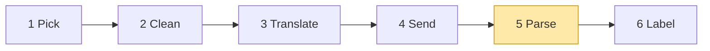
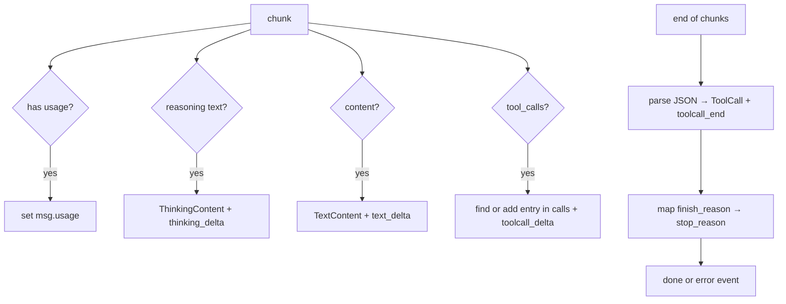

# 03 Part 1 · Parse

**Goal:** Turn streamed deltas into a complete assistant message, for all three vendors.

**Builds on:** [02 Translate + Send](02-translate-send.md) · **Next:** [04 Label + test the pipeline](04-label-test.md)

## Where we are



**Builds:** block 5 · **IN:** raw chunks · **OUT:** events, `AssistantMessage`

Big picture of Part 1: [part-1-ai](part-1-ai.md).

In [01](01-pick-clean.md#out-the-shape-of-a-model-call) we fixed the shape of a model call: a [stream function](glossary.md#stream-function) yields event dicts and ends with `done` or `error` holding the final `AssistantMessage`. In [02](02-translate-send.md) the stream function sent the request. A real model does not answer in one piece. It sends its answer in many small pieces, called **[deltas](glossary.md#delta)**. This chapter builds the code that glues those pieces back into one message.

Code in this chapter (commit `2fc2776`):

- `packages/simp_agent/src/simp_agent/ai/providers/openai_completions.py` — `parse`
- `packages/simp_agent/src/simp_agent/ai/providers/openai_responses.py` — `parse`
- `packages/simp_agent/src/simp_agent/ai/providers/anthropic.py` — `parse`
- `packages/simp_agent/tests/test_openai.py` — parser tests with fake chunks

We start with the OpenAI Chat Completions format because it is the one most servers copy (vLLM, llama.cpp, Ollama). The other two providers (`anthropic.py`, `openai_responses.py`) follow the same plan with their own input format; they come [at the end](#the-other-two-vendors).

## Problem

When you ask a server for `stream=True`, you get a list of **chunks** over time. Each chunk has a tiny `delta`. For the answer "Hello" you might get:

```text
chunk 1: delta.content = "Hel"
chunk 2: delta.content = "lo",  finish_reason = "stop"
```

A tool call is worse. Its arguments are a JSON string, and the server cuts that string anywhere. This is what the server really sends for one call to `read` with `{"path": "a"}` (each line is one chunk, cut to the `choices[0]` part):

```text
chunk 1: delta = {role: "assistant", content: null,
                  tool_calls: [{index: 0, id: "call_1", type: "function",
                                function: {name: "read", arguments: ""}}]}
chunk 2: delta = {tool_calls: [{index: 0, function: {arguments: "{\"pa"}}]}
chunk 3: delta = {tool_calls: [{index: 0, function: {arguments: "th\": \"a\"}"}}]}
chunk 4: delta = {}                          finish_reason = "tool_calls"
chunk 5: choices = []                        usage = {prompt_tokens: 7, completion_tokens: 3, ...}
```

No single chunk holds valid JSON. Only the first piece has the `id`, `type` and `name`. Later pieces have just `index` and a bit of `arguments`. The `index` tells you which call the bit belongs to. `finish_reason` comes in its own chunk with an empty `delta`. Usage comes in one more chunk at the very end, with `choices` empty. The server sends it only because we ask with `stream_options: {"include_usage": true}` (`openai_completions.py:119-120`). The rest of simp-agent wants none of this. The agent loop (ch [05](05-agent-loop.md)) wants one `AssistantMessage` with clean `TextContent` and `ToolCall` parts, a `stop_reason`, and `usage`.

So we need two things at once:

1. **Live events**, so a UI can print text as it arrives.
2. **One final message**, so the loop can act on it.

## Naive version

The first idea: add up text, add up arguments, parse at the end.

```text
FUNCTION parse(chunks):
    text = "", args = "", call_id = none, name = none
    FOR EACH chunk (wait for each one):
        d = the new part of the chunk
        IF d has text:
            ADD it to text
            SEND event {text_delta, the new text}     // UI shows it now
        FOR EACH tool-call piece in d:
            keep the first id and the first name
            ADD the piece's arguments to args          // JSON comes in pieces
    msg = assistant message with text
    IF there was a call_id:
        turn args from JSON text into an object
        ADD ToolCall(call_id, name, object) to msg
    SEND event {done, msg}
```

It works for "Hello" and for one tool call. Then it breaks:

- **Two tool calls at once.** Models often call two tools in one answer (`index` 0 and `index` 1). The naive code glues both argument strings into one, so `json.loads` fails.
- **The usage chunk.** `chunk.choices[0]` raises `IndexError` on the last chunk, which has an empty `choices` list. A stream function [must never raise](01-pick-clean.md#out-the-shape-of-a-model-call).
- **Bad JSON.** If the model writes broken arguments, `json.loads` raises and the whole call is lost.
- **No stop reason.** We always say `done`, even if the server stopped because it ran out of tokens, or the stream was cut off.
- **Thinking.** Some models send "reasoning" text before the answer. We drop it.

## Step by step: from naive to real

**Step 1 — skip chunks with no choices.** Fixes the `IndexError`:

```text
FOR each chunk:
    IF chunk has no choices: SKIP it
```

Real code: [openai_completions.py](../../packages/simp_agent/src/simp_agent/ai/providers/openai_completions.py) — `parse`

**Step 2 — one entry per tool call.** Keep a list `calls` and find the entry for each piece by `index` (then by `id`). Each call gets its own argument string, so the arguments of two calls are never mixed.

**Step 3 — parse JSON once, safely.** At the end, `json.loads` each call in `try`; bad text becomes `{"_raw": ...}` instead of an exception.

**Step 4 — map `finish_reason`.** Remember the last one seen; turn it into our `stop_reason`, and end with `error` when it is missing or unknown.

**Step 5 — thinking.** Read the reasoning field and keep it as a `ThinkingContent` before the text.

The real `parse` is these five steps together. We walk through it in four parts: text, tool calls, stop reasons, usage.

## Real design

The whole function has one job: read chunks, keep a growing message, yield events. The start:

```text
FUNCTION parse(chunks, compat):
    msg = new empty AssistantMessage
    calls = empty list          // tool calls still being built: {index, id, name, args}
    finish = none               // last finish_reason seen
    SEND event {start, partial = msg}
```

Real code: [packages/simp_agent/src/simp_agent/ai/providers/openai_completions.py](../../packages/simp_agent/src/simp_agent/ai/providers/openai_completions.py) (`parse`)

`msg` is the message we build. `start` hands it out at once as `partial`, the same object that will be in `done` later. `calls` holds tool calls that are still being built. `finish` remembers the last finish reason seen. `compat` is a dict of small switches per server; it comes from the `Model` (all keys: [ref-objects](ref-objects.md#request-objects-tool-context-model)).



### Text deltas

```text
IF d has text:
    IF the last part of msg is not a TextContent:
        IF msg has parts: SEND event {thinking_end}    // thinking is over
        ADD a new empty TextContent to msg
    ADD the text to the last part
    SEND event {text_delta, the text}
```

The rule is: **add to the last part if it is the same kind; else start a new part.** So "Hel" + "lo" becomes one `TextContent("Hello")`, not two. We also yield the small piece as a `text_delta`, so a UI can print it now.

Thinking works the same way, just before it. The server may name the field `reasoning_content`, `reasoning` or `reasoning_text`, so the code tries all three:

```text
r = the first non-empty of d.reasoning_content, d.reasoning, d.reasoning_text
IF r:
    IF the last part of msg is not a ThinkingContent:
        ADD a new empty ThinkingContent to msg
        SEND event {thinking_start}
    ADD r to the last part
    SEND event {thinking_delta, r}
```

When the first text arrives after thinking, the text branch yields `thinking_end`. The message keeps the parts in order: thinking first, then text. (`ThinkingContent` fields: [ref-objects](ref-objects.md#content-blocks).)

### Tool-call assembly from deltas

This is the hard part. A tool call arrives in pieces, and the pieces of several calls can arrive mixed together, before any of them is finished. Each piece must be matched to the right call.

```text
FOR EACH tool-call piece tc in d:
    cur = the entry in calls with the same index
    IF none: cur = the entry in calls with the same id
    IF still none:                                   // a new call
        cur = {index, id (or make "call_" + 12 hex), name = "", args = ""}
        ADD cur to calls
        SEND event {toolcall_start, name}
    IF tc has a function part:
        keep the first name seen
        IF it has arguments:
            ADD them to cur.args                     // only add up, never parse here
            SEND event {toolcall_delta, the arguments}
```

How a piece finds its call:

1. **By `index`** — the OpenAI way. Piece with `index: 1` belongs to call 1.
2. **By `id`** — some servers send no `index`, but repeat the `id`.
3. **Neither matches** — it is a new call. If the server gave no `id`, we make one (`call_` + 12 hex chars), because the tool result must point back to it later (see `ToolResultMessage.tool_call_id` in [ref-objects](ref-objects.md#messages)).

The `name` is kept from the first piece that has one. The argument text is only *added up* here, never parsed. We cannot parse until the stream ends.

After the last chunk, each call is parsed once:

```text
FOR EACH c in calls:                       // after the last chunk
    TRY: args = JSON object from c.args (empty text -> {})
    IF that fails, or it is not an object:
        args = {"_raw": c.args}            // schema check fails later -> model gets an error result
    ADD ToolCall(c.id, c.name, args) to msg
    SEND event {toolcall_end}
```

Note what happens with bad JSON. We do **not** throw the call away and we do **not** raise. We keep the raw text as `{"_raw": ...}`. Later, when the loop runs the tool, the arguments fail the tool's schema check, and the model gets an error result saying "Invalid arguments" (ch [05](05-agent-loop.md)). The model sees its mistake and can try again. `json.JSONDecodeError` is a `ValueError`, so one `except` covers both broken JSON and JSON that is not an object (like `[1, 2]`).

Empty arguments (`""`) count as `{}`, because some servers send nothing for a tool with no parameters.

### Stop reasons

The server says *why* it stopped in `finish_reason`. Each server uses its own words. We map them to our five words (`stop | tool_use | length | error | aborted`, from `AssistantMessage`, see [ref-objects](ref-objects.md#messages)):

```text
stop reason map (server word -> our word):
    stop, end             -> stop
    length                -> length
    tool_calls, function_call -> tool_use
```

Real code: [openai_completions.py](../../packages/simp_agent/src/simp_agent/ai/providers/openai_completions.py) — `_STOP`

At the end of `parse`:

```text
IF finish is none:
    IF compat.supports_finish_reason (default yes):
        stop_reason = error, error = "Stream ended without finish_reason"
    ELSE:
        stop_reason = tool_use IF there are calls ELSE stop
ELSE IF finish is in _STOP:
    stop_reason = _STOP[finish]
ELSE:
    stop_reason = error, error = "Provider finish_reason: " + finish
IF stop_reason is stop AND there are calls:      // vLLM/Ollama send "stop" with tool calls
    stop_reason = tool_use
SEND event {error IF stop_reason is error ELSE done, msg}
```

Four cases:

| Server sent | We set | Why |
|---|---|---|
| a known word | the mapped word | normal case |
| an unknown word (e.g. `content_filter`) | `error` + message | we do not guess what it means |
| nothing | `error` "Stream ended without finish_reason" | the connection was probably cut; the answer may be half |
| nothing, but `compat["supports_finish_reason"]` is `False` | `tool_use` or `stop` | some servers never send it; trust what we got |

Plus one fix: vLLM and Ollama say `stop` even when they called a tool. If we have tool calls, the stop reason becomes `tool_use`. This keeps `stop_reason` true for UIs, events and saved history. The loop itself runs tools from `tool_calls()`, not from `stop_reason` (ch [05](05-agent-loop.md)).

The last event is `error` when the stop reason is `error`, else `done`. That keeps the [stream function](glossary.md#stream-function) contract from [01](01-pick-clean.md#out-the-shape-of-a-model-call): the end event always holds the full message, and nothing is raised.

### Usage

**[Usage](glossary.md#usage)** is the token count for one call. It is needed for cost limits (ch [23](23-limits.md)) and for knowing when to compact (ch [16](16-compaction.md)).

```text
FUNCTION _usage(u):
    RETURN {input = u.prompt_tokens or 0,
            output = u.completion_tokens or 0,
            reasoning = u.completion_tokens_details.reasoning_tokens or 0}
            // reasoning is already inside output
```

Real code: [packages/simp_agent/src/simp_agent/ai/providers/openai_completions.py](../../packages/simp_agent/src/simp_agent/ai/providers/openai_completions.py) (`_usage`)

`reasoning` is for information only: it is already inside `output`, so do not add it twice.

Usage can come in two places, so `parse` checks both:

```text
usage = chunk.usage
IF the chunk has no choices:
    IF usage: msg.usage = _usage(usage)
    go to next chunk                     // the last, usage-only chunk
choice = the first choice
IF no usage yet: usage = choice.usage
IF usage: msg.usage = _usage(usage)
finish = choice.finish_reason, or keep the old one
d = choice.delta; IF d is none: go to next chunk
```

The "no choices → go to next chunk" step is also the fix for the naive `IndexError`: the final usage-only chunk has no choices. The server only sends that chunk when asked; `stream` (ch [02](02-translate-send.md)) asks with `stream_options={"include_usage": True}` unless `compat["include_usage"]` is `False`.

## The other two vendors

Parse also exists in the other two providers, `anthropic.py` and `openai_responses.py`. They yield the same events.

**OpenAI Responses.** `parse` here works like the one above, but on Responses [SSE](glossary.md#sse) events. Here is the same tool call as above (`read` with `{"path": "a"}`), cut to the events and fields we use:

```text
event: response.output_item.added
data: {"output_index": 0, "item": {"type": "function_call", "id": "fc_1", "call_id": "call_1", "name": "read", "arguments": ""}}

event: response.function_call_arguments.delta
data: {"item_id": "fc_1", "output_index": 0, "delta": "{\"pa"}

event: response.function_call_arguments.delta
data: {"item_id": "fc_1", "output_index": 0, "delta": "th\": \"a\"}"}

event: response.output_item.done
data: {"output_index": 0, "item": {"type": "function_call", "id": "fc_1", "call_id": "call_1", "name": "read", "arguments": "{\"path\": \"a\"}"}}

event: response.completed
data: {"response": {"status": "completed", "usage": {"input_tokens": 7, "output_tokens": 3, ...}}}
```

Where each event is handled in `openai_responses.py`:

| Event | Line | What `parse` does |
|---|---|---|
| `response.output_item.added` | 79-88 | new `ToolCall` with id `call_id\|id` and `name`; emits `toolcall_start` |
| `response.function_call_arguments.delta` | 105-108 | adds `delta` to a buffer; emits `toolcall_delta` |
| `response.output_item.done` | 109, 119-121 | parses the full `arguments` (falls back to the buffer); emits `toolcall_end` |
| `response.completed` | 123-131 | reads `usage`; stop reason is `tool_use` because the message has a `ToolCall` |

Unlike Chat Completions, the `.done` event carries the whole arguments string, so we do not have to trust the string we built from the pieces.

**Anthropic Messages.** The same tool call from Anthropic looks like this (cut to the fields we use):

```text
event: message_start
data: {"type": "message_start", "message": {"id": "msg_1", "role": "assistant", "content": [], "usage": {"input_tokens": 7, "output_tokens": 1}}}

event: content_block_start
data: {"type": "content_block_start", "index": 0, "content_block": {"type": "tool_use", "id": "toolu_1", "name": "read", "input": {}}}

event: content_block_delta
data: {"type": "content_block_delta", "index": 0, "delta": {"type": "input_json_delta", "partial_json": "{\"pa"}}

event: content_block_delta
data: {"type": "content_block_delta", "index": 0, "delta": {"type": "input_json_delta", "partial_json": "th\": \"a\"}"}}

event: content_block_stop
data: {"type": "content_block_stop", "index": 0}

event: message_delta
data: {"type": "message_delta", "delta": {"stop_reason": "tool_use"}, "usage": {"output_tokens": 3}}

event: message_stop
data: {"type": "message_stop"}
```

We do not read these raw events one by one. `client.messages.stream(...)` from the `anthropic` SDK reads them, builds the message for us, and also gives extra helper events: for each `input_json_delta` it gives an `input_json` event with `partial_json`, and for each `text_delta` a `text` event. Where each one is handled in `anthropic.py`:

| Event | Line | What we do |
|---|---|---|
| `message_start` | (SDK) | SDK keeps `usage.input_tokens` |
| `content_block_start` (`tool_use`) | 71-79 | emits `toolcall_start` with `name` |
| `content_block_delta` (`input_json_delta`) | 88-89 | via the SDK's `input_json` event: emits `toolcall_delta` with `partial_json` |
| `content_block_stop` | 90-92 | emits `toolcall_end` (the SDK adds the finished block as `ev.content_block`) |
| `message_delta` | (SDK) | SDK keeps `stop_reason` and `usage.output_tokens` |
| `message_stop` | (SDK), 116-119 | stream ends; `get_final_message()` gives `stop_reason` (`tool_use`) and `usage` |

During streaming, `parse` keeps partial text on `msg` (useful if the run is aborted). At the end, the provider rebuilds `msg.content` from the SDK's `get_final_message()`, which has the complete, signed blocks.


## Events at a glance

| Event | Extra keys | When |
|---|---|---|
| `start` | `partial` | first, always |
| `thinking_start` / `thinking_delta` / `thinking_end` | `delta` on delta | reasoning text |
| `text_delta` | `delta` | each text piece |
| `toolcall_start` | `name` | first piece of a new call |
| `toolcall_delta` | `delta` | each argument piece |
| `toolcall_end` | — | after the stream, once per call |
| `done` / `error` | `message` | last, always exactly one |

Note: `thinking_end` comes only when text follows the thinking. A UI must not wait for it.

Only `start`, `done` and `error` carry a message. The loop needs only the last event; the middle ones are for people watching (ch [06](06-events-abort.md)).

## Test

`packages/simp_agent/tests/test_openai.py` tests `parse` with fake chunks built from `SimpleNamespace`. No network, no API key. Three small helpers. Two make chunks:

```python
def tc(index=None, id=None, name=None, args=None):
    return NS(index=index, id=id, function=NS(name=name, arguments=args))


def ch(content=None, tool_calls=None, finish=None, usage=None):
    return NS(choices=[NS(delta=NS(content=content, tool_calls=tool_calls), finish_reason=finish)], usage=usage)
```

The third, `run`, feeds a list of chunks to `parse` and collects all events:

```python
async def run(chunks, compat=None):
    async def gen():
        for c in chunks:
            yield c

    return [e async for e in oc.parse(gen(), compat or {})]
```

`parse` reads chunks with `async for`, so `gen` turns a plain list into an async iterator. `oc` is `simp_agent.ai.providers.openai_completions`.

The tool-call example from the Problem section, as a test:

```python
async def test_tool_call_split_and_usage_chunk():
    evs = await run([
        ch(tool_calls=[tc(0, "c1", "read", '{"pa')]),
        ch(tool_calls=[tc(0, None, None, 'th": ')]),
        ch(tool_calls=[tc(0, None, None, '"a"}')], finish="tool_calls"),
        NS(choices=[], usage=NS(prompt_tokens=7, completion_tokens=3)),
    ])
    m = evs[-1]["message"]
    assert m.tool_calls() == [ToolCall("c1", "read", {"path": "a"})] and m.stop_reason == "tool_use"
    assert m.usage == {"input": 7, "output": 3, "reasoning": 0}
```

Other tests in the file cover each naive failure:

- `test_text_only` — "Hel" + "lo" gives one text "Hello".
- `test_parallel_by_index_and_by_id` — two calls by `index`; and a server with no `index` that is matched by `id`, plus a made-up `call_` id.
- `test_finish_reasons` — `stop` with tool calls becomes `tool_use`; `length`; unknown `content_filter` and a missing finish reason both give an `error` event.
- `test_bad_json_gives_validation_error` — `'{"path": '` becomes `{"_raw": ...}`, and `run_tool` (built in ch [05](05-agent-loop.md)) then returns an error result with "Invalid arguments".

Tests for the other two vendors, in `test_reasoning.py`:

- `test_responses_stream_thinking_text_toolcall` — Responses parsing.
- `test_anthropic_thinking_and_signature_delta` — Anthropic thinking and signature.

Run them:

```bash
uv run pytest packages/simp_agent/tests/test_openai.py packages/simp_agent/tests/test_reasoning.py
```

> **Why this way**
>
> We build the message *while* streaming, and hand out the same object as `partial` at `start` and as `message` at the end. One pass, one object, no second "assemble" step that could get out of sync with the events.
>
> We never raise inside `parse`. Every problem — cut stream, odd finish reason, broken JSON — becomes data: an `error` stop reason, or `{"_raw": ...}` arguments. The loop then has one simple rule: read the last event. And the model gets to see and fix its own bad tool calls, instead of the whole run crashing.


## Exercises

1. Write a test with two tool calls whose pieces are mixed: `index` 0, then 1, then 0, then 1. Check both `ToolCall`s come out with the right arguments.
2. Send the chunks for "Hello" with no `finish_reason`. What is the last event? Now pass `compat={"supports_finish_reason": False}`. What changes?

## Recap

- A real model streams small **deltas**; `parse` glues them into one `AssistantMessage` and yields live events on the way.
- Text and thinking pieces join the last part of the same kind.
- Tool-call pieces are matched to a call by `index`, then by `id`; arguments are parsed once, at the end. Bad JSON becomes `{"_raw": ...}`.
- `finish_reason` maps to our `stop_reason`; a missing or unknown one is an `error`. `stop` with tool calls becomes `tool_use`.
- Usage can come in a chunk with no choices.
- It never raises; the last event is always `done` or `error`.

- OpenAI Responses and Anthropic follow the same plan on their own [SSE](glossary.md#sse) events; Anthropic takes the final, signed blocks from the SDK's `get_final_message()`.

**Builds on:** [02 Translate + Send](02-translate-send.md) · **Next:** [04 Label + test the pipeline](04-label-test.md) — `ai.stream` labels every message, and we test the whole pipeline without a real model.

**OUT →** events are the IN of block 6 Label (ch 04).
