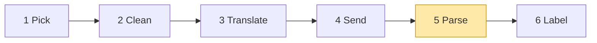

# 03 Part 1 · Parse

**Goal:** Turn streamed deltas into a complete assistant message, for all three vendors.

**Builds on:** [02 Translate + Send](02-translate-send.md) · **Next:** [04 Label + test the pipeline](04-label-test.md)

## Where we are



**Builds:** block 5 · **IN:** raw chunks · **OUT:** events, `AssistantMessage`

Big picture of Part 1: [part-1-ai](01-0-part-1-ai.md).

In [01](01-pick-clean.md#out-the-shape-of-a-model-call) we fixed the shape of a model call: a [stream function](glossary.md#stream-function) yields event dicts and ends with `done` or `error` holding the final `AssistantMessage`. In [02](02-translate-send.md) the stream function sent the request. A real model does not answer in one piece. It sends its answer in many small pieces, called **[deltas](glossary.md#delta)**. This chapter builds the code that glues those pieces back into one message.

Code in this chapter (commit `2fc2776`):

- `packages/simp_agent/src/simp_agent/ai/providers/openai_completions.py` — `parse`
- `packages/simp_agent/src/simp_agent/ai/providers/openai_responses.py` — `parse`
- `packages/simp_agent/src/simp_agent/ai/providers/anthropic.py` — `parse`
- `packages/simp_agent/tests/test_openai.py` — parser tests with fake chunks

## Problem and goal

When you ask a server for `stream=True`, you get a list of **chunks** over time. Here is one full raw chunk:

```json
{"choices": [{"index": 0, "delta": {"role": "assistant", "content": "Hi"}, "finish_reason": null}]}
```

**[`choices`](glossary.md#choices)** is the list of answers. We ask for only one answer, so we always read `choices[0]`. Each choice holds a `delta` (the new piece of the answer: text or a tool-call piece), a `finish_reason` (why the model stopped; `null` until the end), and an `index` (the place of this answer in the list, always `0` for us). `usage` is **not** inside `choices`. It sits on the chunk itself, next to `choices`.

Only Chat Completions has `choices`. OpenAI Responses and Anthropic send named events instead ([The other two vendors](#the-other-two-vendors)).

Here is a real answer: the model says "Hi" and then calls `read` with `{"path": "a"}`. Each line is one chunk. We show the chunks because their exact shape is the problem this chapter solves. To keep the lines short, they show only `choices[0]`:

```text
chunk 1: delta = {role: "assistant", content: "Hi"}
chunk 2: delta = {tool_calls: [{index: 0, id: "call_1", type: "function",
                                function: {name: "read", arguments: ""}}]}
chunk 3: delta = {tool_calls: [{index: 0, function: {arguments: "{\"pa"}}]}
chunk 4: delta = {tool_calls: [{index: 0, function: {arguments: "th\": \"a\"}"}}]}
chunk 5: delta = {}                          finish_reason = "tool_calls"
chunk 6: choices = []                        usage = {prompt_tokens: 7, completion_tokens: 3, ...}
```

No single chunk holds valid JSON. Only the first tool piece has the `id` and `name`. `finish_reason` comes in its own chunk, and chunk 6 has no answer piece at all: `choices` is empty and it only carries `usage`. The rest of simp-agent wants none of this. So `parse` must turn these chunks into two things at once:

1. **Live events**, so a UI can print text as it arrives.
2. **One final [`AssistantMessage`](glossary.md#assistantmessage)**, so the agent loop (ch [05](05-agent-loop.md)) can act on it: clean `TextContent` and `ToolCall` blocks, a `stop_reason`, and `usage`.

### The events

All three parsers yield the same [events](glossary.md#stream-event):

| Event | Extra keys | When |
|---|---|---|
| `start` | `partial` | first, always |
| `thinking_start` / `thinking_delta` / `thinking_end` | `thinking_delta` has `delta` | reasoning text |
| `text_delta` | `delta` | each text piece |
| `toolcall_start` | `name` | first piece of a new call |
| `toolcall_delta` | `delta` | each argument piece |
| `toolcall_end` | — | once per call, when its arguments are complete |
| `done` / `error` | `message` | last, always exactly one |

Only `start`, `done` and `error` carry a message. `partial` and `message` are the **same object**: we build it while we read. The loop needs only the last event; the middle ones are for people watching (ch [06](06-events-abort.md)).

### The goal, worked out

For the six chunks above, `parse` must yield:

```text
{type: start, partial: msg}
{type: text_delta,     delta: "Hi"}          // chunk 1
{type: toolcall_start, name: "read"}         // chunk 2
{type: toolcall_delta, delta: "{\"pa"}       // chunk 3
{type: toolcall_delta, delta: "th\": \"a\"}"}  // chunk 4
                                             // chunk 5: only remembers finish_reason
                                             // chunk 6: only sets usage
{type: toolcall_end}                         // after the last chunk
{type: done, message: msg}
```

and at the end `msg` holds `content = [TextContent("Hi"), ToolCall("call_1", "read", {"path": "a"})]`, `stop_reason = "tool_use"` and `usage = {input: 7, output: 3, reasoning: 0}`.

The rest of this chapter builds the code that does this, one problem at a time.

## Build the Chat Completions parser

We start with OpenAI Chat Completions because most servers copy it (vLLM, llama.cpp, Ollama). Real code for every step: [openai_completions.py](../../packages/simp_agent/src/simp_agent/ai/providers/openai_completions.py) — `parse`.

The frame: make an empty message, hand it out at once, then read chunks. It also takes `compat`, a dict of small switches per server; it comes from the `Model` (all keys: [ref-objects](ref-objects.md#request-objects-tool-context-model)). `parse` uses it only for the stop reason. For each chunk the real code reads usage, then thinking, then text, then tool calls. We teach them in a different order, easiest first.

1. Make an empty `AssistantMessage`, `msg`. Make an empty list `calls` for the tool calls still being built (each one holds `index`, `id`, `name` and `args`), and set `finish` (the last `finish_reason` seen) to none.
2. Send `start` with `partial = msg`.
3. For each chunk, read usage, thinking, text and tool-call pieces (steps 1–4 and [Usage](#usage) below).
4. At the end, parse the tool arguments and set the stop reason (steps 5 and 6).

### What one chunk holds

Each chunk carries one new piece in `chunk.choices[0].delta` (the chunk shape is [above](#problem-and-goal)). We call it **`d`**. `d` can hold:

- `d.content` — a piece of answer text, like `"Hel"`.
- `d.reasoning_content` — a piece of thinking text.
- `d.tool_calls` — pieces of tool calls.

The message we build, `msg`, holds a list of **[content blocks](glossary.md#assistantmessage)** in order (`msg.content`), for example `[ThinkingContent, TextContent]`. Each piece is added to the right block. While we read chunks, this list only gets thinking and text blocks; tool calls are added after the last chunk.

### Step 1 — thinking

**Problem.** Some models send reasoning text before the answer, and each server names the field differently: `reasoning_content`, `reasoning` or `reasoning_text`.

**What we do.** Take the first of the three that has text; call it `r`. If the last block is already a `ThinkingContent`, add `r` to it; else start a new one. A new thinking block sends `thinking_start` first, so the UI can open its "thinking…" box. Then each piece is sent as `thinking_delta`.

Chunks `reasoning_content="Let me"`, `reasoning_content=" look"` give `thinking_start`, `thinking_delta "Let me"`, `thinking_delta " look"` and `content = [ThinkingContent("Let me look")]`. (`ThinkingContent` fields: [ref-objects](ref-objects.md#content-blocks).)

### Step 2 — text

**Problem.** "Hello" can come as `"Hel"` then `"lo"`. We want one `TextContent("Hello")`, not two, and the UI wants each piece now.

**What we do.** `"Hel"` and `"lo"` go into the same text block, and each piece is sent at once as `text_delta`. If the last block is a `ThinkingContent`, the first text piece starts a new text block, and we send `thinking_end` first.

| Piece in `d` | `msg.content` after | Events sent |
|---|---|---|
| `reasoning_content = "Let me look"` | `[ThinkingContent("Let me look")]` | `thinking_start`, `thinking_delta` |
| `content = "Hel"` | `[ThinkingContent(...), TextContent("Hel")]` | `thinking_end`, `text_delta "Hel"` |
| `content = "lo"` | `[ThinkingContent(...), TextContent("Hello")]` | `text_delta "lo"` (same block) |

Chat Completions has no "thinking stopped" signal. We only know thinking is over when text starts, so `thinking_end` comes from the text branch. If the model thinks and then only calls a tool, no `thinking_end` is sent, so a UI must not wait for it.

With no thinking: `"Hel"`, `"lo"` → events `text_delta "Hel"`, `text_delta "lo"` → `content = [TextContent("Hello")]`.

### Step 3 — one tool call

**Problem.** The arguments are a JSON string cut anywhere. Only the first piece has `id` and `name`; later pieces have just `index` and a bit of `arguments`.

**What we do.** `d.tool_calls` is a list; we call each piece in it `tc`. Keep one entry per [tool call](glossary.md#tool-call) in `calls` (the list made in the frame); `cur` is the entry this piece belongs to. A new call sends `toolcall_start`; each argument piece is *added up* (never parsed yet) and sent as `toolcall_delta`. The name is the first one seen. If the server gave no `id`, we make one: `"call_"` plus 12 hex characters.

This is chunks 2–4 of the example: `toolcall_start "read"`, then two `toolcall_delta`s, and `cur.args` grows to `{"path": "a"}`. We make an `id` when there is none because the tool result must point back to it later (`ToolResultMessage.tool_call_id`, see [ref-objects](ref-objects.md#messages)).

### Step 4 — two tool calls at once

**Problem.** Models often call two tools in one answer, and the pieces come mixed. The exact chunks show how:

```text
chunk a: tool_calls: [{index: 0, id: "c1", function: {name: "read", arguments: "{\"path\":"}}]
chunk b: tool_calls: [{index: 1, id: "c2", function: {name: "read", arguments: "{\"path\":"}}]
chunk c: tool_calls: [{index: 0, function: {arguments: " \"a\"}"}}]}
chunk d: tool_calls: [{index: 1, function: {arguments: " \"b\"}"}}]}
```

If we kept one `args` string, we would get `{"path": {"path": "a"} "b"}` — broken.

**What we do.** Find the right entry for each piece:

1. **By `index`** — the OpenAI way. A piece with `index: 1` belongs to call 1.
2. **By `id`** — some servers send no `index`, but repeat the `id`.
3. **Neither matches** — it is a new call (step 3).

So chunk c goes to call 0 and chunk d to call 1: `c1.args = {"path": "a"}`, `c2.args = {"path": "b"}`. Events: `toolcall_start`, `toolcall_delta`, `toolcall_start`, `toolcall_delta`, `toolcall_delta`, `toolcall_delta`. The deltas carry no index, so a UI only sees "more argument text".

### Step 5 — end of stream: parse the JSON safely

**Problem.** We can only parse when the stream ends. And the model may write broken JSON; `json.loads` would raise, and a stream function [must never raise](01-pick-clean.md#out-the-shape-of-a-model-call).

**What we do.** After the last chunk, parse each call once. Try to read `c.args` as a JSON object (empty text counts as `{}`). If that fails, or the result is not an object, use `{"_raw": c.args}` instead. Add `ToolCall(c.id, c.name, args)` to `msg` and send `toolcall_end`.

Example: `c.args = '{"path": '` (cut off) → `ToolCall("c1", "read", {"_raw": '{"path": '})`.

We do **not** throw the call away. When the loop runs the tool, `{"_raw": ...}` fails the tool's schema check, and the model gets an error result "Invalid arguments" (ch [05](05-agent-loop.md)). The model sees its mistake and can try again. Empty arguments (`""`) count as `{}`, because some servers send nothing for a tool with no parameters. `[1, 2]` is valid JSON but not an object, so it also becomes `_raw`.

### Step 6 — why did it stop? `finish_reason` → `stop_reason`

**Problem.** The server says why it stopped in `finish_reason`, in its own words. We need one of our five (`stop | tool_use | length | error | aborted`, from `AssistantMessage`). And sometimes the server sends nothing.

**What we do.** In the loop, remember the last `finish_reason` seen (`finish = choice.finish_reason or finish`, where `choice` is `chunk.choices[0]`). At the end, map it with `_STOP`, a small dict in the code from the server's word to ours: `stop` and `end` give `stop`, `length` gives `length`, and `tool_calls` and `function_call` give `tool_use`. Then:

1. If there was no `finish_reason`: when `compat.supports_finish_reason` is true (the default), the stop reason is `error` with "Stream ended without finish_reason"; else it is `tool_use` if there are calls, or `stop`.
2. If the word is in `_STOP`, use `_STOP[finish]`.
3. Otherwise the stop reason is `error`, with "Provider finish_reason: " plus the word.
4. If the result is `stop` but there are calls, it becomes `tool_use`.
5. Send `error` if the stop reason is `error`, else `done`, with `msg`.

An unknown word such as `content_filter` gives `error`, because we do not guess what it means. No word at all also gives `error`: the connection was probably cut, and the answer may be half. Some servers never send a finish reason; for them `supports_finish_reason` is `False`, and we trust what we got, so `"Hi"` alone gives `stop`. Last, vLLM and Ollama send `stop` even with tool calls, and we turn it into `tool_use`. This keeps `stop_reason` true for UIs and saved history (the loop itself runs tools from `tool_calls()`, not from `stop_reason`).

The last event is `error` when the stop reason is `error`, else `done`. That is the [stream function](glossary.md#stream-function) contract from [01](01-pick-clean.md#out-the-shape-of-a-model-call): the end event always holds the full message, and nothing is raised.

### Usage

**Problem.** **[Usage](glossary.md#usage)** (the token count for one call) is needed for cost limits (ch [23](23-limits.md)) and for knowing when to compact (ch [16](16-compaction.md)). It comes in a last chunk with `choices = []` — so `chunk.choices[0]` would raise `IndexError`. Some servers put it on the choice instead.

**What we do.** This runs first for every chunk:

1. If the chunk has no choices, it is the last, usage-only chunk: set `msg.usage` from `chunk.usage` (if any) and go to the next chunk.
2. Else take the first choice. Use `chunk.usage`, or `choice.usage` if the chunk has none, and set `msg.usage` from it.
3. Keep `choice.finish_reason` as `finish` if it is set.
4. Take `d = choice.delta`; if there is none, go to the next chunk.

`_usage(u)` turns the server's counts into ours: `input` from `prompt_tokens`, `output` from `completion_tokens`, and `reasoning` from `completion_tokens_details.reasoning_tokens` (each one 0 if missing).

Chunk 6 of the example (`choices = []`, `prompt_tokens: 7, completion_tokens: 3`) → `msg.usage = {input: 7, output: 3, reasoning: 0}`. `reasoning` is for information only: it is already inside `output`, so do not add it twice. The server sends the usage chunk only when asked; `stream` (ch [02](02-translate-send.md)) asks with `stream_options={"include_usage": True}` unless `compat["include_usage"]` is `False`.

Run the six chunks from the top through these steps and you get the events and message of [the goal](#the-goal-worked-out).

## The other two vendors

The goal does not change. Responses and Anthropic must give the **same events** and the **same `AssistantMessage`** as Chat Completions. Only the wrapping of the pieces is different.

Where each thing comes from, in the three APIs:

| What we need | Chat Completions | OpenAI Responses | Anthropic (through the SDK) |
|---|---|---|---|
| a text piece | `choices[0].delta.content` | `response.output_text.delta` event | `text` event |
| a tool-arg piece | `choices[0].delta.tool_calls[i].function.arguments` | `response.function_call_arguments.delta` event | `input_json` event (`partial_json`) |
| the end of a block | not sent; we guess it | `response.output_item.done` event | `content_block_stop` event |
| the stop reason | `choices[0].finish_reason` | `status` of `response.completed` / `incomplete` / `failed` | `stop_reason` of `get_final_message()` |
| the usage | `chunk.usage` (last chunk, `choices = []`) | `usage` of `response.completed` | `usage` of `get_final_message()` |

### OpenAI Responses: named events

Real code: [openai_responses.py](../../packages/simp_agent/src/simp_agent/ai/providers/openai_responses.py) — `parse`.

Responses sends **[SSE](glossary.md#sse)** events. SSE (server-sent events) is a simple way for a server to send many small messages over one open HTTP answer. Here, each event has a name in `type`. The answer is a list of [items](glossary.md#item-responses). One real event looks like this:

```json
{"type": "response.output_text.delta", "item_id": "msg_1", "output_index": 0, "content_index": 0, "delta": "Hi"}
```

**Example 1: the text answer "Hi!"**

```text
response.output_item.added       item: {type: message, id: "msg_1"}   → new TextContent (no event)
response.output_text.delta       delta: "Hi"                          → text_delta "Hi"
response.output_text.delta       delta: "!"                           → text_delta "!"
response.output_item.done        item: {..., content: [{text: "Hi!"}]} → text = "Hi!" (the full text wins)
response.completed               status: completed                    → stop_reason stop, done
```

**Example 2: the same `read` call**

```text
response.output_item.added            item: {type: function_call, id: "fc_1", call_id: "call_1", name: "read"}
                                        → toolcall_start "read"
response.function_call_arguments.delta  delta: "{\"pa"        → toolcall_delta
response.function_call_arguments.delta  delta: "th\": \"a\"}"  → toolcall_delta
response.output_item.done             item: {..., arguments: "{\"path\": \"a\"}"}
                                        → ToolCall("call_1|fc_1", "read", {"path": "a"}), toolcall_end
response.completed                    status: completed, usage: {input_tokens: 7, output_tokens: 3}
                                        → stop_reason tool_use, done
```

**The rules.** Each item has a clear start (`response.output_item.added`) and a clear end (`response.output_item.done`). So most of the hard work of Chat Completions goes away. Let us follow the stream in time order.

An item starts with `response.output_item.added`, and `parse` starts a new block for it. Items come one after another, so `parse` keeps just one "current" block. There is no matching by index. A tool call item has two ids: a `call_id` and an item id (`fc_...`). We keep both as `ToolCall.id = "call_1|fc_1"`; ch 02 explains why.

Next come the pieces. Each `.delta` event adds a text, thinking or argument piece to the current block.

Then the item's `.done` event comes. This gives a clear end, so `thinking_end` and `toolcall_end` come from it and we do not guess them. The `.done` item also wins over the pieces: it carries the full text, thinking or `arguments`, and that replaces what we added up. For a tool call, if `arguments` is empty, we keep the pieces we added up. At this point we also save data for replay (the signature). A reasoning item is saved whole as JSON in `ThinkingContent.signature`, and a message item saves `{v, id, phase}` in `TextContent.signature`. Ch 02 reads these back to send the items again ([Responses](02-translate-send.md#responses-to_input)).

Last comes `response.completed`, and its status gives the stop reason: `tool_use` if the message has a `ToolCall`, else `stop`. If the status is `incomplete` because of `max_output_tokens`, we get `length`. Anything else (`failed`, or an `error` event) gives `error`. If `response.completed` never comes, we also get `error`, with "Stream ended without response.completed". The usage comes with `response.completed` too: `input` and `output` tokens, and `reasoning` from `output_tokens_details.reasoning_tokens` (0 if missing).

### Anthropic: the SDK builds the message

Real code: [anthropic.py](../../packages/simp_agent/src/simp_agent/ai/providers/anthropic.py) — `parse` and `stream`.

Here we use the **[SDK](glossary.md#sdk)** (software development kit): the official Python library `anthropic`, made by the vendor. Its `client.messages.stream(...)` reads the raw SSE events for us. It gives back the raw events plus easy helper events: `text`, `thinking`, `signature` and `input_json`. One real raw event looks like this:

```json
{"type": "content_block_start", "index": 1, "content_block": {"type": "tool_use", "id": "toolu_1", "name": "read", "input": {}}}
```

**Example 1: the text answer "Hi!"** (`start` is sent by `stream` before these events.)

```text
content_block_start  {type: text}                     → new TextContent (no event)
text                 text: "Hi"                       → text_delta "Hi"
text                 text: "!"                        → text_delta "!"
content_block_stop   (text)                           → (no event)
get_final_message()  stop_reason: end_turn            → stop_reason stop, done
```

**Example 2: the same `read` call**

```text
content_block_start  {type: tool_use, id: "toolu_1", name: "read"}  → toolcall_start "read"
input_json           partial_json: "{\"pa"                           → toolcall_delta
input_json           partial_json: "th\": \"a\"}"                    → toolcall_delta
content_block_stop   (tool_use)                                      → toolcall_end
get_final_message()  stop_reason: tool_use, usage: {input: 7, output: 3} → done
```

**The rules.** Two jobs are split between two functions: `parse` forwards events while the stream runs, and the SDK builds the final message at the end. Let us follow the stream in time order.

First, `stream` (not `parse`) sends `start`. It makes `msg`, yields `start`, and then passes `msg` into `parse`. So `stream` still holds `msg` when something fails: its `except` puts the error on the same `msg` and yields `error`. Also, `start` is sent even if the connection fails before any event.

While the pieces come, `parse` turns SDK events into our events. It also keeps partial text, thinking and signature on `msg` as they come. **[Signed thinking](glossary.md#signed-thinking)** matters here: Anthropic signs each thinking block, and the `signature` event brings the signature. We must send the block back with the same signature next turn ([ch 02](02-translate-send.md)), so we save it. `parse` does not parse JSON or map stop reasons; `stream` does that at the end.

At the end, `stream` calls **[`get_final_message()`](glossary.md#get_final_message)**. This SDK method returns the full answer that the SDK built from all the events, with the full signed thinking blocks. `stream` replaces `msg.content` with its content, takes `stop_reason` and `usage`, puts them on `msg`, and yields `done`. The `stop_reason` is mapped: `end_turn`/`stop_sequence` → `stop`, `tool_use` → `tool_use`, `max_tokens` → `length`. An unknown word falls back to `stop`, which is a safe default because the SDK already gave a complete message. The `usage` has only `input` and `output`, no `reasoning`.

Why keep partial blocks in `parse` if the SDK content replaces them? If the [run](glossary.md#run-agent) is aborted in the middle, `get_final_message()` is never called, and the partial `msg` is all we have. If the run ends normally, the SDK content replaces `msg.content`, and the partial blocks are thrown away. So the two do not fight: one is for the normal end, one is for an abort.

**Builds on:** [02 Translate + Send](02-translate-send.md) · **Next:** [04 Label + test the pipeline](04-label-test.md) — `ai.stream` labels every message, and we test the whole pipeline without a real model.

**OUT →** events are the IN of block 6 Label (ch [04](04-label-test.md)).
