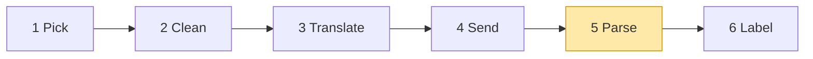

# 03 Part 1 · Parse

**Goal:** Turn streamed deltas into a complete assistant message, for all three vendors.

**Builds on:** [02 Translate + Send](02-translate-send.md) · **Next:** [04 Label + test the pipeline](04-label-test.md)

## Where we are



**Builds:** block 5 · **IN:** raw chunks · **OUT:** events, `AssistantMessage`

Big picture of Part 1: [part-1-ai](part-1-ai.md).

In [01](01-pick-clean.md#out-the-shape-of-a-model-call) we fixed the shape of a model call: a [stream function](glossary.md#stream-function) yields event dicts and ends with `done` or `error` holding the final `AssistantMessage`. In [02](02-translate-send.md) the stream function sent the request. A real model does not answer in one piece. It sends its answer in many small pieces, called **[deltas](glossary.md#delta)**. This chapter builds the code that glues those pieces back into one message.

Code in this chapter (commit `2fc2776`):

- `packages/simp_agent/src/simp_agent/ai/providers/openai_completions.py` — `parse`
- `packages/simp_agent/src/simp_agent/ai/providers/openai_responses.py` — `parse`
- `packages/simp_agent/src/simp_agent/ai/providers/anthropic.py` — `parse`
- `packages/simp_agent/tests/test_openai.py` — parser tests with fake chunks

## Problem and goal

When you ask a server for `stream=True`, you get a list of **chunks** over time. Here is one full raw chunk:

```json
{"choices": [{"index": 0, "delta": {"role": "assistant", "content": "Hi"}, "finish_reason": null}]}
```

**[`choices`](glossary.md#choices)** is the list of answers. We ask for only one answer, so we always read `choices[0]`. Each choice holds:

- `delta` — the new piece of the answer (text or a tool-call piece);
- `finish_reason` — why the model stopped; it is `null` until the end;
- `index` — the place of this answer in the list (always `0` for us).

`usage` is **not** inside `choices`. It sits on the chunk itself, next to `choices`.

Only Chat Completions has `choices`. OpenAI Responses and Anthropic send named events instead (see [The other two vendors](#the-other-two-vendors) below).

Here is a real answer: the model says "Hi" and then calls `read` with `{"path": "a"}`. Each line is one chunk. To keep the lines short, they show only `choices[0]`:

```text
chunk 1: delta = {role: "assistant", content: "Hi"}
chunk 2: delta = {tool_calls: [{index: 0, id: "call_1", type: "function",
                                function: {name: "read", arguments: ""}}]}
chunk 3: delta = {tool_calls: [{index: 0, function: {arguments: "{\"pa"}}]}
chunk 4: delta = {tool_calls: [{index: 0, function: {arguments: "th\": \"a\"}"}}]}
chunk 5: delta = {}                          finish_reason = "tool_calls"
chunk 6: choices = []                        usage = {prompt_tokens: 7, completion_tokens: 3, ...}
```

Chunk 6 is different: it has no answer piece, so `choices` is empty, and it only carries `usage` (see [Usage](#usage) below).

No single chunk holds valid JSON. Only the first tool piece has the `id` and `name`. `finish_reason` comes in its own chunk, and usage in one more chunk with `choices` empty. The rest of simp-agent wants none of this. So `parse` must turn these chunks into two things at once:

1. **Live events**, so a UI can print text as it arrives.
2. **One final [`AssistantMessage`](glossary.md#assistantmessage)**, so the agent loop (ch [05](05-agent-loop.md)) can act on it: clean `TextContent` and `ToolCall` parts, a `stop_reason`, and `usage`.

### The events

All three parsers yield the same [events](glossary.md#stream-event):

| Event | Extra keys | When |
|---|---|---|
| `start` | `partial` | first, always |
| `thinking_start` / `thinking_delta` / `thinking_end` | `thinking_delta` has `delta` | reasoning text |
| `text_delta` | `delta` | each text piece |
| `toolcall_start` | `name` | first piece of a new call |
| `toolcall_delta` | `delta` | each argument piece |
| `toolcall_end` | — | once per call, when its arguments are complete |
| `done` / `error` | `message` | last, always exactly one |

Only `start`, `done` and `error` carry a message. `partial` and `message` are the **same object**: we build it while we read. The loop needs only the last event; the middle ones are for people watching (ch [06](06-events-abort.md)). `thinking_end` does not always come (see below), so a UI must not wait for it.

### The goal, worked out

For the six chunks above, `parse` must yield:

```text
{type: start, partial: msg}
{type: text_delta,     delta: "Hi"}          // chunk 1
{type: toolcall_start, name: "read"}         // chunk 2
{type: toolcall_delta, delta: "{\"pa"}       // chunk 3
{type: toolcall_delta, delta: "th\": \"a\"}"}  // chunk 4
                                             // chunk 5: only remembers finish_reason
                                             // chunk 6: only sets usage
{type: toolcall_end}                         // after the last chunk
{type: done, message: msg}
```

and `msg` at the end is:

```text
AssistantMessage(
    content     = [TextContent("Hi"), ToolCall("call_1", "read", {"path": "a"})],
    stop_reason = "tool_use",
    usage       = {input: 7, output: 3, reasoning: 0})
```

The rest of this chapter builds the code that does this, one problem at a time.

## Build the Chat Completions parser

We start with OpenAI Chat Completions because most servers copy it (vLLM, llama.cpp, Ollama). Real code for every step: [openai_completions.py](../../packages/simp_agent/src/simp_agent/ai/providers/openai_completions.py) — `parse`.

We teach text first because it is the easiest; the real code reads usage, then thinking, then text, then tool calls in each chunk.

The frame: make an empty message, hand it out at once, then read chunks. It also takes `compat`, a dict of small switches per server; it comes from the `Model` (all keys: [ref-objects](ref-objects.md#request-objects-tool-context-model)). `parse` uses it only in step 6.

```text
FUNCTION parse(chunks, compat):
    msg = new empty AssistantMessage
    calls = empty list          // tool calls still being built: {index, id, name, args}
    finish = none               // last finish_reason seen
    SEND event {start, partial = msg}
    FOR EACH chunk (wait for each one):
        ... usage first, then steps 2, 1, 3, 4 ...
    ... steps 5, 6 at the end ...
```

### What one chunk holds

Each chunk carries one new piece in `chunk.choices[0].delta` (the chunk shape is [above](#problem-and-goal)). In the code and below we call it **`d`**. `d` can hold:

- `d.content` — a piece of answer text, like `"Hel"`.
- `d.reasoning_content` — a piece of thinking text (step 2).
- `d.tool_calls` — pieces of tool calls (steps 3 and 4).

The message we build, `msg`, holds a list of **parts** in order (`msg.content`), for example `[ThinkingContent, TextContent]`. Each piece is added to the right part. While we read chunks, this list only gets thinking and text parts; tool calls are added at the end (step 5).

### Step 1 — text

**Problem.** "Hello" can come as `"Hel"` then `"lo"`. We want one `TextContent("Hello")`, not two, and the UI wants each piece now.

**What we do.** Normally, `"Hel"` and `"lo"` go into the same text part, and each piece is sent at once as `text_delta`. But some models think first (step 2). Then the last part is a `ThinkingContent`, and the first text piece tells us thinking is over. So we send `thinking_end` (the UI closes its "thinking…" box), and start a new text part.

| Piece in `d` | `msg.content` after | Events sent |
|---|---|---|
| `reasoning_content = "Let me look"` | `[ThinkingContent("Let me look")]` | `thinking_start`, `thinking_delta` |
| `content = "Hel"` | `[ThinkingContent(...), TextContent("Hel")]` | `thinking_end`, `text_delta "Hel"` |
| `content = "lo"` | `[ThinkingContent(...), TextContent("Hello")]` | `text_delta "lo"` (same part) |

The code, as a recap:

```text
IF d.content:                                          // d has a text piece
    IF the last part of msg is not a TextContent:      // first text piece
        IF msg has parts: SEND event {thinking_end}    // it was thinking; thinking is over
        ADD a new empty TextContent to msg
    ADD d.content to the last part
    SEND event {text_delta, d.content}
```

With no thinking: `"Hel"`, `"lo"` → events `text_delta "Hel"`, `text_delta "lo"` → `content = [TextContent("Hello")]`.

### Step 2 — thinking

**Problem.** Some models send reasoning text before the answer, and each server names the field differently: `reasoning_content`, `reasoning` or `reasoning_text`.

**What we do.** Take the first of the three that has text; call it `r`. Then use the same "join the last part" rule with `ThinkingContent`. A new thinking part sends `thinking_start` first, so the UI can open its "thinking…" box:

```text
r = the first non-empty of d.reasoning_content, d.reasoning, d.reasoning_text
IF r:
    IF the last part of msg is not a ThinkingContent:
        ADD a new empty ThinkingContent to msg
        SEND event {thinking_start}
    ADD r to the last part
    SEND event {thinking_delta, r}
```

Chunks `reasoning_content="Let me"`, `reasoning_content=" look"`, `content="Hi"` give:

```text
thinking_start, thinking_delta "Let me", thinking_delta " look",
thinking_end, text_delta "Hi"
→ content = [ThinkingContent("Let me look"), TextContent("Hi")]
```

There is no "thinking stopped" signal in Chat Completions. We only know thinking is over when text starts, so `thinking_end` comes from the text branch. If the model thinks and then only calls a tool, no `thinking_end` is sent. (`ThinkingContent` fields: [ref-objects](ref-objects.md#content-blocks).)

### Step 3 — one tool call

**Problem.** The arguments are a JSON string cut anywhere. Only the first piece has `id` and `name`; later pieces have just `index` and a bit of `arguments`.

**What we do.** `d.tool_calls` is a list; we call each piece in it `tc`. Keep one entry per [tool call](glossary.md#tool-call) in `calls` (the list made in the frame); `cur` is the entry this piece belongs to. A new call sends `toolcall_start`; each argument piece is *added up* (never parsed yet) and sent as `toolcall_delta`.

```text
FOR EACH tool-call piece tc in d.tool_calls:
    cur = the entry in calls for this piece      // step 4 says how
    IF none:                                     // a new call
        cur = {index, id (or make "call_" + 12 hex), name = "", args = ""}
        ADD cur to calls
        SEND event {toolcall_start, name}
    keep the first name seen
    IF tc has arguments:
        ADD them to cur.args
        SEND event {toolcall_delta, the arguments}
```

This is chunks 2–4 of the example: `toolcall_start "read"`, then two `toolcall_delta`s, and `cur.args` grows to `{"path": "a"}`. If the server gave no `id`, we make one, because the tool result must point back to it later (`ToolResultMessage.tool_call_id`, see [ref-objects](ref-objects.md#messages)).

### Step 4 — two tool calls at once

**Problem.** Models often call two tools in one answer, and the pieces come mixed:

```text
chunk a: tool_calls: [{index: 0, id: "c1", function: {name: "read", arguments: "{\"path\":"}}]
chunk b: tool_calls: [{index: 1, id: "c2", function: {name: "read", arguments: "{\"path\":"}}]
chunk c: tool_calls: [{index: 0, function: {arguments: " \"a\"}"}}]}
chunk d: tool_calls: [{index: 1, function: {arguments: " \"b\"}"}}]}
```

If we kept one `args` string, we would get `{"path": {"path": "a"} "b"}` — broken.

**What we do.** Find the right entry for each piece:

1. **By `index`** — the OpenAI way. A piece with `index: 1` belongs to call 1.
2. **By `id`** — some servers send no `index`, but repeat the `id`.
3. **Neither matches** — it is a new call (step 3).

So chunk c goes to call 0 and chunk d to call 1: `c1.args = {"path": "a"}`, `c2.args = {"path": "b"}`. Events: `toolcall_start`, `toolcall_delta`, `toolcall_start`, `toolcall_delta`, `toolcall_delta`, `toolcall_delta`. The deltas carry no index, so a UI only sees "more argument text".

### Step 5 — end of stream: parse the JSON safely

**Problem.** We can only parse when the stream ends. And the model may write broken JSON; `json.loads` would raise, and a stream function [must never raise](01-pick-clean.md#out-the-shape-of-a-model-call).

**What we do.** After the last chunk, parse each call once:

```text
FOR EACH c in calls:                       // after the last chunk
    TRY: args = JSON object from c.args (empty text -> {})
    IF that fails, or it is not an object:
        args = {"_raw": c.args}
    ADD ToolCall(c.id, c.name, args) to msg
    SEND event {toolcall_end}
```

Example: `c.args = '{"path": '` (cut off) → `ToolCall("c1", "read", {"_raw": '{"path": '})`.

We do **not** throw the call away. When the loop runs the tool, `{"_raw": ...}` fails the tool's schema check, and the model gets an error result "Invalid arguments" (ch [05](05-agent-loop.md)). The model sees its mistake and can try again. Empty arguments (`""`) count as `{}`, because some servers send nothing for a tool with no parameters. `[1, 2]` is valid JSON but not an object, so it also becomes `_raw`.

### Step 6 — why did it stop? `finish_reason` → `stop_reason`

**Problem.** The server says why it stopped in `finish_reason`, in its own words. We need one of our five (`stop | tool_use | length | error | aborted`, from `AssistantMessage`). And sometimes the server sends nothing.

**What we do.** In the loop, remember the last `finish_reason` seen (`finish = choice.finish_reason or finish`, where `choice` is `chunk.choices[0]`). At the end, map it with `_STOP`, a small dict in the code from the server's word to ours:

```text
_STOP: stop, end -> stop · length -> length · tool_calls, function_call -> tool_use

IF finish is none:
    IF compat.supports_finish_reason (default yes):
        stop_reason = error, error = "Stream ended without finish_reason"
    ELSE:
        stop_reason = tool_use IF there are calls ELSE stop
ELSE IF finish is in _STOP:  stop_reason = _STOP[finish]
ELSE:                        stop_reason = error, error = "Provider finish_reason: " + finish
IF stop_reason is stop AND there are calls:      // vLLM/Ollama send "stop" with tool calls
    stop_reason = tool_use
SEND event {error IF stop_reason is error ELSE done, msg}
```

Why each case:

- **Unknown word** (e.g. `content_filter`) → `error`. We do not guess what it means.
- **Nothing** → `error`. The connection was probably cut; the answer may be half.
- **Nothing, but `supports_finish_reason` is `False`** → some servers never send it, so trust what we got: `"Hi"` alone gives `stop`.
- **`stop` with tool calls** → `tool_use`. This keeps `stop_reason` true for UIs and saved history. (The loop itself runs tools from `tool_calls()`, not from `stop_reason`.)

The last event is `error` when the stop reason is `error`, else `done`. That is the [stream function](glossary.md#stream-function) contract from [01](01-pick-clean.md#out-the-shape-of-a-model-call): the end event always holds the full message, and nothing is raised.

### Usage

**Problem.** **[Usage](glossary.md#usage)** (the token count for one call) is needed for cost limits (ch [23](23-limits.md)) and for knowing when to compact (ch [16](16-compaction.md)). It comes in a last chunk with `choices = []` — so `chunk.choices[0]` would raise `IndexError`. Some servers put it on the choice instead.

**What we do.** This runs first for every chunk:

```text
usage = chunk.usage
IF the chunk has no choices:
    IF usage: msg.usage = _usage(usage)
    go to next chunk                     // the last, usage-only chunk
choice = the first choice
IF no usage yet: usage = choice.usage
IF usage: msg.usage = _usage(usage)
finish = choice.finish_reason, or keep the old one
d = choice.delta; IF d is none: go to next chunk

FUNCTION _usage(u):
    RETURN {input = u.prompt_tokens or 0,
            output = u.completion_tokens or 0,
            reasoning = u.completion_tokens_details.reasoning_tokens or 0}
```

Chunk 6 of the example (`choices = []`, `prompt_tokens: 7, completion_tokens: 3`) → `msg.usage = {input: 7, output: 3, reasoning: 0}`. `reasoning` is for information only: it is already inside `output`, so do not add it twice. The server sends the usage chunk only when asked; `stream` (ch [02](02-translate-send.md)) asks with `stream_options={"include_usage": True}` unless `compat["include_usage"]` is `False`.

That is the whole `parse`. Run the six chunks from the top through these steps and you get exactly the events and message of [the goal](#the-goal-worked-out).

## The other two vendors

The goal does not change. Responses and Anthropic must give the **same events** and the **same `AssistantMessage`** as Chat Completions. Only the wrapping of the pieces is different.

Where each thing comes from, in the three APIs:

| What we need | Chat Completions | OpenAI Responses | Anthropic (through the SDK) |
|---|---|---|---|
| a text piece | `choices[0].delta.content` | `response.output_text.delta` event | `text` event |
| a tool-arg piece | `delta.tool_calls[i].function.arguments` | `response.function_call_arguments.delta` event | `input_json` event (`partial_json`) |
| the end of a part | not sent; we guess it | `response.output_item.done` event | `content_block_stop` event |
| the stop reason | `finish_reason` | `status` of `response.completed` / `incomplete` / `failed` | `stop_reason` of `get_final_message()` |
| the usage | last chunk, `choices = []` | `usage` of `response.completed` | `usage` of `get_final_message()` |

### OpenAI Responses: named events

Real code: [openai_responses.py](../../packages/simp_agent/src/simp_agent/ai/providers/openai_responses.py) — `parse`.

Responses sends **[SSE](glossary.md#sse)** events. SSE (server-sent events) is a simple way for a server to send many small messages over one open HTTP answer. Here, each event has a name in `type`. The answer is a list of [items](glossary.md#item-responses). One real event looks like this:

```json
{"type": "response.output_text.delta", "item_id": "msg_1", "output_index": 0, "content_index": 0, "delta": "Hi"}
```

**Example 1: the text answer "Hi!"**

```text
response.output_item.added       item: {type: message, id: "msg_1"}   → new TextContent (no event)
response.output_text.delta       delta: "Hi"                          → text_delta "Hi"
response.output_text.delta       delta: "!"                           → text_delta "!"
response.output_item.done        item: {..., content: [{text: "Hi!"}]} → text = "Hi!" (the full text wins)
response.completed               status: completed                    → stop_reason stop, done
```

**Example 2: the same `read` call**

```text
response.output_item.added            item: {type: function_call, id: "fc_1", call_id: "call_1", name: "read"}
                                        → toolcall_start "read"
response.function_call_arguments.delta  delta: "{\"pa"        → toolcall_delta
response.function_call_arguments.delta  delta: "th\": \"a\"}"  → toolcall_delta
response.output_item.done             item: {..., arguments: "{\"path\": \"a\"}"}
                                        → ToolCall("call_1|fc_1", "read", {"path": "a"}), toolcall_end
response.completed                    status: completed, usage: {input_tokens: 7, output_tokens: 3}
                                        → stop_reason tool_use, done
```

**The rules.** Each item has a clear start (`response.output_item.added`) and a clear end (`response.output_item.done`). So most of the hard work of Chat Completions goes away:

- **No matching by index.** Items come one after another, so `parse` keeps just one "current" part.
- **Clear ends.** `thinking_end` and `toolcall_end` come from the item's `.done` event. We do not guess them.
- **Full arguments at the end.** The `.done` event carries the whole `arguments` string, so we parse that. If it is empty, we use the pieces we added up.
- **The `.done` item wins.** For text and thinking too, the full text in the `.done` item replaces what we added up from pieces.
- **Stop reason from status.** `response.completed` → `tool_use` if the message has a `ToolCall`, else `stop`. `incomplete` because of `max_output_tokens` → `length`. Anything else (`failed`, or an `error` event) → `error`. No `response.completed` at all → `error` "Stream ended without response.completed".
- **Two ids.** A tool call item has a `call_id` and an item id (`fc_...`). We keep both as `ToolCall.id = "call_1|fc_1"`. Ch 02 explains why ([Trick 1](02-translate-send.md#responses-to_input)).

### Anthropic: the SDK builds the message

Real code: [anthropic.py](../../packages/simp_agent/src/simp_agent/ai/providers/anthropic.py) — `parse` and `stream`.

Here we use the **[SDK](glossary.md#sdk)** (software development kit): the official Python library `anthropic`, made by the vendor. Its `client.messages.stream(...)` reads the raw SSE events for us. It gives back the raw events plus easy helper events: `text`, `thinking`, `signature` and `input_json`. One real raw event looks like this:

```json
{"type": "content_block_start", "index": 1, "content_block": {"type": "tool_use", "id": "toolu_1", "name": "read", "input": {}}}
```

**Example 1: the text answer "Hi!"**

```text
content_block_start  {type: text}                     → new TextContent (no event)
text                 text: "Hi"                       → text_delta "Hi"
text                 text: "!"                        → text_delta "!"
content_block_stop   (text)                           → (no event)
get_final_message()  stop_reason: end_turn            → stop_reason stop, done
```

**Example 2: the same `read` call**

```text
content_block_start  {type: tool_use, id: "toolu_1", name: "read"}  → toolcall_start "read"
input_json           partial_json: "{\"pa"                           → toolcall_delta
input_json           partial_json: "th\": \"a\"}"                    → toolcall_delta
content_block_stop   (tool_use)                                      → toolcall_end
get_final_message()  stop_reason: tool_use, usage: {7, 3}            → done
```

**The rules.** Two jobs are split between two functions:

- **The SDK builds the final message.** At the end, `stream` calls **[`get_final_message()`](glossary.md#get_final_message)**. This SDK method returns the full answer that the SDK built from all the events. `stream` takes from it the content, `stop_reason` and `usage`, puts them on `msg`, and yields `done`. So `parse` never parses JSON and never maps stop reasons.
- **`parse` sends events to the UI and keeps partial text.** It turns SDK events into our events. It also adds `text` and `thinking` pieces to `msg` as they come. Why both? If the run is aborted in the middle, `get_final_message()` is never called, and the partial `msg` is all we have. If the run ends normally, the SDK content replaces it. So the two do not fight: one is for the normal end, one is for an abort.
- **Signed thinking comes from the SDK.** **[Signed thinking](glossary.md#signed-thinking)** is a thinking block with a `signature` from Anthropic. We must send it back unchanged in the next request. The final content from `get_final_message()` has the full signed blocks.
- **`start` is sent by `stream`, not by `parse`.** `stream` makes `msg` first, yields `start`, and then passes `msg` into `parse`. So `stream` still holds `msg` when something fails: its `except` puts the error on the same `msg` and yields `error`. Also, `start` is sent even if the connection fails before any event.
- `stop_reason` is mapped: `end_turn`/`stop_sequence` → `stop`, `tool_use` → `tool_use`, `max_tokens` → `length`.
- An unknown word falls back to `stop`. Why: the SDK already checked the stream, so it did not break.
- `usage` has only `input` and `output`, no `reasoning`.

## Test

`packages/simp_agent/tests/test_openai.py` tests `parse` with fake chunks built from `SimpleNamespace`. No network, no API key. `NS` is short for `SimpleNamespace`: an object whose fields we set by hand, so `NS(content="Hi")` acts like a real `delta`. There are three small helpers. `tc` makes one tool-call piece, and `ch` makes one chunk:

```python
def tc(index=None, id=None, name=None, args=None):
    return NS(index=index, id=id, function=NS(name=name, arguments=args))


def ch(content=None, tool_calls=None, finish=None, usage=None):
    return NS(choices=[NS(delta=NS(content=content, tool_calls=tool_calls), finish_reason=finish)], usage=usage)
```

The third, `run`, feeds a list of chunks to `parse` and collects all events:

```python
async def run(chunks, compat=None):
    async def gen():
        for c in chunks:
            yield c

    return [e async for e in oc.parse(gen(), compat or {})]
```

`parse` reads chunks with `async for`, so `gen` turns a plain list into an async iterator. `oc` is `simp_agent.ai.providers.openai_completions`.

The tool-call example from the Problem section (without the text, arguments cut in three pieces), as a test:

```python
async def test_tool_call_split_and_usage_chunk():
    evs = await run([
        ch(tool_calls=[tc(0, "c1", "read", '{"pa')]),
        ch(tool_calls=[tc(0, None, None, 'th": ')]),
        ch(tool_calls=[tc(0, None, None, '"a"}')], finish="tool_calls"),
        NS(choices=[], usage=NS(prompt_tokens=7, completion_tokens=3)),
    ])
    m = evs[-1]["message"]
    assert m.tool_calls() == [ToolCall("c1", "read", {"path": "a"})] and m.stop_reason == "tool_use"
    assert m.usage == {"input": 7, "output": 3, "reasoning": 0}
```

Other tests in the file cover each step:

- `test_text_only` — "Hel" + "lo" gives one text "Hello".
- `test_parallel_by_index_and_by_id` — two calls by `index`; and a server with no `index` that is matched by `id`, plus a made-up `call_` id.
- `test_finish_reasons` — `stop` with tool calls becomes `tool_use`; `length`; unknown `content_filter` and a missing finish reason both give an `error` event.
- `test_bad_json_gives_validation_error` — `'{"path": '` becomes `{"_raw": ...}`, and `run_tool` (built in ch [05](05-agent-loop.md)) then returns an error result with "Invalid arguments".

Tests for the other two vendors, in `test_reasoning.py`:

- `test_responses_stream_thinking_text_toolcall` — Responses parsing.
- `test_anthropic_thinking_and_signature_delta` — Anthropic thinking and signature.

Run them:

```bash
uv run pytest packages/simp_agent/tests/test_openai.py packages/simp_agent/tests/test_reasoning.py
```

> **Why this way**
>
> We build the message *while* streaming, and hand out the same object as `partial` at `start` and as `message` at the end. One pass, one object, no second "assemble" step that could get out of sync with the events.
>
> We never raise inside `parse`. Every problem — cut stream, odd finish reason, broken JSON — becomes data: an `error` stop reason, or `{"_raw": ...}` arguments. The loop then has one simple rule: read the last event. And the model gets to see and fix its own bad tool calls, instead of the whole run crashing.


## Exercises

1. Write a test with two tool calls whose pieces are mixed: `index` 0, then 1, then 0, then 1. Check both `ToolCall`s come out with the right arguments.
2. Send the chunks for "Hello" with no `finish_reason`. What is the last event? Now pass `compat={"supports_finish_reason": False}`. What changes?

## Recap

- A real model streams small **deltas**; `parse` glues them into one `AssistantMessage` and yields live events on the way. `partial` and the final `message` are the same object.
- Text and thinking pieces join the last part of the same kind.
- Tool-call pieces are matched to a call by `index`, then by `id`; arguments are parsed once, at the end. Bad JSON becomes `{"_raw": ...}`.
- `finish_reason` maps to our `stop_reason`; a missing or unknown one is an `error`. `stop` with tool calls becomes `tool_use`.
- Usage can come in a chunk with no choices.
- It never raises; the last event is always `done` or `error`.
- OpenAI Responses has clear item start/end events and keeps tool ids as `call_id|item_id`; Anthropic forwards the SDK's events and takes the final, signed blocks from the SDK's `get_final_message()`.

**Builds on:** [02 Translate + Send](02-translate-send.md) · **Next:** [04 Label + test the pipeline](04-label-test.md) — `ai.stream` labels every message, and we test the whole pipeline without a real model.

**OUT →** events are the IN of block 6 Label (ch [04](04-label-test.md)).
