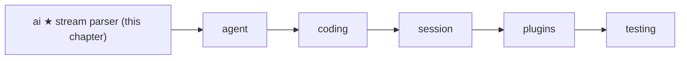
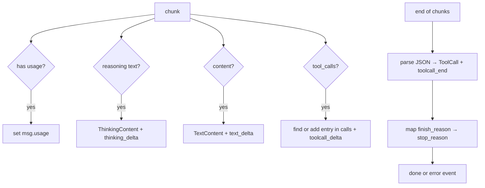

# 03 Part 1 · The stream parser

**Goal:** Turn streamed deltas into a complete assistant message.

**Builds on:** [02 A fake provider](02-fake-provider.md) · **Next:** [04 Providers](04-providers.md)

## Where we are



In [02](02-fake-provider.md) we fixed the shape of a model call: a [stream function](glossary.md#stream-function) yields event dicts and ends with `done` or `error` holding the final `AssistantMessage`. The fake jumps straight from `start` to `done`. A real model does not. It sends its answer in many small pieces, called **[deltas](glossary.md#delta)**. This chapter builds the code that glues those pieces back into one message.

All code here is in one file:

`packages/simp_agent/src/simp_agent/ai/providers/openai_completions.py`, function `parse`.

We use the OpenAI Chat Completions format because it is the one most servers copy (vLLM, llama.cpp, Ollama). The other two providers (`anthropic.py`, `openai_responses.py`) follow the same plan with their own input format; ch [04](04-providers.md) shows them.

## Problem

When you ask a server for `stream=True`, you get a list of **chunks** over time. Each chunk has a tiny `delta`. For the answer "Hello" you might get:

```text
chunk 1: delta.content = "Hel"
chunk 2: delta.content = "lo",  finish_reason = "stop"
```

A tool call is worse. Its arguments are a JSON string, and the server cuts that string anywhere:

```text
chunk 1: tool_calls[0] = {index: 0, id: "c1", name: "read", arguments: '{"pa'}
chunk 2: tool_calls[0] = {index: 0,                        arguments: 'th": '}
chunk 3: tool_calls[0] = {index: 0,                        arguments: '"a"}'}  finish_reason = "tool_calls"
chunk 4: (no choices)  usage = {prompt_tokens: 7, completion_tokens: 3}
```

No single chunk holds valid JSON. The `id` and `name` come only in the first piece. Usage comes in an extra chunk at the very end, with no `choices` at all. The rest of simp-agent wants none of this. The agent loop (ch [05](05-agent-loop.md)) wants one `AssistantMessage` with clean `TextContent` and `ToolCall` parts, a `stop_reason`, and `usage`.

So we need two things at once:

1. **Live events**, so a UI can print text as it arrives.
2. **One final message**, so the loop can act on it.

## Naive version

The first idea: add up text, add up arguments, parse at the end.

```python
import json
from simp_agent.ai import AssistantMessage, TextContent, ToolCall

async def parse(chunks):
    text, args, call_id, name = "", "", None, None
    async for chunk in chunks:
        d = chunk.choices[0].delta
        if d.content:
            text += d.content
            yield {"type": "text_delta", "delta": d.content}
        for tc in d.tool_calls or []:
            call_id = call_id or tc.id
            name = name or tc.function.name
            args += tc.function.arguments or ""
    msg = AssistantMessage([TextContent(text)])
    if call_id:
        msg.content.append(ToolCall(call_id, name, json.loads(args)))
    yield {"type": "done", "message": msg}
```

It works for "Hello" and for one tool call. Then it breaks:

- **Two tool calls at once.** Models often call two tools in one answer (`index` 0 and `index` 1). The naive code glues both argument strings into one, so `json.loads` fails.
- **The usage chunk.** `chunk.choices[0]` raises `IndexError` on the last chunk, which has an empty `choices` list. A stream function [must never raise](02-fake-provider.md#the-shape-of-a-model-call).
- **Bad JSON.** If the model writes broken arguments, `json.loads` raises and the whole call is lost.
- **No stop reason.** We always say `done`, even if the server stopped because it ran out of tokens, or the stream was cut off.
- **Thinking.** Some models send "reasoning" text before the answer. We drop it.

The real `parse` fixes each one. We walk through it in four parts: text, tool calls, stop reasons, usage.

## Real design

The whole function has one job: read chunks, keep a growing message, yield events. The start:

```python
async def parse(chunks, compat: dict) -> AsyncIterator[dict]:
    """Turn ChatCompletionChunk objects into events. Last event is 'done' or 'error'."""
    msg, calls, finish = AssistantMessage(), list(), None  # calls: [{index, id, name, args}]
    yield {"type": "start", "partial": msg}
```

`msg` is the message we build. `start` hands it out at once as `partial`, the same object that will be in `done` later. `calls` holds tool calls that are still being built. `finish` remembers the last finish reason seen. `compat` is a dict of small switches per server; it comes from the `Model` (see ch [04](04-providers.md)).



### Text deltas

```python
        if d.content:
            if not (msg.content and isinstance(msg.content[-1], TextContent)):
                if msg.content:
                    yield {"type": "thinking_end"}
                msg.content.append(TextContent(""))
            msg.content[-1].text += d.content
            yield {"type": "text_delta", "delta": d.content}
```

The rule is: **add to the last part if it is the same kind; else start a new part.** So "Hel" + "lo" becomes one `TextContent("Hello")`, not two. We also yield the small piece as a `text_delta`, so a UI can print it now.

Thinking works the same way, just before it. The server may name the field `reasoning_content`, `reasoning` or `reasoning_text`, so the code tries all three:

```python
        r = next((v for k in ("reasoning_content", "reasoning", "reasoning_text") if isinstance(v := getattr(d, k, None), str) and v), None)
        if r:
            if not (msg.content and isinstance(msg.content[-1], ThinkingContent)):
                msg.content.append(ThinkingContent(""))
                yield {"type": "thinking_start"}
            msg.content[-1].thinking += r
            yield {"type": "thinking_delta", "delta": r}
```

When the first text arrives after thinking, the text branch yields `thinking_end`. The message keeps the parts in order: thinking first, then text. ([01](01-messages.md) defines `ThinkingContent`.)

### Tool-call assembly from deltas

This is the hard part. A tool call arrives in pieces, and several calls can be in flight at once. Each piece must be matched to the right call.

```python
        for tc in d.tool_calls or []:
            idx, tid = getattr(tc, "index", None), tc.id
            cur = next((c for c in calls if idx is not None and c["index"] == idx), None)
            cur = cur or next((c for c in calls if tid and c["id"] == tid), None)
            if cur is None:
                cur = {"index": idx, "id": tid or f"call_{uuid.uuid4().hex[:12]}", "name": "", "args": ""}
                calls.append(cur)
                yield {"type": "toolcall_start", "name": tc.function.name if tc.function else ""}
            if tc.function:
                cur["name"] = cur["name"] or tc.function.name or ""
                if tc.function.arguments:
                    cur["args"] += tc.function.arguments
                    yield {"type": "toolcall_delta", "delta": tc.function.arguments}
```

How a piece finds its call:

1. **By `index`** — the OpenAI way. Piece with `index: 1` belongs to call 1.
2. **By `id`** — some servers send no `index`, but repeat the `id`.
3. **Neither matches** — it is a new call. If the server gave no `id`, we make one (`call_` + 12 hex chars), because the tool result must point back to it later (see `ToolResultMessage.tool_call_id` in [01](01-messages.md)).

The `name` is kept from the first piece that has one. The argument text is only *added up* here, never parsed. We cannot parse until the stream ends.

After the last chunk, each call is parsed once:

```python
    for c in calls:
        try:
            args = json.loads(c["args"] or "{}")
            if not isinstance(args, dict):
                raise ValueError
        except ValueError:
            args = {"_raw": c["args"]}  # fails schema validation -> model gets an error result
        msg.content.append(ToolCall(c["id"], c["name"], args))
        yield {"type": "toolcall_end"}
```

Note what happens with bad JSON. We do **not** throw the call away and we do **not** raise. We keep the raw text as `{"_raw": ...}`. Later, when the loop runs the tool, the arguments fail the tool's schema check, and the model gets an error result saying "Invalid arguments" (ch [05](05-agent-loop.md)). The model sees its mistake and can try again. `json.JSONDecodeError` is a `ValueError`, so one `except` covers both broken JSON and JSON that is not an object (like `[1, 2]`).

Empty arguments (`""`) count as `{}`, because some servers send nothing for a tool with no parameters.

### Stop reasons

The server says *why* it stopped in `finish_reason`. Each server uses its own words. We map them to our five words (`stop | tool_use | length | error | aborted`, from `AssistantMessage` in [01](01-messages.md)):

```python
_STOP = {"stop": "stop", "end": "stop", "length": "length", "tool_calls": "tool_use", "function_call": "tool_use"}
```

At the end of `parse`:

```python
    if finish is None:
        if compat.get("supports_finish_reason", True):
            msg.stop_reason, msg.error = "error", "Stream ended without finish_reason"
        else:
            msg.stop_reason = "tool_use" if calls else "stop"
    elif finish in _STOP:
        msg.stop_reason = _STOP[finish]
    else:
        msg.stop_reason, msg.error = "error", f"Provider finish_reason: {finish}"
    if msg.stop_reason == "stop" and calls:  # vLLM/Ollama send "stop" with tool calls
        msg.stop_reason = "tool_use"
    yield {"type": "error" if msg.stop_reason == "error" else "done", "message": msg}
```

Four cases:

| Server sent | We set | Why |
|---|---|---|
| a known word | the mapped word | normal case |
| an unknown word (e.g. `content_filter`) | `error` + message | we do not guess what it means |
| nothing | `error` "Stream ended without finish_reason" | the connection was probably cut; the answer may be half |
| nothing, but `compat["supports_finish_reason"]` is `False` | `tool_use` or `stop` | some servers never send it; trust what we got |

Plus one fix: vLLM and Ollama say `stop` even when they called a tool. If we have tool calls, the stop reason becomes `tool_use`. This keeps `stop_reason` true for UIs, events and saved history. The loop itself runs tools from `tool_calls()`, not from `stop_reason` (ch [05](05-agent-loop.md)).

The last event is `error` when the stop reason is `error`, else `done`. That keeps the [stream function](glossary.md#stream-function) contract from [02](02-fake-provider.md): the end event always holds the full message, and nothing is raised.

### Usage

**[Usage](glossary.md#usage)** is the token count for one call. It is needed for cost limits (ch [23](23-limits.md)) and for knowing when to compact (ch [16](16-compaction.md)).

```python
def _usage(u) -> dict:
    details = getattr(u, "completion_tokens_details", None)  # completion_tokens already include reasoning
    return {"input": u.prompt_tokens or 0, "output": u.completion_tokens or 0,
            "reasoning": getattr(details, "reasoning_tokens", None) or 0}
```

`reasoning` is for information only: it is already inside `output`, so do not add it twice.

Usage can come in two places, so `parse` checks both:

```python
        usage = getattr(chunk, "usage", None)
        if not chunk.choices:
            if usage:
                msg.usage = _usage(usage)
            continue
        choice = chunk.choices[0]
        usage = usage or getattr(choice, "usage", None)
```

The `if not chunk.choices: continue` line is also the fix for the naive `IndexError`: the final usage-only chunk has no choices. The server only sends that chunk when asked; `stream` asks with `stream_options={"include_usage": True}` unless `compat["include_usage"]` is `False`.

### The wrapper: `stream`

`parse` only reads chunks. The `stream` function in the same file makes the HTTP request and calls `parse`:

```python
        chunks = await client.chat.completions.create(**kw)
        async for ev in parse(chunks, compat):
            yield ev
    except Exception as e:
        yield {"type": "error", "message": AssistantMessage(stop_reason="error", error=str(e))}
```

A network error or a 401 becomes an `error` event, not an exception. We split `parse` out of `stream` so tests can feed it plain objects with no network and no `openai` client. Ch [04](04-providers.md) covers the request side.

## Events at a glance

| Event | Extra keys | When |
|---|---|---|
| `start` | `partial` | first, always |
| `thinking_start` / `thinking_delta` / `thinking_end` | `delta` on delta | reasoning text |
| `text_delta` | `delta` | each text piece |
| `toolcall_start` | `name` | first piece of a new call |
| `toolcall_delta` | `delta` | each argument piece |
| `toolcall_end` | — | after the stream, once per call |
| `done` / `error` | `message` | last, always exactly one |

Note: `thinking_end` comes only when text follows the thinking. A UI must not wait for it.

Only `start`, `done` and `error` carry a message. The loop needs only the last event; the middle ones are for people watching (ch [06](06-events-abort.md)).

## Test

`packages/simp_agent/tests/test_openai.py` tests `parse` with fake chunks built from `SimpleNamespace`. No network, no API key. Two small helpers make chunks:

```python
def tc(index=None, id=None, name=None, args=None):
    return NS(index=index, id=id, function=NS(name=name, arguments=args))


def ch(content=None, tool_calls=None, finish=None, usage=None):
    return NS(choices=[NS(delta=NS(content=content, tool_calls=tool_calls), finish_reason=finish)], usage=usage)
```

The tool-call example from the Problem section, as a test:

```python
async def test_tool_call_split_and_usage_chunk():
    evs = await run([
        ch(tool_calls=[tc(0, "c1", "read", '{"pa')]),
        ch(tool_calls=[tc(0, None, None, 'th": ')]),
        ch(tool_calls=[tc(0, None, None, '"a"}')], finish="tool_calls"),
        NS(choices=[], usage=NS(prompt_tokens=7, completion_tokens=3)),
    ])
    m = evs[-1]["message"]
    assert m.tool_calls() == [ToolCall("c1", "read", {"path": "a"})] and m.stop_reason == "tool_use"
    assert m.usage == {"input": 7, "output": 3, "reasoning": 0}
```

Other tests in the file cover each naive failure:

- `test_text_only` — "Hel" + "lo" gives one text "Hello".
- `test_parallel_by_index_and_by_id` — two calls by `index`; and a server with no `index` that is matched by `id`, plus a made-up `call_` id.
- `test_finish_reasons` — `stop` with tool calls becomes `tool_use`; `length`; unknown `content_filter` and a missing finish reason both give an `error` event.
- `test_bad_json_gives_validation_error` — `'{"path": '` becomes `{"_raw": ...}`, and `run_tool` (built in ch [05](05-agent-loop.md)) then returns an error result with "Invalid arguments".

Run them:

```bash
uv run pytest packages/simp_agent/tests/test_openai.py
```

> **Why this way**
>
> We build the message *while* streaming, and hand out the same object as `partial` at `start` and as `message` at the end. One pass, one object, no second "assemble" step that could get out of sync with the events.
>
> We never raise inside `parse`. Every problem — cut stream, odd finish reason, broken JSON — becomes data: an `error` stop reason, or `{"_raw": ...}` arguments. The loop then has one simple rule: read the last event. And the model gets to see and fix its own bad tool calls, instead of the whole run crashing.

## Recap

- A real model streams small **deltas**; `parse` glues them into one `AssistantMessage` and yields live events on the way.
- Text and thinking pieces join the last part of the same kind.
- Tool-call pieces are matched to a call by `index`, then by `id`; arguments are parsed once, at the end. Bad JSON becomes `{"_raw": ...}`.
- `finish_reason` maps to our `stop_reason`; a missing or unknown one is an `error`. `stop` with tool calls becomes `tool_use`.
- Usage can come in a chunk with no choices.
- It never raises; the last event is always `done` or `error`.

**Builds on:** [02 A fake provider](02-fake-provider.md) · **Next:** [04 Providers](04-providers.md) — the request side, the other two vendors, and the registry that picks one by `model.api`.
