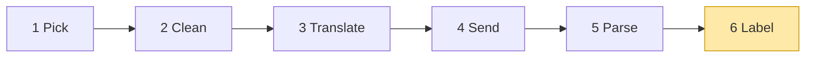
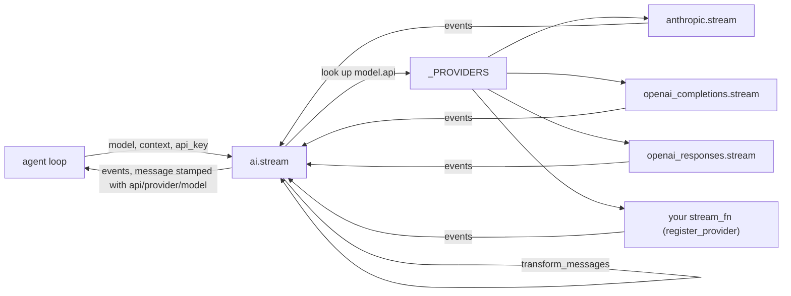
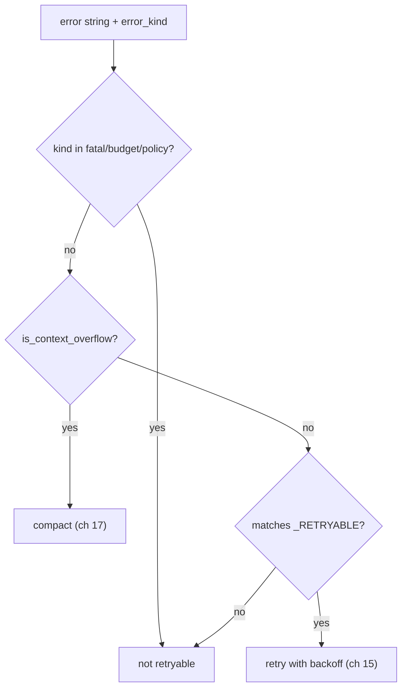
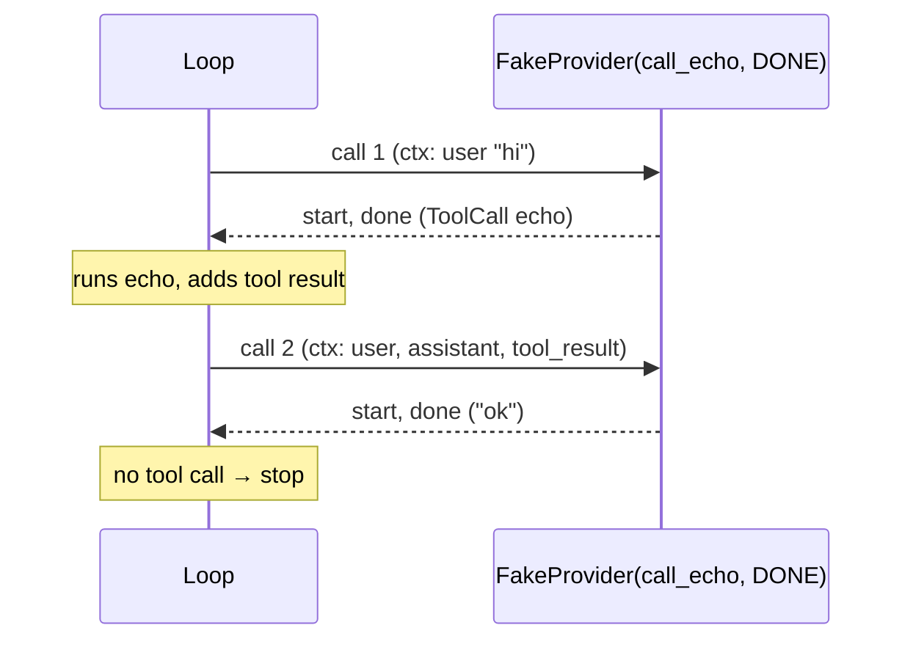

# 04 Part 1 · Label + test the pipeline

**Goal:** Label every answer with who wrote it, read errors, and test the whole pipeline without a real model.

**Builds on:** [03 Parse](03-parse.md) · **Next:** [05 The agent loop](05-agent-loop.md)

## Where we are



**Builds:** block 6, and a test fake for blocks 3–5 · **IN:** events · **OUT:** labelled events

Big picture of Part 1: [part-1-ai](part-1-ai.md).

In [01](01-pick-clean.md) we built Pick and Clean, in [02](02-translate-send.md) Translate and Send, and in [03](03-parse.md) Parse. This chapter adds the last block, **Label**, and the one function that ties them all together: `ai.stream`. Then it shows how to test all of this without a real model, using a fake [provider](glossary.md#provider).

Code in this chapter (commit `2fc2776`):

- `packages/simp_agent/src/simp_agent/ai/__init__.py` — `stream`, `is_retryable`, `is_context_overflow`
- `packages/simp_agent/src/simp_agent/testing/__init__.py` — `FakeProvider`
- `packages/simp_agent/tests/test_core.py` — tests that use the fake

## The entry point `stream` (runs 1, 2, 6)

The one entry point ties blocks 1, 2 and 6 together. It is block 6 Label, wrapped around Pick and Clean:

Real code: [packages/simp_agent/src/simp_agent/ai/__init__.py](../../packages/simp_agent/src/simp_agent/ai/__init__.py) (`stream`)

```text
FUNCTION stream(model, context, opts):   // never raises
    fn = LOOK UP model.api in _PROVIDERS
    IF not found:
        SEND event {error, message with error "Unknown api: ..."}
        STOP
    ctx = same context, but messages = transform_messages(context.messages, model)
    FOR EACH event from fn(model, ctx, opts):
        IF the event has a message or partial:
            STAMP it with model.api, model.provider, model.id
        SEND the event
```

It does three jobs for every provider, so no provider repeats them:

1. Pick: unknown `api` → `error` event, not an exception (ch [01](01-pick-clean.md#1-pick-_providers-register_provider)).
2. Clean the history with `transform_messages` (block 2, ch [01](01-pick-clean.md#2-clean-transform_messages)).
3. **Stamp** each message with `api`, `provider` and `model`. Later, `transform_messages` reads these stamps to know who wrote a turn.



> **Why this way:** the shared work — unknown api, history cleaning, stamping — lives once in `ai.stream`. Each provider only converts and parses.

## Extra: error classification: `is_retryable`, `is_context_overflow`

Providers turn every failure into `AssistantMessage.error`, a string. Two small functions read that string:

Real code: [packages/simp_agent/src/simp_agent/ai/__init__.py](../../packages/simp_agent/src/simp_agent/ai/__init__.py) (`is_retryable`, `is_context_overflow`)

```text
FUNCTION is_context_overflow(error):
    RETURN true IF error matches _OVERFLOW

NON_RETRYABLE = {fatal, budget, policy}

FUNCTION is_retryable(error, kind):
    IF kind is in NON_RETRYABLE:
        RETURN false   // our own code knows better than the text
    RETURN true IF not an overflow AND error matches _RETRYABLE
```

- `_OVERFLOW` matches the ways vendors say "too long": `prompt is too long`, `maximum context length`, `context_length_exceeded`, `too many tokens`, and so on. This is a [context overflow](glossary.md#context-overflow).
- `_RETRYABLE` matches short-lived problems: HTTP `429` or `5xx`, `overloaded`, `rate limit`, `connection`, `timed out`, `stream ended`.
- An overflow is **never** retryable: sending the same too-long request again fails again.
- `error_kind` (`fatal`, `budget`, `policy`) beats the text. Our own code sets it when it knows better — like the missing API key in ch [01](01-pick-clean.md#1-pick-_providers-register_provider).

The session uses them in this order (`session/__init__.py`): overflow first → compact once and try again, if auto-compact is on (ch [17](17-overflow.md)); else retryable → wait and retry, up to `max_retries` (ch [15](15-retry.md)); else give up.



## Testing the pipeline without a real model

A real model is slow, costs money, needs an API key, and gives a different answer each time. So for tests we use a fake [provider](glossary.md#provider).

It lives in the `testing` [layer](glossary.md#layer), at the far right of the [layer map](00-overview.md#the-layer-map). It may import from every other layer, and no library code imports it.

### Why a fake

Almost every later chapter needs "the model said X" to test something:

- The loop (ch [05](05-agent-loop.md)) must run a tool when the model asks for one. To test that, we need a model that *always* asks for that tool.
- Abort (ch [06](06-events-abort.md)), retry (ch [15](15-retry.md)) and compaction (ch [16](16-compaction.md)) need a model that fails, or that writes a summary, at the exact call we choose.
- The server budget tests (ch [23](23-limits.md)) need to count how many model calls happened.

A real model cannot do this. We cannot tell it "on the second call, return an error". And a test that calls a real API is slow, costs money, and fails when the network is down.

So the plan is: the [stream function](glossary.md#stream-function) shape from [01](01-pick-clean.md#the-shape-of-a-model-call) is the only thing the loop knows. A fake that has this shape can stand in for blocks 3–5, and everything else can be tested against it. The real providers (ch [02](02-translate-send.md), [03](03-parse.md)) match the same shape.

### Naive version

The first idea is a function that always returns the same answer:

```text
FUNCTION fake(model, ctx, api_key):
    msg = AssistantMessage with the text "ok"
    SEND event {start, msg}
    SEND event {done, msg}
```

This works for a test where the model only says "ok". But it breaks fast:

- **One answer only.** To test a tool call, the model must first say "call `echo`", and then, on the next call, say "done". A fixed answer cannot do this; the loop would call the tool forever.
- **No memory.** The test cannot ask "how many times was the model called?" or "what did the loop send on the second call?".
- **No errors.** A message with `stop_reason="error"` still comes out as a `done` event, which a real provider never does.

### Step by step: from naive to real

**Step 1 — a script of replies.** Keep a list and take the next one each call:

```text
CLASS FakeProvider(replies...):
    replies = the replies, ready to take one by one
    calls = 0

    WHEN called with (model, ctx, api_key):
        msg = TAKE the next reply
        SEND event {start, msg}
        SEND event {done, msg}
```

Why a class: it must remember where it is in the script between calls.

**Step 2 — memory.** Write down each call (`self.calls += 1`, `self.messages.append(list(ctx.messages))`, ...) so the test can check *what* was sent.

**Step 3 — errors.** End with `error` instead of `done` when the reply has `stop_reason == "error"`, like a real provider.

**Step 4 — replies that are functions.** `msg = msg(ctx) if callable(msg) else msg`, so a reply can look at the context.

### Real design: `FakeProvider`

Put the four steps together and you get the full class:

```text
CLASS FakeProvider(replies...):
    replies = the replies, ready to take one by one
    ctxs, messages, api_keys, models = empty lists
    calls = 0

    WHEN called with (model, ctx, api_key):          // the instance IS a stream_fn
        calls = calls + 1
        ADD ctx to ctxs
        ADD a COPY of ctx.messages to messages        // freeze what was sent now
        ADD api_key to api_keys
        ADD model to models
        msg = TAKE the next reply                     // none left -> test fails
        IF msg is a function: msg = msg(ctx)
        SEND event {start, msg}
        IF msg.stop_reason is "error": SEND event {error, msg}
        ELSE:                          SEND event {done, msg}
```

Real code: [packages/simp_agent/src/simp_agent/testing/__init__.py](../../packages/simp_agent/src/simp_agent/testing/__init__.py) (`FakeProvider`)

Let us go through it part by part.

#### A script of replies

`FakeProvider(*replies)` takes the answers in order. Call 1 gets the first reply, call 2 the second, and so on. This is a **[scripted reply](glossary.md#scripted-reply)**: the test writes the model's lines in advance, like a play.



`replies` is stored as an iterator, and `next(self.replies)` takes the next one. If the code under test calls the model more times than the script has replies, `next` raises `StopIteration`. Inside an async generator Python turns that into `RuntimeError: async generator raised StopIteration`, so the test fails with a `RuntimeError`. That is on purpose: an extra call is a bug in the code under test, and the test should fail loudly.

#### The instance is the function

`FakeProvider` has an `async def __call__` with `yield` inside. So an instance *is* a stream function: you can pass it anywhere a `stream_fn` goes. It has the same arguments as the contract from [01](01-pick-clean.md#the-shape-of-a-model-call): `(model, ctx, api_key=None)`.

Why a class and not a plain function? Because it must keep state between calls: where it is in the script, and what it has seen.

#### Recording every call

Before it answers, the fake writes down what it was given:

| Field | What it holds |
|---|---|
| `calls` | how many times it was called |
| `ctxs` | each `Context` object, as passed |
| `messages` | a **copy** of `ctx.messages` for each call |
| `api_keys` | the `api_key` of each call |
| `models` | the `Model` of each call |

Why copy `messages` with `list(...)`? The loop keeps adding to its message list. If we kept the same list object, by the end of the test every entry would show the final list, and we could not see what the model got *at that moment*. The copy freezes it.

Tests use these fields a lot. For example, the server budget test checks that the third call never reached the model:

```python
assert fp.calls == 2  # $1 + $1 > $1.5 -> third call refused before reaching the provider
```

(`apps/server/tests/test_budget.py`; the budget itself is ch [23](23-limits.md).)

#### A reply can be a function

A reply may be a message *or* a callable `(ctx) -> message`:

```text
IF reply is a function: reply = reply(ctx)
```

Real code: [testing/\_\_init\_\_.py](../../packages/simp_agent/src/simp_agent/testing/__init__.py) — `FakeProvider.__call__`

This lets a reply look at the context, or do something at the exact moment the model is "thinking". A tiny example: a reply that repeats the last user text.

```text
echo_back(ctx) = assistant message with the text of the last message in ctx
fp = FakeProvider(echo_back)
```

Later chapters use this to act *during* a call, for example to type a new message while a summary is being made (ch [07](07-steering.md), [16](16-compaction.md)).

#### Two events, like a real provider

The fake yields exactly two events:

1. `{"type": "start", "partial": msg}` — "an answer has begun".
2. `{"type": "done", "message": msg}`, or `{"type": "error", ...}` if `msg.stop_reason == "error"`.

A real provider yields many small events in between (text pieces, tool-call pieces); ch [03](03-parse.md) builds them up into one message. The fake skips the middle and hands over the whole message at once. The first and last events have the same shape, so the loop cannot tell the difference.

The `error` rule matters. To test retry, a test writes `AssistantMessage(stop_reason="error", error="...")` as a reply, and the fake ends with an `error` event, just like a real provider that hit a network failure. For a scripted reply it never raises (running out of replies does raise, see [A script of replies](#a-script-of-replies)), so it keeps the "must not raise" rule.

#### What the fake does *not* do

- It does not stream text bit by bit. Tests of the stream parser use their own event lists (ch [03](03-parse.md)).
- It does not set `api`, `provider` and `model` on the message. `ai.stream` does that for real providers; the fake is passed in *instead of* `ai.stream`.
- It does not check the API key. A test that needs "no key" behaviour tests `ai.stream` itself ([above](#the-entry-point-stream-runs-1-2-6)).

#### Its neighbour: `FakeEnv`

The same file also has `FakeEnv`, a fake for running shell commands. It needs the execution environment from ch [09](09-exec-env.md), so we meet it there.

## Test

First, the fake alone. Only `FakeProvider` and the types from [01](01-pick-clean.md); no loop:

```text
fp  = FakeProvider(reply "hello", then error reply "boom")
ctx = Context("sys", [user "hi"])
REPEAT 2 times:
    FOR each event from fp(model, ctx): PRINT event type
PRINT fp.calls, first text fp saw

// output:
// start
// done
// start
// error
// 2 hi
```

Real code: [testing/\_\_init\_\_.py](../../packages/simp_agent/src/simp_agent/testing/__init__.py) — `FakeProvider`

The first reply ends with `done`, the second with `error`, and `fp.messages` kept what was sent.

The fake can also stand in for `ai.stream` directly. Note one difference: `ai.stream` cleans the history with `transform_messages` before calling a provider (ch [01](01-pick-clean.md#2-clean-transform_messages)). The fake skips that step; it gets the messages exactly as passed.

> **Forward note: the fake inside the loop.** Most real tests pass the fake to the agent loop as `stream_fn`. For example, `tests/test_core.py` scripts "call the `echo` tool, then say ok" as `run(call("echo", x="a"), DONE)`. We build the loop and this `run` helper in ch [05](05-agent-loop.md), and use a reply function to steer mid-call in ch [07](07-steering.md).

Run tests that use the fake (they use the loop from ch [05](05-agent-loop.md); you can run them now, and they pass):

```bash
cd packages/simp_agent
uv run pytest -q tests/test_core.py::test_no_tool_call_one_turn \
  tests/test_core.py::test_tool_call_then_second_turn
# 2 passed
```

> **Why this way?**
> - **Inject the model call, do not mock it.** The loop takes `stream_fn` as a plain setting, so the test passes a fake. No patching of imports, no mock library.
> - **A script, not a smart fake.** The test lists the replies in order. It is easy to read: the whole "conversation" sits in one line of the test.
> - **Same event shape as real providers.** The fake only yields `start` and `done`/`error`, but they are the same events a real provider ends with, so code tested on the fake works on the real thing.
> - **Record everything.** `calls`, `messages`, `ctxs`, `api_keys`, `models` let a test check *what* was sent, not only what came back.
> - **Cost:** the fake never streams small pieces, so it cannot test the stream parser, and running past the end of the script fails with a `RuntimeError` (caused by `StopIteration`) instead of a clean error.

## Exercises

1. Register your own provider with `register_provider("echo", fn)` where `fn` yields one `done` event with the last user text. Call `ai.stream` with `Model(api="echo")`. Which fields did `ai.stream` set (stamp) on the message?
2. Call `ai.is_retryable("Error code: 529 overloaded")` and `ai.is_retryable("x", "fatal")`. Explain each answer.
3. Script a fake with three replies: text, error, text. Call it three times and print the end event type of each. Then call it a fourth time: what error do you get, and why?
4. Use a reply function to answer with the number of messages in the context (`len(ctx.messages)`).

## Recap

- `ai.stream` runs Pick and Clean, calls the stream function, then **labels** every message with `api`, `provider`, `model`. Later, Clean reads these labels.
- `ai.stream` never raises: an unknown `api` is an `error` event.
- `is_context_overflow` and `is_retryable` turn an error string into "compact", "retry" or "give up".
- The loop takes the stream function as a setting (`stream_fn`), so tests can swap in a fake.
- `FakeProvider(*replies)` plays scripted replies in order; a reply can be a message or a function of the context.
- It records each call in `calls`, `ctxs`, `messages` (copied), `api_keys` and `models`.
- It yields `start`, then `done` — or `error` when the reply's `stop_reason` is `"error"`.

**Builds on:** [03 Parse](03-parse.md) · **Next:** [05 The agent loop](05-agent-loop.md) — the loop that calls `ai.stream` and runs the tools the model asks for.

**Built on by:** [05](05-agent-loop.md) (calls `ai.stream`; loop tests use the fake) · [06](06-events-abort.md) · [07](07-steering.md) · [15](15-retry.md) (`is_retryable`, error replies) · [16](16-compaction.md) (summary replies) · [17](17-overflow.md) (`is_context_overflow`) · [23](23-limits.md) (counting calls)

**OUT →** labelled events from `ai.stream()` are the IN of the agent loop (ch 05).
