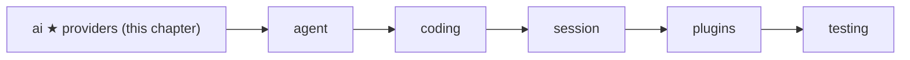
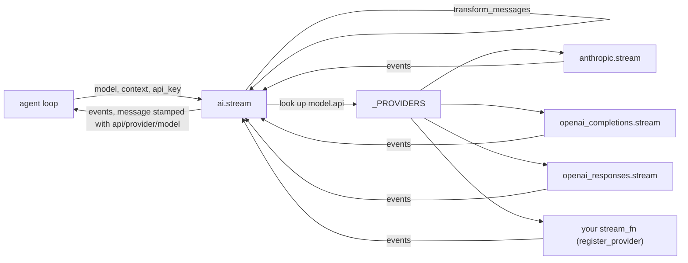
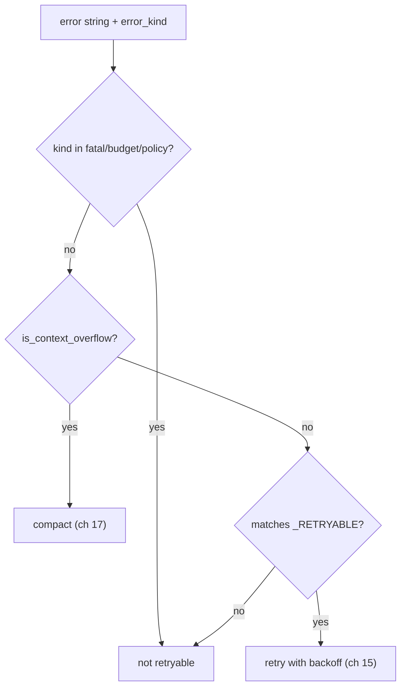

# 04 Part 1 · Providers

**Goal:** Talk to real models through one small registry.

**Builds on:** [03 The stream parser](03-stream-parser.md) · **Next:** [05 The agent loop](05-agent-loop.md)

## Where we are



In [02](02-fake-provider.md) we fixed the shape of a model call: a [stream function](glossary.md#stream-function). In [03](03-stream-parser.md) we built the parser that turns OpenAI chunks into one `AssistantMessage`. This chapter finishes the `ai` [layer](glossary.md#layer). We add the **request side** (our messages → vendor format), the two other vendors, and one function, `ai.stream`, that picks the right [provider](glossary.md#provider) for a model.

Code in this chapter (commit `2fc2776`):

- `packages/simp_agent/src/simp_agent/ai/__init__.py` — `Model`, `transform_messages`, `_PROVIDERS`, `register_provider`, `stream`, `is_retryable`, `is_context_overflow`
- `packages/simp_agent/src/simp_agent/ai/providers/openai_completions.py`
- `packages/simp_agent/src/simp_agent/ai/providers/openai_responses.py`
- `packages/simp_agent/src/simp_agent/ai/providers/anthropic.py`

## Problem

We want the [agent loop](glossary.md#agent-loop) (ch [05](05-agent-loop.md)) to say "ask the model" and not care which vendor answers. But vendors differ a lot:

| | OpenAI Chat Completions | OpenAI Responses | Anthropic Messages |
|---|---|---|---|
| System prompt | first message, role `system` | first input item, role `system` or `developer` | separate `system` field |
| Tool call | `tool_calls` on the assistant message | `function_call` item | `tool_use` block |
| Tool result | role `tool`, one per result | `function_call_output` item | `tool_result` block inside a **user** turn |
| Thinking | `reasoning_content` text | encrypted `reasoning` item | signed `thinking` block |

There are also three cross-cutting problems:

1. **History can be broken.** A turn may have ended with an error, or a tool call may have no result (the user stopped the run). Every vendor rejects a tool call with no result.
2. **Thinking is not portable.** Anthropic signs its thinking. OpenAI Responses encrypts it. Only the same model can read it back.
3. **Errors are strings.** The loop must decide "try again", "make the context smaller", or "give up" — from text like `"Error code: 529 overloaded"`.

## Naive version

The naive way is an `if` chain in the loop:

```text
FUNCTION ask(model, context, api_key):
    IF model.api is "anthropic-messages":
        IMPORT the anthropic SDK
        make a client, build anthropic messages, stream, parse
    ELSE IF model.api is "openai-completions":
        IMPORT the openai SDK
        make a client, build openai messages, stream, parse
    ELSE:
        RAISE an error   // crashes the loop
```

Where it breaks:

- Every new vendor means editing the loop. A user cannot add their own vendor.
- Both SDKs must be installed to import this file, even if you use one.
- A raised exception (network down, bad key) crashes the loop. The [stream function](glossary.md#stream-function) rule says "never raise".
- It sends the history as-is, so an orphan tool call gives a 400 error from the vendor.

## Step by step: from naive to real

**Step 1 — a dict instead of `if`.** Map `model.api` to a stream function. A new vendor is one new entry; users add theirs with `register_provider`.

```text
_PROVIDERS = a table: api name -> stream function
fn = LOOK UP model.api in _PROVIDERS
```

**Step 2 — import late.** Each entry imports its SDK only on the first call (`_builtin`), so you need only the SDK you use.

**Step 3 — never raise.** An unknown `api`, or a missing key for a built-in provider, becomes an `error` event. Each provider catches its own errors the same way.

**Step 4 — clean history once.** Before calling any provider, `ai.stream` runs `transform_messages`, so an orphan tool call gets a "No result provided" result instead of a 400 error.

**Step 5 — read errors.** `is_context_overflow` and `is_retryable` turn an error string into "compact", "retry" or "give up".

The real code puts all five in `ai.stream` and a few helpers.

## Real design



### The `Model`

A model says which **API format** to speak, not only which vendor:

Real code: [packages/simp_agent/src/simp_agent/ai/__init__.py](../../packages/simp_agent/src/simp_agent/ai/__init__.py) (`Model`)

```text
CLASS Model:
    id             = "claude-sonnet-5-5"
    provider       = "anthropic"          // just a name, for messages and keys
    max_tokens     = 8192
    context_window = 200000
    api            = "anthropic-messages" // or openai-completions, openai-responses; picks the code
    base_url       = none
    api_key_env    = none                 // env var that holds the key
    compat         = empty dict           // openai: include_usage, max_tokens_field, supports_finish_reason
                                          // all: reasoning_effort; anthropic: thinking_budget
```

`api` picks the code. `provider` is just a name (for messages and keys). So a local vLLM server is `provider="vllm", api="openai-completions", base_url="http://..."`. `compat` holds small per-server switches, so odd servers need a setting, not a new provider. Profiles (ch [18](18-profiles-plugins.md)) fill these fields from config.

### The registry: `_PROVIDERS`, `register_provider`, `stream`

The [provider registry](glossary.md#provider-registry) is a plain dict from `api` string to stream function (`ai/__init__.py`):

Real code: [packages/simp_agent/src/simp_agent/ai/__init__.py](../../packages/simp_agent/src/simp_agent/ai/__init__.py) (`register_provider`)

```text
_PROVIDERS = {
    "anthropic-messages" -> _builtin("anthropic"),
    "openai-completions" -> _builtin("openai_completions"),
    "openai-responses"   -> _builtin("openai_responses"),
}

FUNCTION register_provider(api, stream_fn):
    // stream_fn(model, context, api_key) gives events and must not raise
    _PROVIDERS[api] = stream_fn
```

`register_provider` lets anyone add or replace an `api` without touching the library. The built-ins go through `_builtin`:

Real code: [packages/simp_agent/src/simp_agent/ai/__init__.py](../../packages/simp_agent/src/simp_agent/ai/__init__.py) (`_builtin`)

```text
FUNCTION _builtin(module):
    RETURN a stream function that, WHEN called with (model, context, opts):
        IF no api_key in opts:   // providers never read env; the app passes the key
            SEND event {error, message with error "no API key for provider ...", error_kind "fatal"}
            STOP
        IMPORT providers/<module> now   // late import: avoids a circular import
        FOR EACH event from that module's stream(model, context, opts):
            SEND the event
```

Two things here, both with a reason:

- **Lazy import.** The provider module is imported only on the first call. The providers import `Model`, `AssistantMessage` and friends from `ai`, so importing them at the top of `ai` would be a circular import. It also means `import anthropic` happens only when you use Anthropic.
- **No key, no call.** Providers never read environment variables. The app passes `api_key`. A missing key is an `error` event with `error_kind="fatal"`, so retry (ch [15](15-retry.md)) does not try again for nothing.

Then the one entry point:

Real code: [packages/simp_agent/src/simp_agent/ai/__init__.py](../../packages/simp_agent/src/simp_agent/ai/__init__.py) (`stream`)

```text
FUNCTION stream(model, context, opts):   // never raises
    fn = LOOK UP model.api in _PROVIDERS
    IF not found:
        SEND event {error, message with error "Unknown api: ..."}
        STOP
    ctx = same context, but messages = transform_messages(context.messages, model)
    FOR EACH event from fn(model, ctx, opts):
        IF the event has a message or partial:
            STAMP it with model.api, model.provider, model.id
        SEND the event
```

It does three jobs for every provider, so no provider repeats them:

1. Unknown `api` → `error` event, not an exception.
2. Clean the history with `transform_messages` (next section).
3. **Stamp** each message with `api`, `provider` and `model`. Later, `transform_messages` reads these stamps to know who wrote a turn.

### `transform_messages`: clean history before sending

`transform_messages(messages, model)` does one pass over the history:

Real code: [packages/simp_agent/src/simp_agent/ai/__init__.py](../../packages/simp_agent/src/simp_agent/ai/__init__.py) (`transform_messages`)

```text
FOR EACH message m in messages:
    IF m is a compaction or custom entry:   // history markers, never sent
        SKIP it
    IF m is a tool result:
        REMOVE its call from pending
        ADD m to out
        NEXT
    flush()   // add "No result provided" for each call still in pending
    IF m is an assistant message:
        IF m.stop_reason is error or aborted:
            SKIP it
        pending = the tool calls in m (id -> name)
        IF a model is given:
            m = a COPY of m with content = _thinking(m, model)
    ADD m to out
flush()
```

- [Compaction entries](glossary.md#compaction-entry) and [custom entries](glossary.md#custom-entry) are skipped. They live in history but are never sent.
- Assistant turns with `stop_reason` `error` or `aborted` are dropped. They are often half-written.
- `pending` remembers tool calls still waiting for a result. When the next non-result message comes (or the end), `flush()` adds a `ToolResultMessage(..., "No result provided", is_error=True)` for each one. Now every call has a result, and the vendor accepts the history.
- It uses `dataclasses.replace`, so the saved history is never changed. Only the copy sent to the model is.

### Thinking: who can read it back

Some models "think" before they answer. We keep that as `ThinkingContent(thinking, signature, redacted)`. The `signature` is vendor proof: an Anthropic signature, or the whole OpenAI Responses reasoning item as JSON. A **redacted** block has no readable text at all.

`_thinking(m, model)` decides what to send back, using the stamps:

Real code: [packages/simp_agent/src/simp_agent/ai/__init__.py](../../packages/simp_agent/src/simp_agent/ai/__init__.py) (`_thinking`)

```text
same = (m.provider, m.api, m.model) equal (model.provider, model.api, model.id)
FOR EACH block c in m.content:
    IF c is thinking:
        IF c is redacted OR (same AND c has a signature):
            IF same: ADD c          // else drop: the other model cannot verify it
        ELSE IF c has text:
            ADD c if same, else ADD it as plain text
    ELSE IF c is text with a signature AND not same:
        ADD plain text without the signature
    ...
```

| Thinking block | Same model | Other model |
|---|---|---|
| signed or redacted | kept as is | dropped (it cannot verify it) |
| unsigned, with text | kept | turned into plain text |
| unsigned, empty | dropped | dropped |

This matters when the user switches model in the middle of a session: the new model still sees what the old one thought, as text, and never gets a signature it would reject.

### The three providers

All three have the same plan: **convert** our messages, **call** the SDK with `stream=True`, **parse** events, and catch every exception into an `error` event. Each one imports its SDK inside `stream`, so you only need the SDK you use. (Note: the import sits just before the `try`, so a missing SDK raises `ImportError` — the one case that breaks "never raise".)

**OpenAI Chat Completions** (`openai_completions.py`). This is the format most local servers copy. `to_openai` puts the system prompt first, sends tool results as one `role: "tool"` message each, and sends `content: None` for an assistant turn that only has tool calls. `stream` reads `compat`:

Real code: [packages/simp_agent/src/simp_agent/ai/providers/openai_completions.py](../../packages/simp_agent/src/simp_agent/ai/providers/openai_completions.py) (`stream`)

```text
kw[ compat "max_tokens_field" or "max_tokens" ] = model.max_tokens
IF compat include_usage (default yes):
    kw.stream_options = {include_usage: true}
IF compat reasoning_effort is set:
    kw.reasoning_effort = that value
```

Some servers want `max_completion_tokens`, some fail on `stream_options`. `compat` handles that without code. The parser is the one from ch [03](03-stream-parser.md).

**OpenAI Responses** (`openai_responses.py`). The newer OpenAI API. We send `store: False`, so OpenAI keeps nothing between calls. To let a reasoning model see its own past reasoning, we ask for `include: ["reasoning.encrypted_content"]` and save the whole reasoning item as JSON in `ThinkingContent.signature`. `to_input` puts it back in the input as-is. Text parts also keep a small JSON signature (`{v, id, phase}`) so their item id goes back the same. A tool call id is stored as `call_id|item_id` in one string; `to_input` splits it again. With reasoning on, the system prompt uses role `developer`. The request is built in `request`:

Real code: [packages/simp_agent/src/simp_agent/ai/providers/openai_responses.py](../../packages/simp_agent/src/simp_agent/ai/providers/openai_responses.py) (`request`)

```text
kw = {model id, input = to_input(model, system prompt, messages), stream: true,
      store: false, max_output_tokens: at least 16}
IF the model has a reasoning effort:
    kw.reasoning = {effort, summary: "auto"}
    kw.include   = ["reasoning.encrypted_content"]   // so we can send it back later
```

`parse` here works like the one in ch 03, but on Responses [SSE](glossary.md#sse) events. Here is the same tool call as in ch 03 (`read` with `{"path": "a"}`), cut to the events and fields we use:

```text
event: response.output_item.added
data: {"output_index": 0, "item": {"type": "function_call", "id": "fc_1", "call_id": "call_1", "name": "read", "arguments": ""}}

event: response.function_call_arguments.delta
data: {"item_id": "fc_1", "output_index": 0, "delta": "{\"pa"}

event: response.function_call_arguments.delta
data: {"item_id": "fc_1", "output_index": 0, "delta": "th\": \"a\"}"}

event: response.output_item.done
data: {"output_index": 0, "item": {"type": "function_call", "id": "fc_1", "call_id": "call_1", "name": "read", "arguments": "{\"path\": \"a\"}"}}

event: response.completed
data: {"response": {"status": "completed", "usage": {"input_tokens": 7, "output_tokens": 3, ...}}}
```

Where each event is handled in `openai_responses.py`:

| Event | Line | What `parse` does |
|---|---|---|
| `response.output_item.added` | 79-88 | new `ToolCall` with id `call_id\|id` and `name`; emits `toolcall_start` |
| `response.function_call_arguments.delta` | 105-108 | adds `delta` to a buffer; emits `toolcall_delta` |
| `response.output_item.done` | 109, 119-121 | parses the full `arguments` (falls back to the buffer); emits `toolcall_end` |
| `response.completed` | 123-131 | reads `usage`; stop reason is `tool_use` because the message has a `ToolCall` |

Unlike Chat Completions, the `.done` event carries the whole arguments string, so we do not have to trust the string we built from the pieces.

**Anthropic Messages** (`anthropic.py`). `_to_anthropic` sends a tool result as a `tool_result` block in a **user** turn. Anthropic needs user and assistant turns to alternate, so the last step merges turns next to each other with the same role:

Real code: [packages/simp_agent/src/simp_agent/ai/providers/anthropic.py](../../packages/simp_agent/src/simp_agent/ai/providers/anthropic.py) (`_to_anthropic`)

```text
merged = empty list
FOR EACH turn t in out:
    IF the last merged turn has the same role as t:
        ADD t's content to that last turn   // Anthropic needs user/assistant to alternate
    ELSE:
        ADD t to merged
```

So three tool results become one user turn. Thinking is turned on by `thinking_params(model)`: `compat.thinking_budget` gives a fixed token budget (older models); `compat.reasoning_effort` gives adaptive thinking with an effort level. The same tool call from Anthropic looks like this (cut to the fields we use):

```text
event: message_start
data: {"type": "message_start", "message": {"id": "msg_1", "role": "assistant", "content": [], "usage": {"input_tokens": 7, "output_tokens": 1}}}

event: content_block_start
data: {"type": "content_block_start", "index": 0, "content_block": {"type": "tool_use", "id": "toolu_1", "name": "read", "input": {}}}

event: content_block_delta
data: {"type": "content_block_delta", "index": 0, "delta": {"type": "input_json_delta", "partial_json": "{\"pa"}}

event: content_block_delta
data: {"type": "content_block_delta", "index": 0, "delta": {"type": "input_json_delta", "partial_json": "th\": \"a\"}"}}

event: content_block_stop
data: {"type": "content_block_stop", "index": 0}

event: message_delta
data: {"type": "message_delta", "delta": {"stop_reason": "tool_use"}, "usage": {"output_tokens": 3}}

event: message_stop
data: {"type": "message_stop"}
```

We do not read these raw events one by one. `client.messages.stream(...)` from the `anthropic` SDK reads them, builds the message for us, and also gives extra helper events: for each `input_json_delta` it gives an `input_json` event with `partial_json`, and for each `text_delta` a `text` event. Where each one is handled in `anthropic.py`:

| Event | Line | What we do |
|---|---|---|
| `message_start` | (SDK) | SDK keeps `usage.input_tokens` |
| `content_block_start` (`tool_use`) | 71-79 | emits `toolcall_start` with `name` |
| `content_block_delta` (`input_json_delta`) | 88-89 | via the SDK's `input_json` event: emits `toolcall_delta` with `partial_json` |
| `content_block_stop` | 90-92 | emits `toolcall_end` (the SDK adds the finished block as `ev.content_block`) |
| `message_delta` | (SDK) | SDK keeps `stop_reason` and `usage.output_tokens` |
| `message_stop` | (SDK), 116-119 | stream ends; `get_final_message()` gives `stop_reason` (`tool_use`) and `usage` |

During streaming, `parse` keeps partial text on `msg` (useful if the run is aborted). At the end, the provider rebuilds `msg.content` from the SDK's `get_final_message()`, which has the complete, signed blocks.

### Error classification: `is_retryable`, `is_context_overflow`

Providers turn every failure into `AssistantMessage.error`, a string. Two small functions read that string:

Real code: [packages/simp_agent/src/simp_agent/ai/__init__.py](../../packages/simp_agent/src/simp_agent/ai/__init__.py) (`is_retryable`, `is_context_overflow`)

```text
FUNCTION is_context_overflow(error):
    RETURN true IF error matches _OVERFLOW

NON_RETRYABLE = {fatal, budget, policy}

FUNCTION is_retryable(error, kind):
    IF kind is in NON_RETRYABLE:
        RETURN false   // our own code knows better than the text
    RETURN true IF not an overflow AND error matches _RETRYABLE
```

- `_OVERFLOW` matches the ways vendors say "too long": `prompt is too long`, `maximum context length`, `context_length_exceeded`, `too many tokens`, and so on. This is a [context overflow](glossary.md#context-overflow).
- `_RETRYABLE` matches short-lived problems: HTTP `429` or `5xx`, `overloaded`, `rate limit`, `connection`, `timed out`, `stream ended`.
- An overflow is **never** retryable: sending the same too-long request again fails again.
- `error_kind` (`fatal`, `budget`, `policy`) beats the text. Our own code sets it when it knows better — like the missing API key above.

The session uses them in this order (`session/__init__.py`): overflow first → compact once and try again, if auto-compact is on (ch [17](17-overflow.md)); else retryable → wait and retry, up to `max_retries` (ch [15](15-retry.md)); else give up.



## Test

No real model or key is needed. The tests replace the SDK or the provider with a fake.

`test_dispatch_by_api` (`tests/test_openai.py`) checks the registry and `transform_messages` together:

Real code: [packages/simp_agent/tests/test_openai.py](../../packages/simp_agent/tests/test_openai.py) (`test_dispatch_by_api`)

```text
TEST dispatch_by_api:
    seen = empty list
    fake provider WHEN called with (model, ctx):
        ADD (model.api, ctx.messages) to seen
        SEND event {done}
    PUT fake in place of openai_completions.stream
    history = [user "u", assistant with tool call "a" and no result]
    RUN ai.stream with api "openai-completions" and key "k"
    CHECK seen[0] api is "openai-completions"
    CHECK last message seen is "No result provided"   // transform_messages ran first
```

The history ends with an orphan tool call. The provider sees a "No result provided" result added for it.

`test_http_error_is_event` makes `AsyncOpenAI` raise a connection error. The stream yields an `error` event (no exception), and `is_retryable` says yes. It also checks `is_context_overflow("This model's maximum context length is 8192 tokens")`.

Other tests:

- `test_compat_params` (`test_openai.py`) — `compat` changes the request keys.
- `test_message_conversion` (`test_openai.py`) — `to_openai` output shape.
- `test_transform_thinking_same_vs_other_model` (`test_reasoning.py`) — the thinking table above.
- `test_responses_stream_thinking_text_toolcall`, `test_responses_replay_order_and_ids` (`test_reasoning.py`) — Responses parsing and replay.
- `test_anthropic_thinking_and_signature_delta` (`test_reasoning.py`) — Anthropic thinking and signature.

```bash
uv run pytest packages/simp_agent/tests/test_openai.py packages/simp_agent/tests/test_reasoning.py
```

> **Why this way**
>
> We pick the provider by **API format** (`model.api`), not by vendor. Many vendors and local servers speak the OpenAI format, so three providers cover almost all of them, and `compat` handles the small differences.
>
> The shared work — unknown api, history cleaning, stamping — lives once in `ai.stream`. Each provider only converts and parses. A provider never raises and never reads the environment, so the loop has one rule (read the last event) and the app stays in control of keys.

## Exercises

1. Register your own provider with `register_provider("echo", fn)` where `fn` yields one `done` event with the last user text. Call `ai.stream` with `Model(api="echo")`. Which fields did `ai.stream` set (stamp) on the message?
2. Call `ai.is_retryable("Error code: 529 overloaded")` and `ai.is_retryable("x", "fatal")`. Explain each answer.

## Recap

- `Model.api` picks a stream function from the `_PROVIDERS` dict. `register_provider` adds your own.
- Built-in providers are imported lazily, and refuse to run without an `api_key` (`error_kind="fatal"`).
- `ai.stream` cleans history with `transform_messages`, then stamps every message with `api`, `provider`, `model`.
- `transform_messages` drops markers and failed turns, and adds "No result provided" for orphan tool calls.
- Signed thinking goes back only to the same model; other models get it as plain text.
- Each provider converts our messages to its format and parses its stream; Anthropic merges same-role turns.
- `is_context_overflow` and `is_retryable` turn an error string into "compact", "retry" or "give up".

**Builds on:** [03 The stream parser](03-stream-parser.md) · **Next:** [05 The agent loop](05-agent-loop.md) — the loop that calls `ai.stream` and runs the tools the model asks for.
