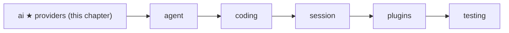
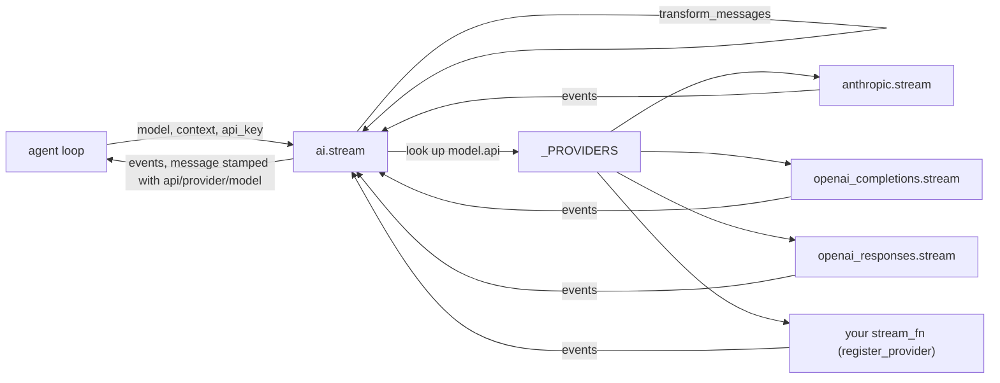
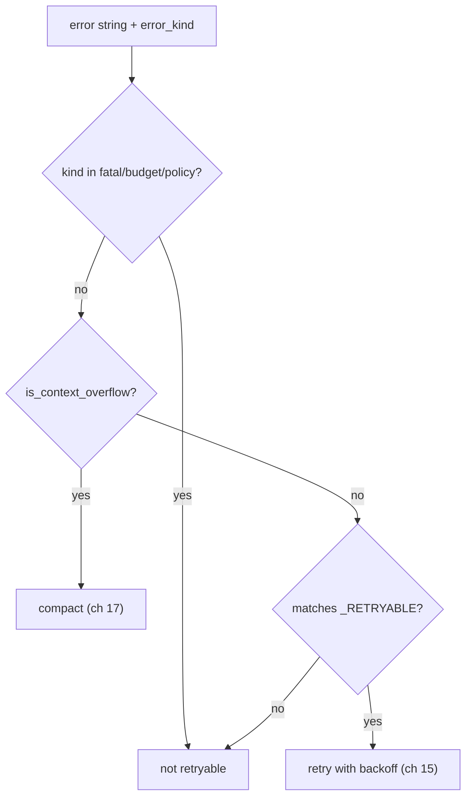

# 04 Part 1 · Providers

**Goal:** Talk to real models through one small registry.

**Builds on:** [03 The stream parser](03-stream-parser.md) · **Next:** [05 The agent loop](05-agent-loop.md)

## Where we are



In [02](02-fake-provider.md) we fixed the shape of a model call: a [stream function](glossary.md#stream-function). In [03](03-stream-parser.md) we built the parser that turns OpenAI chunks into one `AssistantMessage`. This chapter finishes the `ai` [layer](glossary.md#layer). We add the **request side** (our messages → vendor format), the two other vendors, and one function, `ai.stream`, that picks the right [provider](glossary.md#provider) for a model.

Code in this chapter (commit `2fc2776`):

- `packages/simp_agent/src/simp_agent/ai/__init__.py` — `Model`, `transform_messages`, `_PROVIDERS`, `register_provider`, `stream`, `is_retryable`, `is_context_overflow`
- `packages/simp_agent/src/simp_agent/ai/providers/openai_completions.py`
- `packages/simp_agent/src/simp_agent/ai/providers/openai_responses.py`
- `packages/simp_agent/src/simp_agent/ai/providers/anthropic.py`

## Problem

We want the [agent loop](glossary.md#agent-loop) (ch [05](05-agent-loop.md)) to say "ask the model" and not care which vendor answers. But vendors differ a lot:

| | OpenAI Chat Completions | OpenAI Responses | Anthropic Messages |
|---|---|---|---|
| System prompt | first message, role `system` | first input item, role `system` or `developer` | separate `system` field |
| Tool call | `tool_calls` on the assistant message | `function_call` item | `tool_use` block |
| Tool result | role `tool`, one per result | `function_call_output` item | `tool_result` block inside a **user** turn |
| Thinking | `reasoning_content` text | encrypted `reasoning` item | signed `thinking` block |

There are also three cross-cutting problems:

1. **History can be broken.** A turn may have ended with an error, or a tool call may have no result (the user stopped the run). Every vendor rejects a tool call with no result.
2. **Thinking is not portable.** Anthropic signs its thinking. OpenAI Responses encrypts it. Only the same model can read it back.
3. **Errors are strings.** The loop must decide "try again", "make the context smaller", or "give up" — from text like `"Error code: 529 overloaded"`.

## Naive version

The naive way is an `if` chain in the loop:

```python
async def ask(model, context, api_key):
    if model.api == "anthropic-messages":
        import anthropic
        client = anthropic.AsyncAnthropic(api_key=api_key)
        ...  # build anthropic messages, stream, parse
    elif model.api == "openai-completions":
        import openai
        client = openai.AsyncOpenAI(api_key=api_key)
        ...  # build openai messages, stream, parse
    else:
        raise ValueError(model.api)
```

Where it breaks:

- Every new vendor means editing the loop. A user cannot add their own vendor.
- Both SDKs must be installed to import this file, even if you use one.
- A raised exception (network down, bad key) crashes the loop. The [stream function](glossary.md#stream-function) rule says "never raise".
- It sends the history as-is, so an orphan tool call gives a 400 error from the vendor.

## Real design



### The `Model`

A model says which **API format** to speak, not only which vendor:

```python
@dataclass
class Model:
    id: str = "claude-sonnet-5-5"
    provider: str = "anthropic"
    max_tokens: int = 8192
    context_window: int = 200000
    api: str = "anthropic-messages"  # anthropic-messages | openai-completions | openai-responses
    base_url: str | None = None
    api_key_env: str | None = None  # env var holding the key
    compat: dict = field(default_factory=dict)  # openai: include_usage, max_tokens_field, supports_finish_reason; all: reasoning_effort; anthropic: thinking_budget
```

`api` picks the code. `provider` is just a name (for messages and keys). So a local vLLM server is `provider="vllm", api="openai-completions", base_url="http://..."`. `compat` holds small per-server switches, so odd servers need a setting, not a new provider. Profiles (ch [18](18-profiles-plugins.md)) fill these fields from config.

### The registry: `_PROVIDERS`, `register_provider`, `stream`

The [provider registry](glossary.md#provider-registry) is a plain dict from `api` string to stream function (`ai/__init__.py`):

```python
_PROVIDERS = {"anthropic-messages": _builtin("anthropic"), "openai-completions": _builtin("openai_completions"),
              "openai-responses": _builtin("openai_responses")}


def register_provider(api: str, stream_fn) -> None:
    """stream_fn(model, context, api_key=None) -> async iterator of events. Must not raise."""
    _PROVIDERS[api] = stream_fn
```

`register_provider` lets anyone add or replace an `api` without touching the library. The built-ins go through `_builtin`:

```python
def _builtin(module: str):
    async def fn(model, context, **opts):  # lazy import: providers import this module
        if not opts.get("api_key"):  # strict: providers never read env; the app passes get_api_key
            msg = AssistantMessage(stop_reason="error", error=f"no API key for provider {model.provider}", error_kind="fatal")
            yield {"type": "error", "message": msg}
            return
        async for ev in import_module(f".providers.{module}", __package__).stream(model, context, **opts):
            yield ev

    return fn
```

Two things here, both with a reason:

- **Lazy import.** The provider module is imported only on the first call. The providers import `Model`, `AssistantMessage` and friends from `ai`, so importing them at the top of `ai` would be a circular import. It also means `import anthropic` happens only when you use Anthropic.
- **No key, no call.** Providers never read environment variables. The app passes `api_key`. A missing key is an `error` event with `error_kind="fatal"`, so retry (ch [15](15-retry.md)) does not try again for nothing.

Then the one entry point:

```python
async def stream(model: Model, context: Context, **opts) -> AsyncIterator[dict]:
    """Yield events. Never raises: errors become an 'error' event with a final message. opts: api_key."""
    fn = _PROVIDERS.get(model.api)
    if fn is None:
        yield {"type": "error", "message": AssistantMessage(stop_reason="error", error=f"Unknown api: {model.api}")}
        return
    ctx = Context(context.system_prompt, transform_messages(context.messages, model), context.tools)
    async for ev in fn(model, ctx, **opts):
        if m := ev.get("message") or ev.get("partial"):
            m.api, m.provider, m.model = model.api, model.provider, model.id
        yield ev
```

It does three jobs for every provider, so no provider repeats them:

1. Unknown `api` → `error` event, not an exception.
2. Clean the history with `transform_messages` (next section).
3. **Stamp** each message with `api`, `provider` and `model`. Later, `transform_messages` reads these stamps to know who wrote a turn.

### `transform_messages`: clean history before sending

`transform_messages(messages, model)` does one pass over the history:

```python
    for m in messages:
        if m.role in ("compaction", "custom"):  # history markers, never sent
            continue
        if isinstance(m, ToolResultMessage):
            pending.pop(m.tool_call_id, None)
            out.append(m)
            continue
        flush()
        if isinstance(m, AssistantMessage):
            if m.stop_reason in ("error", "aborted"):
                continue
            pending = {c.id: c.name for c in m.tool_calls()}
            if model is not None:
                m = dataclasses.replace(m, content=_thinking(m, model))
        out.append(m)
    flush()
```

- [Compaction entries](glossary.md#compaction-entry) and [custom entries](glossary.md#custom-entry) are skipped. They live in history but are never sent.
- Assistant turns with `stop_reason` `error` or `aborted` are dropped. They are often half-written.
- `pending` remembers tool calls still waiting for a result. When the next non-result message comes (or the end), `flush()` adds a `ToolResultMessage(..., "No result provided", is_error=True)` for each one. Now every call has a result, and the vendor accepts the history.
- It uses `dataclasses.replace`, so the saved history is never changed. Only the copy sent to the model is.

### Thinking: who can read it back

Some models "think" before they answer. We keep that as `ThinkingContent(thinking, signature, redacted)`. The `signature` is vendor proof: an Anthropic signature, or the whole OpenAI Responses reasoning item as JSON. A **redacted** block has no readable text at all.

`_thinking(m, model)` decides what to send back, using the stamps:

```python
    same = (m.provider, m.api, m.model) == (model.provider, model.api, model.id)
    ...
        if isinstance(c, ThinkingContent):
            if c.redacted or (same and c.signature):
                if same:
                    out.append(c)
            elif c.thinking.strip():
                out.append(c if same else TextContent(c.thinking))
        elif isinstance(c, TextContent) and c.signature and not same:
            out.append(TextContent(c.text))
```

| Thinking block | Same model | Other model |
|---|---|---|
| signed or redacted | kept as is | dropped (it cannot verify it) |
| unsigned, with text | kept | turned into plain text |
| unsigned, empty | dropped | dropped |

This matters when the user switches model in the middle of a session: the new model still sees what the old one thought, as text, and never gets a signature it would reject.

### The three providers

All three have the same plan: **convert** our messages, **call** the SDK with `stream=True`, **parse** events, and catch every exception into an `error` event. Each one imports its SDK inside `stream`, so you only need the SDK you use. (Note: the import sits just before the `try`, so a missing SDK raises `ImportError` — the one case that breaks "never raise".)

**OpenAI Chat Completions** (`openai_completions.py`). This is the format most local servers copy. `to_openai` puts the system prompt first, sends tool results as one `role: "tool"` message each, and sends `content: None` for an assistant turn that only has tool calls. `stream` reads `compat`:

```python
            compat.get("max_tokens_field", "max_tokens"): model.max_tokens,
        }
        if compat.get("include_usage", True):
            kw["stream_options"] = {"include_usage": True}
        if compat.get("reasoning_effort"):
            kw["reasoning_effort"] = compat["reasoning_effort"]
```

Some servers want `max_completion_tokens`, some fail on `stream_options`. `compat` handles that without code. The parser is the one from ch [03](03-stream-parser.md).

**OpenAI Responses** (`openai_responses.py`). The newer OpenAI API. We send `store: False`, so OpenAI keeps nothing between calls. To let a reasoning model see its own past reasoning, we ask for `include: ["reasoning.encrypted_content"]` and save the whole reasoning item as JSON in `ThinkingContent.signature`. `to_input` puts it back in the input as-is. Text parts also keep a small JSON signature (`{v, id, phase}`) so their item id goes back the same. A tool call id is stored as `call_id|item_id` in one string; `to_input` splits it again. With reasoning on, the system prompt uses role `developer`. The request is built in `request`:

```python
    kw = {"model": model.id, "input": to_input(model, context.system_prompt, context.messages), "stream": True,
          "store": False, "max_output_tokens": max(16, model.max_tokens)}
    if effort := _reasoning(model):
        kw["reasoning"] = {"effort": effort, "summary": "auto"}
        kw["include"] = ["reasoning.encrypted_content"]
```

`parse` here works like the one in ch 03, but on Responses events (`response.output_item.added`, `...delta`, `response.output_item.done`, `response.completed`).

**Anthropic Messages** (`anthropic.py`). `_to_anthropic` sends a tool result as a `tool_result` block in a **user** turn. Anthropic needs user and assistant turns to alternate, so the last step merges turns next to each other with the same role:

```python
    merged = list()  # consecutive same-role turns become one (Anthropic needs user/assistant alternation)
    for t in out:
        if merged and merged[-1]["role"] == t["role"]:
            merged[-1]["content"].extend(t["content"])
        else:
            merged.append(t)
```

So three tool results become one user turn. Thinking is turned on by `thinking_params(model)`: `compat.thinking_budget` gives a fixed token budget (older models); `compat.reasoning_effort` gives adaptive thinking with an effort level. During streaming, `parse` keeps partial text on `msg` (useful if the run is aborted). At the end, the provider rebuilds `msg.content` from the SDK's `get_final_message()`, which has the complete, signed blocks.

### Error classification: `is_retryable`, `is_context_overflow`

Providers turn every failure into `AssistantMessage.error`, a string. Two small functions read that string:

```python
def is_context_overflow(error: str) -> bool:
    return bool(_OVERFLOW.search(error or ""))


NON_RETRYABLE = {"fatal", "budget", "policy"}


def is_retryable(error: str, kind: str | None = None) -> bool:
    if kind in NON_RETRYABLE:
        return False
    return not is_context_overflow(error) and bool(_RETRYABLE.search(error or ""))
```

- `_OVERFLOW` matches the ways vendors say "too long": `prompt is too long`, `maximum context length`, `context_length_exceeded`, `too many tokens`, and so on. This is a [context overflow](glossary.md#context-overflow).
- `_RETRYABLE` matches short-lived problems: HTTP `429` or `5xx`, `overloaded`, `rate limit`, `connection`, `timed out`, `stream ended`.
- An overflow is **never** retryable: sending the same too-long request again fails again.
- `error_kind` (`fatal`, `budget`, `policy`) beats the text. Our own code sets it when it knows better — like the missing API key above.

The session uses them in this order (`session/__init__.py`): overflow first → compact once and try again, if auto-compact is on (ch [17](17-overflow.md)); else retryable → wait and retry, up to `max_retries` (ch [15](15-retry.md)); else give up.



## Test

No real model or key is needed. The tests replace the SDK or the provider with a fake.

`test_dispatch_by_api` (`tests/test_openai.py`) checks the registry and `transform_messages` together:

```python
async def test_dispatch_by_api(monkeypatch):
    seen = []

    async def fake(model, ctx, api_key=None):
        seen.append((model.api, ctx.messages))
        yield {"type": "done", "message": AssistantMessage()}

    monkeypatch.setattr(oc, "stream", fake)
    calls = AssistantMessage([ToolCall("a", "x", {})], "tool_use")
    [e async for e in ai.stream(Model(id="m", api="openai-completions"), Context("s", [UserMessage("u"), calls]), api_key="k")]
    assert seen[0][0] == "openai-completions"
    assert seen[0][1][-1].content == "No result provided"  # transform_messages ran before the provider
```

The history ends with an orphan tool call. The provider sees a "No result provided" result added for it.

`test_http_error_is_event` makes `AsyncOpenAI` raise a connection error. The stream yields an `error` event (no exception), and `is_retryable` says yes. It also checks `is_context_overflow("This model's maximum context length is 8192 tokens")`.

Other tests:

- `test_compat_params` (`test_openai.py`) — `compat` changes the request keys.
- `test_message_conversion` (`test_openai.py`) — `to_openai` output shape.
- `test_transform_thinking_same_vs_other_model` (`test_reasoning.py`) — the thinking table above.
- `test_responses_stream_thinking_text_toolcall`, `test_responses_replay_order_and_ids` (`test_reasoning.py`) — Responses parsing and replay.
- `test_anthropic_thinking_and_signature_delta` (`test_reasoning.py`) — Anthropic thinking and signature.

```bash
uv run pytest packages/simp_agent/tests/test_openai.py packages/simp_agent/tests/test_reasoning.py
```

> **Why this way**
>
> We pick the provider by **API format** (`model.api`), not by vendor. Many vendors and local servers speak the OpenAI format, so three providers cover almost all of them, and `compat` handles the small differences.
>
> The shared work — unknown api, history cleaning, stamping — lives once in `ai.stream`. Each provider only converts and parses. A provider never raises and never reads the environment, so the loop has one rule (read the last event) and the app stays in control of keys.

## Recap

- `Model.api` picks a stream function from the `_PROVIDERS` dict. `register_provider` adds your own.
- Built-in providers are imported lazily, and refuse to run without an `api_key` (`error_kind="fatal"`).
- `ai.stream` cleans history with `transform_messages`, then stamps every message with `api`, `provider`, `model`.
- `transform_messages` drops markers and failed turns, and adds "No result provided" for orphan tool calls.
- Signed thinking goes back only to the same model; other models get it as plain text.
- Each provider converts our messages to its format and parses its stream; Anthropic merges same-role turns.
- `is_context_overflow` and `is_retryable` turn an error string into "compact", "retry" or "give up".

**Builds on:** [03 The stream parser](03-stream-parser.md) · **Next:** [05 The agent loop](05-agent-loop.md) — the loop that calls `ai.stream` and runs the tools the model asks for.
