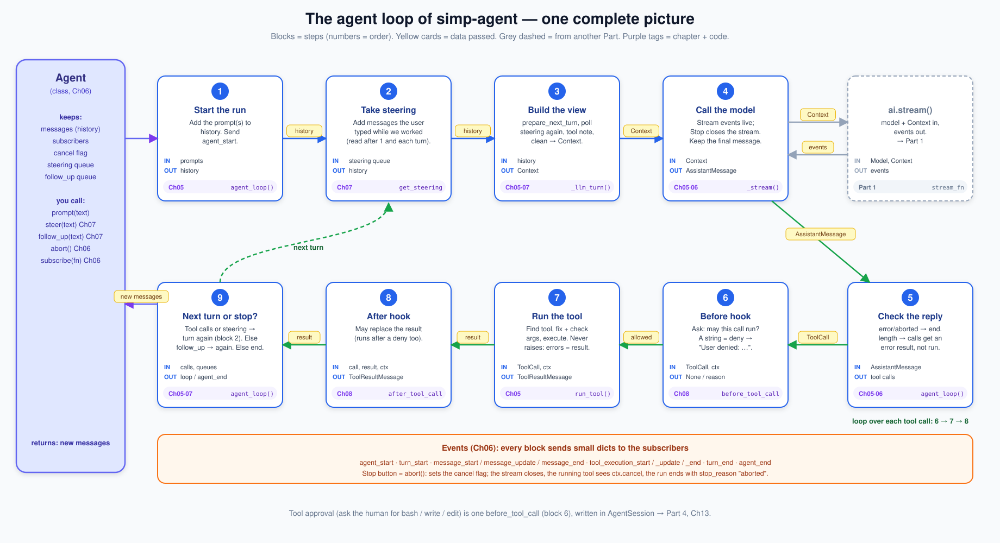
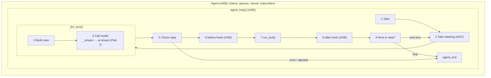

# Part 2 big picture: the agent loop

**In one sentence:** Part 2 teaches the program to keep asking the model, running the tools it asks for, until the model gives a final answer. That program is the [agent loop](glossary.md#agent-loop).

Read this page before [05](05-agent-loop.md). Come back to it any time you get lost in [05](05-agent-loop.md)–[08](08-hooks-approval.md). It adds no new facts. The story comes first; the map (picture and tables) is at the end.

## The story: Ann asks about a file

Ann opens the app and types: **"What is in README.md?"**

After Part 1 we can do one thing: send Ann's question to the model and get **one** reply back. That is like phoning a friend who cannot see your computer.

The friend says: *"I can't see it. Please read README.md for me and tell me what it says."*

That reply is not the answer. It is a request. Somebody must:

1. open README.md,
2. tell the text to the friend,
3. and wait for the friend to answer again.

The friend may ask for another file, and another. Only when the friend stops asking and just talks do we have Ann's answer.

**That "somebody" is the agent loop.** Part 1 is the phone. Part 2 is the person who holds the phone, does the jobs the friend asks for, and calls back.

## The core loop in 4 steps

1. **Ask** the model.
2. If it wants tools, **run** them.
3. **Give** it the results.
4. **Repeat** until it just answers.

A simple sketch, not the real code:

```python
while True:
    reply = ask_model(history)
    history.append(reply)
    if not reply.tool_calls: break
    for call in reply.tool_calls: history.append(run(call))
```

That is all. Chapters 05–08 add safety and control around these five lines.

## Walk Ann's question through the loop

At each step: where the thing comes from, who does it, and what it is. Then the code name.

**1. Ann's text becomes a message.** Ann types in the app. The app (the UI) takes the text and hands it to the agent. The **agent** is the code we build in Part 2: it runs the loop above, between the app and the model. The app calls it like this: `agent.prompt("What is in README.md?")`. The text is the **prompt**. The agent wraps it in a `UserMessage` (a [message](glossary.md#message) from the user, Part 1).

**2. The message goes into the history.** The [history](glossary.md#history) is the list of all messages in this chat so far: Ann's questions, the model's replies, the tool results. The model remembers nothing between calls, so we must send it the history every time. The `Agent` object keeps this list (`agent.messages`) so it lives from one question to the next. See [Agent (class)](glossary.md#agent-class).

**3. The agent builds what the model will see.** It takes the history, the system prompt (the fixed instructions the app gives the model before any chat, like "You are a helpful coding helper") and the list of tools Ann's app gave it (here: `read`). It puts them in one package: the [view](glossary.md#view-llm-view), stored as a [Context](glossary.md#context) (Part 1). In Part 2 the view is (almost) the whole history: the app may trim or change it a little before it is sent.

**4. The agent asks the model.** It sends the `Context` to the model and gets the answer back as a stream, a little at a time. The function that does this is `ai.stream()` from Part 1. Words come back piece by piece. At the end there is one full reply from the model, an `AssistantMessage`. Here it holds no text, only a **tool call**: "run `read` with `path = README.md`". A [tool call](glossary.md#tool-call) is the model's written request to run a tool. The model cannot run anything itself; it can only ask.

**5. The agent runs the tool.** The agent finds the tool named `read` in its list, checks the arguments (the inputs in the call, here `path`: are they there and of the right type?), and runs it. The file text comes back as a **tool result**: a message that says "here is what `read` gave", called a `ToolResultMessage`. If the tool fails, the result just says so (an error result). The loop does not crash.

**6. The result goes into the history, and we ask again.** Now the history has 3 messages: Ann's question, the model's tool call, the file text. The agent goes back to step 3 and asks the model again. One trip from step 3 to here is one [turn](glossary.md#turn).

**7. The model answers.** This time the model has the file, so it writes plain text: "README.md says …". No tool calls. The loop stops. `agent.prompt()` gives back the new messages.

**All the time, the agent tells the UI what happens.** At each moment (run started, new words came, tool started, tool ended, run ended) the loop sends a small note called an [event](glossary.md#event), and the `Agent` passes it to everyone who listens. The UI listens to these notes and draws them: the words as they arrive, a "reading README.md…" line. The agent does not draw anything itself.

**How the run ends.** Normally: the model replies with no tool calls. It also ends if the model call fails (`error`) or if Ann presses Stop (`aborted`).

## What each chapter adds

The 5 lines above work, but real use needs more. Each chapter adds one thing to the same loop.

- **[05 The agent loop](05-agent-loop.md): run tools safely.** The model may ask for a tool that does not exist, or send bad arguments, or the tool may crash. 05 builds the loop so each problem becomes an error result the model can read and fix. It also builds the [agent tool](glossary.md#agent-tool) (a tool that can run) and the [tool context](glossary.md#tool-context) it gets.
- **[06 Events and abort](06-events-abort.md): let the UI watch, let Ann stop.** 06 builds the `Agent` class and the events, so the UI can show each step live. It also adds a Stop button: Ann presses it, the agent [aborts](glossary.md#abort), the model stream closes, tools are told to stop, the run ends `aborted`.
- **[07 Steering](07-steering.md): let Ann type while the agent works.** Ann sees the agent reading the file and types "only the first line". She should not have to wait. 07 keeps her message in a queue and adds it at a [safe point](glossary.md#safe-point), before the next model call: a [steer](glossary.md#steer). A [follow-up](glossary.md#follow-up) is a message that waits until the agent would stop.
- **[08 Hooks and approval](08-hooks-approval.md): let the app ask before a tool runs.** Some tools are dangerous (delete a file, run a command). 08 adds a [tool hook](glossary.md#tool-hook) before and after each tool. The app can use the "before" hook to ask Ann "allow this?" ([tool approval](glossary.md#tool-approval)). If she says no, the model gets "User denied: …" as the result.

## Map for later

Now the same loop with the real names. Use this as a reference when you read the chapters.

### The picture



Read the top row left to right (build the question, ask the model), then the bottom row right to left (handle the answer, run tools). Blocks are steps. Yellow cards on the arrows are the data passed between steps. Purple tags say which chapter builds the block. The dashed green arrow goes back for the next [turn](glossary.md#turn). `ai.stream()` is grey: it is Part 1, see [part-1-ai](01-0-part-1-ai.md).

### The blocks

| # | Block | What it does | IN | OUT | Code (file · function) | Chapter |
|---|---|---|---|---|---|---|
| 1 | Start the run | Add the prompt messages to the history. Send `agent_start`. | prompts | history | `agent/__init__.py` · `agent_loop()` | [05](05-agent-loop.md) |
| 2 | Take steering | Add messages the user typed while the agent worked. They are read after block 1 and after each turn, and added after `turn_start`. | steering queue | history | `agent/__init__.py` · `agent_loop()` → `config.get_steering()` | [07](07-steering.md) |
| 3 | Build the view | Run `prepare_next_turn`, poll steering once more, add a "Tools added / removed" note if tools changed, clean the messages, make a `Context`. | history | `Context` | `agent/__init__.py` · `_llm_turn()` | [05](05-agent-loop.md), [07](07-steering.md); the hook is filled in [16](16-compaction.md) |
| 4 | Call the model | Call `stream_fn` (normally `ai.stream()`), send each event on as `message_update`, keep the final message. Stop closes the stream. | `Context` | `AssistantMessage` | `agent/__init__.py` · `_llm_turn()`, `_stream()` | [05](05-agent-loop.md), [06](06-events-abort.md) |
| 5 | Check the reply | `error` or `aborted` → end the run. `length` → every tool call gets an error result and does not run. | `AssistantMessage` | tool calls | `agent/__init__.py` · `agent_loop()` | [05](05-agent-loop.md), [06](06-events-abort.md) |
| 6 | Before hook | Ask "may this call run?". `None` = run it. A string = deny, and the result is `"User denied: <reason>"`. | `ToolCall`, `ToolContext` | `None` or a reason | `agent/__init__.py` · `LoopConfig.before_tool_call` | [08](08-hooks-approval.md) |
| 7 | Run the tool | Find the tool by name, fix the args (`prepare_arguments`), check them against the schema, call `execute`. Never raises: every problem becomes an error result. | `ToolCall`, `ToolContext` | `ToolResultMessage` | `agent/__init__.py` · `run_tool()` | [05](05-agent-loop.md) |
| 8 | After hook | May return a new result to replace the old one. Runs after a deny too. | call, result, `ToolContext` | `ToolResultMessage` | `agent/__init__.py` · `LoopConfig.after_tool_call` | [08](08-hooks-approval.md) |
| 9 | Next turn or stop? | Had tool calls, or steering waits → go to block 2. Else take a follow-up → go to block 2. Else send `agent_end` and return. | tool calls, queues | next turn, or new messages | `agent/__init__.py` · `agent_loop()` | [05](05-agent-loop.md), [07](07-steering.md) |

Blocks 6, 7 and 8 run once **for each** tool call in the reply, in order. `tool_execution_start` is sent before block 6 and `tool_execution_end` after block 8, so a denied call gets both events too.

Words: the **view** is the list of messages sent in one call (it may be shorter than the history). The **cancel event** is the `asyncio.Event` behind [abort](glossary.md#abort). The **queues** are the steer and follow-up lists in `Agent`.

Paths are under `packages/simp_agent/src/simp_agent/`.

### Which block is inside which

- **`agent_loop()` is the whole Part.** It does blocks 1, 2, 5, 6, 8 and 9 itself.
- **One model turn = `_llm_turn()`** = blocks 3 and 4. Inside block 4, `_stream()` wraps `stream_fn`. `stream_fn` is `ai.stream()` from Part 1 (or `FakeProvider` in tests, [04](04-label-test.md)).
- **`run_tool()`** is block 7 only. The hooks (6, 8) are *around* it, in `agent_loop()`.
- **The `Agent` class** ([06](06-events-abort.md)) is *outside* the loop. It keeps the history, the subscribers, the cancel event and the two queues. Each `prompt()` builds a `LoopConfig` and calls `agent_loop()` once.
- **Events** ([06](06-events-abort.md)) are not a block. Every block sends them through one `emit` function; `Agent` gives them to each subscriber.
- **[Tool approval](glossary.md#tool-approval)** is not in this Part's code. It is one `before_tool_call` (block 6) written in `AgentSession` → Part 4, [13](13-session.md). [08](08-hooks-approval.md) shows it early.



**Rule for the whole Part:** the loop does not crash on a bad tool. Unknown tool, bad args, an exception in `execute`: each one becomes a `ToolResultMessage` with `is_error=True`, and the model sees it on the next turn.

If something else raises (for example a subscriber), `Agent` ends the run with an `AssistantMessage` whose `stop_reason` is `"error"`. No `agent_end` is sent then.

### The objects

| Object | Fields | Meaning |
|---|---|---|
| [Agent](glossary.md#agent-class) | `messages`, `tools`, `steering`, `follow_ups`, `is_streaming` + `prompt()`, `steer()`, `follow_up()`, `abort()`, `subscribe()` | The thin object that keeps state between runs and calls `agent_loop()`. |
| [Agent tool](glossary.md#agent-tool) (`AgentTool`) | `name`, `description`, `parameters` + `execute(args, ctx)`, `prepare_arguments` | A [Tool](glossary.md#tool) that can also run. |
| [Tool context](glossary.md#tool-context) (`ToolContext`) | `cancel`, `env`, `cwd`, `on_update` | What a tool (and a hook) gets besides its args. `on_update(text)` sends `tool_execution_update`. |
| [LoopConfig](glossary.md#loopconfig) | `model`, `tools` / `get_tools`, `stream_fn`, `get_steering`, `get_follow_up`, `prepare_next_turn`, `get_api_key`, `env`, `cwd`, `before_tool_call`, `after_tool_call`, … | All settings of one run. Every hook has a "do nothing" default. |
| [Event](glossary.md#event) | a dict with `type`: `agent_start`, `turn_start`, `message_start`, `message_update`, `message_end`, `tool_execution_start` / `_update` / `_end`, `turn_end`, `agent_end` | One signal to the subscribers. `message_update` carries one Part 1 [stream event](glossary.md#stream-event). |
| [Abort](glossary.md#abort) | one `asyncio.Event` (the cancel event) | `Agent.abort()` sets it. The stream closes, tools see `ctx.cancel`, the run ends `aborted`. |
| [Steer](glossary.md#steer) / [Follow-up](glossary.md#follow-up) queue | a list of `UserMessage` | Steer = add at the next turn. Follow-up = add only when the loop would stop. |
| [Queue mode](glossary.md#queue-mode) | `"one-at-a-time"` (default) or `"all"` | How many queued messages are taken each time. |
| [Tool hook](glossary.md#tool-hook) | `before_tool_call(call, ctx)`, `after_tool_call(call, result, ctx)` | Sync or async. Gate or change one tool call. |

Messages (`UserMessage`, `AssistantMessage`, `ToolResultMessage`, `ToolCall`) come from Part 1: see [part-1-ai](01-0-part-1-ai.md#the-objects).

### The worked example with all blocks

Ann's story again, now with block numbers and events.

1. The app calls `agent.prompt("What is in README.md?")`. `Agent` builds a `LoopConfig` and calls `agent_loop()`.
2. **Start:** the `UserMessage` goes into the history. Events: `agent_start`, `message_start`, `message_end`.
3. **Take steering:** the queue is empty. Event: `turn_start`.
4. **Build the view:** no tool change. The `Context` has the system prompt, one message and the `read` tool.
5. **Call the model:** `ai.stream()` streams. Each piece is sent as `message_update`. The final message has one `ToolCall(name="read", arguments={"path": "README.md"})`, `stop_reason="tool_use"`.
6. **Check the reply:** not an error, not cut off. Go on to the tools.
7. **Before hook:** first the event `tool_execution_start`. Then the hook returns `None` (allow).
8. **Run the tool:** `read` is found, args pass the schema, `execute` returns the file text → `ToolResultMessage`.
9. **After hook:** keeps the result. Events: `tool_execution_end`, then the result is added (`message_start`, `message_end`), then `turn_end`.
10. **Next or stop?** There was a tool call → next turn. While the tool ran, the user called `agent.steer("only the first line")`. Block 2 adds that message now, before the next model call.
11. The model answers with text (only the first line, as Ann asked), `stop_reason="stop"`. No tool calls, no steering, no follow-up → `agent_end`. `prompt()` returns the new messages.

If Ann pressed Stop while `read` ran (block 7), the tool would see `ctx.cancel` and return an error result ("Interrupted by the user"). The loop adds that result, then an `AssistantMessage` with `stop_reason="aborted"`, and ends.

## Builds on / Next

- Builds on: [Part 1 big picture](01-0-part-1-ai.md) · [04 Label + test the pipeline](04-label-test.md).
- Chapters: [05 The agent loop](05-agent-loop.md) · [06 Events and abort](06-events-abort.md) · [07 Steering](07-steering.md) · [08 Hooks and approval](08-hooks-approval.md).
- Next: [Part 3 big picture](09-0-part-3-coding.md), then [09 Execution environment](09-exec-env.md) gives tools a safe `env` (the `ToolContext.env` field).
