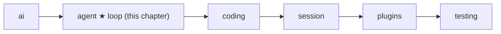
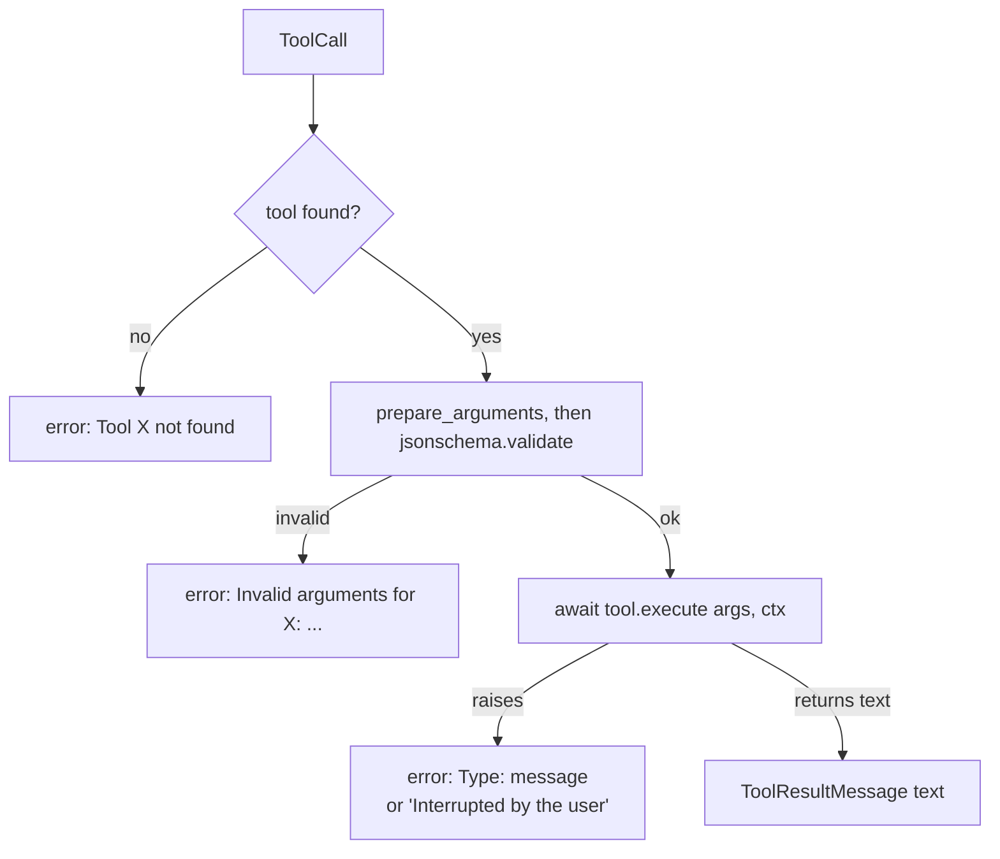

# 05 Part 2 · The agent loop

**Goal:** Build the smallest loop that calls a model and runs tools.

**Builds on:** [04 Providers](04-providers.md) · **Next:** [06 Events and abort](06-events-abort.md)

## Where we are



Part 1 finished the `ai` [layer](glossary.md#layer). We can now send a [context](glossary.md#context) to any model with `ai.stream` ([04](04-providers.md)) and get back one `AssistantMessage` ([03](03-stream-parser.md)). In tests, `FakeProvider` plays the model ([02](02-fake-provider.md)).

But one model call is not an agent. A [coding agent](glossary.md#coding-agent) must **act**: the model asks for a [tool call](glossary.md#tool-call), we run it, we give the result back, and we ask again. This chapter builds that [agent loop](glossary.md#agent-loop).

Code in this chapter (commit `2fc2776`):

- `packages/simp_agent/src/simp_agent/agent/__init__.py` — `AgentTool`, `ToolContext`, `LoopConfig`, `run_tool`, `agent_loop`, `_llm_turn`
- `packages/simp_agent/tests/test_core.py` — the loop tests

The same file also holds events, abort, steering, hooks and the `Agent` class. We only touch them here; chapters [06](06-events-abort.md), [07](07-steering.md) and [08](08-hooks-approval.md) explain them.

## Problem

The model cannot do anything by itself. It only writes text and tool calls. Someone must:

1. Send the history to the model.
2. Look at the answer. If it has tool calls, run each tool.
3. Put each result in the history as a `ToolResultMessage`.
4. Go back to step 1. Stop when the model answers with no tool calls.

Each step can go wrong. The model can ask for a tool that does not exist. It can send bad arguments. The tool can crash. The provider can fail. The loop must handle all of these **without crashing**, because a crash loses the whole run.

## Naive version

```python
async def naive_loop(system_prompt, messages, tools, model):
    while True:
        ctx = Context(system_prompt, messages, tools)
        msg = None
        async for ev in ai.stream(model, ctx):
            if ev["type"] in ("done", "error"):
                msg = ev["message"]
        messages.append(msg)
        calls = msg.tool_calls()
        if not calls:
            return messages
        for call in calls:
            tool = {t.name: t for t in tools}[call.name]      # KeyError if unknown
            text = await tool.execute(call.arguments)          # may raise
            messages.append(ToolResultMessage(call.id, call.name, text))
```

It works for the happy path. Where it breaks:

- **Unknown tool** → `KeyError`, the run dies.
- **Bad arguments** (missing field, wrong type) → the tool crashes in a strange place, or worse, does the wrong thing.
- **Tool raises** → the exception ends the run. The model never learns what went wrong, so it cannot try another way.
- **Provider error** → `msg.stop_reason == "error"` has no tool calls, so we return. That is fine, but by luck, not by design.
- **Answer cut off** (`stop_reason == "length"`) → the last tool call's arguments may be half-written JSON. We would run it anyway.
- **No way to test** → `ai.stream` is hard-coded, so a test needs a real model.
- **The tool knows nothing** → no working folder, no way to stop it, no way to report progress.

The real design fixes each of these.

## Real design

### Tools: `AgentTool`

From [01](01-messages.md), `ai.Tool` is only a description for the model: `name`, `description`, `parameters` (a JSON schema). The `ai` layer never runs tools. The `agent` layer adds the code:

```python
@dataclass
class AgentTool(ai.Tool):
    execute: Callable[[dict, "ToolContext"], Awaitable[str]] | None = None  # (args, ctx) -> text
    prepare_arguments: Callable[[dict], dict] | None = None  # raw args -> args, before validation (pi prepareArguments)
```

- `execute(args, ctx)` is an async function. It returns **text**. The text goes back to the model as the tool result.
- `prepare_arguments` is optional. It fixes raw arguments before they are checked (for example, an old argument name). We see it in `run_tool` below.

Because `AgentTool` **is** an `ai.Tool`, we can pass the same list to the model (as descriptions) and to the loop (to run them).

### `ToolContext`: what a tool gets

```python
@dataclass
class ToolContext:
    cancel: asyncio.Event
    env: ExecutionEnv
    cwd: str
    on_update: Callable[[str], Awaitable[None]]  # emits tool_execution_update (progress for the UI)
```

A tool should not reach for globals. Everything it needs comes in this one object — the [tool context](glossary.md#tool-context):

| Field | What it is | Explained in |
|---|---|---|
| `cancel` | Set when the user stops the run. A long tool should check it. | [06](06-events-abort.md) |
| `env` | The [execution environment](glossary.md#execution-environment): the one place where tools read files and run commands. Default `LocalEnv`. | [09](09-exec-env.md) |
| `cwd` | The working folder. Default: the process's current folder. | [09](09-exec-env.md) |
| `on_update` | Send progress text (for example, bash output lines) to the UI. | [06](06-events-abort.md) |

Why one object and not four arguments? We can add a field later without changing every tool. And the same tool code runs on a laptop or in a Docker sandbox ([24](24-docker-sandbox.md)): only `env` changes.

### `run_tool`: one call, never raises

```python
async def run_tool(tools: list, call: ai.ToolCall, ctx: ToolContext) -> ToolResultMessage:
    def err(text):
        return ToolResultMessage(call.id, call.name, text, is_error=True)

    tool = next((t for t in tools if t.name == call.name), None)
    if tool is None:
        return err(f"Tool {call.name} not found")
    try:
        if tool.prepare_arguments:
            call.arguments = tool.prepare_arguments(call.arguments)
        jsonschema.validate(call.arguments, tool.parameters)
    except jsonschema.ValidationError as e:
        return err(f"Invalid arguments for {call.name}: {e.message}")
    except Exception as e:
        return err(f"prepare_arguments failed: {type(e).__name__}: {e}")
    try:
        return ToolResultMessage(call.id, call.name, await tool.execute(call.arguments, ctx))
    except Exception as e:
        return err("Interrupted by the user" if ctx.cancel.is_set() else f"{type(e).__name__}: {e}")
```

This is the most important rule of the chapter: **every failure becomes a `ToolResultMessage` with `is_error=True`**. Nothing raises out of `run_tool`.



Why turn errors into messages? Because the model can **read** them. If it sees `'x' is a required property`, it calls the tool again with `x`. If the run crashed, there is nobody left to fix it. The error text is feedback, not a failure.

Three more details:

- The schema check uses the same `parameters` the model was shown. One schema, two jobs: it tells the model what to send, and it checks what the model sent.
- `prepare_arguments` runs **before** validation, so it can repair old argument shapes. It writes back into `call.arguments`, so the history keeps the repaired version.
- If the tool raised **because** the user stopped the run, the model sees `Interrupted by the user`, not a confusing `CancelledError`.

### `LoopConfig`: the settings

`agent_loop` takes many settings. They live in one dataclass, `LoopConfig`. Here are the ones this chapter uses:

```python
@dataclass
class LoopConfig:
    model: Model
    tools: list = field(default_factory=list)
    get_tools: Callable[[], list] | None = None  # re-read every turn (wins over tools); changes are told to the model
    ...
    stream_fn: Callable = ai.stream  # swap for a fake in tests
    ...
    get_api_key: Callable[[str], Any] | None = None
    env: ExecutionEnv = field(default_factory=LocalEnv)
    cwd: str = field(default_factory=os.getcwd)
```

- `stream_fn` defaults to `ai.stream`. A test passes `FakeProvider(...)` instead. This is the [stream function](glossary.md#stream-function) shape from [02](02-fake-provider.md) paying off: the loop cannot tell the difference.
- `get_api_key(provider)` is called **before every model call**, so an OAuth token can refresh in the middle of a long run. `api_key_opts` turns it into `{"api_key": ...}`. If it is `None`, no key is passed and the provider returns a "no API key" error ([04](04-providers.md)).
- `env` and `cwd` go into every `ToolContext`.
- `get_tools`, if set, is called every turn and wins over `tools`. So the tool list can change during a run. The `Agent` class sets `get_tools=lambda: self.tools`, so changing `agent.tools` takes effect at the next turn.

The other fields (`get_steering`, `get_follow_up`, `prepare_next_turn`, `before_tool_call`, `after_tool_call`, `convert_to_llm`, `transform_context`, `declared_tools`) all have "do nothing" defaults. Later chapters fill them in. That is why the loop in this chapter can stay small: the hooks exist, but they are empty.

### `agent_loop`: the loop

Here is the shape, with the steering and follow-up parts ([07](07-steering.md)) left as they are:

```python
async def agent_loop(system_prompt, messages, prompts, config, emit=lambda e: None, cancel=None) -> list:
    """Run until the assistant stops calling tools. Mutates `messages`, returns the new ones."""
    ...
    await send({"type": "agent_start"})
    for p in prompts:
        await add(p)
    pending, has_calls, msg = config.get_steering(), True, None
    while True:
        while has_calls or pending:
            await send({"type": "turn_start"})
            ...
            msg = await _llm_turn(system_prompt, messages, config, cancel, send, add)
            await add(msg)
            calls = msg.tool_calls()
            if msg.stop_reason in ("error", "aborted"):
                return await _end(send, msg, new)
            for call in calls:
                ...
                if msg.stop_reason == "length":  # args may be cut off: never run them
                    result = ToolResultMessage(call.id, call.name, "Tool call was truncated (max tokens); not executed", True)
                else:
                    ...
                    ctx = ToolContext(cancel, config.env, config.cwd, on_update)
                    ...
                        result = await run_tool(_tools(config), call, ctx)
                    ...
                await add(result)
            ...
            await send({"type": "turn_end", "message": msg})
            has_calls, pending = bool(calls), config.get_steering()
        pending = config.get_follow_up()
        if not pending:
            break
    await send({"type": "agent_end", "messages": new})
    return new
```

Read it as the four steps from the Problem section:


(The diagram leaves out one exit: if the user aborts during the tool batch, the loop adds an `aborted` message and ends. That is [06](06-events-abort.md).)


One pass of the inner `while` is one [turn](glossary.md#turn): one model call plus the tools it asked for. Some points:

- **Inputs.** `messages` is the full history. The loop **appends** to it (mutates it). `prompts` are the new user messages for this run. The return value is only the **new** messages, so the caller can save or show them.
- **`add(m)`** does two things: it appends `m` to `messages` and to `new`, and it emits `message_start` / `message_end` events. Every message goes through `add`, so events and history never disagree. Events are the topic of [06](06-events-abort.md).
- **The stop rule.** `has_calls = bool(calls)`. If the model asked for nothing, the inner loop ends. This is the only "done" signal: the model decides when it has finished.
- **Errors end the run, not the program.** A provider error comes back as an `AssistantMessage` with `stop_reason="error"` ([02](02-fake-provider.md)). The loop adds it to history and returns. The caller sees it; retry is a separate job ([15](15-retry.md)).
- **Cut-off calls are never run.** When `stop_reason == "length"`, each call gets an error result "Tool call was truncated (max tokens); not executed". Running half-written arguments (say, a `write` with half a file) would be dangerous. The model still gets a result for each call, so the next request is valid.
- **Every tool call gets a result.** Unknown tool, bad args, crash, truncated: in every case the loop adds a `ToolResultMessage`. Providers reject a tool call with no result ([04](04-providers.md)), so this keeps the history sendable. (One exception: after an abort the remaining calls are skipped; `transform_messages` repairs that later, see [04](04-providers.md) and [06](06-events-abort.md).)
- **Tools run one after another**, in the order the model gave, so results stay in the same order as the calls. (A design reason, not written in the code: two tools never edit the same file at the same time.)

The parts marked `...` are: `tool_execution_*` events and abort ([06](06-events-abort.md)), steering and follow-ups ([07](07-steering.md)), and `before_tool_call` / `after_tool_call` ([08](08-hooks-approval.md)).

### `_llm_turn`: one model call

`_llm_turn` builds the request and streams one answer. Its core:

```python
    tools = list(_tools(config))
    ...
    if callable(system_prompt):
        system_prompt = await _maybe_await(system_prompt())
    llm_msgs = ai.transform_messages(config.convert_to_llm(config.transform_context(view)))
    msg = partial = None
    opts = await api_key_opts(config.get_api_key, config.model)
    async for ev in _stream(config.stream_fn, config.model, Context(system_prompt, llm_msgs, tools), cancel, opts):
        await send({"type": "message_update", "event": ev})
        partial = ev.get("partial", partial)
        if ev["type"] in ("done", "error"):
            msg = ev["message"]
```

- The tool list is read again **every turn**.
- `system_prompt` is typed `str`, but it may also be a function (sync or async) that returns the string. A function is called every turn, so the prompt can change between turns. (What goes in the prompt is [11](11-system-prompt.md).)
- `transform_messages` ([04](04-providers.md)) cleans the history before it is sent. The view goes through `transform_context` and `convert_to_llm` first; both do nothing by default.
- The final message is taken from the last `done` or `error` event — the one rule of a stream function.
- `_stream` wraps `stream_fn` so the call can be stopped in the middle; that is [06](06-events-abort.md).

The skipped lines (the `prepare_next_turn` hook, a steering poll, and a "Tools added / removed" note when the tool list changed) belong to [07](07-steering.md) and [16](16-compaction.md); the note is shown when tools change at run time.

## Test

`test_core.py` drives the loop with `FakeProvider` and two tiny tools:

```python
def call(name, **args):
    return AssistantMessage([ToolCall("c1", name, args)], stop_reason="tool_use")


async def echo(args, cancel):
    return f"echo {args['x']}"


ECHO = AgentTool("echo", "", {"type": "object", "properties": {"x": {"type": "string"}}, "required": ["x"]}, echo)
BOOM = AgentTool("boom", "", {"type": "object"}, boom)
DONE = AssistantMessage([TextContent("ok")])


async def run(*replies, tools=(ECHO, BOOM)):
    events = []
    cfg = LoopConfig(Model(), list(tools), stream_fn=FakeProvider(*replies))
    new = await agent_loop("sys", [], [UserMessage("hi")], cfg, events.append)
    return new, [e["type"] for e in events]
```

(`boom` always raises `RuntimeError("kaboom")`. The second parameter is named `cancel` in the test, but it receives the `ToolContext`.)

Each [scripted reply](glossary.md#scripted-reply) is one model answer. The test for the main path:

```python
async def test_tool_call_then_second_turn():
    new, ev = await run(call("echo", x="a"), DONE)
    assert [m.role for m in new] == ["user", "assistant", "tool_result", "assistant"]
    assert new[2].content == "echo a" and not new[2].is_error
    assert ev.count("turn_end") == 2 and "tool_execution_end" in ev
```

Reply 1 asks for `echo(x="a")`. The loop runs it and calls the model again. Reply 2 has no tool calls, so the loop stops. Two turns, four new messages.

The error paths:

```python
async def test_unknown_tool_and_invalid_args():
    new, _ = await run(call("nope"), call("echo", y=1), DONE)
    assert new[2].is_error and new[2].content == "Tool nope not found"
    assert new[4].is_error and "'x' is a required property" in new[4].content
    assert new[-1].text() == "ok"
```

Neither error stops the run. The model gets the error text and the third reply ends normally.

Other loop tests in the same file (the edit and real-tool tests belong to [10](10-coding-tools.md)):

- `test_no_tool_call_one_turn` — one reply with no calls → one turn.
- `test_tool_exception` — `boom` raises; the result is an error containing `kaboom`.
- `test_provider_error` — a reply with `stop_reason="error"` ends the run with `agent_end`.

```bash
uv run pytest packages/simp_agent/tests/test_core.py
```

> **Why this way**
>
> The loop is a plain function, not a class. Its inputs are a history, new prompts and a `LoopConfig`; its output is the new messages. All state lives in `messages`, which the caller owns. This makes it easy to test (fake `stream_fn`, list of events) and easy to wrap: the `Agent` class ([06](06-events-abort.md)) and the session ([13](13-session.md)) add state on top.
>
> Errors are data. A tool error becomes a message the model can read and fix; a provider error becomes an assistant message the caller can retry. The loop never raises because of what the model or a tool did.

## Exercises

1. Give the `echo` tool a `prepare_arguments` that renames an old argument `text` to `x`. Let the model call `echo` with `{"text": "a"}`. Is the result an error? What arguments does the assistant message in history hold now?
2. Script a reply that calls `echo(x="a")` with `stop_reason="length"`, then `DONE`. Did `echo` run? What text is in the tool result, and does the run still reach the second reply?

## Recap

- `AgentTool` = `ai.Tool` + `execute(args, ctx) -> str` (+ optional `prepare_arguments`).
- `ToolContext` gives a tool `cancel`, `env`, `cwd` and `on_update`, so tools need no globals.
- `run_tool` finds the tool, checks the arguments with the tool's JSON schema, runs it, and turns every failure into an error `ToolResultMessage`.
- `agent_loop` repeats: call the model, add the answer, run each tool call, add each result. It stops when the model asks for no tools, on an `error` / `aborted` answer, or when the user aborts.
- Cut-off (`length`) tool calls are never run, but still get a result.
- `LoopConfig.stream_fn` lets tests use `FakeProvider`; the other hooks have empty defaults and are filled in by later chapters.

**Builds on:** [04 Providers](04-providers.md) · **Next:** [06 Events and abort](06-events-abort.md) — what the `send(...)` events are, and how `cancel` stops a model call or a tool in the middle.
