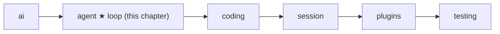
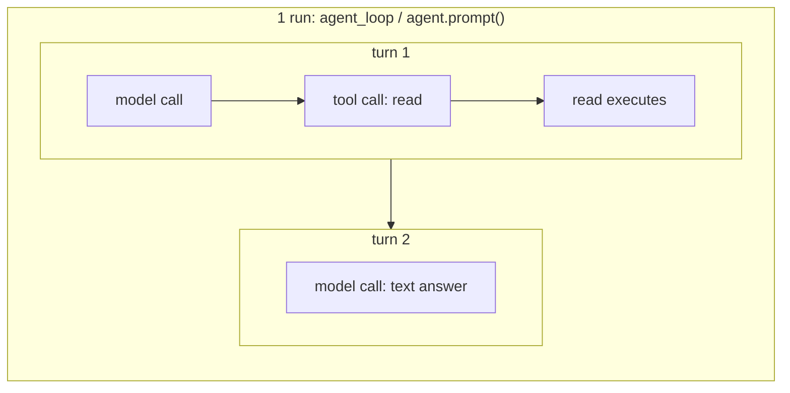
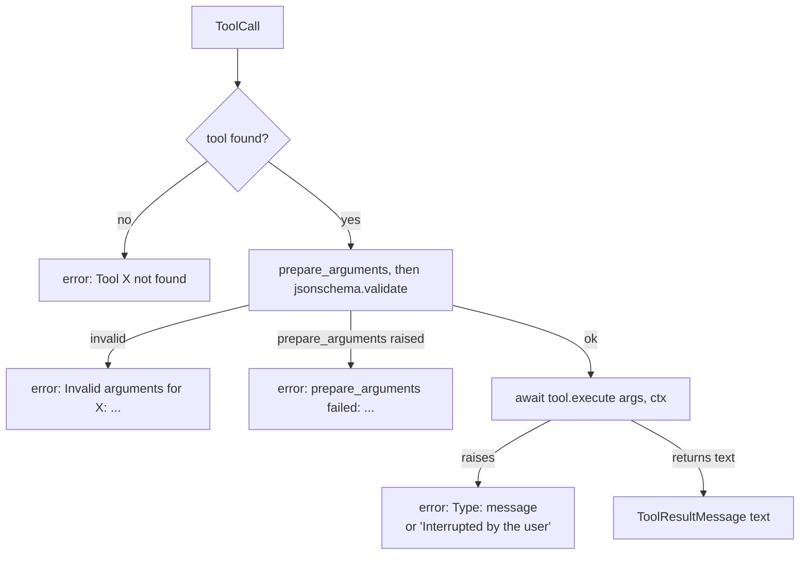
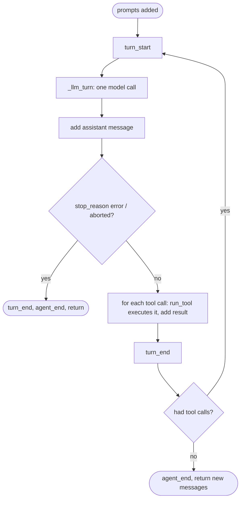

# 05 Part 2 · The agent loop

**Goal:** Build the smallest loop that calls a model and executes tools.

**Builds on:** [04 Label + test the pipeline](04-label-test.md) · **Next:** [06 Events and abort](06-events-abort.md)

## Where we are



Big picture of Part 2: [part-2-agent](05-0-part-2-agent.md).

Part 1 finished the `ai` [layer](glossary.md#layer). We can now send a [context](glossary.md#context) to any model with `ai.stream` ([04](04-label-test.md)) and get back one `AssistantMessage` ([03](03-parse.md)). In tests, `FakeProvider` plays the model ([04](04-label-test.md#testing-the-pipeline-without-a-real-model)).

But one model call is not an agent. A [coding agent](glossary.md#coding-agent) must **act**: the model asks for a [tool call](glossary.md#tool-call), we execute that tool, we give the result back, and we ask again. This chapter builds that [agent loop](glossary.md#agent-loop).

Code in this chapter (commit `2fc2776`):

- `packages/simp_agent/src/simp_agent/agent/__init__.py` — `AgentTool`, `ToolContext`, `LoopConfig`, `run_tool`, `agent_loop`, `_llm_turn`
- `packages/simp_agent/tests/test_core.py` — the loop tests

The same file also holds events, abort, steering, hooks and the `Agent` class. We only touch them here; chapters [06](06-events-abort.md), [07](07-steering.md) and [08](08-hooks-approval.md) explain them.

## Problem

The model cannot do anything by itself. It only writes text and tool calls. Someone must:

1. Send the history to the model.
2. Look at the answer. If it has tool calls, execute each tool.
3. Put each result in the history as a `ToolResultMessage`.
4. Go back to step 1. Stop when the model answers with no tool calls.

Each step can go wrong. The model can ask for a tool that does not exist. It can send bad arguments. The tool can crash. The provider can fail. The loop must handle all of these **without crashing**, because a crash loses the whole run.

Three words we use from here on, from big to small. A **[run](glossary.md#run-agent)** is everything from the user's message until the loop stops; here it is one call to `agent_loop()` (later `agent.prompt()`, [06](06-events-abort.md)). A **[turn](glossary.md#turn)** is one model call plus the tools that call asked for; a run has one or more turns. A **[tool call](glossary.md#tool-call)** is the model asking for one tool, which we then *execute* once; a turn has zero or more of them. So "run" never means one tool or one model call.

Take the example below: the user asks "What is in README.md?". It is one run with two turns. In turn 1 the model asks for `read`, and the `read` tool executes. In turn 2 the model answers with text and asks for nothing, so the run ends.



## Naive version

```text
FUNCTION naive_loop(system_prompt, messages, tools, model):
    REPEAT forever:
        request = Context(system_prompt, messages, tools)
        FOR EACH event from ai.stream(model, request):
            IF event type is "done" or "error": msg = event message
        ADD msg to messages
        calls = the tool calls in msg
        IF no calls: RETURN messages
        FOR EACH call in calls:
            tool = look up tools by call.name      // crashes if the name is unknown
            text = WAIT for tool.execute(call.arguments)   // may crash; WAIT = await
            ADD ToolResultMessage(call.id, call.name, text) to messages
```

Here `Context` is the request we send to the model.

It works for the **happy path**: the case where nothing goes wrong. Let us follow one example through it and see where it breaks. The user asks: *"What is in README.md?"* We have one tool, `read`, which takes `{"path": ...}` and returns the file's text. (Later in this chapter `read` becomes an `AgentTool`; its real code is in [10](10-coding-tools.md).)

If all goes well, the model answers with a tool call `read({"path": "README.md"})`. The loop executes `read`, adds the file's text to the history, and calls the model again. Now the model has the text, so it writes a short summary with no tool calls, and the loop returns. Good. But models make mistakes, files go missing and networks fail. Here is what the naive loop does then.

**The model mistypes the tool name.** Say the model asks for `raed` instead of `read`. The naive loop looks up `raed` in a Python dict. The name is not there, so Python raises a `KeyError` (the error a dict raises when a key is missing). Nobody catches it, so the whole program crashes. The user sees a stack trace and no answer. But the model could easily fix this itself, if someone told it "there is no tool `raed`".

**The model sends bad arguments.** Now the name is right, but the arguments are `{}`, with no `path`. The naive loop calls `read({})` anyway. Inside the tool, `args["path"]` raises another `KeyError`. With a different tool it could be worse: the tool might not crash at all and just do the wrong thing.

**The tool itself fails.** The arguments are fine, `{"path": "README.md"}`, but the file is not there. The tool raises `FileNotFoundError`. Again nothing catches it, and the run dies. The model never learns that the file is missing, so it never gets the chance to try another path.

**The provider fails.** A **[provider](glossary.md#provider)** is the code that talks to one model vendor's API (Anthropic, OpenAI, and so on). Say the vendor's server is down. In our `ai` layer, `ai.stream` does not raise in that case: it returns an `AssistantMessage` with `stop_reason="error"` ([02](02-translate-send.md)). That message has no tool calls, so the naive loop says "no calls, so we are done" and returns. The result is correct, but by luck. The loop never looked at the error. It stopped only because an error message has no tool calls.

**The answer is cut off.** Every model has a limit on how many tokens it may write. If it hits the limit in the middle of a tool call, the answer ends with `stop_reason="length"`, and the last call's arguments may be half-written, for example `{"path": "READ`. The naive loop does not check, and executes the call anyway. For `read` that is only an odd error. For a `write` tool it could save half a file.

**We cannot test it.** The loop calls `ai.stream` by name, so every test needs a real model, a network and an API key. Tests would be slow, cost money, and give a different answer each time.

**The tool knows nothing.** The tool gets only its arguments. It does not know the working folder, so `README.md` is looked up relative to wherever the program happened to start. It cannot see when the user presses Stop, so a long command keeps going. And it cannot report progress while it works.

The real design fixes each of these, one step at a time. The big idea behind most of the fixes is the same: **an error becomes text that the model can read**, not an exception that kills the run.

## Step by step: from naive to real

We fix the naive loop one problem at a time, with the same README.md example. Each step is small. Steps 1 to 3 all live in one function, `run_tool`, which executes one tool call and never raises. (A note on the name: `run_tool` executes one tool call; it is not a whole run.)

First, one small helper. When something goes wrong with a tool call, `run_tool` uses `err(text)` to build the answer. It makes a normal `ToolResultMessage` for that call, with the error text as its content and `is_error=True`. The `is_error` flag marks the result as a failure, so the provider and the UI can show it as one. The important part is that it is still a normal tool result. It goes into the history, and the model reads it on the next turn like any other result.

**Step 1 — find the tool safely.** Instead of a dict lookup, we search the list of tools. If no tool has that name, we return an error result instead of crashing:

```text
FUNCTION run_tool(tools, call, ctx):
    err(text) = ToolResultMessage(call.id, call.name, text, is_error = yes)
    tool = FIND the tool in tools whose name is call.name, or nothing
    IF tool is nothing:
        RETURN err("Tool <call.name> not found")
```

`RETURN` here gives the result back to `agent_loop`, the caller of `run_tool`. `agent_loop` adds the result to the history, and the model reads it on the next turn.

Back to the typo. The model asked for `raed`. The run does not crash any more. The history now holds a tool result with the text `Tool raed not found`. On the next turn the model reads it, sees its mistake, and calls `read({"path": "README.md"})`. The run goes on.

**Step 2 — check the arguments.** Each tool already describes its arguments with a **[JSON Schema](glossary.md#json-schema)** in its `parameters` field: a small JSON document that says "`path` is a string and it is required". The model uses this schema to know what to send. We use the same schema to check what it sent, with the `jsonschema` Python library, before the tool executes:

```text
FUNCTION run_tool(tools, call, ctx):
    ...
    CHECK call.arguments against tool.parameters    // jsonschema.validate
    IF the check fails:
        RETURN err("Invalid arguments for <call.name>: <what is wrong>")
```

So for `read({})` the tool never executes. The model gets the text `Invalid arguments for read: 'path' is a required property`. That is clear enough that on the next turn it sends `{"path": "README.md"}`.

**Step 3 — catch tool errors.** We wrap the tool call in `try`, and turn any exception into text. The tool now also gets a second argument, `ctx`: a small helper object that each tool call gets (Step 6). Here we only need one part of it, `ctx.cancel`, which is set when the user presses Stop.

```text
FUNCTION run_tool(tools, call, ctx):
    ...
    TRY:
        RETURN ToolResultMessage(call.id, call.name, WAIT for tool.execute(call.arguments, ctx))
    IF it raised an error e:
        IF ctx.cancel is set: RETURN err("Interrupted by the user")
        ELSE: RETURN err("<error type>: <e>")
```

Why check `ctx.cancel`? When the user presses Stop, a running command is killed, and that also shows up as an exception. The model should hear "the user stopped this", not a confusing low-level error.

Now the missing file. `read` raises `FileNotFoundError`, and the model receives a result like `FileNotFoundError: [Errno 2] No such file or directory: '.../README.md'`. The run goes on, and the model can react: it can list the folder to look for the right file, or tell the user that there is no README.md.

**Step 4 — check `stop_reason`.** After each model call, before any tool executes, the loop checks why the model stopped. `error` (the provider failed) and `aborted` (the user pressed Stop) both mean there is nothing useful to execute, so the loop ends on purpose.

**How Stop works.** Pressing Stop happens in two parts. First, it sets a flag, the **[cancel flag](glossary.md#abort)**. The model call, the tool that is executing and the loop all watch this flag. Second, an `aborted` label goes into the history, so later everyone can see why the run ended. Who writes that label depends on when the user pressed Stop. If the model was still answering, its answer stops and gets `stop_reason` `aborted`. If a tool was executing, the model had already finished, so the tool returns "Interrupted by the user", the other calls of that turn are skipped, and the loop adds an `aborted` message itself. How the flag works inside is [06](06-events-abort.md).

**When a run ends.** A [run](#problem) ends in only three ways. The model's message has `stop_reason` `error` or `aborted`. Or the user pressed Stop while the tools of a turn were executing. Or, the normal way, the model asks for no more tools (and no new message from the user is waiting, [07](07-steering.md)). In every case the loop sends a last `agent_end` event and returns the new messages.

```text
IF msg.stop_reason is "error" or "aborted":
    RETURN the new messages       // the full loop is below
```

So for the provider failure, the loop now stops because it *checked* `stop_reason`, not by luck. The error message stays in the history, and the caller can see it.

Note that `"length"` does **not** stop the loop. Each tool call gets an error result instead of executing, and the loop goes on. With our example: the model was cut off in `{"path": "READ`. The call is not executed. The model receives `Tool call was truncated (max tokens); not executed`, and on the next turn it can send the call again, this time in full. (If a cut-off answer has no tool calls at all, the run simply ends as usual.) Half-written arguments never reach a tool.

**Step 5 — let tests swap the model.** The naive loop has `ai.stream(...)` written inside it. So every test must call a real model: slow, costs money, and the answer changes each time. The fix: the loop does not pick the function itself. It takes the function as an input, `stream_fn`, and calls whatever it is given.

```text
naive:  reply = ai.stream(model, request)
real:   reply = config.stream_fn(model, request)
```

The app passes `stream_fn = ai.stream`. A test passes `FakeProvider` ([04](04-label-test.md)), which returns a scripted answer, such as "call `read` README.md". No real model, and the same answer every time.

`stream_fn` lives in [`LoopConfig`](glossary.md#loopconfig), the one object that holds all the loop's inputs except the history (we meet the other fields as we need them).

**Step 6 — give the tool a context.** Last, the tool needs to know where it works. Each tool call gets one `ToolContext` object, `ctx`, built from the loop's settings:

```text
ctx = ToolContext(cancel, config.env, config.cwd, on_update)
```

It has four parts. `cancel` is the Stop flag that we already used in Step 3. `env` is the place where file and shell work really happens. By default it is `LocalEnv`: file reads and shell commands on your own disk ([09](09-exec-env.md)). A Docker env can replace it ([24](24-docker-sandbox.md)). `cwd` is the working folder, so `README.md` means the README.md in the user's project, not wherever the program started. `on_update` is a function the tool can call with a short text to report progress while it works, for example the output of a long command; the UI can show it right away.

Here is the whole path in one table:

| Problem in the naive loop | Fixed in |
|---|---|
| Unknown tool name (`raed`) crashes with `KeyError` | Step 1 |
| Bad arguments (`{}`) reach the tool | Step 2 |
| Tool raises (file not found) and kills the run | Step 3 |
| Provider error stops the loop only by luck | Step 4 |
| Cut-off tool call executes with half-written arguments | Step 4 |
| Cannot test without a real model | Step 5 |
| Tool cannot see the folder, Stop, or report progress | Step 6 |

## Real design

The six steps fixed the naive loop. Now we put them together as real code, piece by piece, in the order the code builds them (not the order of the steps). First the tool itself: the naive loop only had a name and an `execute` function, and the real one is `AgentTool`. Next comes what each tool gets (`ToolContext`, Step 6) and the function that executes one call safely (`run_tool`, Steps 1–3). Then the settings (`LoopConfig`, Step 5). Last, the loop that uses them all (`agent_loop`, Step 4) and the model call inside it (`_llm_turn`).

### Tools: `AgentTool`

This is the tool from the naive loop, made real. Why do we need a new class? From [01](01-pick-clean.md), `ai.Tool` is only a description for the model: `name`, `description`, `parameters` (a JSON schema). The `ai` layer never executes tools. But the loop must also have the code that executes the tool. So `AgentTool` is `ai.Tool` plus `execute`:

Real code: [packages/simp_agent/src/simp_agent/agent/__init__.py](../../packages/simp_agent/src/simp_agent/agent/__init__.py) (`AgentTool`)

```text
CLASS AgentTool(ai.Tool):          // name, description, parameters + the code
    execute = FUNCTION (args, ctx) -> text
    prepare_arguments = FUNCTION (raw args) -> args, or nothing
                        // called before validation
```

- `execute(args, ctx)` is an async function. It returns **text**. The text goes back to the model as the tool result.
- `prepare_arguments` is optional. It fixes raw arguments before they are checked (for example, an old argument name). We see it in `run_tool` below.

Because `AgentTool` **is** an `ai.Tool`, we can pass the same list to the model (as descriptions) and to the loop (to execute them).

### `ToolContext`: what a tool gets

This is Step 6 in real code: the one object each tool call gets.

Real code: [packages/simp_agent/src/simp_agent/agent/__init__.py](../../packages/simp_agent/src/simp_agent/agent/__init__.py) (`ToolContext`)

```text
CLASS ToolContext:
    cancel       // an asyncio.Event
    env          // the ExecutionEnv
    cwd          // the working folder
    on_update    // FUNCTION (text): SEND event tool_execution_update (progress for the UI)
```

A tool should not reach for globals. Everything it needs comes in this one object — the [tool context](glossary.md#tool-context):

| Field | What it is | Explained in |
|---|---|---|
| `cancel` | Set when the user stops the run. A long tool should check it. | [06](06-events-abort.md) |
| `env` | The [execution environment](glossary.md#execution-environment): the one place where tools read files and execute commands. Default `LocalEnv`. | [09](09-exec-env.md) |
| `cwd` | The working folder. Default: the process's current folder. | [09](09-exec-env.md) |
| `on_update` | Send progress text (for example, bash output lines) to the UI. | [06](06-events-abort.md) |

Why one object and not four arguments? We can add a field later without changing every tool. And the same tool code works on a laptop or in a Docker sandbox ([24](24-docker-sandbox.md)): only `env` changes.

### `run_tool`: one call, never raises

This is Steps 1–3 in real code: the same three checks, in one function.

Real code: [packages/simp_agent/src/simp_agent/agent/__init__.py](../../packages/simp_agent/src/simp_agent/agent/__init__.py) (`run_tool`)

```text
FUNCTION run_tool(tools, call, ctx) -> ToolResultMessage:
    err(text) = ToolResultMessage(call.id, call.name, text, is_error = yes)

    tool = FIND the tool in tools whose name is call.name
    IF no tool: RETURN err("Tool <call.name> not found")
    TRY:
        IF tool.prepare_arguments: call.arguments = tool.prepare_arguments(call.arguments)
        CHECK call.arguments against tool.parameters    // jsonschema.validate
    IF the check fails: RETURN err("Invalid arguments for <call.name>: <message>")
    IF prepare_arguments raised e: RETURN err("prepare_arguments failed: <type>: <e>")
    TRY:
        text = WAIT for tool.execute(call.arguments, ctx)
        RETURN ToolResultMessage(call.id, call.name, text)
    IF it raised e:
        IF ctx.cancel is set: RETURN err("Interrupted by the user")
        ELSE: RETURN err("<type>: <e>")
```

This is the most important rule of the chapter: **every failure becomes a `ToolResultMessage` with `is_error=True`**. Nothing raises out of `run_tool`.



Why turn errors into messages? Because the model can **read** them. If it sees `'x' is a required property`, it calls the tool again with `x`. If the run crashed, there is nobody left to fix it. The error text is feedback, not a failure.

Three more details:

- The schema check uses the same `parameters` the model was shown. One schema, two jobs: it tells the model what to send, and it checks what the model sent.
- `prepare_arguments` is called **before** validation, so it can repair old argument shapes. It writes back into `call.arguments`, so the history keeps the repaired version.
- If the tool raised **because** the user stopped the run, the model sees `Interrupted by the user`, not a confusing `CancelledError`.

### `LoopConfig`: the settings

This is Step 5 in real code: `stream_fn` and the other settings are inputs to the loop, not fixed inside it.

`agent_loop` takes many settings. They live in one dataclass, `LoopConfig`. Here are the ones this chapter uses:

Real code: [packages/simp_agent/src/simp_agent/agent/__init__.py](../../packages/simp_agent/src/simp_agent/agent/__init__.py) (`LoopConfig`)

```text
CLASS LoopConfig:
    model
    tools = empty list
    get_tools = nothing    // if set: called every turn, wins over tools
    stream_fn = ai.stream  // swap for a fake in tests
    get_api_key = nothing
    env = a new LocalEnv
    cwd = the current folder
    // other fields: later chapters (07 steering, 08 hooks, 16 compaction)
```

`stream_fn` defaults to `ai.stream`, and a test passes `FakeProvider(...)` instead; thanks to the [stream function](glossary.md#stream-function) shape from [01](01-pick-clean.md#out-the-shape-of-a-model-call), the loop cannot tell the difference. `get_tools`, if set, is called every turn, so the tool list can change during a run (the `Agent` class uses it so that changing `agent.tools` takes effect at the next turn). `get_api_key(provider)` is called before every model call, so a key that can expire, like a login token, can refresh in the middle of a long run; if it is not set, no key is passed and the provider returns a "no API key" error ([01](01-pick-clean.md#1-pick-_providers-register_provider)). `env` and `cwd` go into every `ToolContext`.

All the other fields have "do nothing" defaults, and later chapters fill them in: steering and follow-ups in [07](07-steering.md), tool hooks in [08](08-hooks-approval.md), and the history view in [16](16-compaction.md). That is why the loop in this chapter can stay small.

### `agent_loop`: the loop

This is the main loop from the naive version, with the Step 4 check of `stop_reason` and the pieces above plugged in.

First, a run in plain words. The user asks "What is in README.md?" Two turns happen:

| Turn | Model reply | Loop does | `has_calls` |
|---|---|---|---|
| 1 | call `read(path="README.md")` | executes `read`, adds the file text as the result | yes, so go on |
| 2 | text answer (no calls) | nothing to execute | no, so stop |

The run returns four new messages: the user prompt, the assistant message and tool result of turn 1, then the final assistant message.

Now the loop that does this. This is a small version: it leaves out steering and follow-ups ([07](07-steering.md)), tool events and most of abort ([06](06-events-abort.md)), and hooks ([08](08-hooks-approval.md)).

Its inputs, in plain words: `messages` is the history so far (the loop appends to this same list), `prompts` are the new user messages for this run, and `config` is the `LoopConfig` above. `emit` is how the app listens: the loop gives it every event. Inside, `send(event)` tells the app's listeners about one event, and `add(message)` keeps a message in the history and also tells the listeners about it. `cancel` is the Stop flag from Steps 3 and 4.

`_llm_turn` gets `send` and `add` too. It uses `send` for each piece of the streamed answer, and `add` for the few messages it puts in the history itself (a note when the tool list changed, and steering messages, [07](07-steering.md)).

Real code: [packages/simp_agent/src/simp_agent/agent/__init__.py](../../packages/simp_agent/src/simp_agent/agent/__init__.py) (`agent_loop`)

```text
FUNCTION agent_loop(system_prompt, messages, prompts, config, emit, cancel) -> new messages:
    new = []                                   // only the messages from this run
    FUNCTION send(event): emit(event)          // give the event to the subscribers
    // add is called for the user's prompts, the model's reply and tool results
    FUNCTION add(message): append message to messages and to new; SEND message_start, message_end
    SEND event agent_start
    FOR EACH p in prompts: add(p)
    has_calls = yes
    WHILE has_calls:                           // one pass = one turn
        SEND event turn_start
        msg = WAIT for _llm_turn(system_prompt, messages, config, cancel, send, add)
        add(msg)
        IF msg.stop_reason is "error" or "aborted":
            SEND turn_end, agent_end; RETURN new
        calls = the tool calls in msg
        FOR EACH call in calls:
            IF cancel is set: STOP this FOR loop   // skip the remaining calls
            IF msg.stop_reason is "length":    // args may be cut off: never execute them
                result = error ToolResultMessage "Tool call was truncated (max tokens); not executed"
            ELSE:
                on_update = FUNCTION (text): SEND event tool_execution_update for this call
                ctx = ToolContext(cancel, config.env, config.cwd, on_update)
                result = WAIT for run_tool(the current tools, call, ctx)
            add(result)
        IF cancel is set:                      // Stop during the tools: see Step 4
            msg = an aborted AssistantMessage; add(msg)
            SEND turn_end, agent_end; RETURN new
        SEND event {turn_end, msg}
        has_calls = (calls is not empty)
    SEND event {agent_end, new}
    RETURN new
```

Every message goes through `add`, so the history (`messages`) and the events always match: a listener sees `message_end` for exactly the messages the loop keeps.

In the real code, the `while` sits inside one more loop for follow-ups, and `has_calls` is joined by "pending steering messages". [07](07-steering.md) adds those.

Read it as the four steps from the Problem section:



(The diagram leaves out the Stop-during-tools exit; see [Step 4](#step-by-step-from-naive-to-real).)

One pass of the inner `while` is one [turn](glossary.md#turn): one model call plus the tools it asked for. Normally the run ends when the model asks for no tools (`has_calls` is false), so the model itself decides when it is done. Every way a run ends, and why cut-off calls never execute, is in [Step 4](#step-by-step-from-naive-to-real). Retrying after a provider error is a separate job ([15](15-retry.md)).

Every tool call gets a result: unknown tool, bad arguments, a crash or a cut-off call all still add a `ToolResultMessage`. Why does this matter? Providers reject a history where a tool call has no result ([01](01-pick-clean.md#2-clean-transform_messages)), so without it the next model call would fail. The one exception is Stop: the skipped calls get no result, and `transform_messages` repairs that before the next send ([06](06-events-abort.md)). The tools execute one after another, in the order the model gave, so the results stay in the same order as the calls.

### `_llm_turn`: one model call

This is the model call inside the loop: the line `msg = WAIT for _llm_turn(...)` in `agent_loop` above. It is also where Step 5's `stream_fn` is called.

`_llm_turn` builds the request and streams one answer. Its core:

Real code: [packages/simp_agent/src/simp_agent/agent/__init__.py](../../packages/simp_agent/src/simp_agent/agent/__init__.py) (`_llm_turn`)

```text
// inside FUNCTION _llm_turn(system_prompt, messages, config, cancel, send, add):
    tools = config.get_tools() if set, else config.tools    // read again every turn
    view = the messages to send (by default, the whole history)
    ...
    IF system_prompt is a function: system_prompt = WAIT for system_prompt()
    llm_msgs = ai.transform_messages(view)
    msg = nothing; partial = nothing
    key = {"api_key": WAIT for config.get_api_key(config.model.provider)}, or {} if not set
    FOR EACH event from config.stream_fn(config.model,
                                Context(system_prompt, llm_msgs, tools), key):
                                // wrapped so that Stop can cut it off (06)
        SEND event {message_update, event}
        partial = event.partial, if it has one
        IF event type is "done" or "error": msg = event message
```

The tool list and the system prompt are read again every turn. `system_prompt` is usually a string, but it may also be a function that returns the string, so the prompt can change between turns (what goes in it is [11](11-system-prompt.md)). The `view` is the list of messages we send; by default it is the whole history, and [16](16-compaction.md) makes it shorter. `transform_messages` ([01](01-pick-clean.md#2-clean-transform_messages)) cleans it before it is sent. The final message is taken from the last `done` or `error` event, the one rule of a stream function. In the real code the call goes through a small wrapper, `_stream`, so that Stop can cut it off in the middle ([06](06-events-abort.md)).

The skipped lines (a steering poll and the "Tools added / removed" note) belong to [07](07-steering.md). The `view` is made by the `prepare_next_turn` hook, and two more hooks, `transform_context` and `convert_to_llm`, can change it before `transform_messages`; all three do nothing by default, and [16](16-compaction.md) uses `prepare_next_turn`.

## Test

`test_core.py` drives the loop with `FakeProvider` and two tiny tools:

```python
def call(name, **args):
    return AssistantMessage([ToolCall("c1", name, args)], stop_reason="tool_use")


async def echo(args, ctx):
    return f"echo {args['x']}"


ECHO = AgentTool("echo", "", {"type": "object", "properties": {"x": {"type": "string"}}, "required": ["x"]}, echo)
BOOM = AgentTool("boom", "", {"type": "object"}, boom)
DONE = AssistantMessage([TextContent("ok")])


async def run(*replies, tools=(ECHO, BOOM)):
    events = []
    cfg = LoopConfig(Model(), list(tools), stream_fn=FakeProvider(*replies))
    new = await agent_loop("sys", [], [UserMessage("hi")], cfg, events.append)
    return new, [e["type"] for e in events]
```

(`boom` always raises `RuntimeError("kaboom")`.)

Each [scripted reply](glossary.md#scripted-reply) is one model answer. The test for the main path:

```python
async def test_tool_call_then_second_turn():
    new, ev = await run(call("echo", x="a"), DONE)
    assert [m.role for m in new] == ["user", "assistant", "tool_result", "assistant"]
    assert new[2].content == "echo a" and not new[2].is_error
    assert ev.count("turn_end") == 2 and "tool_execution_end" in ev
```

Reply 1 asks for `echo(x="a")`. The loop executes `echo` and calls the model again. Reply 2 has no tool calls, so the loop stops. Two turns, four new messages.

The error paths:

```python
async def test_unknown_tool_and_invalid_args():
    new, _ = await run(call("nope"), call("echo", y=1), DONE)
    assert new[2].is_error and new[2].content == "Tool nope not found"
    assert new[4].is_error and "'x' is a required property" in new[4].content
    assert new[-1].text() == "ok"
```

Neither error stops the run. The model gets the error text and the third reply ends normally.

Other loop tests in the same file (the edit and real-tool tests belong to [10](10-coding-tools.md)):

- `test_no_tool_call_one_turn` — one reply with no calls → one turn.
- `test_tool_exception` — `boom` raises; the result is an error containing `kaboom`.
- `test_provider_error` — a reply with `stop_reason="error"` ends the run with `agent_end`.

```bash
uv run pytest packages/simp_agent/tests/test_core.py
```

## Why this way

> **A plain function, not a class.** `agent_loop` takes a history, new prompts and a `LoopConfig`, and returns the new messages. It is easy to test with a fake `stream_fn`. The cost: the caller must keep the state; the `Agent` class ([06](06-events-abort.md)) and the session ([13](13-session.md)) do that.
>
> **Errors are data.** Every tool failure becomes a `ToolResultMessage` with `is_error=True`, and a provider error is an `AssistantMessage` with `stop_reason="error"`. The model can read and fix its mistake. The cost: a broken tool does not crash loudly, so you must read the results to see it.
>
> **One schema, two jobs.** `parameters` tells the model what to send and also checks what it sent. No second check to keep in sync. The cost: a JSON schema cannot check everything (for example, "this file must exist"); the tool still checks that itself.
>
> **Tools execute one after another.** Results keep the same order as the calls, and two tools never touch the same file at once (a design reason; the code does not say it). The cost: many slow tools in one turn take longer than they would in parallel.

## Exercises

1. Give the `echo` tool a `prepare_arguments` that renames an old argument `text` to `x`. Let the model call `echo` with `{"text": "a"}`. Is the result an error? What arguments does the assistant message in history hold now?
2. Script a reply that calls `echo(x="a")` with `stop_reason="length"`, then `DONE`. Did `echo` execute? What text is in the tool result, and does the run still reach the second reply?

## Recap

- `AgentTool` = `ai.Tool` + `execute(args, ctx) -> str` (+ optional `prepare_arguments`).
- `ToolContext` gives a tool `cancel`, `env`, `cwd` and `on_update`, so tools need no globals.
- `run_tool` finds the tool, checks the arguments with the tool's JSON schema, executes it, and turns every failure into an error `ToolResultMessage`.
- `agent_loop` repeats: call the model, add the answer, execute each tool call, add each result. It stops when the model asks for no tools, on an `error` / `aborted` answer, or when the user aborts.
- Cut-off (`length`) tool calls are never executed, but still get a result.
- `LoopConfig.stream_fn` lets tests use `FakeProvider`; the other hooks have empty defaults and are filled in by later chapters.

**Builds on:** [04 Label + test the pipeline](04-label-test.md) · **Next:** [06 Events and abort](06-events-abort.md) — what the `send(...)` events are, and how `cancel` stops a model call or a tool in the middle.
