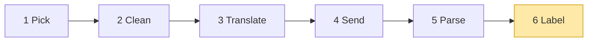
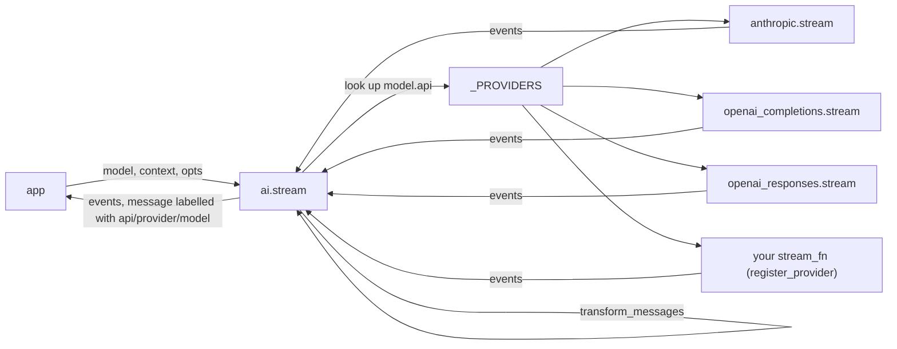
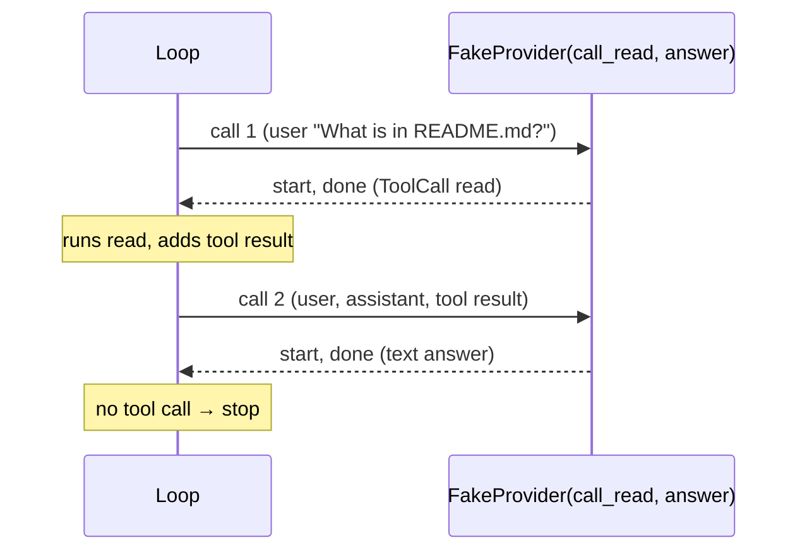

# 05 Part 1 · Label + test the pipeline

**Goal:** Label every answer with who wrote it, read errors, and test the whole pipeline without a real model.

**Builds on:** [04 Parse](04-parse.md) · **Next:** [06 Part 2 big picture](06-part-2-agent.md)

## Where we are



**Builds:** block 6, and a test fake for blocks 3–5 · **IN:** events · **OUT:** labelled events

Big picture of Part 1: [part-1-ai](01-part-1-ai.md).

Code in this chapter (commit `2fc2776`): `ai/__init__.py` (`stream`), `testing/__init__.py` (`FakeProvider`), and `tests/test_core.py`, all under `packages/simp_agent/`.

## Example: the answer leaves Parse

We follow the same example as the [Part 1 big picture](01-part-1-ai.md#example-the-user-asks-about-a-file). The user asks **"What is in README.md?"**, and Claude answers. At the end of [04](04-parse.md), Parse has built this message and sent it in a `done` event:

```text
AssistantMessage(content=[ToolCall read {"path": "README.md"}], stop_reason="tool_use")
```

Nothing in this message says that Claude wrote it. That is a problem later. In [02](02-pick-clean.md#2-clean-transform_messages) the user switches to GPT and types "Just tell me the title." Then Clean must know which turns came from Claude, because only Claude can read Claude's thinking back. So before the message goes to the app, someone must write on it who wrote it. That is block 6, **Label**: it sets three [labels](glossary.md#label) on the message, `api`, `provider` and `model`.

## The entry point `stream` (runs 1, 2, 6)

Where does Label run? Not in each provider. It runs in `ai.stream`, the one function the app calls for every model call. The same function also runs Pick and Clean before the provider starts, so it wraps the whole pipeline:

```text
FUNCTION stream(model, context, opts):   // never raises
    fn = LOOK UP model.api in _PROVIDERS               // 1 Pick
    IF not found:
        SEND event {error, message with error "Unknown api: ..."}
        STOP
    ctx = same context, but messages = transform_messages(context.messages, model)   // 2 Clean
    FOR EACH event from fn(model, ctx, opts):          // 3-5 in the provider
        IF the event has a message or partial:
            SET message.api, .provider, .model = model.api, model.provider, model.id   // 6 Label
        SEND the event
```

Real code: [ai/\_\_init\_\_.py](../../packages/simp_agent/src/simp_agent/ai/__init__.py) (`stream`)

In our example, the `done` event comes out of the Anthropic provider, and `stream` labels its message before it passes the event on:

```text
from the provider:  AssistantMessage(content=[ToolCall read ...], stop_reason="tool_use")
after ai.stream:    AssistantMessage(content=[ToolCall read ...], stop_reason="tool_use",
                                     api="anthropic-messages", provider="anthropic", model="claude-x")
```

The `start` event carries the same object as `partial` ([04](04-parse.md)), so it is labelled too. On the next turn, Clean reads these three labels and sees that this turn came from Claude.



> **Why this way:** the shared work (unknown api, history cleaning, labels) lives once in `ai.stream`. Each provider only converts and parses.

## Errors are plain text

What if the call fails instead? The message still comes out, labelled the same way, but with `stop_reason="error"` and the reason in `error`, a plain string. When our own code knows the cause, it also sets `error_kind`: `fatal` when trying again cannot help (no API key), `budget` when the user's spend limit is used up (ch [28](28-limits.md)), and `policy` when the request is not allowed. For example:

```text
AssistantMessage(stop_reason="error", error="no API key for provider openai", error_kind="fatal")
```

`ai.is_retryable` never retries these three kinds. For other errors, the session reads the string to choose: wait and retry (ch [19](19-retry.md)), shrink the history and try again ([context overflow](glossary.md#context-overflow), ch [21](21-overflow.md)), or give up. Nothing in this chapter needs that yet.

## Testing the pipeline without a real model

Now the whole pipeline works. How do we test the code that will use it? A real model is slow, costs money, needs an API key, and gives a different answer each time. Worse, later chapters need "the model said X" at an exact call. The loop (ch [07](07-agent-loop.md)) needs a model that asks for `read`, and then, on the next call, answers in text. Retry (ch [19](19-retry.md)) needs a model that fails on the second call. We cannot ask a real model for that.

### Why a fake

The loop does not call `ai.stream` by name. It takes the [stream function](glossary.md#stream-function) as a setting, `LoopConfig.stream_fn`, and the default is `ai.stream` ([agent/\_\_init\_\_.py](../../packages/simp_agent/src/simp_agent/agent/__init__.py)). Any function with the same shape (take `(model, context, api_key)`, yield events, end with `done` or `error`, from [02](02-pick-clean.md#out-the-shape-of-a-model-call)) can stand in. So a test passes a fake there, and the fake plays the model. No patched imports, no mock library.

The fake lives in the `testing` [layer](glossary.md#layer), at the far right of the [layer map](00-overview.md#the-layer-map). It may import from every layer, and no library code imports it.

### Start: the smallest fake

The smallest function with that shape always says "ok":

```text
FUNCTION fake(model, ctx, api_key):
    msg = AssistantMessage with the text "ok"
    SEND event {start, msg}
    SEND event {done, msg}
```

Try it on our example. The loop's first call must get the `read` tool call, and the second call must get the text answer. This fake gives "ok" both times, so the loop never runs `read`. It also cannot tell the test what the loop sent, and it can never fail.

### Step by step: grow it into `FakeProvider`

To give a different answer on each call, the fake keeps a list of replies and takes the next one on each call. To keep its place between calls it must be an object, not a plain function. It writes down every call, so the test can check what the loop sent. To act like a failing model, it ends with `error` instead of `done` when the reply has `stop_reason="error"`. And so that a reply can depend on what the loop sent, a reply may also be a function of the context. Put together:

```text
CLASS FakeProvider(replies...):
    replies = the replies, ready to take one by one
    ctxs, messages, api_keys, models = empty lists
    calls = 0

    WHEN called with (model, ctx, api_key):          // the object IS a stream function
        calls = calls + 1
        ADD ctx to ctxs
        ADD a COPY of ctx.messages to messages        // freeze what was sent now
        ADD api_key to api_keys
        ADD model to models
        msg = TAKE the next reply                     // none left -> test fails
        IF msg is a function: msg = msg(ctx)
        SEND event {start, msg}
        IF msg.stop_reason is "error": SEND event {error, msg}
        ELSE:                          SEND event {done, msg}
```

Real code: [testing/\_\_init\_\_.py](../../packages/simp_agent/src/simp_agent/testing/__init__.py) (`FakeProvider`)

### Real design: `FakeProvider`

#### A script of replies

`FakeProvider(*replies)` keeps the replies as a Python iterator and takes the next one with `next(...)` on each call. Each one is a **[scripted reply](glossary.md#scripted-reply)**: the test writes the model's lines in advance, like a play. For our example the script is "ask for `read`, then answer":



If the loop calls more times than there are replies, `next` has nothing left and the test fails with a `RuntimeError`. That is on purpose: an extra call is a bug in the code under test.

#### The object is the function

`FakeProvider` has an `async def __call__` with `yield` inside, so an object of it *is* a stream function with the arguments `(model, ctx, api_key=None)`. You pass it as `stream_fn`, and the loop cannot tell it from `ai.stream`.

#### Recording every call

Before it answers, the fake writes down what it got: `calls` (how many calls), `ctxs` (each `Context`), `messages` (a copy of `ctx.messages`), `api_keys` and `models`. Why a copy of the messages? The loop keeps adding to its list. Without the copy, every entry would point at the final list, and the test could not see what the model got *at that moment*.

A server test, for example, checks that the third call never reached the model:

```python
assert fp.calls == 2  # $1 + $1 > $1.5 -> third call refused before reaching the provider
```

(`apps/server/tests/test_budget.py`; the budget is ch [28](28-limits.md).)

#### A reply can be a function

A reply is a message or a function `(ctx) -> message`. The function runs at the moment the model is "thinking", so it can read the context, for example to answer with the last user text. Later chapters use it to do something *during* a call, such as typing a new message while a summary is made (ch [09](09-steering.md), [20](20-compaction.md)).

#### Two events, like a real provider

The fake sends only `start` and then `done` (or `error`). A real provider sends many small events in between ([04](04-parse.md)); the fake hands over the whole message at once. The first and last events have the same shape as a real provider's, which is all the loop reads.

#### What the fake does *not* do

It does not run Pick, Clean or Label, because it is passed *instead of* `ai.stream`: its messages get no labels, and it sees the history exactly as passed. It does not stream small pieces, so tests of Parse feed raw chunks instead ([04](04-parse.md)). It does not check the API key; a "no key" test calls `ai.stream` itself.

#### Its neighbour: `FakeEnv`

The same file also has `FakeEnv`, a fake for running shell commands. It needs the execution environment from ch [12](12-exec-env.md), so we meet it there.

**Builds on:** [04 Parse](04-parse.md) · **Next:** [06 Part 2 big picture](06-part-2-agent.md) — the loop that calls `ai.stream` and runs the tools the model asks for.

**Built on by:** [07](07-agent-loop.md) · [08](08-events-abort.md) · [09](09-steering.md) · [19](19-retry.md) (error replies) · [20](20-compaction.md) (summary replies) · [21](21-overflow.md) (reads `error`) · [28](28-limits.md) (counting calls)

**OUT →** labelled events from `ai.stream()` are the IN of the agent loop (ch 07).
