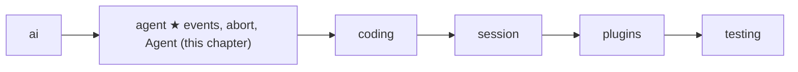
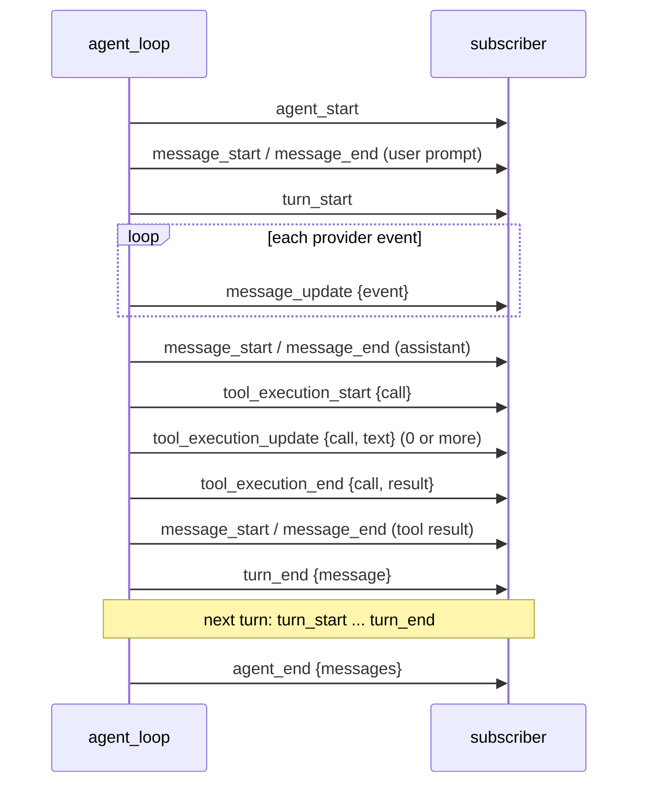

# 06 Part 2 · Events and abort

**Goal:** Let callers watch the loop and stop it.

**Builds on:** [05 The agent loop](05-agent-loop.md) · **Next:** [07 Steering](07-steering.md)

## Where we are



In [05](05-agent-loop.md) we built `agent_loop`. It calls the model, runs tools, and returns the new messages. But while it runs, it is a black box. A user interface wants to show text **as it arrives**, show "running bash…" while a tool works, and offer a **Stop** button.

This chapter adds three things, all in the same file:

- [Events](glossary.md#event): small dicts the loop sends at each step, so callers can watch.
- [Abort](glossary.md#abort): one `asyncio.Event` that stops a model call or a tool in the middle.
- The `Agent` class: a thin object that keeps the history, the subscribers and the cancel flag for you.

Code in this chapter (commit `2fc2776`):

- `packages/simp_agent/src/simp_agent/agent/__init__.py` — `agent_loop` (the `send` / `add` helpers), `_emit_all`, `_stream`, `_aborted`, `_llm_turn` (the end), `Agent`
- `packages/simp_agent/tests/test_harden.py` — the abort and subscriber tests

## Problem

Two needs, one for each direction:

1. **Out:** the caller needs to see progress. A model answer can take 30 seconds. A `bash` tool can take minutes. Waiting for the final list of messages is not enough.
2. **In:** the user must be able to say "stop". And "stop" must be **real**: close the HTTP request (so we stop paying for tokens), kill the running command, and leave the history in a state the next run can use.

The hard part is the second one. Stopping is easy; stopping **cleanly** is not.

## Naive version

```python
async def naive_loop(messages, model, ctx, on_text, stopped):
    async for ev in ai.stream(model, ctx):
        if stopped():                 # checked only when an event arrives
            return messages           # nothing added to history
        if ev["type"] == "text_delta":
            on_text(ev["delta"])      # one callback per kind of thing
        if ev["type"] in ("done", "error"):
            messages.append(ev["message"])
    return messages
```

Where it breaks:

- **The check waits for the model.** If the provider sends nothing for 20 seconds, the stop flag is only seen after 20 seconds.
- **The HTTP request stays open.** We leave the `for` loop, but nobody closes the generator, so the connection can stay alive.
- **The partial answer is lost.** The user saw "Here is the fi…" on screen, but the history has nothing. The screen and the history disagree.
- **One callback per kind of thing** (`on_text`, then `on_tool_start`, `on_tool_end`, …) grows forever. Every new feature changes the signature.
- **Stop between tools** is not handled at all. If the model asked for three tools and the user stops after the first, the history has two tool calls with no result. Vendors reject that with a 400 error.

## Real design

### Events: one stream of small dicts

The loop has **one** output channel: `emit(event)`, where `event` is a plain dict with a `"type"` key. Adding a new kind of event never changes a signature.

Inside `agent_loop`, two helpers do all the sending (`packages/simp_agent/src/simp_agent/agent/__init__.py`):

```python
    async def send(e):
        await _emit_all([emit], e)

    async def add(m):
        messages.append(m)
        new.append(m)
        await send({"type": "message_start", "message": m})
        await send({"type": "message_end", "message": m})
```

`add` is the **only** way a message enters the history. So every message, from any source, produces `message_start` and `message_end`. A UI that only listens to `message_end` sees the full conversation.

`_emit_all` calls each subscriber and awaits it if it returned an awaitable:

```python
async def _emit_all(subs: list, e: dict) -> None:
    for f in subs:
        r = f(e)
        if inspect.isawaitable(r):
            await r
```

So a subscriber may be a normal function (`events.append`) or an `async def` (write to a websocket). Because the loop **awaits** each subscriber, events arrive in order, and a slow subscriber slows the loop. That is on purpose: a websocket that cannot keep up should push back, not lose events.

Here are all the event types the loop sends, in order for one run with one tool call:



| Event | Extra keys | When |
|---|---|---|
| `agent_start` | — | first thing, once per run |
| `turn_start` | — | before each model call |
| `message_update` | `event` | each raw provider event ([03](03-stream-parser.md)); `event["partial"]` is the message so far |
| `message_start`, `message_end` | `message` | each time `add` puts a message in history |
| `tool_execution_start` | `call` | before a tool runs (not for cut-off `length` calls) |
| `tool_execution_update` | `call`, `text` | when a tool calls `ctx.on_update(text)` ([05](05-agent-loop.md#toolcontext-what-a-tool-gets)) |
| `tool_execution_end` | `call`, `result` | after the tool, and after the `after_tool_call` hook ([08](08-hooks-approval.md)) |
| `turn_end` | `message` | after the tool batch; also on error / abort |
| `agent_end` | `messages` | last thing; `messages` = all new messages of this run |

`message_update` carries the provider event as-is. The loop does not invent its own "text delta" type: the UI reads `event["type"]` (`text_delta`, `toolcall_delta`, …) from the [stream parser](03-stream-parser.md). One vocabulary, not two.

Every exit path ends with `turn_end` then `agent_end`. Normal end goes through the bottom of `agent_loop`; error and abort go through `_end`:

```python
async def _end(send, msg, new) -> list:
    await send({"type": "turn_end", "message": msg})
    await send({"type": "agent_end", "messages": new})
    return new
```

So a UI can reset its "busy" state on `agent_end` (or when `prompt()` returns, which also covers a crashed subscriber, below).

### Abort: one `asyncio.Event`

`agent_loop` takes `cancel: asyncio.Event | None`. The caller calls `cancel.set()` from anywhere (a key press, an HTTP request). The loop checks it in four places:

1. **During the model call** — `_stream` races the next provider event against `cancel.wait()` (next section).
2. **Before each tool** — `if cancel.is_set(): break` in the tool loop.
3. **Inside a tool** — the same event is `ctx.cancel` in [`ToolContext`](glossary.md#tool-context). A long tool (like `bash` in [10](10-coding-tools.md)) waits on it and kills its process. If the tool then raises, `run_tool` turns it into the text `"Interrupted by the user"` (not the exception text), because `ctx.cancel.is_set()`.
4. **After the tool batch** — the loop adds an aborted message and ends:

```python
            if cancel.is_set():
                msg = _aborted()
                await add(msg)
                return await _end(send, msg, new)
```

`_aborted()` is just `AssistantMessage(stop_reason="aborted", error="aborted")`. Abort is **data**, like errors in [05](05-agent-loop.md): the caller reads `new[-1].stop_reason == "aborted"`. The loop never raises because of an abort.

Why one shared event and not a flag per part? Because a single `set()` reaches the model call, the loop and every tool at once. Nobody has to know who is running right now.

### Stop between tools: the history stays valid

Say the model asked for tools `c1`, `c2`, `c3`, and the user stops during `c2`. Then `c2` gets its result (maybe "Interrupted by the user"), the loop breaks before `c3`, and adds the aborted message. History now has tool call `c3` with **no result**.

The loop does not fix that itself. `_llm_turn` runs `ai.transform_messages` on the view before every model call (and the real `ai.stream` runs it again, [04](04-providers.md#transform_messages-clean-history-before-sending)). It drops `aborted` / `error` assistant messages and adds an error result `"No result provided"` for any call with no result. The saved history keeps the truth (what really happened); only the view sent to the model is cleaned.

### `_stream`: stop a model call in the middle

The naive version only saw the stop flag when the next event came. `_stream` wraps the provider's stream and waits on **two** things at once:

```python
async def _stream(stream_fn, model, ctx, cancel: asyncio.Event, opts: dict):
    """Yield provider events; on cancel, close the provider stream (ends the HTTP request) and stop."""
    it = stream_fn(model, ctx, **opts).__aiter__()
    stop = asyncio.ensure_future(cancel.wait())
    try:
        while True:
            nxt = asyncio.ensure_future(it.__anext__())
            await asyncio.wait({nxt, stop}, return_when=asyncio.FIRST_COMPLETED)
            if not nxt.done():
                nxt.cancel()  # raises CancelledError inside the generator -> its `async with` closes the stream
                await asyncio.gather(nxt, return_exceptions=True)
                return
            try:
                yield nxt.result()
            except StopAsyncIteration:
                return
    finally:
        stop.cancel()
        await it.aclose()
```

Step by step:

- `stop` is a task that finishes when `cancel` is set.
- For each event, `nxt` is a task that gets the next provider event.
- `asyncio.wait(..., FIRST_COMPLETED)` returns as soon as **either** one is done. So a stop is seen at once, even if the model is silent.
- If `nxt` is not done, the stop won. We cancel `nxt`. That raises `CancelledError` **inside** the provider generator, at its `await`. The provider's `async with` block (the HTTP client, [04](04-providers.md)) exits and closes the connection. We stop paying for tokens.
- `finally` cleans up both ways: it cancels the `stop` task and calls `aclose()` on the generator.

If the event came first, we yield it. When the provider ends, `nxt.result()` raises `StopAsyncIteration` and we return.

### Keep the partial answer

Back in `_llm_turn`, the loop reads the events from `_stream`:

```python
    async for ev in _stream(config.stream_fn, config.model, Context(system_prompt, llm_msgs, tools), cancel, opts):
        await send({"type": "message_update", "event": ev})
        partial = ev.get("partial", partial)
        if ev["type"] in ("done", "error"):
            msg = ev["message"]
    if msg is None:  # aborted mid-stream: keep partial content
        msg = partial or _aborted()
        msg.stop_reason, msg.error = "aborted", "aborted"
    return msg
```

Every provider event may carry `partial`, the message built so far ([03](03-stream-parser.md)). The loop keeps the latest one. If the stream ended without `done` or `error`, it is treated as aborted (normally because `cancel` was set): the partial message becomes the answer, marked `aborted`. Now the history has the same text the user saw on screen. `agent_loop` then sees `stop_reason == "aborted"` and ends through `_end`.

### The `Agent` class: state on top of the loop

`agent_loop` is a plain function: the caller must keep the history, the subscribers and the cancel event. `Agent` does that for you:

```python
class Agent:
    def __init__(self, system_prompt: str, model: Model, tools: list, stream_fn: Callable = ai.stream, ...):
        ...
        self.messages = list(messages or [])  # saved history (CompactionEntry markers included)
        self.is_streaming = False
        self._subs = list()
        self._cancel = asyncio.Event()

    def subscribe(self, fn: Callable[[dict], Any]) -> Callable[[], None]:
        self._subs.append(fn)
        return lambda: self._subs.remove(fn)

    def abort(self) -> None:
        self._cancel.set()

    async def prompt(self, text: str, extra: list = ()) -> list:
        """extra: more messages sent with the prompt (e.g. from a plugin)."""
        return await self._run([UserMessage(text), *extra])
```

(`...` hides other settings: API key, env, hooks, queues; see [07](07-steering.md) and [08](08-hooks-approval.md).)

- `subscribe` adds a listener and returns a function that removes it.
- `abort` sets the event. It is a plain sync method, so a key handler can call it.
- `prompt` runs one user message through the loop.

All runs go through `_run`:

```python
    async def _run(self, prompts: list) -> list:
        if self.is_streaming:
            raise RuntimeError("Agent is already processing a prompt; wait for it or call abort() first")
        self._cancel = asyncio.Event()
        self.is_streaming = True
        start = len(self.messages)
        try:
            cfg = LoopConfig(self.model, get_tools=lambda: self.tools, ...)
            emit = lambda e: _emit_all(self._subs, e)  # noqa: E731
            try:
                return await agent_loop(self.system_prompt, self.messages, prompts, cfg, emit, self._cancel)
            finally:
                self.declared_tools = cfg.declared_tools
        except Exception as e:  # e.g. a subscriber raised: end the run cleanly with an error message
            self.messages.append(AssistantMessage(stop_reason="error", error=f"{type(e).__name__}: {e}"))
            return self.messages[start:]
        finally:
            self.is_streaming = False
```

Four details matter:

- **One run at a time.** A second `prompt()` while one runs raises `RuntimeError`. Two loops on one history would mix their messages. (To add a message during a run, use `steer` / `follow_up`, [07](07-steering.md).)
- **A fresh event each run.** An old `abort()` must not kill the next prompt, so `_run` makes a new `asyncio.Event`.
- **One `emit` fans out.** The loop still sees one `emit`; `_emit_all(self._subs, e)` sends to every subscriber.
- **A broken subscriber cannot crash the run.** The loop does not catch subscriber errors, so they reach `_run`. It appends an `error` assistant message straight to `self.messages` (not through `add`, so no events for it) and returns. `finally` always sets `is_streaming = False`, so the agent is usable again.

`continue_()` is the other entry: it runs from the current history with no new message, for retry after an error ([15](15-retry.md)).

## Test

The tests live in `test_harden.py`. Abort during the model call:

```python
async def test_abort_during_stream_closes():
    closed, cancel = [], asyncio.Event()

    async def stream(model, ctx):
        msg = AssistantMessage([TextContent("par")])
        try:
            yield {"type": "start", "partial": msg}
            cancel.set()
            await asyncio.sleep(10)
            yield {"type": "done", "message": msg}
        finally:
            closed.append(1)

    new = await asyncio.wait_for(agent_loop("s", [], [UserMessage("a")], LoopConfig(Model(), stream_fn=stream), cancel=cancel), 2)
    assert new[-1].stop_reason == "aborted" and new[-1].text() == "par"
    assert closed
```

The fake stream sends a partial `"par"`, sets `cancel`, then hangs for 10 seconds. The test allows only 2. It checks the three promises: the stop is fast, the partial text is kept with `stop_reason="aborted"`, and the provider's `finally` ran (the stream was closed).

Abort between tools:

```python
async def test_abort_mid_batch_repairs_history():
    cancel = asyncio.Event()

    async def slow(args, c):
        if args["n"] == 2:
            cancel.set()
        return "r"

    tool = AgentTool("t", "", {"type": "object"}, slow)
    batch = AssistantMessage([ToolCall(f"c{i}", "t", {"n": i}) for i in (1, 2, 3)], stop_reason="tool_use")
    stream = FakeProvider(batch, DONE)
    seen = stream.messages
    msgs = []
    cfg = LoopConfig(Model(), [tool], stream_fn=stream)
    await agent_loop("s", msgs, [UserMessage("a")], cfg, cancel=cancel)
    assert msgs[-1].stop_reason == "aborted"
    await agent_loop("s", msgs, [UserMessage("b")], cfg)
    sent = seen[-1]
    check_pairs(sent)
    assert not any(isinstance(m, AssistantMessage) and m.stop_reason == "aborted" for m in sent)
    assert next(m for m in sent if getattr(m, "tool_call_id", "") == "c3").content == "No result provided"
```

Tool call `c2` sets `cancel`, so `c3` never runs and the run ends `aborted`. Then a **second** run on the same history checks what the model is sent (`FakeProvider.messages`, [02](02-fake-provider.md)): every call has a result (`check_pairs`), the aborted message is gone, and `c3` got `"No result provided"`.

Subscribers through `Agent`: `test_raising_subscriber_ends_with_error` adds a subscriber that raises on `message_end`; after `prompt("hi")` the last message has `stop_reason="error"` with `"sub broke"` in it, and `is_streaming` is `False` again. `test_async_subscriber_awaited` checks that an `async` subscriber sees `agent_start` first and `agent_end` last, and `test_prompt_while_streaming` checks the one-run-at-a-time rule.

```bash
uv run pytest packages/simp_agent/tests/test_harden.py
```

> **Why this way**
>
> **Events are dicts, not classes or many callbacks.** One `emit(dict)` channel means new event types (steering, compaction, retry in later chapters) need no new signature. Dicts also go straight to JSON for the server ([21](21-transport.md)).
>
> **Abort is one `asyncio.Event`, and its result is data.** One `set()` reaches the model call, the loop and every tool. The run ends with an `aborted` message, not an exception, so callers handle "stopped" like any other end. The history keeps the partial truth; `transform_messages` cleans only what the model sees.
>
> **`Agent` is thin.** All logic stays in `agent_loop`; `Agent` only holds state (history, subscribers, cancel event, queues). The session ([13](13-session.md)) wraps `Agent` the same way.

## Recap

- The loop sends [events](glossary.md#event): dicts with a `"type"`, through one `emit`. `add` is the only way into history, so every message gives `message_start` / `message_end`.
- `message_update` carries the raw provider event; `tool_execution_*` events show tool progress; every run ends with `turn_end` then `agent_end`.
- Subscribers may be sync or async; the loop awaits each one, in order.
- [Abort](glossary.md#abort) is one `asyncio.Event`, checked during the model call, before each tool, inside tools (`ctx.cancel`) and after the batch.
- `_stream` races the next event against `cancel.wait()`, so stop is instant and the HTTP request is closed.
- On abort mid-stream the partial message is kept, marked `aborted`. Missing tool results are filled in later by `transform_messages`.
- `Agent` keeps history, subscribers and the cancel event; it allows one run at a time and turns a subscriber crash into an `error` message.

**Builds on:** [05 The agent loop](05-agent-loop.md) · **Next:** [07 Steering](07-steering.md) — the `get_steering` / `get_follow_up` hooks and the `Agent` queues, so the user can type while the agent works.
