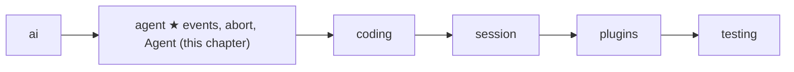
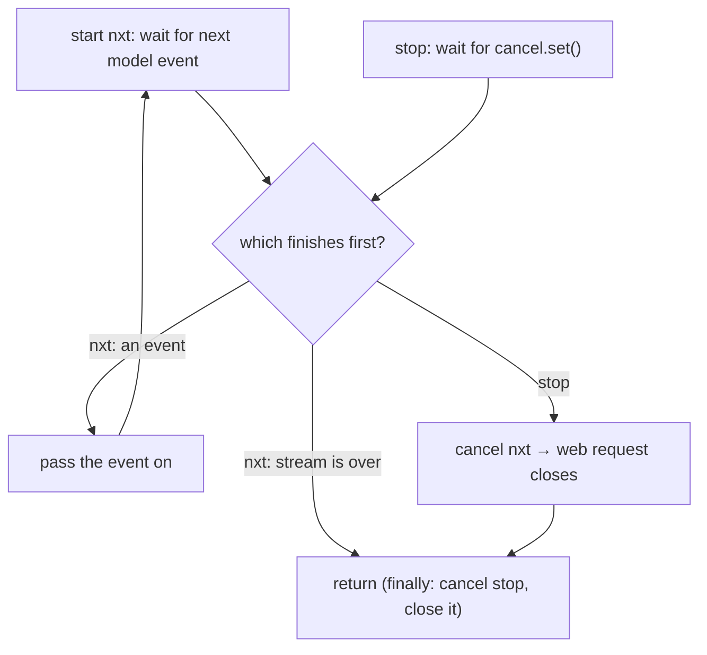

# 06 Part 2 · Events and abort

**Goal:** Let the user watch a run as it happens, and stop it cleanly.

**Builds on:** [05 The agent loop](05-agent-loop.md) · **Next:** [07 Steering](07-steering.md)

## Where we are



Big picture of Part 2: [part-2-agent](05-0-part-2-agent.md).

## Problem

Take the example from [05](05-agent-loop.md). The user asks "What is in README.md?". The model calls `read`, the loop runs it, and the model answers "README.md says this project is…". In 05, `agent_loop` gives back the new messages only at the very end. While it works, it is a closed box.

A real app needs two more things. First, it must **watch** the run: show the words while they arrive, and show "reading README.md…" while the tool runs. A model answer can take 30 seconds, and a `bash` command can take minutes. Second, the user must be able to **stop** it. [05 Step 4](05-agent-loop.md#step-by-step-from-naive-to-real) already promised this. A Stop sets the [cancel flag](glossary.md#abort), and an `aborted` label goes into the history. This chapter shows how that works inside.

Stopping is easy. Stopping **cleanly** is hard. A clean Stop closes the web request (so we stop paying for tokens), kills a running command, and leaves a history that the next question can use.

Code in this chapter (commit `2fc2776`):

- `packages/simp_agent/src/simp_agent/agent/__init__.py`: the `send` / `add` helpers inside `agent_loop`, `_emit_all`, `_end`, `_stream`, the end of `_llm_turn`, `Agent`
- `packages/simp_agent/tests/test_harden.py`: the abort and subscriber tests

## Naive version

A first try: give the loop one callback for the text and one function that says "stopped?".

```text
FUNCTION naive_loop(messages, model, ctx, on_text, stopped):
    FOR EACH event ev IN ai.stream(model, ctx):
        IF stopped():                 // checked only when an event arrives
            RETURN messages           // nothing added to history
        IF ev is "text_delta":
            on_text(ev.delta)
        IF ev is "done" or "error":
            ADD ev.message to messages
    RETURN messages
```

The first problem is about watching. We need one callback per kind of thing: `on_text`, then `on_tool_start`, `on_tool_end`, and so on. Every new feature changes the signature. The other four problems are about stopping. The check waits for the model, so if the provider sends nothing for 20 seconds, Stop is seen only after 20 seconds. We leave the `for` loop, but nobody closes the stream, so the web request can stay open. The user saw "README.md says this proj…" on screen, but the history keeps nothing, so the screen and the history disagree. And if the model asked for three tools and the user stops after the first one, the history has tool calls with no result. Vendors reject that with a 400 error.

The next section fixes watching. The section after it fixes stopping. The last one puts both behind one small class.

## Events: one stream of small dicts

### What a caller sees

The loop has **one** output: `emit(event)`. An [event](glossary.md#event) is a plain dict with a `"type"` key. Here is our README run, as the UI sees it. (The model sends many `message_update` events per call; we show one.)

```text
{type: agent_start}                                              // the run starts
{type: message_start, message: UserMessage("What is in README.md?")}
{type: message_end,   message: UserMessage("What is in README.md?")}
{type: turn_start}                                               // turn 1
{type: message_update, event: {type: toolcall_delta, partial: ...}}
{type: message_start, message: AssistantMessage(ToolCall c1 read README.md)}
{type: message_end,   message: AssistantMessage(ToolCall c1 read README.md)}
{type: tool_execution_start, call: c1}                           // UI: "reading README.md…"
{type: tool_execution_end,   call: c1, result: ToolResultMessage(c1)}
{type: message_start, message: ToolResultMessage(c1)}
{type: message_end,   message: ToolResultMessage(c1)}
{type: turn_end, message: AssistantMessage(ToolCall c1 ...)}
{type: turn_start}                                               // turn 2
{type: message_update, event: {type: text_delta, delta: "README.md says", partial: ...}}  // UI: words appear
{type: message_start, message: AssistantMessage("README.md says ...")}
{type: message_end,   message: AssistantMessage("README.md says ...")}
{type: turn_end, message: AssistantMessage("README.md says ...")}
{type: agent_end, messages: [user, assistant c1, tool result c1, assistant answer]}  // UI: not busy
```

The [run](glossary.md#run-agent) and the [turns](glossary.md#turn) from 05 are now visible: a run is `agent_start` … `agent_end`, and each turn is `turn_start` … `turn_end`. The table adds what the trace does not show:

| Event | Extra keys | When |
|---|---|---|
| `message_update` | `event` | each raw provider event ([03](03-parse.md)); `event["partial"]` is the message built so far |
| `message_start`, `message_end` | `message` | each time a message enters the history |
| `tool_execution_start` | `call` | before a tool runs (not for cut-off `length` calls, [05 Step 4](05-agent-loop.md#step-by-step-from-naive-to-real)) |
| `tool_execution_update` | `call`, `text` | when a tool calls `ctx.on_update(text)` ([05](05-agent-loop.md#toolcontext-what-a-tool-gets)) |
| `tool_execution_end` | `call`, `result` | after the tool, and after the `after_tool_call` hook ([08](08-hooks-approval.md)) |
| `turn_end` | `message` | after the tool batch; also on error or abort (then `message` is that error or aborted message) |
| `agent_end` | `messages` | last thing; only the **new** messages of this run, not the whole history |

`message_update` carries the provider event as it is. The loop does not make its own "text delta" type. The UI reads `event["type"]` (`text_delta`, `toolcall_delta`, …) from the [stream parser](03-parse.md), so there is one set of names, not two.

Why dicts on one channel? A new kind of event (steering, compaction, retry in later chapters) needs no new signature. And a dict turns straight into JSON for the server ([21](21-transport.md)).

### How the loop sends them

Inside `agent_loop`, two small helpers do all the sending:

Real code: [packages/simp_agent/src/simp_agent/agent/__init__.py](../../packages/simp_agent/src/simp_agent/agent/__init__.py) (`agent_loop`)

```text
INSIDE agent_loop:
    FUNCTION send(e):
        _emit_all([emit], e)

    FUNCTION add(m):
        ADD m to messages and to new
        SEND event {message_start, m}
        SEND event {message_end, m}
```

`add` is the **only** way a message enters the history. That is why `message_start` and `message_end` come one right after the other: the message is already complete when it is added, and the streaming part was the `message_update` events before it. So a UI that listens only to `message_end` still sees the whole conversation.

`_emit_all` calls each subscriber (a function that wants the events). A subscriber can be a normal function, like `events.append`, or an `async def` function, like one that writes to a websocket. An `async` function gives back something that must be awaited, so `_emit_all` awaits it:

Real code: [packages/simp_agent/src/simp_agent/agent/__init__.py](../../packages/simp_agent/src/simp_agent/agent/__init__.py) (`_emit_all`)

```text
FUNCTION _emit_all(subs, e):
    FOR EACH subscriber f IN subs:
        r = f(e)
        IF r can be awaited:
            WAIT for r
```

Because the loop waits for each subscriber, events arrive in order, and a slow subscriber slows the loop. That is on purpose: a websocket that cannot keep up should hold the loop back, not lose events.

The error and abort exits from 05 Step 4 go through `_end`, so they also finish with `turn_end` and then `agent_end`:

Real code: [packages/simp_agent/src/simp_agent/agent/__init__.py](../../packages/simp_agent/src/simp_agent/agent/__init__.py) (`_end`)

```text
FUNCTION _end(send, msg, new):
    SEND event {turn_end, msg}
    SEND event {agent_end, new}
    RETURN new
```

So every run ends with `agent_end`, and the UI can always clear its "busy" state there.

## Abort: one asyncio.Event

The cancel flag from 05 is one `asyncio.Event` named `cancel`. `agent_loop` takes it as an input, and the caller calls `cancel.set()` from anywhere, for example a key press or an HTTP request. The same object is `ctx.cancel` in every [tool context](glossary.md#tool-context). So one `set()` reaches the model call, the loop and every tool at once, and the caller does not need to know what is running right now.

As 05 said, a Stop is data, not an exception: the run ends with an assistant message whose `stop_reason` is `aborted` (made by `_aborted()` when there is no other message to mark). The caller reads `new[-1].stop_reason`.

Our user can press Stop at three moments. For each one we ask the same three questions: **what stops**, **what goes into the history**, and **what the model sees next time**.

### Moment 1: Stop while the model is writing

The answer "README.md says this proj…" is arriving word by word, and the user presses Stop.

**What stops.** The model call, and at once. The trick is a race between two waiting tasks. Task `nxt` waits for the next event from the model. Task `stop` waits for the cancel flag. We wait until **one** of them finishes first.



The naive loop only waited for the model, so a silent model hid the Stop. With the race, the Stop wins even when the model sends nothing. `_stream` does this. It wraps the provider stream `it`, which is the async generator returned by `stream_fn`:

Real code: [packages/simp_agent/src/simp_agent/agent/__init__.py](../../packages/simp_agent/src/simp_agent/agent/__init__.py) (`_stream`)

```text
FUNCTION _stream(stream_fn, model, ctx, cancel, opts):
    it = the provider generator stream_fn(model, ctx, **opts)
    stop = a task that waits for cancel
    TRY:
        REPEAT:
            nxt = a task that gets the next event from it
            WAIT until nxt OR stop is done           // asyncio.wait(FIRST_COMPLETED)
            IF nxt is not done:                      // stop won
                CANCEL nxt
                WAIT for nxt to finish
                RETURN
            IF the provider has ended (StopAsyncIteration):
                RETURN
            YIELD the event from nxt
    FINALLY:
        CANCEL stop
        CLOSE it (aclose)
```

Why does cancelling `nxt` close the web request? `nxt` is paused **inside** the provider generator. Cancelling it raises `CancelledError` at that spot. The provider's `async with` block for the HTTP client ([02](02-translate-send.md)) then exits, and that closes the connection. The `finally` part cleans up the rest: it cancels `stop` and closes the generator.

**What goes into the history.** The end of [`_llm_turn`](05-agent-loop.md#_llm_turn-one-model-call) keeps the latest `partial`, the message built so far ([03](03-parse.md)). A normal stream always ends with a `done` or `error` event that carries the final message. If the stream ended without one, the loop treats it as a Stop:

Real code: [packages/simp_agent/src/simp_agent/agent/__init__.py](../../packages/simp_agent/src/simp_agent/agent/__init__.py) (`_llm_turn`)

```text
msg = None, partial = None
FOR EACH event ev IN _stream(...):
    SEND event {message_update, ev}
    partial = ev.partial if it has one, else keep the old partial
    IF ev is "done" or "error":
        msg = ev.message
IF msg is None:                  // no done/error: the stream was stopped
    msg = partial, or _aborted() if there is none
    SET msg.stop_reason and msg.error to "aborted"
RETURN msg
```

So the history gets `AssistantMessage("README.md says this proj", stop_reason="aborted")`, the same text the user saw. `agent_loop` adds it, sees `aborted` (05 Step 4), and ends through `_end`.

**What the model sees next time.** Nothing of it. `ai.transform_messages` drops `aborted` and `error` assistant messages from the view sent to the model ([01](01-pick-clean.md#2-clean-transform_messages)). The saved history keeps the truth; only the view is cleaned.

### Moment 2: Stop while a tool runs

Reading README.md is too fast to stop, so take a longer step: the model asked to run `bash` with `npm test`, and the user presses Stop while it runs.

**What stops.** The tool. A long tool such as `bash` ([10](10-coding-tools.md)) watches `ctx.cancel` and kills its process. As 05 Step 4 said, the tool's error then becomes the text "Interrupted by the user" (`run_tool` checks `ctx.cancel.is_set()`). If more calls wait in the same turn, they do not run (moment 3).

**What goes into the history.** That tool result, and then an `aborted` message that the loop adds itself, because the model had already finished. The check sits right after the tool batch:

Real code: [packages/simp_agent/src/simp_agent/agent/__init__.py](../../packages/simp_agent/src/simp_agent/agent/__init__.py) (`agent_loop`)

```text
IF cancel is set:                // after the tool batch
    msg = _aborted()
    add(msg)
    RETURN _end(send, msg, new)
```

**What the model sees next time.** The tool call and its result, which is a normal, valid pair. The aborted message is dropped from the view.

### Moment 3: Stop between tools

Now the model asked for three reads in one turn: `c1` README.md, `c2` package.json, `c3` setup.py. The user presses Stop while `c2` runs. Before each tool, the loop checks the flag:

```text
FOR EACH call IN calls:
    IF cancel is set: STOP the tool loop (break)
    ...run the tool...
```

**What stops.** `c2` finishes (or is interrupted, as in moment 2). `c3` never starts.

**What goes into the history.** `c3` has **no result**:

```text
assistant  [ToolCall c1, ToolCall c2, ToolCall c3]
tool_result c1
tool_result c2
assistant  (stop_reason="aborted")
```

**What the model sees next time.** The loop does not patch the history. Instead, before every model call, `_llm_turn` runs `ai.transform_messages` on the view (and `ai.stream` runs it once more). It drops the aborted message and adds an error result for every call that has none:

```text
assistant  [ToolCall c1, ToolCall c2, ToolCall c3]
tool_result c1
tool_result c2
tool_result c3  "No result provided"  (is_error)
user       (the next question)
```

Every call has a result, so the vendor does not return a 400 error.

## The `Agent` class: state on top of the loop

`agent_loop` is a plain function, so the caller must keep the history, the subscribers and the cancel flag between questions. A chat app asks many questions, so `Agent` keeps them for you:

Real code: [packages/simp_agent/src/simp_agent/agent/__init__.py](../../packages/simp_agent/src/simp_agent/agent/__init__.py) (`Agent`)

```text
CLASS Agent(system_prompt, model, tools, stream_fn = ai.stream, ...):
    messages = copy of the given messages
    is_streaming = False
    _subs = empty list
    _cancel = new asyncio.Event

    FUNCTION subscribe(fn):  ADD fn to _subs; RETURN a function that removes it
    FUNCTION abort():        SET _cancel       // a plain sync method, so a key handler can call it
    FUNCTION prompt(text, extra = ()):
        RETURN _run([UserMessage(text), *extra])   // extra: more messages (e.g. from a plugin)
```

(`...` hides other settings: API key, env, hooks, queues; see [07](07-steering.md) and [08](08-hooks-approval.md).)

All runs go through `_run`:

Real code: [packages/simp_agent/src/simp_agent/agent/__init__.py](../../packages/simp_agent/src/simp_agent/agent/__init__.py) (`Agent._run`)

```text
FUNCTION Agent._run(prompts):
    IF is_streaming:
        RAISE RuntimeError("Agent is already processing a prompt; wait for it or call abort() first")
    _cancel = new asyncio.Event
    is_streaming = True
    start = length of messages
    TRY:
        cfg = LoopConfig(model, get_tools = the current tools, stream_fn, ...)
        emit = a function that calls _emit_all(_subs, e)
        RETURN agent_loop(system_prompt, messages, prompts, cfg, emit, _cancel)
    IF an Exception happens:     // e.g. a subscriber raised
        ADD AssistantMessage(stop_reason="error", error="<type>: <text>") to messages
        RETURN messages from start
    FINALLY:
        is_streaming = False
```

Each line has a reason. Only one run can go at a time, because two loops on one history would mix their messages; a second `prompt()` raises `RuntimeError` (to add a message during a run, use `steer` or `follow_up`, [07](07-steering.md)). Each run gets a fresh cancel event, so an old `abort()` cannot kill the next question. The loop still sees one `emit`, and that one `emit` passes each event to every subscriber. Last, the loop does not catch errors from subscribers. If one raises, `_run` appends an `error` message straight to `self.messages` (not through `add`, so no events are sent for it), and `finally` sets `is_streaming` back to `False`, so the agent can take the next question.

`Agent` has one more way to start a run, `continue_()`. It runs from the current history with no new message, so a host can try again after an error ([15](15-retry.md)).

## Test

The tests live in `test_harden.py`. The first one stops during the model call:

```python
async def test_abort_during_stream_closes():
    closed, cancel = [], asyncio.Event()

    async def stream(model, ctx):
        msg = AssistantMessage([TextContent("par")])
        try:
            yield {"type": "start", "partial": msg}
            cancel.set()
            await asyncio.sleep(10)
            yield {"type": "done", "message": msg}
        finally:
            closed.append(1)

    new = await asyncio.wait_for(agent_loop("s", [], [UserMessage("a")], LoopConfig(Model(), stream_fn=stream), cancel=cancel), 2)
    assert new[-1].stop_reason == "aborted" and new[-1].text() == "par"
    assert closed
```

The fake stream sends the partial text `"par"`, sets `cancel`, then goes silent for 10 seconds, while the test allows only 2. So the test checks moment 1: the Stop is fast, the partial text is kept with `stop_reason="aborted"`, and the provider's `finally` ran, which means the stream was closed.

The second test stops between tools:

```python
async def test_abort_mid_batch_repairs_history():
    cancel = asyncio.Event()

    async def slow(args, c):
        if args["n"] == 2:
            cancel.set()
        return "r"

    tool = AgentTool("t", "", {"type": "object"}, slow)
    batch = AssistantMessage([ToolCall(f"c{i}", "t", {"n": i}) for i in (1, 2, 3)], stop_reason="tool_use")
    stream = FakeProvider(batch, DONE)
    seen = stream.messages
    msgs = []
    cfg = LoopConfig(Model(), [tool], stream_fn=stream)
    await agent_loop("s", msgs, [UserMessage("a")], cfg, cancel=cancel)
    assert msgs[-1].stop_reason == "aborted"
    await agent_loop("s", msgs, [UserMessage("b")], cfg)
    sent = seen[-1]
    check_pairs(sent)
    assert not any(isinstance(m, AssistantMessage) and m.stop_reason == "aborted" for m in sent)
    assert next(m for m in sent if getattr(m, "tool_call_id", "") == "c3").content == "No result provided"
```

This is moment 3. `FakeProvider` ([04](04-label-test.md)) first returns the three calls, then `DONE`, a plain "ok" answer. Call `c2` sets `cancel`, so `c3` never runs and the run ends `aborted`. A **second** run on the same history then looks at what the model was sent (`FakeProvider.messages`). `check_pairs` is a helper in the test file that fails if any tool call has no result. The aborted message is gone, and `c3` got `"No result provided"`.

Three more tests check `Agent`. In `test_raising_subscriber_ends_with_error`, a subscriber raises "sub broke" on `message_end`, the last message has `stop_reason="error"` with that text, and `is_streaming` is `False` again. In `test_async_subscriber_awaited`, an `async` subscriber sees `agent_start` first and `agent_end` last. In `test_prompt_while_streaming`, a second `prompt()` during a run raises `RuntimeError`.

```bash
uv run pytest packages/simp_agent/tests/test_harden.py
```

## Why this way

> **Events are dicts on one channel.** New event types need no new signature, and dicts go straight to JSON.
>
> **Stop is one `asyncio.Event`, and its result is data.** One `set()` reaches the model call, the loop and every tool. The history keeps the partial truth; `transform_messages` cleans only what the model sees.
>
> **Subscribers are awaited in order.** Events never come out of order and are never lost. The cost: a slow subscriber slows the whole loop, and a subscriber that raises ends the run with an `error` message.
>
> **`Agent` is thin.** All logic stays in `agent_loop`; `Agent` only holds state (history, subscribers, cancel event, queues). The session ([13](13-session.md)) wraps `Agent` the same way.

## Exercises

1. Build an `Agent` with the `echo` tool and a `FakeProvider` that calls `echo` once, then says `"ok"`. `subscribe` a function that collects `e["type"]`. Print the list without `message_update`. How many `turn_start` events are there, and where does `tool_execution_start` come?
2. Call `agent.abort()` **before** `agent.prompt("hi")`. Does the run end `aborted`? Find the line in `_run` that explains why.

## Recap

The loop now talks while it works: every step sends one [event](glossary.md#event) dict through `emit`, and every message enters the history through `add`, so a UI can draw the whole README run from `agent_start` to `agent_end`. The cancel flag from 05 is one `asyncio.Event`. It is checked in a race during the model call, before each tool, inside tools and after the batch, so a Stop is fast and closes the web request. Whatever was on screen stays in the history, marked `aborted`, and `transform_messages` repairs only the model's view. `Agent` holds the history, the subscribers and the flag between questions.

**Builds on:** [05 The agent loop](05-agent-loop.md) · **Next:** [07 Steering](07-steering.md): the `get_steering` / `get_follow_up` hooks and the `Agent` queues, so the user can type while the agent works.
