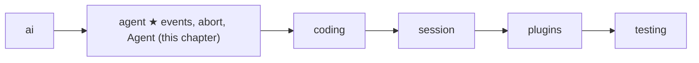

# 06 Part 2 · Events and abort

**Goal:** Let callers watch the loop and stop it.

**Builds on:** [05 The agent loop](05-agent-loop.md) · **Next:** [07 Steering](07-steering.md)

## Where we are



Big picture of Part 2: [part-2-agent](part-2-agent.md).

In [05](05-agent-loop.md) we built `agent_loop`. It calls the model, runs tools, and returns the new messages. But while it runs, it is a black box. A user interface wants to show text **as it arrives**, show "running bash…" while a tool works, and offer a **Stop** button.

This chapter adds three things, all in the same file:

- [Events](glossary.md#event): small dicts the loop sends at each step, so callers can watch.
- [Abort](glossary.md#abort): one `asyncio.Event` (the cancel event) that stops a model call or a tool in the middle.
- The `Agent` class: a thin object that keeps the history, the subscribers and the cancel event for you.

Code in this chapter (commit `2fc2776`):

- `packages/simp_agent/src/simp_agent/agent/__init__.py` — `agent_loop` (the `send` / `add` helpers), `_emit_all`, `_end`, `_stream`, `_aborted`, `_llm_turn` (the end), `Agent`
- `packages/simp_agent/tests/test_harden.py` — the abort and subscriber tests

## Problem

Two needs, one for each direction:

1. **Out:** the caller needs to see progress. A model answer can take 30 seconds. A `bash` tool can take minutes. Waiting for the final list of messages is not enough.
2. **In:** the user must be able to press **Stop**. And Stop must be **real**: close the HTTP request (so we stop paying for tokens), kill the running command, and leave the history in a state the next run can use.

The hard part is the second one. Stopping is easy; stopping **cleanly** is not.

In this chapter we use one word for the Stop idea: the **cancel event**. It is one `asyncio.Event` named `cancel`. Pressing Stop means `cancel.set()`.

## Naive version

```text
FUNCTION naive_loop(messages, model, ctx, on_text, stopped):
    FOR EACH event ev IN ai.stream(model, ctx):
        IF stopped():                 // checked only when an event arrives
            RETURN messages           // nothing added to history
        IF ev is "text_delta":
            on_text(ev.delta)         // one callback per kind of thing
        IF ev is "done" or "error":
            ADD ev.message to messages
    RETURN messages
```

Where it breaks:

- **One callback per kind of thing** (`on_text`, then `on_tool_start`, `on_tool_end`, …) grows forever. Every new feature changes the signature.
- **The check waits for the model.** If the provider sends nothing for 20 seconds, `stopped()` is only checked after 20 seconds.
- **The HTTP request stays open.** We leave the `for` loop, but nobody closes the generator, so the connection can stay alive.
- **The partial answer is lost.** The user saw "Here is the fi…" on screen, but the history has nothing. The screen and the history disagree.
- **Stop between tools** is not handled. If the model asked for three tools and the user stops after the first, the history has tool calls with no result. Vendors reject that with a 400 error.

The first problem is about watching (part A below). The other four are about stopping (part B). Part C puts both behind one small class.

## Events: one stream of small dicts

### What a caller sees

The loop has **one** output channel: `emit(event)`, where `event` is a plain dict with a `"type"` key. Here is the full list for one real run. The user says `"hi"`; the model calls `read` once, then answers `"done"`. (`message_update` events are shown once per model call; really there is one per provider event.)

```text
{type: agent_start}
{type: message_start, message: UserMessage("hi")}
{type: message_end,   message: UserMessage("hi")}
{type: turn_start}
{type: message_update, event: {type: toolcall_delta, partial: ...}}     // turn 1: model streams
{type: message_start, message: AssistantMessage(ToolCall c1 read)}
{type: message_end,   message: AssistantMessage(ToolCall c1 read)}
{type: tool_execution_start, call: c1}
{type: tool_execution_end,   call: c1, result: ToolResultMessage(c1)}
{type: message_start, message: ToolResultMessage(c1)}
{type: message_end,   message: ToolResultMessage(c1)}
{type: turn_end, message: AssistantMessage(ToolCall c1 read)}
{type: turn_start}
{type: message_update, event: {type: text_delta, delta: "done", partial: ...}}  // turn 2
{type: message_start, message: AssistantMessage("done")}
{type: message_end,   message: AssistantMessage("done")}
{type: turn_end, message: AssistantMessage("done")}
{type: agent_end, messages: [user, assistant c1, tool result c1, assistant "done"]}
```

Each turn is `turn_start` … `turn_end`; the run is `agent_start` … `agent_end`.

| Event | Extra keys | When |
|---|---|---|
| `agent_start` | — | first thing, once per run |
| `turn_start` | — | before each model call |
| `message_update` | `event` | each raw provider event ([03](03-parse.md)); `event["partial"]` is the message so far |
| `message_start`, `message_end` | `message` | each time a message enters history |
| `tool_execution_start` | `call` | before a tool runs (not for cut-off `length` calls) |
| `tool_execution_update` | `call`, `text` | when a tool calls `ctx.on_update(text)` ([05](05-agent-loop.md#toolcontext-what-a-tool-gets)) |
| `tool_execution_end` | `call`, `result` | after the tool, and after the `after_tool_call` hook ([08](08-hooks-approval.md)) |
| `turn_end` | `message` | after the tool batch; also on error / abort |
| `agent_end` | `messages` | last thing; `messages` = all new messages of this run |

`message_update` carries the provider event as-is. The loop does not invent its own "text delta" type: the UI reads `event["type"]` (`text_delta`, `toolcall_delta`, …) from the [stream parser](03-parse.md). One vocabulary, not two.

Why dicts and one channel? A new kind of event (steering, compaction, retry in later chapters) needs no new signature. And dicts go straight to JSON for the server ([21](21-transport.md)).

### How the loop sends them

Inside `agent_loop`, two helpers do all the sending:

Real code: [packages/simp_agent/src/simp_agent/agent/__init__.py](../../packages/simp_agent/src/simp_agent/agent/__init__.py) (`agent_loop`)

```text
INSIDE agent_loop:
    FUNCTION send(e):
        _emit_all([emit], e)

    FUNCTION add(m):
        ADD m to messages and to new
        SEND event {message_start, m}
        SEND event {message_end, m}
```

`add` is the **only** way a message enters the history. So every message, from any source, produces `message_start` and `message_end`. A UI that only listens to `message_end` sees the full conversation.

`_emit_all` calls each subscriber and awaits it if it returned an awaitable:

Real code: [packages/simp_agent/src/simp_agent/agent/__init__.py](../../packages/simp_agent/src/simp_agent/agent/__init__.py) (`_emit_all`)

```text
FUNCTION _emit_all(subs, e):
    FOR EACH subscriber f IN subs:
        r = f(e)
        IF r can be awaited:
            WAIT for r
```

So a subscriber may be a normal function (`events.append`) or an `async def` (write to a websocket). Because the loop **awaits** each subscriber, events arrive in order, and a slow subscriber slows the loop. That is on purpose: a websocket that cannot keep up should push back, not lose events.

Error and abort exits go through `_end`, so they too finish with `turn_end` then `agent_end`:

Real code: [packages/simp_agent/src/simp_agent/agent/__init__.py](../../packages/simp_agent/src/simp_agent/agent/__init__.py) (`_end`)

```text
FUNCTION _end(send, msg, new):
    SEND event {turn_end, msg}
    SEND event {agent_end, new}
    RETURN new
```

So every run ends with `agent_end`. A UI can reset its "busy" state there.

## Abort: one asyncio.Event

`agent_loop` takes `cancel: asyncio.Event | None` — the cancel event. The caller calls `cancel.set()` from anywhere (a key press, an HTTP request). The same event is also `ctx.cancel` in every [`ToolContext`](glossary.md#tool-context). So one `set()` reaches the model call, the loop and every tool at once; nobody has to know who is running right now.

Abort is **data**, like errors in [05](05-agent-loop.md). The run ends with an assistant message made by `_aborted()`:

```text
FUNCTION _aborted():
    RETURN AssistantMessage(stop_reason="aborted", error="aborted")
```

The caller reads `new[-1].stop_reason == "aborted"`. The loop never raises because of an abort.

The user can press Stop at three moments. For each one we answer the same three questions: **what stops**, **what goes into history**, **what the model sees next time**.

### Situation 1: Stop while the model is talking

The model is streaming `"Here is the fi"` and the user presses Stop.

**The race.** Think of two runners. Runner `nxt` waits for the next event from the model. Runner `stop` waits for the cancel event. We wait until **one** of them crosses the line:

- `nxt` wins: we pass the event on and start a new `nxt` for the next event.
- `stop` wins: we cancel `nxt`. That closes the web connection, so we stop paying for tokens.

The naive loop had only one runner (the model), so a silent model hid the Stop. With the race, Stop is seen at once.

`_stream` does this. It wraps the provider stream; `it` is the provider's async generator (`stream_fn(...)`):

Real code: [packages/simp_agent/src/simp_agent/agent/__init__.py](../../packages/simp_agent/src/simp_agent/agent/__init__.py) (`_stream`)

```text
FUNCTION _stream(stream_fn, model, ctx, cancel, opts):
    it = the provider generator stream_fn(model, ctx, opts)
    stop = a task that waits for cancel
    TRY:
        REPEAT:
            nxt = a task that gets the next event from it
            WAIT until nxt OR stop is done            // asyncio.wait(FIRST_COMPLETED)
            IF nxt is not done:                      // stop won
                CANCEL nxt
                WAIT for nxt to finish
                RETURN
            IF the provider has ended (StopAsyncIteration):
                RETURN
            YIELD the event from nxt
    FINALLY:
        CANCEL stop
        CLOSE it (aclose)
```

Why does cancelling `nxt` close the connection? `nxt` is waiting **inside** the provider generator. Cancelling it raises `CancelledError` there. The provider's `async with` block (the HTTP client, [02](02-translate-send.md)) exits, and that closes the connection. `finally` then cleans up both ways: it cancels the `stop` task and closes the generator.

**What goes into history.** Back in `_llm_turn`, the loop keeps the latest `partial` (the message built so far, [03](03-parse.md)):

Real code: [packages/simp_agent/src/simp_agent/agent/__init__.py](../../packages/simp_agent/src/simp_agent/agent/__init__.py) (`_llm_turn`)

```text
msg = None, partial = None
FOR EACH event ev IN _stream(...):
    SEND event {message_update, ev}
    partial = ev.partial if it has one, else keep the old partial
    IF ev is "done" or "error":
        msg = ev.message
IF msg is None:                  // stream ended with no done/error: aborted
    msg = partial, or _aborted() if there is none
    SET msg.stop_reason and msg.error to "aborted"
RETURN msg
```

So the history gets `AssistantMessage("Here is the fi", stop_reason="aborted")` — the same text the user saw on screen. `agent_loop` adds it, sees `stop_reason == "aborted"`, and ends through `_end`.

**What the model sees next time.** Nothing of it. `ai.transform_messages` drops `aborted` and `error` assistant messages from the view sent to the model ([01](01-pick-clean.md#2-clean-transform_messages)). The saved history keeps the truth; only the view is cleaned.

### Situation 2: Stop while a tool runs

`bash` is running `npm test` and the user presses Stop.

**What stops.** The tool. A long tool (like `bash` in [10](10-coding-tools.md)) waits on `ctx.cancel` and kills its process. If the tool then raises, `run_tool` gives the text `"Interrupted by the user"` (not the exception text), because `ctx.cancel.is_set()`. If more tool calls wait in the batch, they do not run (situation 3).

**What goes into history.** The tool result (e.g. `"Interrupted by the user"`), then the aborted message. After the tool batch the loop checks the cancel event:

Real code: [packages/simp_agent/src/simp_agent/agent/__init__.py](../../packages/simp_agent/src/simp_agent/agent/__init__.py) (`agent_loop`)

```text
IF cancel is set:                // after the tool batch
    msg = _aborted()
    add(msg)
    RETURN _end(send, msg, new)
```

**What the model sees next time.** The tool call and its result (a normal, valid pair). The aborted message is dropped from the view.

### Situation 3: Stop between tools

The model asked for `c1`, `c2`, `c3`. The user presses Stop while `c2` runs. Before each tool the loop checks:

```text
FOR EACH call IN calls:
    IF cancel is set: STOP the tool loop (break)
    ...run the tool...
```

**What stops.** `c2` finishes (or is interrupted, situation 2). `c3` never starts.

**What goes into history.** `c3` has **no result**:

```text
assistant  [ToolCall c1, ToolCall c2, ToolCall c3]
tool_result c1
tool_result c2
assistant  (stop_reason="aborted")
```

**What the model sees next time.** The loop does not patch the history. Before every model call, `_llm_turn` runs `ai.transform_messages` on the view (and the real `ai.stream` runs it again). It drops the aborted message and adds an error result for every call with no result:

```text
assistant  [ToolCall c1, ToolCall c2, ToolCall c3]
tool_result c1
tool_result c2
tool_result c3  "No result provided"  (is_error)
user       (the next prompt)
```

Every call has a result, so the vendor does not return a 400 error.

## The `Agent` class: state on top of the loop

`agent_loop` is a plain function: the caller must keep the history, the subscribers and the cancel event. `Agent` keeps them for you:

Real code: [packages/simp_agent/src/simp_agent/agent/__init__.py](../../packages/simp_agent/src/simp_agent/agent/__init__.py) (`Agent`)

```text
CLASS Agent(system_prompt, model, tools, stream_fn = ai.stream, ...):
    messages = copy of the given messages
    is_streaming = False
    _subs = empty list
    _cancel = new asyncio.Event

    FUNCTION subscribe(fn):  ADD fn to _subs; RETURN a function that removes it
    FUNCTION abort():        SET _cancel       // plain sync method: a key handler can call it
    FUNCTION prompt(text, extra = ()):
        RETURN _run([UserMessage(text), *extra])   // extra: more messages (e.g. from a plugin)
```

(`...` hides other settings: API key, env, hooks, queues; see [07](07-steering.md) and [08](08-hooks-approval.md).)

All runs go through `_run`:

Real code: [packages/simp_agent/src/simp_agent/agent/__init__.py](../../packages/simp_agent/src/simp_agent/agent/__init__.py) (`Agent._run`)

```text
FUNCTION Agent._run(prompts):
    IF is_streaming:
        RAISE RuntimeError("Agent is already processing a prompt; wait for it or call abort() first")
    _cancel = new asyncio.Event
    is_streaming = True
    start = length of messages
    TRY:
        cfg = LoopConfig(model, tools, stream_fn, ...)
        emit = a function that calls _emit_all(_subs, e)
        RETURN agent_loop(system_prompt, messages, prompts, cfg, emit, _cancel)
    IF any error happens:        // e.g. a subscriber raised
        ADD AssistantMessage(stop_reason="error", error="<type>: <text>") to messages
        RETURN messages from start
    FINALLY:
        is_streaming = False
```

- **One run at a time.** A second `prompt()` while one runs raises `RuntimeError`. Two loops on one history would mix their messages. (To add a message during a run, use `steer` / `follow_up`, [07](07-steering.md).)
- **A fresh cancel event each run.** An old `abort()` must not kill the next prompt.
- **One `emit` fans out.** The loop still sees one `emit`; `_emit_all(self._subs, e)` sends to every subscriber.

Note: the loop does not catch subscriber errors. If a subscriber raises, `_run` appends an `error` message straight to `self.messages` (not through `add`, so no events for it), and `finally` sets `is_streaming = False`, so the agent is usable again.

`continue_()` is the other entry: it runs from the current history with no new message, for retry after an error ([15](15-retry.md)).

## Test

The tests live in `test_harden.py`. Abort during the model call:

```python
async def test_abort_during_stream_closes():
    closed, cancel = [], asyncio.Event()

    async def stream(model, ctx):
        msg = AssistantMessage([TextContent("par")])
        try:
            yield {"type": "start", "partial": msg}
            cancel.set()
            await asyncio.sleep(10)
            yield {"type": "done", "message": msg}
        finally:
            closed.append(1)

    new = await asyncio.wait_for(agent_loop("s", [], [UserMessage("a")], LoopConfig(Model(), stream_fn=stream), cancel=cancel), 2)
    assert new[-1].stop_reason == "aborted" and new[-1].text() == "par"
    assert closed
```

The fake stream sends a partial `"par"`, sets `cancel`, then hangs for 10 seconds. The test allows only 2. It checks the three promises: the stop is fast, the partial text is kept with `stop_reason="aborted"`, and the provider's `finally` ran (the stream was closed).

Abort between tools:

```python
async def test_abort_mid_batch_repairs_history():
    cancel = asyncio.Event()

    async def slow(args, c):
        if args["n"] == 2:
            cancel.set()
        return "r"

    tool = AgentTool("t", "", {"type": "object"}, slow)
    batch = AssistantMessage([ToolCall(f"c{i}", "t", {"n": i}) for i in (1, 2, 3)], stop_reason="tool_use")
    stream = FakeProvider(batch, DONE)
    seen = stream.messages
    msgs = []
    cfg = LoopConfig(Model(), [tool], stream_fn=stream)
    await agent_loop("s", msgs, [UserMessage("a")], cfg, cancel=cancel)
    assert msgs[-1].stop_reason == "aborted"
    await agent_loop("s", msgs, [UserMessage("b")], cfg)
    sent = seen[-1]
    check_pairs(sent)
    assert not any(isinstance(m, AssistantMessage) and m.stop_reason == "aborted" for m in sent)
    assert next(m for m in sent if getattr(m, "tool_call_id", "") == "c3").content == "No result provided"
```

Tool call `c2` sets `cancel`, so `c3` never runs and the run ends `aborted`. Then a **second** run on the same history checks what the model is sent (`FakeProvider.messages`, [04](04-label-test.md)): every call has a result (`check_pairs`), the aborted message is gone, and `c3` got `"No result provided"`.

Three `Agent` tests, one line each:

- `test_raising_subscriber_ends_with_error`: a subscriber raises on `message_end` → last message has `stop_reason="error"` with `"sub broke"`, and `is_streaming` is `False` again.
- `test_async_subscriber_awaited`: an `async` subscriber sees `agent_start` first and `agent_end` last.
- `test_prompt_while_streaming`: a second `prompt()` during a run raises `RuntimeError`.

```bash
uv run pytest packages/simp_agent/tests/test_harden.py
```

## Why this way

> **Events are dicts, not classes or many callbacks.** One `emit(dict)` channel means new event types (steering, compaction, retry in later chapters) need no new signature. Dicts also go straight to JSON for the server ([21](21-transport.md)).
>
> **Abort is one cancel event (`asyncio.Event`), and its result is data.** One `set()` reaches the model call, the loop and every tool. The run ends with an `aborted` message, not an exception, so callers handle "stopped" like any other end. The history keeps the partial truth; `transform_messages` cleans only what the model sees.
>
> **Subscribers are awaited in order.** Events never arrive out of order and are never lost. The cost: a slow subscriber slows the whole loop, and a subscriber that raises ends the run with an `error` message.
>
> **`Agent` is thin.** All logic stays in `agent_loop`; `Agent` only holds state (history, subscribers, cancel event, queues). The session ([13](13-session.md)) wraps `Agent` the same way.

## Exercises

1. Build an `Agent` with the `echo` tool and a `FakeProvider` that calls `echo` once, then says `"ok"`. `subscribe` a function that collects `e["type"]`. Print the list without `message_update`. How many `turn_start` events are there, and where does `tool_execution_start` come?
2. Call `agent.abort()` **before** `agent.prompt("hi")`. Does the run end `aborted`? Find the line in `_run` that explains why.

## Recap

- The loop sends [events](glossary.md#event): dicts with a `"type"`, through one `emit`. `add` is the only way into history, so every message gives `message_start` / `message_end`.
- `message_update` carries the raw provider event; `tool_execution_*` events show tool progress; every run ends with `turn_end` then `agent_end`.
- Subscribers may be sync or async; the loop awaits each one, in order.
- [Abort](glossary.md#abort) is one `asyncio.Event`, checked during the model call, before each tool, inside tools (`ctx.cancel`) and after the batch.
- `_stream` races the next model event (`nxt`) against the cancel event (`stop`), so Stop is seen at once and the HTTP request is closed.
- On abort mid-stream the partial message is kept, marked `aborted`. Missing tool results are filled in later by `transform_messages`.
- `Agent` keeps history, subscribers and the cancel event; it allows one run at a time and turns a subscriber crash into an `error` message.

**Builds on:** [05 The agent loop](05-agent-loop.md) · **Next:** [07 Steering](07-steering.md) — the `get_steering` / `get_follow_up` hooks and the `Agent` queues, so the user can type while the agent works.
