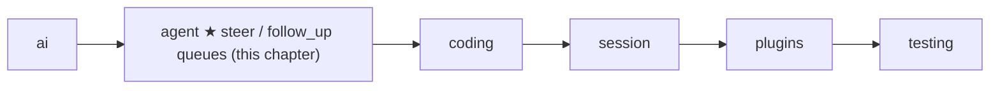
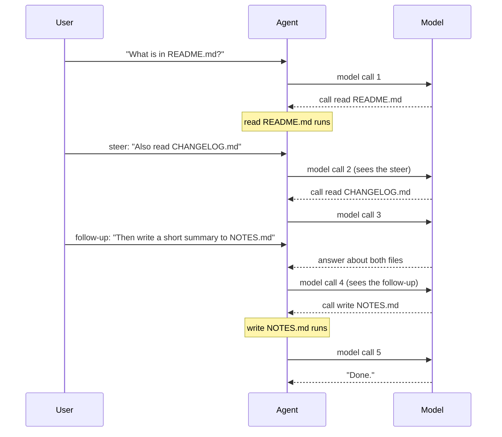
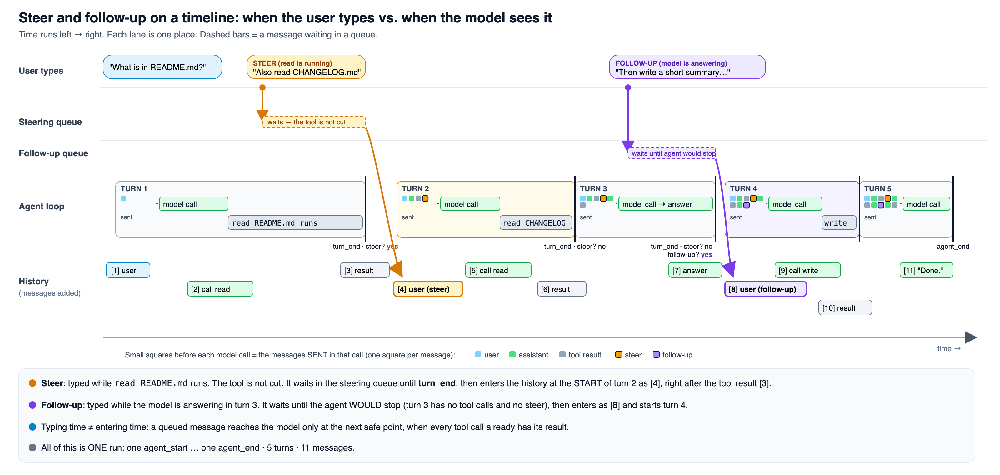
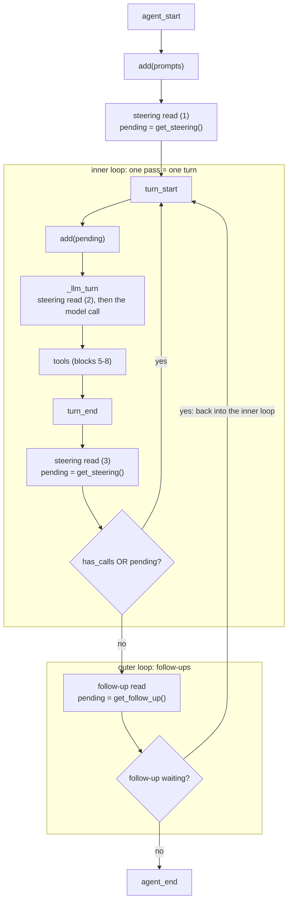

# 07 Part 2 · Steering

**Goal:** Let the user add messages while the agent works.

**Builds on:** [06 Events and abort](06-events-abort.md) · **Next:** [08 Hooks and approval](08-hooks-approval.md)

## Where we are



Big picture of Part 2: [part-2-agent](05-0-part-2-agent.md).

## Example: two new wishes during one run

Take the README run from [Part 2](05-0-part-2-agent.md#example-the-user-asks-about-a-file) again, and follow it in time:





The picture shows the same run on a timeline: time runs left to right, through 5 turns and 11 messages. The steer and the follow-up wait in their queue (the dashed bars) and enter the history only at a safe point. The small squares before each model call show which messages that call sends: orange is the steer, sent from turn 2 on, and purple is the follow-up, sent from turn 4 on.

While `read README.md` runs, the user remembers something and types "Also read CHANGELOG.md". Near the end, they type "Then write a short summary to NOTES.md". This whole chapter is about how these two messages get into the run.

## Problem

In [06](06-events-abort.md) the user got a Stop button, but they do not want to stop. They want to add to the work. And they cannot start a second run: `Agent` allows one [run](glossary.md#run-agent) at a time, and a second `prompt()` raises `RuntimeError` ([06](06-events-abort.md#the-agent-class-state-on-top-of-the-loop)).

The two messages need different times. "Also read CHANGELOG.md" should reach the model **soon**, so the model can change its plan. "Then write a summary" should wait **until the current job is done**. So we give each its own kind of message. A [steer](glossary.md#steer) is delivered as soon as it is safe, in the middle of the run. A [follow-up](glossary.md#follow-up) waits until the agent would stop, then starts more work in the same run.

Why "as soon as it is safe"? [06](06-events-abort.md#starting-point-05s-loop-with-nobody-listening) showed that every tool call must be followed by its tool result, or the vendor returns a 400 error. So we cannot put the user's message into the history at the moment they type it:

```text
assistant: call c1 read README.md
user:      "Also read CHANGELOG.md"     <- WRONG: between the call and its result
tool:      result of c1
```

We must wait until every tool call has its result. We call such a place a [safe point](glossary.md#safe-point):

```text
assistant: call c1 read README.md
tool:      result of c1
user:      "Also read CHANGELOG.md"     <- safe point: c1 has its result
// model call 2 sees the message and calls read CHANGELOG.md
```

Note the cost: the tool that is running still finishes. Steer changes the model's **next** decision; it does not stop work. To stop work, the user presses Stop ([06](06-events-abort.md#abort-one-asyncioevent)).

Code in this chapter (commit `2fc2776`):

- `packages/simp_agent/src/simp_agent/agent/__init__.py`: `LoopConfig.get_steering` / `get_follow_up`, the two `while` loops of `agent_loop`, the steering read in `_llm_turn`, and on `Agent`: `steer`, `follow_up`, `_take`, `clear_queues`, `has_queued`
- `packages/simp_agent/tests/test_queues_compaction.py`: the queue tests

## Starting point: 06's `Agent` and loop

So where can "Also read CHANGELOG.md" go today? We start from what [06](06-events-abort.md) ended with. `Agent._run` refuses a second run while one is going, and `agent_loop` reads the user's messages only once, at the start:

```text
FUNCTION agent_loop(system_prompt, messages, prompts, config, emit, cancel):
    SEND agent_start
    FOR EACH p in prompts: add(p)             // the only place user messages come in
    WHILE the model asked for tools:          // one pass = one turn
        ...                                   // model call, tool calls, abort exit
    SEND agent_end
```

So with 06's code the message has nowhere to go. The easy patch is to keep the text in `Agent` and call `prompt()` again when the run ends. That keeps the history valid, but it comes **too late**: the model has already answered about README.md alone. It also keeps **one place for two needs**: the urgent steer and the "later" follow-up wait together, so the agent cannot treat them differently. Everything waiting goes out together, so there is **no choice of batch size**, but sometimes the user wants each message handled as its own task. And each delivery is a new run, with a new `agent_start` and `agent_end` [event](glossary.md#event), so a UI that shows "busy" until `agent_end` gives **a flickering UI**.

## Step by step: grow the loop

How do we fix all of this without a second run? Four small steps.

**Step 1: two queues.** `Agent` keeps two lists, `steering` and `follow_ups`. The UI picks one by calling `steer(text)` or `follow_up(text)`. This fixes "one place for two needs".

**Step 2: read steering inside the run.** Instead of waiting for the run to end, the loop asks "is a steer waiting?" at every safe point, so "Also read CHANGELOG.md" reaches model call 2. This fixes "too late".

**Step 3: follow-ups extend the same run.** When the agent would stop, the loop asks "is a follow-up waiting?". If yes, it adds the message and goes on. There is only one `agent_start` and one `agent_end`. This fixes "a flickering UI".

**Step 4: take one message, or all.** Each read takes either the oldest waiting message only, or all of them. This fixes "no choice of batch size".

## Real design

### The loop from 05, with two new places

Where in the loop do steps 2 and 3 go? Here is `agent_loop` from [05](05-agent-loop.md#agent_loop-the-loop), with the events of [06](06-events-abort.md#how-the-loop-sends-them). The block numbers are the ones of the [Part 2 map](05-0-part-2-agent.md#the-blocks). Only the lines marked `NEW` are new; the hook calls and abort exits are cut.

Two names first. `pending` is the list of user messages the loop has just taken from a queue and will add at the top of the next turn. `has_calls` says "the last reply asked for tools". The loop sets it to true before the first turn, because there is no reply yet and the first turn must run.

```text
SEND event {agent_start}                     // block 1: start the run
FOR EACH p in prompts: add(p)
pending = config.get_steering()              // NEW: steering read (1), steers typed before the run
has_calls = true
FOREVER:                                     // NEW: outer loop, for follow-ups
    WHILE has_calls OR pending:              // inner loop: one pass = one turn
        SEND event {turn_start}
        FOR EACH p in pending: add(p)        // block 2: take steering
        pending = empty
        msg = WAIT for _llm_turn(...)        // blocks 3 + 4: build the view, call the model
        add(msg)
        ...                                  // blocks 5-8: check the reply, run the tools
        SEND event {turn_end, msg}
        has_calls = (msg asked for tools)
        pending = config.get_steering()      // NEW: steering read (3) (block 9, safe point)
    pending = config.get_follow_up()         // NEW: the follow-up read (block 9)
    IF pending is empty: STOP
SEND event {agent_end, new messages}
RETURN new messages
```

Real code: [packages/simp_agent/src/simp_agent/agent/__init__.py](../../packages/simp_agent/src/simp_agent/agent/__init__.py) (`agent_loop`)

The **steering read (3)** sits at the end of each turn, after all the tools of that reply have run. There every tool call has its result, so it is a safe point. The inner loop goes on while the model asked for tools **or** a steer is waiting, so a steer can even start a new turn when the model was done.

The **follow-up read** sits outside the inner loop. The inner loop ends only when the agent would stop, so only then does the loop ask for follow-ups; reading them earlier would cut into the current job. If one is waiting, `pending` is not empty and the inner loop starts again. If not, the run ends.

There is one more, small steering read (2) inside block 3, in `_llm_turn`. Before each model call, the `prepare_next_turn` hook builds the `view`, the list of messages the model will see ([05](05-agent-loop.md#_llm_turn-one-model-call)). That hook can be slow: compaction runs there and makes its own model call ([16](16-compaction.md)). A steer typed during it should join this turn, not wait for the next:

```text
// inside _llm_turn
view = copy of the result of prepare_next_turn(messages)
FOR EACH p in config.get_steering():     // steering read (2)
    add(p)                               // into the history
    ADD p to view                        // and into this turn's view, built before the read
```

Real code: [packages/simp_agent/src/simp_agent/agent/__init__.py](../../packages/simp_agent/src/simp_agent/agent/__init__.py) (`_llm_turn`)

Here are the two loops as one picture. The three steering reads have the same labels as above: (1) before the run, (2) inside `_llm_turn`, (3) at the end of each turn.



The [timeline picture](#example-two-new-wishes-during-one-run) shows the path of "Also read CHANGELOG.md" from the keyboard to model call 2.

### Where `get_steering` gets its messages

`steer()` only wraps the text in a `UserMessage`, appends it to `Agent.steering` and returns at once; it never cuts the running tool and never waits for the loop. The queue lives in `Agent`, not in the loop. The loop only gets two **functions** through `LoopConfig` ([05](05-agent-loop.md#loopconfig-the-settings)): `get_steering` and `get_follow_up` (both return an empty list by default). `Agent._run` sets them to "take from my list", using `_take` and the queue mode (next part). Because they are functions, each call looks at the list as it is **now**, so a `steer()` in the middle of the run is seen at the next read.

### The `Agent` side: two lists and a mode

What does `Agent` ([06](06-events-abort.md#the-agent-class-state-on-top-of-the-loop)) keep behind these hooks?

```text
CLASS Agent:
    steering = empty list
    follow_ups = empty list
    steering_mode = follow_up_mode = "one-at-a-time"   // or "all"

    FUNCTION steer(text):        ADD UserMessage(text) to steering
    FUNCTION follow_up(text):    ADD UserMessage(text) to follow_ups
    FUNCTION clear_queues():     EMPTY steering and follow_ups
    FUNCTION has_queued():       RETURN true IF either list is not empty

    FUNCTION _take(queue, mode):
        n = IF mode is "all": length of queue, ELSE: at most 1
        out = the first n messages of queue
        REMOVE those n messages from queue    // so a message is never sent twice
        RETURN out
```

Real code: [packages/simp_agent/src/simp_agent/agent/__init__.py](../../packages/simp_agent/src/simp_agent/agent/__init__.py) (`Agent.steer`, `follow_up`, `clear_queues`, `has_queued`, `_take`)

`steer` and `follow_up` are plain sync methods, like `abort`. They only append to a list, so a key handler can call them at any time. `has_queued` lets a UI show "2 messages waiting".

The [queue mode](glossary.md#queue-mode) decides how many messages one read takes. Why have a choice? Say the user types three steers quickly while `read README.md` runs: "Also read CHANGELOG.md", "and LICENSE", "skip the tests folder". With `"one-at-a-time"` (the default), the read at the end of turn 1 takes only the first one. Turn 2 sees "Also read CHANGELOG.md"; the next read takes "and LICENSE" for turn 3, and so on. Each message gets its own turn, so the model handles each as its own task. With `"all"`, the read takes all three, and turn 2 sees them together. That is fewer model calls, and better when the messages are parts of one wish.

Higher layers only pass text down. The session ([13](13-session.md)) has its own `steer` and `follow_up` that call the `Agent` ones, and the CLI ([19](19-cli.md)) and the server ([20](20-server-run.md)) call the session.

### Errors and abort leave the queues alone

What if the run ends early? If a turn ends with `error` or `aborted`, `agent_loop` returns at once ([06](06-events-abort.md#abort-one-asyncioevent)), before the steering read and the follow-up read. So waiting messages stay in the queues. The `Agent` docstring says:

> Queued messages survive abort(); they wait for the next prompt() or clear_queues().

This is on purpose. The user pressed Stop, not "throw away what I typed". The next `prompt()` reads the steering queue right after its prompt, so a waiting steer goes out with the new prompt. If the UI wants the messages gone, it calls `clear_queues()`.

## Test

The tests are in `test_queues_compaction.py`. They use [FakeProvider](04-label-test.md) and its `messages` list, which records what the model was sent on each call.

Steer during a tool:

```text
TEST steer is delivered after the tools:
    tool t = WHEN run:
        agent.steer("change plan")         // typed while the tool runs
        RETURN "r"
    provider = FakeProvider(reply that calls t, then DONE)
    agent = Agent with tool t and provider
    WAIT for agent.prompt("go")
    CHECK model call 1 did NOT see "change plan"
    CHECK model call 2 ends with "change plan", right after a ToolResultMessage
    CHECK nothing is queued
```

Real code: [packages/simp_agent/tests/test_queues_compaction.py](../../packages/simp_agent/tests/test_queues_compaction.py) (`test_steer_delivered_after_tool_batch`)

This is our example in small. The tool calls `steer` itself, as a user typing during the tool would. The first model call did not see the message, because it was typed later. The second call has it as the last message, right after the tool result, so it was added at a safe point. And the queue is empty at the end.

Follow-ups in both modes:

```text
TEST follow-ups in both modes:
    FOR EACH (mode, expected calls) in ("one-at-a-time", 3), ("all", 2):
        provider = FakeProvider(DONE, DONE, DONE)
        agent = Agent with no tools and provider
        agent.follow_up_mode = mode
        agent.follow_up("f1")
        agent.follow_up("f2")
        WAIT for agent.prompt("go")
        CHECK number of model calls == expected calls
        CHECK the last two user messages of the last call are "f1", "f2"
        CHECK nothing is queued
```

Real code: [packages/simp_agent/tests/test_queues_compaction.py](../../packages/simp_agent/tests/test_queues_compaction.py) (`test_follow_up_one_at_a_time_and_all`)

Two follow-ups are queued before the prompt. In `"one-at-a-time"` mode the model is called three times: for `go`, then `f1`, then `f2`. In `"all"` mode it is called twice: for `go`, then `f1` and `f2` together. Note that the follow-ups did not go out with the prompt: they waited until the model answered `go`.

A third test, `test_steer_during_compaction_same_turn`, checks the steering read inside `_llm_turn`. The fake summary call (the slow `prepare_next_turn` of [16](16-compaction.md)) calls `steer("late")`. There are only two model calls, and the second already ends with `"late"`: the steer joined the same turn instead of making a new one.

```bash
uv run pytest packages/simp_agent/tests/test_queues_compaction.py
```

## Why this way

> **Two queues, because there are two needs.** "Change what you are doing" must arrive soon; "then do this" must wait. One place cannot do both.
>
> **Deliver only at safe points.** Every tool call keeps its result, so the history stays valid. The price is that steer never stops work; that is Stop's job.
>
> **The loop asks; the caller keeps.** `agent_loop` holds no queue state, so any host can keep the messages anywhere.
>
> **All in one run.** Queued messages extend the current run, so the UI sees one `agent_start` and one `agent_end`, and the one-run-at-a-time rule stays simple.

## Exercises

1. Call `agent.steer("s1")` **before** `agent.prompt("go")`, with a `FakeProvider` of two `DONE` replies. How many model calls happen? Which user messages does the first call see?
2. Queue `agent.follow_up("later")`, then prompt with a `FakeProvider` whose first reply has `stop_reason="error"`. Is `"later"` still queued (`has_queued()`)? Prompt again and check when it is sent.

## Recap

A [steer](glossary.md#steer) is delivered soon, at the next safe point; a [follow-up](glossary.md#follow-up) waits until the agent would stop. The loop keeps no queue: it calls `get_steering` before the first turn, before each model call and at the end of each turn, and calls `get_follow_up` only when the inner loop ends. Everything happens in one run. On error or abort the queues are not read, so the messages wait for the next `prompt()`. `Agent` keeps the two lists, and `_take` hands out one message or all of them, by queue mode.

**Builds on:** [06 Events and abort](06-events-abort.md) · **Next:** [08 Hooks and approval](08-hooks-approval.md): `before_tool_call` and `after_tool_call`, so a caller can check, deny or change a tool call.
