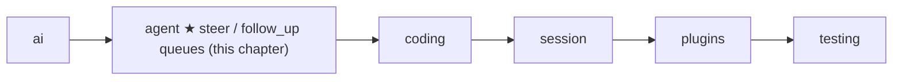
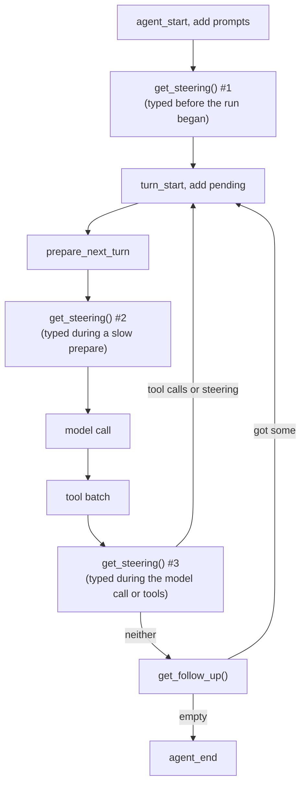

# 07 Part 2 · Steering

**Goal:** Let the user add messages while the agent works.

**Builds on:** [06 Events and abort](06-events-abort.md) · **Next:** [08 Hooks and approval](08-hooks-approval.md)

## Where we are



In [06](06-events-abort.md) the user got a **Stop** button. But stop is a hard tool. Often the user does not want to stop. They want to say "wait, use the other file" while the agent is still running a tool. Or they want to queue "now write the tests" for when the current job is done.

This chapter adds two queues to the agent:

- [Steer](glossary.md#steer): a message that should reach the model **as soon as possible**, in the middle of the work.
- [Follow-up](glossary.md#follow-up): a message that should wait **until the agent would stop**, then start more work.

Code in this chapter (commit `2fc2776`):

- `packages/simp_agent/src/simp_agent/agent/__init__.py` — `LoopConfig.get_steering` / `get_follow_up`, the two `while` loops of `agent_loop`, the steering poll in `_llm_turn`, and `Agent.steer`, `follow_up`, `_take`, `clear_queues`, `has_queued`
- `packages/simp_agent/tests/test_queues_compaction.py` — the queue tests

## Problem

In [06](06-events-abort.md) we saw that `Agent` allows **one run at a time**. A second `prompt()` during a run raises `RuntimeError`. That rule is right: two loops writing to one history would mix their messages.

But the user still types while the agent works. A coding run can take minutes. In that time the user may see the agent go the wrong way, or think of the next task. We need a way to take their text **now** and deliver it **at a safe point** later.

What is a safe point? The history must stay valid. The model asked for tools; each tool call must be followed by its tool result ([01](01-messages.md)). If we put a user message **between** a tool call and its result, vendors reject the request. So "deliver now" really means "deliver at the next place where the history is complete".

## Naive version

```python
class NaiveAgent:
    def __init__(self, loop_fn):
        self.loop_fn, self.running, self.inbox = loop_fn, False, []

    def say(self, text):
        if self.running:
            self.inbox.append(UserMessage(text))   # keep it for later
            return
        asyncio.create_task(self.run([UserMessage(text)]))

    async def run(self, prompts):
        self.running = True
        await self.loop_fn(prompts)                # runs until the model stops
        self.running = False
        if self.inbox:                             # deliver at the very end
            msgs, self.inbox = self.inbox, []
            await self.run(msgs)
```

Where it breaks:

- **"Change plan" comes too late.** The inbox is read only when the whole run is over. If the agent is about to edit ten files the wrong way, the user's "stop, use the other file" waits until all ten edits are done.
- **One inbox for two needs.** "Change plan" (urgent) and "then write tests" (later) go to the same place. The agent cannot tell them apart.
- **All or nothing.** Three queued messages are sent as one batch. Sometimes the user wants each one handled as its own task.
- **Not one run.** Each delivery is a new `run`, with new `agent_start` / `agent_end` [events](glossary.md#event). A UI that shows "busy" until `agent_end` flickers off and on.

## Real design

### Two hooks in `LoopConfig`

`agent_loop` itself has no queue. It only asks the caller, through two functions in `LoopConfig`:

```python
    get_steering: Callable[[], list] = lambda: []  # messages typed while working; read after each tool batch
    get_follow_up: Callable[[], list] = lambda: []  # read only when the loop would otherwise stop
```

Each one returns a list of messages (often empty). (The comment on `get_steering` says "after each tool batch", but as we see below it is read at three points.) The loop calls them at fixed points and adds what they return to the history with `add` ([06](06-events-abort.md#events-one-stream-of-small-dicts)), so each message also gives `message_start` / `message_end` events.

Why functions and not lists? The loop does not care where the messages come from. `Agent` keeps them in lists, but a server could read them from a database or a socket. The loop only needs "give me what is waiting now".

### Two loops: inner for steering, outer for follow-ups

Here is the core of `agent_loop` again, now with the queue parts (`packages/simp_agent/src/simp_agent/agent/__init__.py`; the tool batch is cut, see [05](05-agent-loop.md)):

```python
    await send({"type": "agent_start"})
    for p in prompts:
        await add(p)
    pending, has_calls, msg = config.get_steering(), True, None
    while True:
        while has_calls or pending:
            await send({"type": "turn_start"})
            for p in pending:
                await add(p)
            pending = []
            msg = await _llm_turn(system_prompt, messages, config, cancel, send, add)
            await add(msg)
            ...                                   # error / abort exit, then the tool batch
            await send({"type": "turn_end", "message": msg})
            has_calls, pending = bool(calls), config.get_steering()
        pending = config.get_follow_up()
        if not pending:
            break
    await send({"type": "agent_end", "messages": new})
    return new
```

Read it as two loops:

- **Inner loop** (`while has_calls or pending`): one pass is one [turn](glossary.md#turn). It goes on while the model asked for tools **or** a steering message is waiting. So a steer can start a new turn even when the model was done.
- **Outer loop** (`while True`): runs only when the inner loop ends, which means the agent would stop now. Then it asks for follow-ups. If there are some, `pending` is not empty, so the inner loop starts again. If there are none, the run ends.

The whole thing is **one run**: one `agent_start`, one `agent_end`, however many messages were delivered. The UI stays "busy" the whole time.

### When each queue is read

Steering is read at three points, follow-ups at one:



1. **Before the first turn.** `pending = config.get_steering()` right after the prompts. A steer that arrived just before the run starts is sent with the prompt. (Point 2 also runs on the first turn.)
2. **Inside `_llm_turn`, just before the model call.** This is the latest possible moment:

   ```python
       view = await config.prepare_next_turn(messages)
       view = list(messages if view is None else view)
       for p in config.get_steering():
           await add(p)
           view.append(p)
   ```

   `prepare_next_turn` may be slow: it is where compaction runs ([16](16-compaction.md)), and when compaction runs, that is one more model call. A message typed during it goes into this turn, not the next. The docstring says it: "prepare_next_turn hook -> steering poll (the hook may be slow) -> …". The message is added to the history **and** to `view`, because `view` was built before the poll.
3. **After the tool batch** (`has_calls, pending = bool(calls), config.get_steering()`). This is the main point. All tool results are in the history now, so a user message is safe here.

Follow-ups are read at one point only: when the inner loop has ended.

Note what steering does **not** do. It does not stop the tool that is running, and it does not skip the other tools in the batch. If the model asked for three tools and the user steers during the first, all three run, then the steer is sent. To stop a tool, the user needs [abort](glossary.md#abort). Steer changes the **next** decision; abort stops the **current** one.

### Errors and abort leave the queues alone

If the turn ends with `error` or `aborted`, `agent_loop` returns at once through `_end` ([06](06-events-abort.md#abort-one-asyncioevent)). It does not call `get_steering` or `get_follow_up` again. So waiting messages stay in the queues. The `Agent` docstring says:

> Queued messages survive abort(); they wait for the next prompt() or clear_queues().

This is on purpose. The user pressed Stop, not "throw away what I typed". The next `prompt()` reads the steering queue at point 1, so the old messages go out with the new prompt. If the UI wants them gone, it calls `clear_queues()`.

### The `Agent` side: two lists and a mode

`Agent` owns the real queues:

```python
        self.steering, self.follow_ups = list(), list()
        self.steering_mode = self.follow_up_mode = "one-at-a-time"  # or "all"
```

```python
    def steer(self, text: str) -> None:
        self.steering.append(UserMessage(text))

    def follow_up(self, text: str) -> None:
        self.follow_ups.append(UserMessage(text))

    def clear_queues(self) -> None:
        self.steering.clear()
        self.follow_ups.clear()

    def has_queued(self) -> bool:
        return bool(self.steering or self.follow_ups)
```

`steer` and `follow_up` are plain sync methods, like `abort`. They only append to a list; they never wait for the loop. A key handler can call them at any time, during a run or not. `has_queued` lets a UI show "2 messages waiting".

The [mode](glossary.md#queue-mode) decides how many messages one read takes:

```python
    @staticmethod
    def _take(queue: list, mode: str) -> list:
        n = len(queue) if mode == "all" else min(1, len(queue))
        out = queue[:n]
        del queue[:n]
        return out
```

- `"one-at-a-time"` (default): take the oldest message only. Each queued message gets its own turn, and the model answers each one.
- `"all"`: take everything. The model sees all waiting messages together in one turn.

`_take` removes what it returns (`del queue[:n]`), so a message is never sent twice.

Finally `_run` connects the lists to the loop:

```python
                get_steering=lambda: self._take(self.steering, self.steering_mode),
                get_follow_up=lambda: self._take(self.follow_ups, self.follow_up_mode),
```

The lambdas read `self.steering` at call time, not when `_run` starts. So a `steer()` called in the middle of the run is seen at the next read point.

Higher layers pass text down: the session ([13](13-session.md)) has its own `steer` / `follow_up` that call `self.agent.steer(text)` / `self.agent.follow_up(text)`, and the CLI ([19](19-cli.md)) and server ([20](20-server-run.md)) call those. `Agent`'s lists have no size limit; the server adds its own cap (`MAX_QUEUED`) and handles a follow-up that arrives just after the loop decided to stop by starting a new run ([20](20-server-run.md)).

## Test

The tests are in `test_queues_compaction.py`. They use [FakeProvider](02-fake-provider.md) and its `messages` list, which records what the model was sent on each call.

Steer during a tool:

```python
async def test_steer_delivered_after_tool_batch():
    agent = None

    async def t(args, cancel):
        agent.steer("change plan")  # typed while the tool runs
        return "r"

    stream = FakeProvider(call(1), DONE)
    seen = stream.messages
    agent = Agent("s", Model(), [AgentTool("t", "", {"type": "object"}, t)], stream)
    await agent.prompt("go")
    assert "change plan" not in texts(seen[0])
    assert texts(seen[1])[-1] == "change plan" and isinstance(seen[1][-2], ToolResultMessage)
    assert not agent.has_queued()
```

The tool itself calls `steer`, as a user typing during the tool would. The checks: the first model call did not see it (it was typed later); the second call has it as the last user message, **right after the tool result**, so the history is valid; and the queue is empty after.

Follow-ups in both modes:

```python
async def test_follow_up_one_at_a_time_and_all():
    for mode, calls in (("one-at-a-time", 3), ("all", 2)):
        stream = FakeProvider(DONE, DONE, DONE)
        seen = stream.messages
        a = Agent("s", Model(), [], stream)
        a.follow_up_mode = mode
        a.follow_up("f1")
        a.follow_up("f2")
        await a.prompt("go")
        assert len(seen) == calls
        assert texts(seen[-1])[-2:] == ["f1", "f2"] and not a.has_queued()
```

Two follow-ups are queued before the prompt. In `"one-at-a-time"` mode the model is called three times: for `go`, then `f1`, then `f2`. In `"all"` mode it is called twice: for `go`, then `f1` and `f2` together. In both cases the last call has both messages in history, and nothing is left in the queue. Note that the follow-ups did **not** go with the prompt: they waited until the model answered `go`.

`test_steer_during_compaction_same_turn` checks read point 2. The fake summary call (the slow `prepare_next_turn` of [16](16-compaction.md)) calls `steer("late")`. The test asserts there are only two model calls and the second already ends with `"late"`: the steer joined the same turn instead of making a new one.

```bash
uv run pytest packages/simp_agent/tests/test_queues_compaction.py
```

> **Why this way**
>
> **Two queues, because there are two needs.** "Change what you are doing" must arrive soon; "then do this" must wait. One inbox cannot do both.
>
> **Deliver only at safe points.** Steering is read before a model call and after a full tool batch, never in the middle. So every tool call keeps its result and the history stays valid. It also means steer never kills work; that is abort's job ([06](06-events-abort.md)).
>
> **The loop asks; the caller keeps.** `agent_loop` only calls `get_steering()` / `get_follow_up()`. It has no queue state. `Agent` keeps simple lists; other hosts can keep them anywhere.
>
> **All in one run.** Queued messages extend the current run instead of starting a new one, so there is one `agent_start` and one `agent_end`, and `prompt()` stays one-at-a-time.

## Recap

- [Steer](glossary.md#steer) = deliver soon. [Follow-up](glossary.md#follow-up) = deliver when the agent would stop.
- `LoopConfig` has two hooks, `get_steering` and `get_follow_up`. The loop calls them; it keeps no queue itself.
- The inner loop runs while there are tool calls **or** steering; the outer loop asks for follow-ups when the inner loop ends.
- Steering is read before the first turn, just before each model call (after `prepare_next_turn`), and after each tool batch. It never cuts a tool batch.
- On error or abort the queues are not read, so messages survive for the next `prompt()` (or `clear_queues()`).
- `Agent.steer` / `follow_up` append to lists; `_take` takes one message (`"one-at-a-time"`) or all (`"all"`) per read.

**Builds on:** [06 Events and abort](06-events-abort.md) · **Next:** [08 Hooks and approval](08-hooks-approval.md) — `before_tool_call` and `after_tool_call`, so a caller can check, deny or change a tool call.
