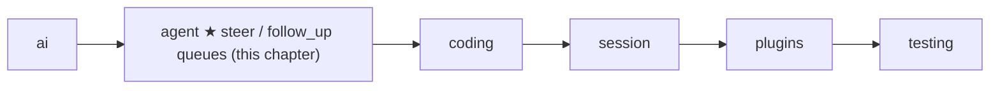
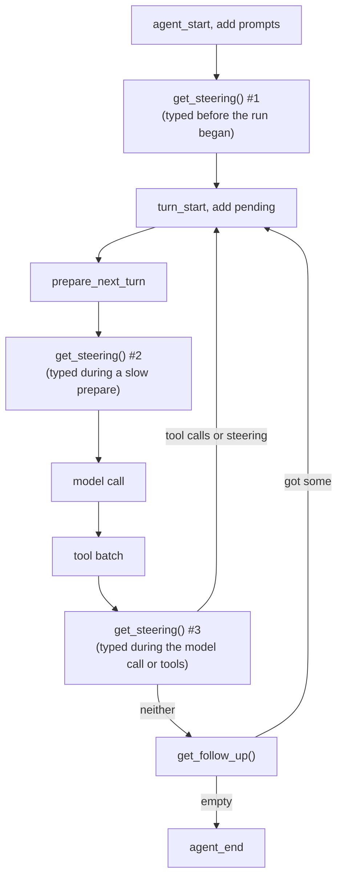

# 07 Part 2 · Steering

**Goal:** Let the user add messages while the agent works.

**Builds on:** [06 Events and abort](06-events-abort.md) · **Next:** [08 Hooks and approval](08-hooks-approval.md)

## Where we are



Big picture of Part 2: [part-2-agent](05-0-part-2-agent.md).

## Problem

Take the README run again. The user asks "What is in README.md?", and the model calls `read README.md`. While the tool runs, the user remembers something and types "Also read CHANGELOG.md". A moment later they also type "Then write a short summary to NOTES.md".

In [06](06-events-abort.md) the user got a Stop button, but they do not want to stop. They want to add to the work. And they cannot start a second run: `Agent` allows one [run](glossary.md#run-agent) at a time, and a second `prompt()` raises `RuntimeError` ([06](06-events-abort.md#the-agent-class-state-on-top-of-the-loop)).

The two messages also need different times. "Also read CHANGELOG.md" should reach the model **soon**, so the model can change its plan. "Then write a summary" should wait **until the current job is done**. This chapter adds one queue for each:

- a [steer](glossary.md#steer) message is delivered as soon as it is safe, in the middle of the run;
- a [follow-up](glossary.md#follow-up) message waits until the agent would stop, then starts more work in the same run.

"As soon as it is safe" matters. [06](06-events-abort.md#starting-point-05s-loop-with-nobody-listening) showed that every tool call must be followed by its tool result, or the vendor returns a 400 error. So we cannot put the user's message into the history at the moment they type it:

```text
assistant: call c1 read README.md
user:      "Also read CHANGELOG.md"     <- WRONG: between the call and its result
tool:      result of c1
```

We must wait until every tool call has its result. We call such a place a [safe point](glossary.md#safe-point):

```text
assistant: call c1 read README.md
tool:      result of c1
user:      "Also read CHANGELOG.md"     <- safe point: c1 has its result
// the next model call sees the message and calls read CHANGELOG.md
```

Note the cost: the tool that is running still finishes. Steer changes the model's **next** decision; it does not stop work. To stop work, the user presses Stop ([06](06-events-abort.md#abort-one-asyncioevent)).

Code in this chapter (commit `2fc2776`):

- `packages/simp_agent/src/simp_agent/agent/__init__.py`: `LoopConfig.get_steering` / `get_follow_up`, the two `while` loops of `agent_loop`, the steering read in `_llm_turn`, and on `Agent`: `steer`, `follow_up`, `_take`, `clear_queues`, `has_queued`
- `packages/simp_agent/tests/test_queues_compaction.py`: the queue tests

## Naive version

A first try: keep one inbox. If a run is going, store the text; when the run ends, send everything as a new run.

```text
CLASS NaiveAgent(loop_fn):
    running = false
    inbox = empty list

    FUNCTION say(text):
        IF running:
            ADD UserMessage(text) to inbox      // keep it for later
            RETURN
        START run([UserMessage(text)]) in the background

    FUNCTION run(prompts):
        running = true
        WAIT for loop_fn(prompts)               // runs until the model stops
        running = false
        IF inbox is not empty:                  // deliver at the very end
            msgs = TAKE everything from inbox
            WAIT for run(msgs)
```

This is safe (the history stays valid), but it breaks in four ways. First, "Also read CHANGELOG.md" comes too late: the inbox is read only when the whole run is over, so the model has already answered about README.md alone. Second, the urgent message and the "later" message go to the same inbox, so the agent cannot treat them differently. Third, everything in the inbox goes out as one batch, but sometimes the user wants each message handled as its own task. Last, each delivery is a new run, with a new `agent_start` and `agent_end` [event](glossary.md#event). A UI that shows "busy" until `agent_end` flickers off and on.

## Step by step: from naive to real

**Step 1: two queues, not one inbox.** `Agent` keeps two lists, `steering` and `follow_ups`. The user (or the UI) picks one by calling `steer(text)` or `follow_up(text)`. This fixes the second problem.

**Step 2: the loop reads steering at safe points, inside the run.** Instead of waiting for the run to end, the loop asks "is a steer waiting?" each time the history is complete, so "Also read CHANGELOG.md" reaches the next model call. This fixes the first problem. We call each place where the loop asks a **read point**; the next section shows all three.

**Step 3: follow-ups extend the same run.** When the agent would stop, the loop asks "is a follow-up waiting?". If yes, it adds the message and goes on. There is only one `agent_start` and one `agent_end`, so the UI does not flicker. This fixes the last problem.

**Step 4: take one message, or all.** Each read takes either the oldest message only, or all of them. This fixes the third problem.

## Real design

### Two hooks in `LoopConfig`

`agent_loop` keeps no queue itself. It asks the caller through two functions in `LoopConfig` ([05](05-agent-loop.md#loopconfig-the-settings)). Both return a list of messages, and both return an empty list by default:

```text
get_steering  = a function that returns a list   // read at the three read points
get_follow_up = a function that returns a list   // read only when the loop would otherwise stop
```

Real code: [packages/simp_agent/src/simp_agent/agent/__init__.py](../../packages/simp_agent/src/simp_agent/agent/__init__.py) (`LoopConfig`)

Why functions and not lists? The loop does not care where the messages come from. `Agent` keeps them in plain lists, but another host could read them from a database or a socket. The loop only needs "give me what is waiting now". Each message the loop gets is put into the history with `add`, the same helper as for every other message ([06](06-events-abort.md#how-the-loop-sends-them)), so the UI sees it as a normal user message.

### Two loops: inner for steering, outer for follow-ups

Here is `agent_loop` from [05](05-agent-loop.md#agent_loop-the-loop), now with the queue parts. The tool batch and the two error/abort exits are cut:

Real code: [packages/simp_agent/src/simp_agent/agent/__init__.py](../../packages/simp_agent/src/simp_agent/agent/__init__.py) (`agent_loop`)

```text
SEND event {agent_start}
FOR EACH p in prompts: add(p)
pending = config.get_steering()          // read point 1
has_calls = true                         // so the first turn always runs
FOREVER:                                 // outer loop: follow-ups
    WHILE has_calls OR pending:          // inner loop: one pass = one turn
        SEND event {turn_start}
        FOR EACH p in pending: add(p)
        pending = empty
        msg = WAIT for _llm_turn(...)    // the model call; read point 2 is inside
        add(msg)
        ...                              // error/abort exit, tool batch, abort exit
        SEND event {turn_end, msg}
        has_calls = (msg asked for tools)
        pending = config.get_steering()  // read point 3
    pending = config.get_follow_up()
    IF pending is empty: STOP
SEND event {agent_end, new messages}
RETURN new messages
```

The inner loop runs one [turn](glossary.md#turn) per pass. It goes on while the model asked for tools **or** a steer is waiting, so a steer can start a new turn even when the model was done. The inner loop ends only when the agent would stop. Only then does the outer loop ask for follow-ups: reading them earlier would cut into the current task. If a follow-up is waiting, `pending` is not empty and the inner loop starts again; if not, the run ends.

In our example, the second turn sees "Also read CHANGELOG.md" and calls `read CHANGELOG.md`. The third turn answers about both files. Then the inner loop ends, the outer loop finds "Then write a short summary to NOTES.md", and the agent goes on to write it. It is all **one run**: one `agent_start`, one `agent_end`.

### When each queue is read

Steering is read at three points, and follow-ups at one:



Read point 1 is right after the prompts. A steer that was queued before the run began goes out with the prompt. Read point 3 is after the tool batch. This is the main one, and it is the one in our example: every tool call has its result now, so the history is at a safe point.

Read point 2 is inside `_llm_turn`, just before the model call. Before each call, the `prepare_next_turn` hook builds the `view`, the list of messages the model will see ([05](05-agent-loop.md#_llm_turn-one-model-call)). That hook can be slow: compaction runs there and makes its own model call ([16](16-compaction.md)). A steer typed during it should go into this turn, not wait for the next one:

```text
// inside _llm_turn
view = copy of the result of prepare_next_turn(messages)
FOR EACH p in config.get_steering():     // read point 2
    add(p)                               // into the history
    ADD p to view                        // and into this turn's view, built before the read
```

Real code: [packages/simp_agent/src/simp_agent/agent/__init__.py](../../packages/simp_agent/src/simp_agent/agent/__init__.py) (`_llm_turn`)

Note that no read point is in the middle of a tool batch. Steer never cuts a batch.

### Errors and abort leave the queues alone

If a turn ends with `error` or `aborted`, `agent_loop` returns at once ([06](06-events-abort.md#abort-one-asyncioevent)), before read point 3 and before the follow-up read. So waiting messages stay in the queues. The `Agent` docstring says:

> Queued messages survive abort(); they wait for the next prompt() or clear_queues().

This is on purpose. The user pressed Stop, not "throw away what I typed". The next `prompt()` reads the steering queue at read point 1, so a waiting steer goes out with the new prompt. If the UI wants the messages gone, it calls `clear_queues()`.

### The `Agent` side: two lists and a mode

`Agent` ([06](06-events-abort.md#the-agent-class-state-on-top-of-the-loop)) owns the real queues:

```text
CLASS Agent:
    steering = empty list
    follow_ups = empty list
    steering_mode = follow_up_mode = "one-at-a-time"   // or "all"

    FUNCTION steer(text):        ADD UserMessage(text) to steering
    FUNCTION follow_up(text):    ADD UserMessage(text) to follow_ups
    FUNCTION clear_queues():     EMPTY steering and follow_ups
    FUNCTION has_queued():       RETURN true IF either list is not empty

    FUNCTION _take(queue, mode):
        n = IF mode is "all": length of queue, ELSE: at most 1
        out = the first n messages of queue
        REMOVE those n messages from queue    // so a message is never sent twice
        RETURN out
```

Real code: [packages/simp_agent/src/simp_agent/agent/__init__.py](../../packages/simp_agent/src/simp_agent/agent/__init__.py) (`Agent.steer`, `follow_up`, `clear_queues`, `has_queued`, `_take`)

`steer` and `follow_up` are plain sync methods, like `abort`. They only append to a list and never wait for the loop, so a key handler can call them at any time. `has_queued` lets a UI show "2 messages waiting".

The [queue mode](glossary.md#queue-mode) decides how many messages one read takes. With `"one-at-a-time"` (the default), each queued message gets its own turn, so the model answers each one as its own task. With `"all"`, the model sees all waiting messages together in one turn.

`_run` connects the lists to the loop:

```text
// inside _run, when building LoopConfig
get_steering  = WHEN called: RETURN _take(steering, steering_mode)
get_follow_up = WHEN called: RETURN _take(follow_ups, follow_up_mode)
```

Real code: [packages/simp_agent/src/simp_agent/agent/__init__.py](../../packages/simp_agent/src/simp_agent/agent/__init__.py) (`Agent._run`)

These functions look at the lists each time they are called, not once when the run starts. So a `steer()` in the middle of the run is seen at the next read point.

Higher layers only pass text down. The session ([13](13-session.md)) has its own `steer` and `follow_up` that call the `Agent` ones, and the CLI ([19](19-cli.md)) and the server ([20](20-server-run.md)) call the session.

## Test

The tests are in `test_queues_compaction.py`. They use [FakeProvider](04-label-test.md) and its `messages` list, which records what the model was sent on each call.

Steer during a tool:

```text
TEST steer is delivered after the tool batch:
    tool t = WHEN run:
        agent.steer("change plan")         // typed while the tool runs
        RETURN "r"
    provider = FakeProvider(reply that calls t, then DONE)
    agent = Agent with tool t and provider
    WAIT for agent.prompt("go")
    CHECK model call 1 did NOT see "change plan"
    CHECK model call 2 ends with "change plan", right after a ToolResultMessage
    CHECK nothing is queued
```

Real code: [packages/simp_agent/tests/test_queues_compaction.py](../../packages/simp_agent/tests/test_queues_compaction.py) (`test_steer_delivered_after_tool_batch`)

This is our example in small. The tool calls `steer` itself, as a user typing during the tool would. The first model call did not see the message, because it was typed later. The second call has it as the last message, right after the tool result, so it was added at a safe point. And the queue is empty at the end.

Follow-ups in both modes:

```text
TEST follow-ups in both modes:
    FOR EACH (mode, expected calls) in ("one-at-a-time", 3), ("all", 2):
        provider = FakeProvider(DONE, DONE, DONE)
        agent = Agent with no tools and provider
        agent.follow_up_mode = mode
        agent.follow_up("f1")
        agent.follow_up("f2")
        WAIT for agent.prompt("go")
        CHECK number of model calls == expected calls
        CHECK the last two user messages of the last call are "f1", "f2"
        CHECK nothing is queued
```

Real code: [packages/simp_agent/tests/test_queues_compaction.py](../../packages/simp_agent/tests/test_queues_compaction.py) (`test_follow_up_one_at_a_time_and_all`)

Two follow-ups are queued before the prompt. In `"one-at-a-time"` mode the model is called three times: for `go`, then `f1`, then `f2`. In `"all"` mode it is called twice: for `go`, then `f1` and `f2` together. Note that the follow-ups did not go out with the prompt: they waited until the model answered `go`.

A third test, `test_steer_during_compaction_same_turn`, checks read point 2. The fake summary call (the slow `prepare_next_turn` of [16](16-compaction.md)) calls `steer("late")`. There are only two model calls, and the second already ends with `"late"`: the steer joined the same turn instead of making a new one.

```bash
uv run pytest packages/simp_agent/tests/test_queues_compaction.py
```

## Why this way

> **Two queues, because there are two needs.** "Change what you are doing" must arrive soon; "then do this" must wait. One inbox cannot do both.
>
> **Deliver only at safe points.** Every tool call keeps its result, so the history stays valid. The price is that steer never stops work; that is Stop's job.
>
> **The loop asks; the caller keeps.** `agent_loop` holds no queue state, so any host can keep the messages anywhere.
>
> **All in one run.** Queued messages extend the current run, so the UI sees one `agent_start` and one `agent_end`, and the one-run-at-a-time rule stays simple.

## Exercises

1. Call `agent.steer("s1")` **before** `agent.prompt("go")`, with a `FakeProvider` of two `DONE` replies. How many model calls happen? Which user messages does the first call see?
2. Queue `agent.follow_up("later")`, then prompt with a `FakeProvider` whose first reply has `stop_reason="error"`. Is `"later"` still queued (`has_queued()`)? Prompt again and check when it is sent.

## Recap

A [steer](glossary.md#steer) is delivered soon, at the next safe point; a [follow-up](glossary.md#follow-up) waits until the agent would stop. The loop keeps no queue: it calls `get_steering` before the first turn, before each model call and after each tool batch, and calls `get_follow_up` only when the inner loop ends. Everything happens in one run. On error or abort the queues are not read, so the messages wait for the next `prompt()`. `Agent` keeps the two lists, and `_take` hands out one message or all of them, by queue mode.

**Builds on:** [06 Events and abort](06-events-abort.md) · **Next:** [08 Hooks and approval](08-hooks-approval.md): `before_tool_call` and `after_tool_call`, so a caller can check, deny or change a tool call.
