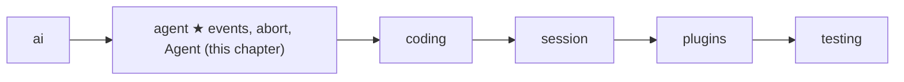
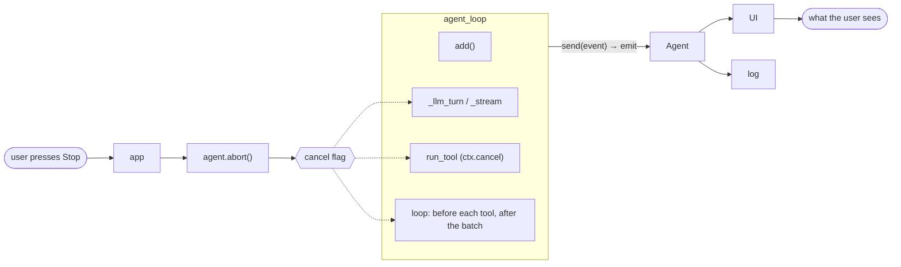
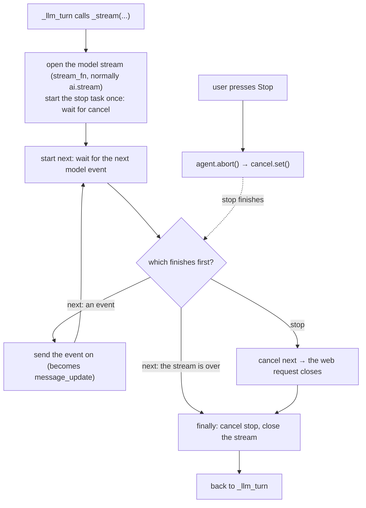

# 08 Part 2 · Events and abort

**Goal:** Let the user watch a run as it happens, and stop it cleanly.

**Builds on:** [07 The agent loop](07-agent-loop.md) · **Next:** [09 Steering](09-steering.md)

## Where we are



Big picture of Part 2: [part-2-agent](06-part-2-agent.md).

## Problem

Take the example from [07](07-agent-loop.md). The user asks "What is in README.md?". The model calls `read`, the loop runs it, and the model answers "README.md says this project is…". In 05, `agent_loop` gives back the new messages only at the very end. While it works, it is a closed box.

A real app needs two more things. First, it must **watch** the run: show the words while they arrive, and show "reading README.md…" while the tool runs. A model answer can take 30 seconds, and a `bash` command can take minutes. Second, the user must be able to **stop** it. [07 Step 4](07-agent-loop.md#step-by-step-from-naive-to-real) already promised this. A Stop sets the [cancel flag](glossary.md#abort), and an `aborted` label goes into the history. This chapter shows how that works inside.

Stopping is easy. Stopping **cleanly** is hard. A clean Stop closes the web request (so we stop paying for tokens), kills a running command, and leaves a history that the next question can use.

Code in this chapter (commit `2fc2776`):

- `packages/simp_agent/src/simp_agent/agent/__init__.py`: the `send` / `add` helpers inside `agent_loop`, `_emit_all`, `_end`, `_stream`, the end of `_llm_turn`, `Agent`
- `packages/simp_agent/tests/test_harden.py`: the abort and subscriber tests

## Starting point: 05's loop, with nobody listening

We do not write a new loop. We start from the `agent_loop` of [07](07-agent-loop.md#agent_loop-the-loop). It already calls `send(...)` at each important moment; 05 just did not say who hears it. Here is that loop again, short, with each event marked where it is sent:

```text
FUNCTION agent_loop(system_prompt, messages, prompts, config, emit, cancel):
    SEND agent_start                          // the run starts
    FOR EACH p in prompts: add(p)             // add() sends message_start, message_end
    WHILE the model asked for tools:          // one pass = one turn
        SEND turn_start
        msg = _llm_turn(...)                  // _stream inside: one message_update per stream piece
        add(msg)                              // message_start, message_end
        FOR EACH call in msg:
            IF cancel is set: STOP this FOR loop
            SEND tool_execution_start
            result = run_tool(call, ctx)      // the tool may send tool_execution_update
            SEND tool_execution_end
            add(result)                       // message_start, message_end
        IF cancel is set: add an aborted message; SEND turn_end, agent_end; RETURN
        SEND turn_end
    SEND agent_end                            // the run is over
```

The blocks are the same as in the [Part 2 big picture](06-part-2-agent.md#walk-the-question-through-the-loop): ask the model (`_llm_turn`), run the tools (`run_tool`), put each message into the history (`add`), and repeat.

So the loop already **speaks**. Two things are still missing. First, nobody **listens**: in 05, `emit` is just one function the caller passes in, and there is no place where a UI and a log can both sign up. Second, nobody can **stop** it from outside: 05 Step 4 gave the loop a [cancel flag](glossary.md#abort), but no button reaches it, and we have not looked at how each block reacts to it. If the loop only checked the flag between turns, three things would go wrong. A silent model would hide the Stop for as long as it says nothing. The web request would stay open and keep costing tokens. And if the model asked for three tools and the user stops after the first one, the history would have tool calls with no result, and vendors reject that with a 400 error.

The picture shows the whole chapter. Events go **out** of the loop's blocks, to the `Agent`, then to each subscriber. The Stop comes **in** from the user, through `agent.abort()`, to the cancel flag, and the blocks that watch the flag react.



## Events: one stream of small dicts

### What a caller sees

Inside the loop, every event goes through `send`. `send` only passes it on to `emit`, the one function the caller gave to `agent_loop`. That is the loop's only output. An [event](glossary.md#event) is a plain dict with a `"type"` key. Here is our README run, as the UI sees it. (The model sends many `message_update` events per call; we show one.)

```text
{type: agent_start}                                              // the run starts
{type: message_start, message: UserMessage("What is in README.md?")}
{type: message_end,   message: UserMessage("What is in README.md?")}
{type: turn_start}                                               // turn 1
{type: message_update, event: {type: toolcall_delta, partial: ...}}
{type: message_start, message: AssistantMessage(ToolCall c1 read README.md)}
{type: message_end,   message: AssistantMessage(ToolCall c1 read README.md)}
{type: tool_execution_start, call: c1}                           // UI: "reading README.md…"
{type: tool_execution_end,   call: c1, result: ToolResultMessage(c1)}
{type: message_start, message: ToolResultMessage(c1)}
{type: message_end,   message: ToolResultMessage(c1)}
{type: turn_end, message: AssistantMessage(ToolCall c1 ...)}
{type: turn_start}                                               // turn 2
{type: message_update, event: {type: text_delta, delta: "README.md says", partial: ...}}  // UI: words appear
{type: message_start, message: AssistantMessage("README.md says ...")}
{type: message_end,   message: AssistantMessage("README.md says ...")}
{type: turn_end, message: AssistantMessage("README.md says ...")}
{type: agent_end, messages: [user, assistant c1, tool result c1, assistant answer]}  // UI: not busy
```

Look at which messages get a `message_update`. The user's question and the tool result are complete from the start, so `add()` sends `message_start` and then `message_end` at once, with nothing between them. Only the model's reply streams: `_llm_turn` sends one `message_update` for each raw provider event it receives. Now look at the order for the model's reply: its `message_update` events come *before* `message_start`. This is because `_llm_turn` returns the message only when the stream ends, and only then does `add()` put it in the history and send `message_start` and `message_end`. So `message_start` does not mean "the model starts talking". The first `message_update` is what tells a UI that the model has started.

The [run](glossary.md#run-agent) and the [turns](glossary.md#turn) from 05 are now visible: a run is `agent_start` … `agent_end`, and each turn is `turn_start` … `turn_end`. The table adds what the trace does not show:

| Event | Extra keys | When |
|---|---|---|
| `message_update` | `event` | each raw provider event ([04](04-parse.md)); `event["partial"]` is the message built so far |
| `message_start`, `message_end` | `message` | each time a message enters the history |
| `tool_execution_start` | `call` | before a tool runs (not for cut-off `length` calls, [07 Step 4](07-agent-loop.md#step-by-step-from-naive-to-real)) |
| `tool_execution_update` | `call`, `text` | when a tool calls `ctx.on_update(text)` ([07](07-agent-loop.md#toolcontext-what-a-tool-gets)) |
| `tool_execution_end` | `call`, `result` | after the tool, and after the `after_tool_call` hook ([10](10-hooks-approval.md)) |
| `turn_end` | `message` | after the tool batch; also on error or abort (then `message` is that error or aborted message) |
| `agent_end` | `messages` | last thing; only the **new** messages of this run, not the whole history |

`message_update` carries the provider event as it is. The loop does not make its own "text delta" type. The UI reads `event["type"]` (`text_delta`, `toolcall_delta`, …) from the [stream parser](04-parse.md), so there is one set of names, not two.

Why dicts on one channel? A new kind of event (steering, compaction, retry in later chapters) needs no new signature. And a dict turns straight into JSON for the server ([26](26-transport.md)).

### How the loop sends them

Inside `agent_loop`, two small helpers do all the sending. `send(e)` just calls `_emit_all([emit], e)`. `add(m)` puts the message `m` into `messages` and into `new`, then sends `message_start` and `message_end` for it.

Real code: [packages/simp_agent/src/simp_agent/agent/__init__.py](../../packages/simp_agent/src/simp_agent/agent/__init__.py) (`agent_loop`)

`add` is the **only** way a message enters the history. That is why `message_start` and `message_end` come one right after the other: the message is already complete when it is added, and the streaming part was the `message_update` events before it. So a UI that listens only to `message_end` still sees the whole conversation.

`_emit_all` calls each subscriber (a function that wants the events). A subscriber can be a normal function, like `events.append`, or an `async def` function, like one that writes to a websocket. An `async` function gives back something that must be awaited, so `_emit_all` awaits it. In short: for each subscriber `f`, call `f(e)`, and if the result can be awaited, wait for it.

Real code: [packages/simp_agent/src/simp_agent/agent/__init__.py](../../packages/simp_agent/src/simp_agent/agent/__init__.py) (`_emit_all`)

Subscribers run one by one, in order, so events never come out of order, and a slow subscriber slows the loop. That is on purpose: a websocket that cannot keep up should hold the loop back, not lose events.

The error and abort exits from 05 Step 4 go through `_end`, so they also finish with `turn_end` and then `agent_end`. `_end(send, msg, new)` sends `turn_end` with `msg`, sends `agent_end` with `new`, and returns `new`.

Real code: [packages/simp_agent/src/simp_agent/agent/__init__.py](../../packages/simp_agent/src/simp_agent/agent/__init__.py) (`_end`)

So every run ends with `agent_end`, and the UI can always clear its "busy" state there.

### Where the events go

Follow one event out. `send` hands it to `emit`. When the app uses the `Agent` class, that `emit` is `_emit_all(agent._subs, e)`, so the event goes to **each subscriber** in the order they signed up with `agent.subscribe(fn)`. One subscriber can be the UI, another can be a log. The UI turns each event into what the user sees in our README example: `message_update` with a `text_delta` puts the words "README.md says…" on screen, `tool_execution_start` shows "reading README.md…", and `agent_end` turns off the busy spinner. The loop never draws anything; it only says what happened.

## Abort: one asyncio.Event

The Stop **comes from** the user. The user presses Stop (a key, or a button in the web page), the app calls `agent.abort()`, and `abort()` sets the [cancel flag of 07 Step 4](07-agent-loop.md#step-by-step-from-naive-to-real). 05 already explains what the flag means; here we follow where it **goes**.

The cancel flag is one `asyncio.Event` named `cancel`. `agent_loop` takes it as an input. `abort()` is just `cancel.set()`, and anybody can call it, for example a key handler or an HTTP request. The same object is `ctx.cancel` in every [tool context](glossary.md#tool-context). So one `set()` reaches the model call, the loop and every tool at once, and the caller does not need to know what is running right now.

As 05 said, a Stop is data, not an exception: the run ends with an assistant message whose `stop_reason` is `aborted` (made by `_aborted()` when there is no other message to mark). The caller reads `new[-1].stop_reason`.

Three blocks watch the flag: `_stream` during the model call, the tool through `ctx.cancel`, and the loop itself (before each tool and after the batch). That gives three moments when our user can press Stop. For each one we ask the same three questions: **what stops**, **what goes into the history**, and **what the model sees next time**.

### Moment 1: Stop while the model is writing

The answer "README.md says this proj…" is arriving word by word, and the user presses Stop.

**What stops.** The model call, and at once. Recall from [07](07-agent-loop.md) that `_llm_turn` calls the model through `_stream(...)`, which opens the model stream (`stream_fn`, normally `ai.stream`).

Normally we read a stream with `async for ev in stream`. Each round waits for the stream to give the next event, and while it waits, the code is stuck on that line: it cannot notice Stop. So `_stream` takes that one waiting step, "get the next event from the stream", and runs it as a background job, a **task**, called `next`. A second task, `stop`, only watches the cancel flag; it is started once. `_stream` waits for **both at once** and acts on whichever finishes first. If `next` finishes, a new event has arrived: send it on, and start a new `next` for the event after it. If `stop` finishes, the user pressed Stop: cancel `next`, so we stop waiting for the model and the web request closes. Either way, at the end `_stream` cancels `stop`, closes the stream and goes back to `_llm_turn`. (In the real code the `next` task is called `nxt`.)



A loop that only checks the flag between events would wait for the model, so a silent model would hide the Stop. With the race, the Stop wins even when the model sends nothing. `_stream(stream_fn, model, ctx, cancel, opts)` wraps the provider stream `it = stream_fn(model, ctx, **opts)`, an async generator. The race is `asyncio.wait(..., FIRST_COMPLETED)`. When `stop` wins, `_stream` cancels `next` and waits for it to finish before it returns. The provider "has ended" when `next` raises `StopAsyncIteration`. The `finally` closes the generator with `aclose()`.

Real code: [packages/simp_agent/src/simp_agent/agent/__init__.py](../../packages/simp_agent/src/simp_agent/agent/__init__.py) (`_stream`)

Why does cancelling `next` close the web request? `next` is paused **inside** the provider generator. Cancelling it raises `CancelledError` at that spot. The provider's `async with` block for the HTTP client ([03](03-translate-send.md)) then exits, and that closes the connection. The `finally` part cleans up the rest: it cancels `stop` and closes the generator.

**What goes into the history.** The end of [`_llm_turn`](07-agent-loop.md#_llm_turn-one-model-call) keeps the latest `partial`, the message built so far ([04](04-parse.md)). A normal stream always ends with a `done` or `error` event that carries the final message. If the stream ended without one, the loop treats it as a Stop. Step by step:

1. For each event from `_stream`, send `message_update`, and keep `ev.partial` if the event has one.
2. If the event is `done` or `error`, take its `message` as the result.
3. If no result came, use the last `partial` (or `_aborted()` if there is none) and set its `stop_reason` and `error` to `"aborted"`.

Real code: [packages/simp_agent/src/simp_agent/agent/__init__.py](../../packages/simp_agent/src/simp_agent/agent/__init__.py) (`_llm_turn`)

So the history gets `AssistantMessage("README.md says this proj", stop_reason="aborted")`, the same text the user saw. `agent_loop` adds it, sees `aborted` (05 Step 4), and ends through `_end`.

**What the model sees next time.** Nothing of it. `ai.transform_messages` drops `aborted` and `error` assistant messages from the view sent to the model ([02](02-pick-clean.md#2-clean-transform_messages)). The saved history keeps the truth; only the view is cleaned.

### Moment 2: Stop while a tool runs

**Stop during a tool.** This time the model has already answered: it asked to run `bash` with `npm test`, and the tests take a minute. The user presses Stop while they run.

The model call is over, so there is no stream to close. Now the **tool** must stop. `bash` ([13](13-coding-tools.md)) watches `ctx.cancel`; when the flag is set, it kills the `npm test` process. The tool ends with an error, and `run_tool` turns it into the result "Interrupted by the user" ([07 Step 3](07-agent-loop.md)). This is not special to `bash`: any tool that is running when Stop comes and stops because of the flag gets the same result (the tools that run commands, such as `ls`, `grep` and `find`, pass the flag on to `env.exec`). A tool that does not watch the flag just finishes, and keeps its normal result.

Right after the tools, the loop checks the flag and ends the run. The model's message finished normally, so it is not marked `aborted`. The loop therefore makes one small message with `_aborted()`, puts it in with `add`, and returns `_end(send, msg, new)`, to record that the user stopped.

Real code: [packages/simp_agent/src/simp_agent/agent/__init__.py](../../packages/simp_agent/src/simp_agent/agent/__init__.py) (`agent_loop`)

The history now holds the model's `bash` call, its result "Interrupted by the user", and the `aborted` message. When the user asks something next, the model sees the call and its result, a normal pair, but not the `aborted` message: `transform_messages` ([02](02-pick-clean.md)) drops aborted messages before sending.

### Moment 3: Stop between tools

Now the model asked for three reads in one turn: `c1` README.md, `c2` package.json, `c3` setup.py. The user presses Stop while `c2` runs. Before each tool, the loop checks the flag, and if it is set, it leaves the tool loop (`break`).

**What stops.** `c2` finishes (or is interrupted, as in moment 2). `c3` never starts.

**What goes into the history.** `c3` has **no result**:

```text
assistant  [ToolCall c1, ToolCall c2, ToolCall c3]
tool_result c1
tool_result c2
assistant  (stop_reason="aborted")
```

**What the model sees next time.** The loop does not patch the history. Instead, before every model call, `_llm_turn` runs `ai.transform_messages` on the view (and `ai.stream` runs it once more). It drops the aborted message and adds an error result for every call that has none:

```text
assistant  [ToolCall c1, ToolCall c2, ToolCall c3]
tool_result c1
tool_result c2
tool_result c3  "No result provided"  (is_error)
user       (the next question)
```

Every call has a result, so the vendor does not return a 400 error.

## The `Agent` class: state on top of the loop

`agent_loop` is a plain function, so the caller must keep the history, the subscribers and the cancel flag between questions. A chat app asks many questions, so `Agent` keeps them for you. `Agent(system_prompt, model, tools, stream_fn=ai.stream, ...)` holds a copy of the given `messages`, an `is_streaming` flag (starts `False`), a list of subscribers `_subs`, and a cancel flag `_cancel` (an `asyncio.Event`). It has three main methods:

- `subscribe(fn)` adds `fn` to `_subs` and returns a function that removes it.
- `abort()` sets `_cancel`. It is a plain sync method, so a key handler can call it.
- `prompt(text, extra=())` runs `_run([UserMessage(text), *extra])`; `extra` is more messages, for example from a plugin.

(`...` hides other settings: API key, env, hooks, queues; see [09](09-steering.md) and [10](10-hooks-approval.md).)

Real code: [packages/simp_agent/src/simp_agent/agent/__init__.py](../../packages/simp_agent/src/simp_agent/agent/__init__.py) (`Agent`)

All runs go through `_run(prompts)`:

1. If `is_streaming` is already `True`, raise `RuntimeError("Agent is already processing a prompt; wait for it or call abort() first")`.
2. Make a new `_cancel` event, set `is_streaming = True`, and remember `start`, the length of `messages`.
3. Build a `LoopConfig` (model, `get_tools` giving the current tools, `stream_fn`, ...) and an `emit` that calls `_emit_all(_subs, e)`, then run `agent_loop(system_prompt, messages, prompts, cfg, emit, _cancel)`.
4. If an exception happens (for example a subscriber raised), add `AssistantMessage(stop_reason="error", error="<type>: <text>")` to `messages` and return the messages from `start`.
5. In `finally`, set `is_streaming = False`.

Real code: [packages/simp_agent/src/simp_agent/agent/__init__.py](../../packages/simp_agent/src/simp_agent/agent/__init__.py) (`Agent._run`)

Each line has a reason. Only one run can go at a time, because two loops on one history would mix their messages; a second `prompt()` raises `RuntimeError` (to add a message during a run, use `steer` or `follow_up`, [09](09-steering.md)). Each run gets a fresh cancel flag, so an old `abort()` cannot kill the next question. The loop still sees one `emit`, and that one `emit` passes each event to every subscriber. Last, the loop does not catch errors from subscribers. If one raises, `_run` appends an `error` message straight to `self.messages` (not through `add`, so no events are sent for it), and `finally` sets `is_streaming` back to `False`, so the agent can take the next question.

`Agent` has one more way to start a run, `continue_()`. It runs from the current history with no new message, so a host can try again after an error ([19](19-retry.md)).

**Builds on:** [07 The agent loop](07-agent-loop.md) · **Next:** [09 Steering](09-steering.md): the `get_steering` / `get_follow_up` hooks and the `Agent` queues, so the user can type while the agent works.
