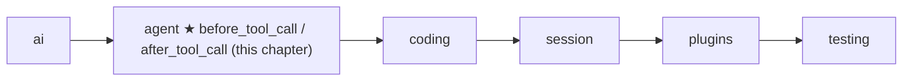

# 08 Part 2 · Hooks and approval

**Goal:** Check or change tool calls before and after they run.

**Builds on:** [07 Steering](07-steering.md) · **Next:** [09 Execution environment](09-exec-env.md)

## Where we are



Big picture of Part 2: [part-2-agent](05-0-part-2-agent.md).

## Example: the model wants to write a file

We keep the story from [07](07-steering.md). The user asked "What is in README.md?", then steered with "Also read CHANGELOG.md". The model called `read` twice. Reading is safe, so nobody needs to be asked.

Then the user sent the follow-up "write a summary to NOTES.md". Now the model calls `write` with `{"path": "NOTES.md", ...}`. Today the loop just runs it: when the model asks for a tool, the loop executes it at once. **Nobody asks the user, and the user has no way to stop that one call.** If NOTES.md already holds the user's own notes, they are gone. And the `bash` tool ([10](10-coding-tools.md)) can run any command, such as `rm -rf`, so a wrong call can do much more damage.

## Problem

So before a risky call runs (`write` and `edit` change files, `bash` runs commands), the loop must **ask the user**, and the user must be able to **say no to that one call**.

## Starting point: the tool step from 05 and 06

We do not write a new loop. Here is the tool step of `agent_loop` as [06](06-events-abort.md#starting-point-05s-loop-with-nobody-listening) left it (steering from [07](07-steering.md) does not touch this part):

```text
FOR EACH call in msg:
    IF cancel is set: STOP this FOR loop
    SEND tool_execution_start
    result = run_tool(call, ctx)
    SEND tool_execution_end
    add(result)
```

Every call runs. The simplest way to ask first is Python's `input()`: it prints a question in the terminal and waits until the user types `y` or `n`. So the first idea is to ask right here, just before `run_tool`, for those three tools:

```text
    IF call.name IN {bash, write, edit}:
        answer = input("Run {call.name} {call.arguments}? [y/n]")
        IF answer is not "y": CONTINUE        // skip: no result is added
```

If the user answers `n`, the naive loop just skips the `write` call. That breaks two things. The call gets no result, so the next model request is rejected ([06](06-events-abort.md)). And the model never learns that the user said no, so it may simply try `write` again. Both have one fix: a denied call still gets a result, and the result says why.

The bigger problem is *where* the question lives. `input()` and the list of risky tools are written inside the loop, so only a terminal can answer: a web server or a test cannot, and while `input()` waits, not even Stop can end it. So the loop should not ask the user itself. It should call a **hook**: a fixed moment where the loop calls code that someone else gives it. Here that code is a function the app puts in the loop's settings: one before a tool runs (allow or deny), and one after (change the result, for example cut a huge `bash` output or hide an API key before the model reads it). These are the two [tool hooks](glossary.md#tool-hook), and [tool approval](glossary.md#tool-approval), "ask the human first", is built as one of them.

## Step by step: grow the tool step

We fix it one problem at a time.

**Step 1: a "no" still makes a result.** Instead of `CONTINUE`, a no becomes a normal error result. The history stays valid, and the text tells the model why, so it can pick another plan (for example, show the summary in the chat):

```text
result = ToolResultMessage(call.id, call.name, "User denied: {reason}", is_error=True)
```

**Step 2: move the policy out.** The loop only calls a function that the caller puts in `LoopConfig`. The function returns `None` for "go on", or a string: the reason to deny. Any string denies, even `""`.

**Step 3: a place to change results.** A second function runs after the tool. It returns a new result, or `None` to keep the old one. Why change a result after the tool ran? The output may hold a secret, such as an API key printed by `cat .env`, and it must be hidden before the model, the saved history or the screen sees it. That is what [RedactSecrets](18-profiles-plugins.md#redactsecrets) does.

**Step 4: do not block forever.** Both functions get the [tool context](glossary.md#tool-context) `ctx` from [05](05-agent-loop.md). It holds `cancel`, so a hook that waits for a human can also stop waiting when Stop is pressed.

## Real design

### Where the hooks plug into `agent_loop`

The four steps all land in the tool step of `agent_loop`. The rest of the loop is in [05](05-agent-loop.md) and [07](07-steering.md), and the truncation branch from [05](05-agent-loop.md) is not changed. For each call, after `tool_execution_start`, the loop builds `ctx = ToolContext(cancel, config.env, config.cwd, on_update)`. Then it calls `before_tool_call` (if set), runs the tool only when there is no deny, calls `after_tool_call` (if set) on the result, sends `tool_execution_end`, and adds the result to the history. The path below shows this for one call.

Real code: [agent/\_\_init\_\_.py](../../packages/simp_agent/src/simp_agent/agent/__init__.py) — `agent_loop`

### The path of one call

The `write NOTES.md` call goes through five steps:

1. **`tool_execution_start`**: the UI shows "write NOTES.md", so the user sees what they are asked about.
2. **`before_tool_call`** asks the user. *Allow*: it returns `None`, and `run_tool` writes the file. *Deny*: it returns a reason (here `"denied"`), `run_tool` is skipped, and the result is the error `User denied: denied`.
3. **`after_tool_call`** runs on both paths and may replace the result. Returning `None` keeps it.
4. **`tool_execution_end`**: the result goes into the history.
5. **The next model call** reads it.

A deny does not stop the run: the model reads "User denied" and tries another way.

One case skips both hooks: a call from a reply that was cut off at the token limit (`stop_reason` `length`, [05 Step 4](05-agent-loop.md)). Its arguments may be half-written, so the loop never runs it and gives it an error result at once. With nothing to run, there is nothing to ask the user about and no result to change.

### The two fields in `LoopConfig`

Like `get_steering` in [07](07-steering.md), the loop only **asks** the caller. The two hooks are optional fields of `LoopConfig`:

```text
LoopConfig:
    before_tool_call(call, ctx)         -> None = run the tool; a string = deny with this reason
    after_tool_call(call, result, ctx)  -> a new ToolResultMessage, or None = keep result
```

Real code: [agent/\_\_init\_\_.py](../../packages/simp_agent/src/simp_agent/agent/__init__.py) — `LoopConfig`

Both default to `None`: no hook, no change. A hook may be a plain function or an `async def`; the loop awaits it only when needed.

Real code: [agent/\_\_init\_\_.py](../../packages/simp_agent/src/simp_agent/agent/__init__.py) — `_maybe_await`

The `Agent` class from [06](06-events-abort.md) takes both hooks in its constructor (`Agent(..., before_tool_call=None, after_tool_call=None)`) and passes them into each `LoopConfig` it builds, so a caller that uses `Agent` gets the same gate.

### Approval: a `before_tool_call` that asks a human

Tool approval is **not** part of the loop. It is just one `before_tool_call`. The real one lives in `AgentSession` ([13](13-session.md)), which passes `before_tool_call=self._before_tool_call` to its `Agent`. We look at it now because it shows how to write a good hook (`packages/simp_agent/src/simp_agent/session/__init__.py`).

The session keeps three things. `approve` is a function that asks the human and returns the answer as a string; if it is `None`, nothing is asked and every tool runs (the CLI's `--yes`, see [19](19-cli.md)). `needs_approval` is the set `{"bash", "write", "edit"}`; only these tools ask, so the two `read` calls in our story never asked. `always_allowed` holds the tools the human answered `"always"` for; it starts empty and lasts for this session only.

Now the `write NOTES.md` call reaches the hook. There are five cases:

| | Case in our story | Hook returns | `write` runs? |
|---|---|---|---|
| (a) | No need to ask: `approve` is `None`, or the tool is not in `needs_approval`, or it is in `always_allowed` | `None` | yes |
| (b) | The user answers `"allow"` | `None` | yes, once |
| (c) | The user answers `"always"` | `None`, and `write` goes into `always_allowed` | yes |
| (d) | Any other answer (`"deny"`, a typo, `""`) | `"denied"` | no (fail closed) |
| (e) | Stop is pressed while the question is open, or just before a late `"allow"` | `"aborted"` | no |

Case (e) is why the hook gets `ctx`. A browser question may never be answered. If the hook only waited for the answer, Stop could not end the [run](glossary.md#run-agent). So it waits for **whichever comes first**: the answer, or `ctx.cancel`. Case (d) fails closed: a typo or an empty answer is a "no", never a "yes". After case (c), the next `write` in this session goes straight to case (a) and does not ask again.

The approval part of the hook works like this, with the same letters:

1. If there is no need to ask, return `None` (a).
2. Start two tasks: `approve(call)` and a wait on `ctx.cancel`. Wait for the first one to finish, then cancel the wait on `ctx.cancel`.
3. If Stop came first, cancel the question, wait for it to clean up, and return `"aborted"` (e).
4. If the answer is `"always"`, add the tool to `always_allowed` and return `None` (c).
5. If the answer is not `"allow"`, or `ctx.cancel` is set by now, return `"aborted"` when cancel is set, else `"denied"` (e or d). Otherwise return `None` (b).

Real code: [session/\_\_init\_\_.py](../../packages/simp_agent/src/simp_agent/session/__init__.py) — `AgentSession._before_tool_call`

After `"aborted"`, the loop ends the run as in [06](06-events-abort.md).

**Builds on:** [07 Steering](07-steering.md) · **Next:** [09 Execution environment](09-exec-env.md) — the one place where tools touch files and run commands.
