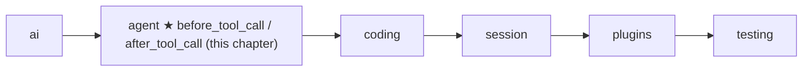
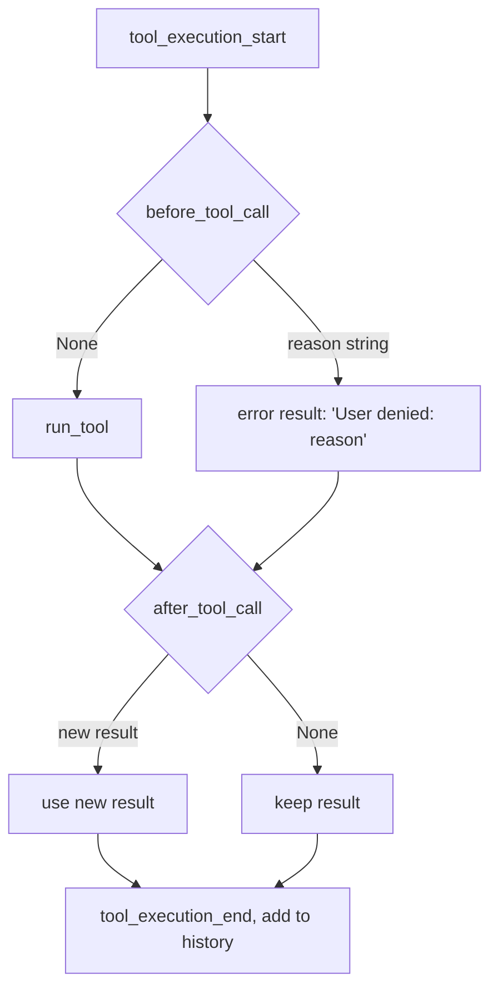

# 08 Part 2 · Hooks and approval

**Goal:** Check or change tool calls before and after they run.

**Builds on:** [07 Steering](07-steering.md) · **Next:** [09 Execution environment](09-exec-env.md)

## Where we are



In [05](05-agent-loop.md) the loop learned to run tools. In [06](06-events-abort.md) and [07](07-steering.md) the user learned to stop it and to talk to it. But the user still cannot say **"no, do not run that"** to one tool call. A coding agent will soon have a `bash` tool ([10](10-coding-tools.md)). Before that day, we want a gate.

This chapter adds two [tool hooks](glossary.md#tool-hook) to the loop, and shows how [tool approval](glossary.md#tool-approval) is built on top of the first one.

Code in this chapter (commit `2fc2776`):

- `packages/simp_agent/src/simp_agent/agent/__init__.py` — `LoopConfig.before_tool_call` / `after_tool_call`, the tool step in `agent_loop`, `_maybe_await`, and the same two arguments on `Agent`
- `packages/simp_agent/src/simp_agent/session/__init__.py` — `AgentSession._before_tool_call` (approval; a preview of [13](13-session.md))
- `apps/cli/tests/test_cli.py` and `apps/cli/tests/test_sockets.py` — the tests

## Problem

Today the loop runs every tool call the model asks for. That is fine for `read`. It is not fine for `bash` with `{"command": "rm -rf /"}`.

We need three things:

1. **Look** at a call before it runs, and maybe **say no**.
2. **Change** a result after it runs (for example, cut a huge output, or add a note).
3. Do this **without** putting policy into `agent_loop`. The loop should not know what "dangerous" means, or how to ask a human. A CLI asks with `y/n`; a web app shows a button; a test answers at once.

And one rule from [01](01-messages.md) still holds: every tool call must get a tool result. A "no" must still make a result, or the next model request is invalid.

## Naive version

```python
DANGEROUS = {"bash", "write", "edit"}

async def run_calls(calls, tools, history):
    for call in calls:
        if call.name in DANGEROUS:
            answer = input(f"Run {call.name} {call.arguments}? [y/n] ")
            if answer != "y":
                continue                      # skip it
        history.append(await run_tool(tools, call))
```

Where it breaks:

- **A missing result.** `continue` skips the call, so no tool result is added. The next model call fails: the vendor sees a tool call with no answer.
- **The model is not told.** Even if the history were valid, the model does not learn that the user said no. It may just try again.
- **Policy in the loop.** The list of dangerous tools and `input()` live inside the loop. A web server cannot use `input()`. A test cannot answer it.
- **Blocks forever.** `input()` waits for the human. The **Stop** button from [06](06-events-abort.md) cannot end the wait.
- **No way to change results.** There is no place to edit a result after the tool runs.

## Real design

### Two hooks in `LoopConfig`

Like `get_steering` in [07](07-steering.md), the loop only **asks** the caller. `LoopConfig` has two optional functions (`packages/simp_agent/src/simp_agent/agent/__init__.py`):

```python
    # (call, ctx) -> None to run the tool, or a deny reason string (pi beforeToolCall). Sync or async.
    before_tool_call: Callable[[ai.ToolCall, "ToolContext"], Any] | None = None
    # (call, result, ctx) -> new ToolResultMessage or None to keep it (pi afterToolCall). Also runs after a deny.
    after_tool_call: Callable[[ai.ToolCall, ToolResultMessage, "ToolContext"], Any] | None = None
```

- `before_tool_call(call, ctx)` returns `None` ("go on") or a **string**: the reason to deny.
- `after_tool_call(call, result, ctx)` returns a new `ToolResultMessage`, or `None` to keep the old one.

Both get the [tool context](glossary.md#tool-context) `ctx` ([05](05-agent-loop.md)), so a hook can see the `cancel` event, the [execution environment](glossary.md#execution-environment) and the `cwd`. Both default to `None`: no hook, no change. The names and shapes follow pi's `beforeToolCall` / `afterToolCall`.

"Sync or async" means a hook can be a plain function or an `async def`. The loop handles both with one small helper:

```python
async def _maybe_await(r):
    return await r if inspect.isawaitable(r) else r
```

A test can pass a `lambda`; a real app can pass an `async` function that waits for a click.

### Where the hooks run

Here is the tool step of `agent_loop` (same file; the rest of the loop is in [05](05-agent-loop.md) and [07](07-steering.md)):

```python
            for call in calls:
                if cancel.is_set():
                    break
                if msg.stop_reason == "length":  # args may be cut off: never run them
                    result = ToolResultMessage(call.id, call.name, "Tool call was truncated (max tokens); not executed", True)
                else:
                    await send({"type": "tool_execution_start", "call": call})
                    on_update = functools.partial(lambda c, text: send({"type": "tool_execution_update", "call": c, "text": text}), call)
                    ctx = ToolContext(cancel, config.env, config.cwd, on_update)
                    deny = await _maybe_await(config.before_tool_call(call, ctx)) if config.before_tool_call else None
                    if deny is not None:
                        result = ToolResultMessage(call.id, call.name, f"User denied: {deny}", is_error=True)
                    else:
                        result = await run_tool(_tools(config), call, ctx)
                    if config.after_tool_call:
                        result = await _maybe_await(config.after_tool_call(call, result, ctx)) or result
                    await send({"type": "tool_execution_end", "call": call, "result": result})
                await add(result)
```



Read it step by step:

1. **`tool_execution_start` comes first.** The UI shows the call **before** the hook runs. So while a human is asked "allow?", they can already see which call it is.
2. **A deny still makes a result.** It is a normal `ToolResultMessage` with `is_error=True` and text `User denied: <reason>`. Every call keeps its result, so the history stays valid. And the model reads the reason, so it can change plan instead of trying the same thing.
3. **The loop does not stop on a deny.** It goes on to the next call, then to the next model turn. Denying one call is not an abort.
4. **`after_tool_call` runs after a deny too.** The comment says so: "Also runs after a deny". So an after-hook sees every result from a real run **or** a deny (only truncated calls skip it, see step 6). A hook that logs or rewrites results has one place to do it.
5. **`... or result`** means: if the after-hook returns `None` (or nothing), keep the old result. A hook that only watches does not need to return anything.
6. **Truncated calls skip the hooks.** When `stop_reason == "length"`, the arguments may be cut off ([03](03-stream-parser.md)). The loop never runs them, so it does not ask the hooks either.

Why is the deny check `is not None` and not just "truthy"? Because the reason is the signal. An empty string `""` still means "deny" (the model gets `User denied: `). Only `None` means "go on".

### The same hooks on `Agent`

The `Agent` class from [06](06-events-abort.md) takes both hooks in its constructor and passes them into each `LoopConfig`:

```python
                 before_tool_call: Callable | None = None, after_tool_call: Callable | None = None):
```

```python
                before_tool_call=self.before_tool_call,
                after_tool_call=self.after_tool_call,
```

So a caller that uses `Agent` instead of `agent_loop` gets the same gate.

### Approval: a `before_tool_call` that asks a human

[Tool approval](glossary.md#tool-approval) is **not** a feature of the loop. It is just one `before_tool_call`. The real one lives in `AgentSession` ([13](13-session.md)), which passes `before_tool_call=self._before_tool_call` to its `Agent`. We look at it now because it shows how to write a good hook (`packages/simp_agent/src/simp_agent/session/__init__.py`):

```python
        # approval policy: approve(call) -> "allow" | "deny" | "always" (sync or async). None = allow everything.
        self.approve, self.needs_approval, self.always_allowed = approve, {"bash", "write", "edit"}, set()
```

```python
        if self.approve is None or call.name not in self.needs_approval or call.name in self.always_allowed:
            return None
        ask = asyncio.ensure_future(_maybe_await(self.approve(call)))
        stop = asyncio.ensure_future(ctx.cancel.wait())
        await asyncio.wait([ask, stop], return_when=asyncio.FIRST_COMPLETED)
        stop.cancel()
        if not ask.done():  # aborted: a browser approval may never answer
            ask.cancel()
            await asyncio.wait([ask])  # let its cleanup (e.g. an "aborted" event) finish before the run ends
            return "aborted"
        answer = ask.result()
        if answer == "always":
            self.always_allowed.add(call.name)
        elif answer != "allow" or ctx.cancel.is_set():
            return "aborted" if ctx.cancel.is_set() else "denied"
        return None
```

(The part of this method before these lines runs plugin `tool_call` hooks first; that is [14](14-plugins.md).)

What it does:

- **Ask only when needed.** No `approve` function → allow all (the CLI's `--yes`, see [19](19-cli.md)). Only `bash`, `write` and `edit` ask; `read` never does. A tool in `always_allowed` does not ask again.
- **Three answers.** `"allow"` runs this call. `"always"` runs it and remembers the tool name for the rest of the session. Anything else denies, so a typo or an empty answer is a "no" (fail closed).
- **Race the human against Stop.** The hook waits for **either** the answer **or** `ctx.cancel`. This fixes the "blocks forever" problem of the naive version. If the user presses Stop while the question is open, the hook cancels the question and returns `"aborted"`. Then the loop adds the deny result, sees `cancel` is set, and ends the run as in [06](06-events-abort.md).
- **Late answers lose.** If an answer arrives but `cancel` is already set, it still returns `"aborted"`, not "run it".

This is why `ToolContext` is passed to the hook: without `ctx.cancel`, an approval could not be stopped.

## Test

The loop-level test passes a plain sync function as the hook; it always says no (`apps/cli/tests/test_cli.py`):

```python
async def test_before_tool_call_hook_in_loop():
    ran, seen = [], []

    def hook(call, ctx):
        seen.append(call.name)
        return "nope"

    msgs = []
    cfg = LoopConfig(Model(), tools(ran), stream_fn=FakeProvider(bash_call(), DONE), before_tool_call=hook)
    await agent_loop("s", msgs, [UserMessage("hi")], cfg)
    res = msgs[2]
    assert seen == ["bash"] and ran == [] and res.is_error and res.content == "User denied: nope"
    assert msgs[-1] is DONE  # the loop continued
```

The [FakeProvider](02-fake-provider.md) asks for `bash` (`rm -rf /`), then says `"ok"`. The test checks: the hook saw the call, the tool **did not run**, the result is an error with the reason, and the loop **went on** to the second reply.

The after-hook test changes a result (`apps/cli/tests/test_sockets.py`):

```python
    after = lambda c, r, ctx: ai.ToolResultMessage(r.tool_call_id, r.tool_name, r.content + "!")  # noqa: E731
    a = Agent("s", Model(), [t], FakeProvider(call("t", num=1), DONE), after_tool_call=after)
    new = await a.prompt("x")
    assert got == [{"n": 1}] and new[2].content == "raw!"
```

The tool returns `"raw"`; the history keeps `"raw!"`. This also shows the hook works through `Agent`.

Approval has its own tests in the same `test_cli.py`: `test_deny_skips_tool`, `test_always_asks_once_and_read_never_asks` (two `bash` calls ask once; `read` never asks), `test_no_approve_allows_all`, and `test_abort_while_asking_denies` (Stop is pressed, then a late `"allow"` arrives: the tool does not run and the run ends `aborted`). The other abort path, where the question is still open and gets cancelled, has no test at this commit.

```bash
uv run pytest apps/cli/tests/test_cli.py apps/cli/tests/test_sockets.py
```

> **Why this way**
>
> **The loop asks; the caller decides.** Like steering in [07](07-steering.md), the loop has no policy. It calls two functions. A CLI, a server, a test or a plugin system can each plug in their own.
>
> **A "no" is a tool result, not a skip.** The history stays valid, and the model learns why, so it can pick another way.
>
> **A string is the whole deny API.** `None` = run, any string = deny with that reason. No enum, no exception.
>
> **Approval is built on the hook, not in the loop.** The loop stays small. The hard parts of asking a human (remembering "always", racing against Stop) live in one hook in the session.

## Exercises

1. Pass `before_tool_call=lambda c, ctx: ""` (an empty string). Does the tool run? What is the result text? Why does the loop check `is not None` and not "truthy"?
2. Write an `async def` `after_tool_call` that only appends `(r.is_error, r.content)` to a list and returns nothing. Use it with a `before_tool_call` that returns `"no"`. Does the after-hook run? Is the result in history changed?

## Recap

- `LoopConfig` has two [tool hooks](glossary.md#tool-hook): `before_tool_call(call, ctx)` and `after_tool_call(call, result, ctx)`. Both may be sync or async (`_maybe_await`).
- `before_tool_call` returns `None` to run, or a reason string to deny. A deny becomes an error result `User denied: <reason>`; the loop goes on.
- `after_tool_call` runs after a real run and after a deny (not for truncated calls). Return a new result, or `None` to keep it.
- Hooks run after `tool_execution_start` and before `tool_execution_end`; truncated calls skip them.
- `Agent` takes the same two hooks.
- [Tool approval](glossary.md#tool-approval) is one `before_tool_call` in `AgentSession`: it asks for `bash` / `write` / `edit`, remembers `"always"`, denies anything else, and stops waiting on abort.

**Builds on:** [07 Steering](07-steering.md) · **Next:** [09 Execution environment](09-exec-env.md) — the one place where tools touch files and run commands.
