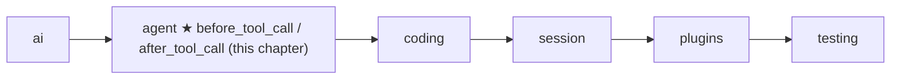
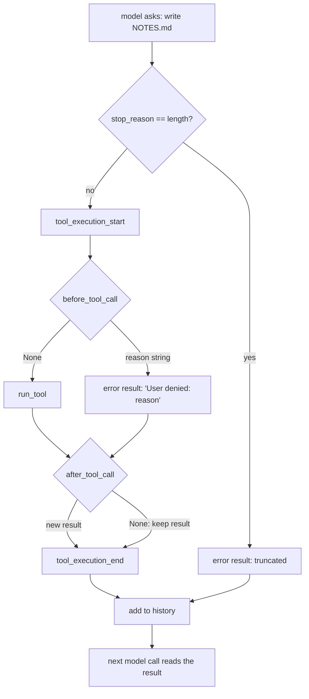

# 08 Part 2 · Hooks and approval

**Goal:** Check or change tool calls before and after they run.

**Builds on:** [07 Steering](07-steering.md) · **Next:** [09 Execution environment](09-exec-env.md)

## Where we are



Big picture of Part 2: [part-2-agent](05-0-part-2-agent.md).

## Example: the model wants to write a file

We keep the story from [07](07-steering.md). The user asked "What is in README.md?", then steered with "Also read CHANGELOG.md". The model called `read` twice. Reading is safe, so nobody needs to be asked.

Then the user sent the follow-up "write a summary to NOTES.md". Now the model calls `write` with `{"path": "NOTES.md", ...}`. Today the loop just runs it: when the model asks for a tool, the loop executes it at once. **Nobody asks the user, and the user has no way to stop that one call.** If NOTES.md already holds the user's own notes, they are gone. And the `bash` tool ([10](10-coding-tools.md)) can run any command, such as `rm -rf`, so a wrong call can do much more damage.

## Problem

So before a risky call runs (`write` and `edit` change files, `bash` runs commands), the loop must **ask the user**, and the user must be able to **say no to that one call**.

## Starting point: the tool step from 05 and 06

We do not write a new loop. Here is the tool step of `agent_loop` as [06](06-events-abort.md#starting-point-05s-loop-with-nobody-listening) left it (steering from [07](07-steering.md) does not touch this part):

```text
FOR EACH call in msg:
    IF cancel is set: STOP this FOR loop
    SEND tool_execution_start
    result = run_tool(call, ctx)
    SEND tool_execution_end
    add(result)
```

Every call runs. Some tools are risky: `write` and `edit` change files, `bash` runs commands. The simplest way to ask first is Python's `input()`: it prints a question in the terminal and waits until the user types `y` or `n`. So the first idea is to ask right here, just before `run_tool`, for those three tools:

```text
    IF call.name IN {bash, write, edit}:
        answer = input("Run {call.name} {call.arguments}? [y/n]")
        IF answer is not "y": CONTINUE        // skip: no result is added
```

If the user answers `n`, the naive loop just skips the `write` call. That breaks two things. The call gets no result, so the next model request is rejected ([06](06-events-abort.md)). And the model never learns that the user said no, so it may simply try `write` again. Both have one fix: a denied call still gets a result, and the result says why.

The bigger problem is *where* the question lives. `input()` and the list of risky tools are written inside the loop, so only a terminal can answer: a web server or a test cannot, and while `input()` waits, not even Stop can end it. So the loop should not ask the user itself. It should call a **hook** that the app gives it: one before a tool runs (allow or deny), and one after (change the result). These are the two [tool hooks](glossary.md#tool-hook), and [tool approval](glossary.md#tool-approval), "ask the human first", is built as one of them.

## Step by step: grow the tool step

We fix it one problem at a time.

**Step 1: a "no" still makes a result.** Instead of `CONTINUE`, a no becomes a normal error result. The history stays valid, and the text tells the model why, so it can pick another plan (for example, show the summary in the chat):

```text
result = ToolResultMessage(call.id, call.name, "User denied: {reason}", is_error=True)
```

**Step 2: move the policy out.** The loop only calls a function that the caller puts in `LoopConfig`. The function returns `None` for "go on", or a string: the reason to deny.

**Step 3: a place to change results.** A second function runs after the tool. It returns a new result, or `None` to keep the old one.

**Step 4: do not block forever.** Both functions get the [tool context](glossary.md#tool-context) `ctx` from [05](05-agent-loop.md). It holds `cancel`, so a hook that waits for a human can also stop waiting when Stop is pressed.

## Real design

### Where the hooks plug into `agent_loop`

The four steps all land in the tool step of `agent_loop`. Here it is with the new lines marked. The rest of the loop is in [05](05-agent-loop.md) and [07](07-steering.md); the truncation branch is from [05](05-agent-loop.md) and is not changed. One name in it is new to you: `run_tool` needs the list of tools, and `_tools(config)` is a tiny helper that gives it. It returns `config.get_tools()` if the caller set that function (an `Agent` does, so tools can change between turns), else the fixed list `config.tools`.

```text
FOR EACH call IN calls:
    IF cancel is set: STOP this FOR loop
    IF msg.stop_reason == "length":
        result = error result "Tool call was truncated (max tokens); not executed"
    ELSE:
        SEND event {tool_execution_start, call}
        ctx = ToolContext(cancel, config.env, config.cwd, on_update)
        deny = None                                                          // NEW
        IF config.before_tool_call: deny = WAIT for before_tool_call(call, ctx)   // NEW
        IF deny is not None:                                                 // NEW
            result = ToolResultMessage(call.id, call.name, "User denied: {deny}", is_error=True)   // NEW
        ELSE:                                                                // NEW
            result = WAIT for run_tool(_tools(config), call, ctx)
        IF config.after_tool_call:                                           // NEW
            result = WAIT for after_tool_call(call, result, ctx), OR keep result if None
        SEND event {tool_execution_end, call, result}
    ADD result to history
```

Real code: [agent/\_\_init\_\_.py](../../packages/simp_agent/src/simp_agent/agent/__init__.py) — `agent_loop`

### The path of one call



Follow the `write NOTES.md` call from start to end. The model's reply holds the call. The loop first sends `tool_execution_start`, so the UI already shows "write NOTES.md" **before** the hook runs; the human sees which call they are asked about. Then `before_tool_call` runs, and the human is asked. If they allow it, the hook returns `None` and `run_tool` writes the file. If they deny it, the hook returns `"denied"`, `run_tool` is skipped, and the call gets the error result `User denied: denied`. Next, `after_tool_call` runs on both paths: after a real run **and after a deny**. So a hook that logs or rewrites results has one place to see them all. If it returns `None`, the old result stays, so a hook that only watches does not need to return anything. Then `tool_execution_end` is sent, the result goes into the history, and the next model call reads it. A deny is not an abort: the model reads "User denied" and answers in a new way.

Only truncated calls skip both hooks: the loop never runs them, so there is nothing to ask about.

Note the check is `deny is not None`, not "is it truthy". The string is the signal. Even an empty string `""` means deny (the model gets `User denied: `). Only `None` means go on.

### The two fields in `LoopConfig`

Like `get_steering` in [07](07-steering.md), the loop only **asks** the caller. The two hooks are optional fields of `LoopConfig`:

```text
LoopConfig:
    before_tool_call(call, ctx)         -> None = run the tool; a string = deny with this reason
    after_tool_call(call, result, ctx)  -> a new ToolResultMessage, or None = keep result
```

Real code: [agent/\_\_init\_\_.py](../../packages/simp_agent/src/simp_agent/agent/__init__.py) — `LoopConfig`

Both default to `None`: no hook, no change. A hook may be a plain function (a test passes a `lambda`) or an `async def` (a web app waits for a click). In the real code, each "WAIT for hook(...)" above goes through one small helper, so the loop handles both kinds:

```text
FUNCTION _maybe_await(r):
    IF r can be awaited: RETURN (WAIT for r)    // async hook
    RETURN r                                    // plain hook
```

Real code: [agent/\_\_init\_\_.py](../../packages/simp_agent/src/simp_agent/agent/__init__.py) — `_maybe_await`

### The same hooks on `Agent`

The `Agent` class from [06](06-events-abort.md) takes both hooks in its constructor and passes them into each `LoopConfig` it builds:

```text
Agent(..., before_tool_call = None, after_tool_call = None)
```

Real code: [agent/\_\_init\_\_.py](../../packages/simp_agent/src/simp_agent/agent/__init__.py) — `Agent`

So a caller that uses `Agent` instead of `agent_loop` gets the same gate.

### Approval: a `before_tool_call` that asks a human

Tool approval is **not** part of the loop. It is just one `before_tool_call`. The real one lives in `AgentSession` ([13](13-session.md)), which passes `before_tool_call=self._before_tool_call` to its `Agent`. We look at it now because it shows how to write a good hook (`packages/simp_agent/src/simp_agent/session/__init__.py`).

The session keeps three things. `approve` is a function that asks the human and returns their answer as a string; if it is `None`, nothing is asked and every tool runs (the CLI's `--yes`, see [19](19-cli.md)). `needs_approval` is the set `{"bash", "write", "edit"}`: only these tools ask, which is why the two `read` calls in our story never asked. `always_allowed` holds tool names the human answered `"always"` for; it starts empty and lasts for this session only.

Now the `write NOTES.md` call reaches the hook. There are five cases:

| | Case in our story | Hook returns | `write` runs? |
|---|---|---|---|
| (a) | No need to ask: `approve` is `None`, or the tool is not in `needs_approval`, or it is in `always_allowed` | `None` | yes |
| (b) | The question is open, and the user presses Stop before answering | `"aborted"` | no |
| (c) | The user answers `"always"` | `None`, and `write` goes into `always_allowed` | yes |
| (d) | The user answers `"allow"`, but Stop was pressed just before | `"aborted"` | no |
| (e) | The user answers `"allow"` (no Stop): run. Any other answer (`"deny"`, a typo, `""`): deny | `None` / `"denied"` | yes / no |

Case (b) is why the hook gets `ctx`. A browser question may never be answered. If the hook only waited for the answer, Stop could not end the [run](glossary.md#run-agent). So it waits for **whichever comes first**: the answer, or `ctx.cancel`. Case (e) fails closed: a typo or an empty answer is a "no", never a "yes". After case (c), the next `write` in this session goes straight to case (a) and does not ask again.

Here is the code, with the same letters:

```text
FUNCTION _before_tool_call(call, ctx):          // (approval part)
    IF approve is None OR call.name NOT IN needs_approval OR call.name IN always_allowed:
        RETURN None                              // (a)
    ask  = START approve(call)
    stop = START waiting for ctx.cancel
    WAIT for the first one of (ask, stop) to finish
    CANCEL stop
    IF ask is not done:                          // (b) Stop came first
        CANCEL ask
        WAIT for ask to finish its cleanup
        RETURN "aborted"
    answer = result of ask
    IF answer == "always":                       // (c)
        ADD call.name to always_allowed
    ELSE IF answer != "allow" OR ctx.cancel is set:
        RETURN "aborted" if ctx.cancel is set, else "denied"   // (d) or (e) deny
    RETURN None                                  // (c) or (e) allow
```

Real code: [session/\_\_init\_\_.py](../../packages/simp_agent/src/simp_agent/session/__init__.py) — `AgentSession._before_tool_call`

Two small notes. Only an `"allow"` is checked against `ctx.cancel` again; an `"always"` that comes after Stop still runs the tool, and then the loop sees `cancel` and ends the run as in [06](06-events-abort.md). And the part of this method before the approval part runs plugin `tool_call` hooks first; that is [14](14-plugins.md).

When the hook returns `"aborted"`, the loop adds the deny result, sees that `cancel` is set, and ends the run as in [06](06-events-abort.md). The history is still valid, because the `write` call got its result.

## Test

The loop-level test passes a plain function that always says no (`apps/cli/tests/test_cli.py`):

```python
async def test_before_tool_call_hook_in_loop():
    ran, seen = [], []

    def hook(call, ctx):
        seen.append(call.name)
        return "nope"

    msgs = []
    cfg = LoopConfig(Model(), tools(ran), stream_fn=FakeProvider(bash_call(), DONE), before_tool_call=hook)
    await agent_loop("s", msgs, [UserMessage("hi")], cfg)
    res = msgs[2]
    assert seen == ["bash"] and ran == [] and res.is_error and res.content == "User denied: nope"
    assert msgs[-1] is DONE  # the loop continued
```

The test uses `bash` instead of our `write`; any tool name works the same. The [FakeProvider](04-label-test.md) first asks for `bash`, then replies `"ok"`. The test checks that the hook saw the call, the tool did **not** run, the result is an error with the reason, and the loop went on to the second reply.

The after-hook test, `test_after_tool_call_and_prepare_arguments` (`apps/cli/tests/test_sockets.py`), changes a result through `Agent`:

```python
    after = lambda c, r, ctx: ai.ToolResultMessage(r.tool_call_id, r.tool_name, r.content + "!")  # noqa: E731
    a = Agent("s", Model(), [t], FakeProvider(call("t", num=1), DONE), after_tool_call=after)
    new = await a.prompt("x")
    assert got == [{"n": 1}] and new[2].content == "raw!"
```

The tool returns `"raw"`; the history keeps `"raw!"`.

Approval has its own tests in `test_cli.py`. `test_deny_skips_tool` checks case (e) with a "no". `test_always_asks_once_and_read_never_asks` checks that two `bash` calls ask only once after `"always"`, and that `read` never asks. `test_no_approve_allows_all` checks case (a) with no `approve`. `test_abort_while_asking_denies` checks case (d): Stop is pressed, then a late `"allow"` comes, and the tool does not run. Cases (b) and (c)-after-Stop have no test at this commit.

```bash
uv run pytest apps/cli/tests/test_cli.py apps/cli/tests/test_sockets.py
```

## Why this way

> **The loop asks; the caller decides.** Like steering in [07](07-steering.md), the loop has no policy. A CLI, a server, a test or a plugin system can each plug in their own hook. The cost: the loop cannot protect you alone. With no hook, every tool runs.
>
> **A "no" is a tool result, not a skip.** The history stays valid, and the model learns why. The cost: a deny uses one more model turn.
>
> **A string is the whole deny API.** `None` = run, any string = deny with that reason. No enum, no exception. The cost: even `""` means deny, which can surprise you.
>
> **Approval is built on the hook, not in the loop.** The hard parts of asking a human (remembering "always", racing against Stop) live in one hook in the session. The cost: "always" is kept per tool name, only for this session.

## Exercises

1. Pass `before_tool_call=lambda c, ctx: ""`. Does the tool run? What is the result text?
2. Write an `async def` `after_tool_call` that only appends `(r.is_error, r.content)` to a list and returns nothing. Use it with a `before_tool_call` that returns `"no"`. Does the after-hook run? Is the result in history changed?

## Recap

`LoopConfig` and `Agent` take two [tool hooks](glossary.md#tool-hook). `before_tool_call(call, ctx)` runs after `tool_execution_start`; it returns `None` to run the tool, or a reason string to deny it. A deny becomes the error result `User denied: <reason>`, and the loop goes on. `after_tool_call(call, result, ctx)` runs on both paths and may return a new result. Truncated calls skip both. Hooks may be plain or async.

[Tool approval](glossary.md#tool-approval) is one `before_tool_call` in `AgentSession`. In our story, the two `read` calls run freely, and the `write NOTES.md` call asks first. "allow" runs it once, "always" runs it and stops asking for `write`, anything else denies, and Stop ends the question.

**Builds on:** [07 Steering](07-steering.md) · **Next:** [09 Execution environment](09-exec-env.md) — the one place where tools touch files and run commands.
