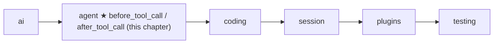
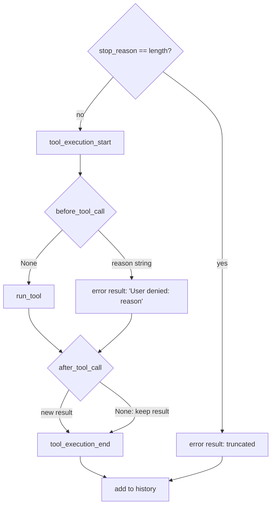

# 08 Part 2 · Hooks and approval

**Goal:** Check or change tool calls before and after they run.

**Builds on:** [07 Steering](07-steering.md) · **Next:** [09 Execution environment](09-exec-env.md)

## Where we are



Big picture of Part 2: [part-2-agent](05-0-part-2-agent.md).

*This chapter adds the last piece of the `agent` layer: a gate in front of every tool call.*

Code in this chapter (commit `2fc2776`):

- `packages/simp_agent/src/simp_agent/agent/__init__.py` — `LoopConfig.before_tool_call` / `after_tool_call`, the tool step in `agent_loop`, `_maybe_await`, and the same two arguments on `Agent`
- `packages/simp_agent/src/simp_agent/session/__init__.py` — `AgentSession._before_tool_call` (approval; a preview of [13](13-session.md))
- `apps/cli/tests/test_cli.py` and `apps/cli/tests/test_sockets.py` — the tests

## Problem

We keep the story from [07](07-steering.md). The user asked "What is in README.md?", then steered with "Also read CHANGELOG.md". The model called `read` twice. Reading is safe, so nobody needs to be asked.

Then the user sent the follow-up "write a summary to NOTES.md". Now the model calls `write` with `{"path": "NOTES.md", ...}`. Today the loop just runs it. NOTES.md may already hold the user's own notes, and they are gone. Soon there will also be a `bash` tool ([10](10-coding-tools.md)), and `bash` can do much worse. The user needs a way to say **"no, do not run that"** to one call.

So we want three things. First, a way to **look** at a call before it runs, and maybe say no. Second, a way to **change** a result after it runs (for example, cut a huge output). Third, both must stay **out of** `agent_loop`. The loop should not know which tools are risky, or how to ask a human: a CLI asks with `y/n`, a web app shows a button, a test answers at once.

The answer is two [tool hooks](glossary.md#tool-hook): functions the caller gives to the loop, which run just before and just after each tool call. [Tool approval](glossary.md#tool-approval), "ask the human first", is then built as one of them.

## Naive version

The first idea is to ask right inside the loop:

```text
DANGEROUS = {bash, write, edit}

FUNCTION run_calls(calls, tools, history):
    FOR EACH call IN calls:
        IF call.name IN DANGEROUS:
            answer = input("Run {call.name} {call.arguments}? [y/n]")
            IF answer is not "y":
                CONTINUE                     // skip: no result is added
        ADD run_tool(tools, call) to history
```

The user answers `n` to the `write`, and it breaks in several ways. The skipped call gets no tool result, but [06](06-events-abort.md) taught us that every tool call must get one, so the next model request is invalid. Even if it were valid, the model is never told that the user said no, so it may just try `write` again. The list of risky tools and `input()` sit inside the loop, so a web server or a test cannot use it. `input()` also blocks: if the user presses **Stop** ([06](06-events-abort.md)) while the question is open, nothing ends the wait. And there is still no place to change a result after a tool runs.

## Step by step: from naive to real

We fix it one problem at a time.

**Step 1: a "no" still makes a result.** Instead of `CONTINUE`, a no becomes a normal error result. The history stays valid, and the text tells the model why, so it can pick another plan (for example, show the summary in the chat):

```text
result = ToolResultMessage(call.id, call.name, "User denied: {reason}", is_error=True)
```

**Step 2: move the policy out.** The loop only calls a function that the caller puts in `LoopConfig`. The function returns `None` for "go on", or a string: the reason to deny.

**Step 3: a place to change results.** A second function runs after the tool. It returns a new result, or `None` to keep the old one.

**Step 4: do not block forever.** Both functions get the [tool context](glossary.md#tool-context) `ctx` from [05](05-agent-loop.md). It holds `cancel`, so a hook that waits for a human can also stop waiting when Stop is pressed.

The rest of the chapter shows the real code for these four steps.

## Real design

### Two hooks in `LoopConfig`

Like `get_steering` in [07](07-steering.md), the loop only **asks** the caller. `LoopConfig` has two optional fields (`packages/simp_agent/src/simp_agent/agent/__init__.py`):

```text
LoopConfig:
    before_tool_call(call, ctx)         -> None = run the tool; a string = deny with this reason
    after_tool_call(call, result, ctx)  -> a new ToolResultMessage, or None = keep result
                                           (also runs after a deny)
```

Real code: [agent/\_\_init\_\_.py](../../packages/simp_agent/src/simp_agent/agent/__init__.py) — `LoopConfig`

Both default to `None`: no hook, no change. A hook may be a plain function (a test passes a `lambda`) or an `async def` (a web app waits for a click). The loop handles both with one small helper:

```text
FUNCTION _maybe_await(r):
    IF r can be awaited: RETURN (WAIT for r)    // async hook
    RETURN r                                    // plain hook
```

Real code: [agent/\_\_init\_\_.py](../../packages/simp_agent/src/simp_agent/agent/__init__.py) — `_maybe_await`

### Where the hooks run

Here is the tool step of `agent_loop`. The rest of the loop is in [05](05-agent-loop.md) and [07](07-steering.md); the truncation branch is from [05](05-agent-loop.md) and is not changed.

```text
FOR EACH call IN calls:
    IF cancel is set: STOP the loop
    IF msg.stop_reason == "length":
        result = error result "Tool call was truncated (max tokens); not executed"
    ELSE:
        SEND event {tool_execution_start, call}
        ctx = ToolContext(cancel, config.env, config.cwd, on_update)
        deny = None
        IF config.before_tool_call: deny = WAIT for _maybe_await(before_tool_call(call, ctx))
        IF deny is not None:
            result = ToolResultMessage(call.id, call.name, "User denied: {deny}", is_error=True)
        ELSE:
            result = WAIT for run_tool(_tools(config), call, ctx)
        IF config.after_tool_call:
            result = WAIT for _maybe_await(after_tool_call(call, result, ctx)), OR keep result if None
        SEND event {tool_execution_end, call, result}
    ADD result to history
```

Real code: [agent/\_\_init\_\_.py](../../packages/simp_agent/src/simp_agent/agent/__init__.py) — `agent_loop`



Follow the `write NOTES.md` call through it. The loop first sends `tool_execution_start`, so the UI already shows "write NOTES.md" **before** the hook runs; the human sees which call they are asked about. Then `before_tool_call` runs. If it returns `"denied"`, the call gets the error result `User denied: denied`, and the loop goes on to the next call and the next model turn. A deny is not an abort: the model reads the result and answers in a new way.

`after_tool_call` runs on both paths, after a real run and after a deny (the code comment says "Also runs after a deny"). So a hook that logs or rewrites results has one place to see them all. If it returns `None`, the old result stays, so a hook that only watches does not need to return anything. Only truncated calls skip both hooks: the loop never runs them, so there is nothing to ask about.

Note the check is `deny is not None`, not "is it truthy". The string is the signal. Even an empty string `""` means deny (the model gets `User denied: `). Only `None` means go on.

### The same hooks on `Agent`

The `Agent` class from [06](06-events-abort.md) takes both hooks in its constructor and passes them into each `LoopConfig` it builds:

```text
Agent(..., before_tool_call = None, after_tool_call = None)
```

Real code: [agent/\_\_init\_\_.py](../../packages/simp_agent/src/simp_agent/agent/__init__.py) — `Agent`

So a caller that uses `Agent` instead of `agent_loop` gets the same gate.

### Approval: a `before_tool_call` that asks a human

Tool approval is **not** part of the loop. It is just one `before_tool_call`. The real one lives in `AgentSession` ([13](13-session.md)), which passes `before_tool_call=self._before_tool_call` to its `Agent`. We look at it now because it shows how to write a good hook (`packages/simp_agent/src/simp_agent/session/__init__.py`).

The session keeps three things. `approve` is a function that asks the human and returns their answer as a string; if it is `None`, nothing is asked and every tool runs (the CLI's `--yes`, see [19](19-cli.md)). `needs_approval` is the set `{"bash", "write", "edit"}`: only these tools ask, which is why the two `read` calls in our story never asked. `always_allowed` holds tool names the human answered `"always"` for; it starts empty and lasts for this session only.

Now the `write NOTES.md` call reaches the hook. There are five cases:

| | Case in our story | Hook returns | `write` runs? |
|---|---|---|---|
| (a) | No need to ask: `approve` is `None`, or the tool is not in `needs_approval`, or it is in `always_allowed` | `None` | yes |
| (b) | The question is open, and the user presses Stop before answering | `"aborted"` | no |
| (c) | The user answers `"always"` | `None`, and `write` goes into `always_allowed` | yes |
| (d) | The user answers `"allow"`, but Stop was pressed just before | `"aborted"` | no |
| (e) | The user answers `"allow"` (no Stop): run. Any other answer (`"deny"`, a typo, `""`): deny | `None` / `"denied"` | yes / no |

Case (b) is why the hook gets `ctx`. A browser question may never be answered. If the hook only waited for the answer, Stop could not end the [run](glossary.md#run-agent). So it waits for **whichever comes first**: the answer, or `ctx.cancel`. Case (e) fails closed: a typo or an empty answer is a "no", never a "yes". After case (c), the next `write` in this session goes straight to case (a) and does not ask again.

Here is the code, with the same letters:

```text
FUNCTION _before_tool_call(call, ctx):          // (approval part)
    IF approve is None OR call.name NOT IN needs_approval OR call.name IN always_allowed:
        RETURN None                              // (a)
    ask  = START approve(call)
    stop = START waiting for ctx.cancel
    WAIT for the first one of (ask, stop) to finish
    CANCEL stop
    IF ask is not done:                          // (b) Stop came first
        CANCEL ask
        WAIT for ask to finish its cleanup
        RETURN "aborted"
    answer = result of ask
    IF answer == "always":                       // (c)
        ADD call.name to always_allowed
    ELSE IF answer != "allow" OR ctx.cancel is set:
        RETURN "aborted" if ctx.cancel is set, else "denied"   // (d) or (e) deny
    RETURN None                                  // (c) or (e) allow
```

Real code: [session/\_\_init\_\_.py](../../packages/simp_agent/src/simp_agent/session/__init__.py) — `AgentSession._before_tool_call`

Two small notes. Only an `"allow"` is checked against `ctx.cancel` again; an `"always"` that comes after Stop still runs the tool, and then the loop sees `cancel` and ends the run as in [06](06-events-abort.md). And the part of this method before the approval part runs plugin `tool_call` hooks first; that is [14](14-plugins.md).

When the hook returns `"aborted"`, the loop adds the deny result, sees that `cancel` is set, and ends the run as in [06](06-events-abort.md). The history is still valid, because the `write` call got its result.

## Test

The loop-level test passes a plain function that always says no (`apps/cli/tests/test_cli.py`):

```python
async def test_before_tool_call_hook_in_loop():
    ran, seen = [], []

    def hook(call, ctx):
        seen.append(call.name)
        return "nope"

    msgs = []
    cfg = LoopConfig(Model(), tools(ran), stream_fn=FakeProvider(bash_call(), DONE), before_tool_call=hook)
    await agent_loop("s", msgs, [UserMessage("hi")], cfg)
    res = msgs[2]
    assert seen == ["bash"] and ran == [] and res.is_error and res.content == "User denied: nope"
    assert msgs[-1] is DONE  # the loop continued
```

The [FakeProvider](04-label-test.md) first asks for `bash`, then replies `"ok"`. The test checks that the hook saw the call, the tool did **not** run, the result is an error with the reason, and the loop went on to the second reply.

The after-hook test, `test_after_tool_call_and_prepare_arguments` (`apps/cli/tests/test_sockets.py`), changes a result through `Agent`:

```python
    after = lambda c, r, ctx: ai.ToolResultMessage(r.tool_call_id, r.tool_name, r.content + "!")  # noqa: E731
    a = Agent("s", Model(), [t], FakeProvider(call("t", num=1), DONE), after_tool_call=after)
    new = await a.prompt("x")
    assert got == [{"n": 1}] and new[2].content == "raw!"
```

The tool returns `"raw"`; the history keeps `"raw!"`.

Approval has its own tests in `test_cli.py`. `test_deny_skips_tool` checks case (e) with a "no". `test_always_asks_once_and_read_never_asks` checks that two `bash` calls ask only once after `"always"`, and that `read` never asks. `test_no_approve_allows_all` checks case (a) with no `approve`. `test_abort_while_asking_denies` checks case (d): Stop is pressed, then a late `"allow"` comes, and the tool does not run. Cases (b) and (c)-after-Stop have no test at this commit.

```bash
uv run pytest apps/cli/tests/test_cli.py apps/cli/tests/test_sockets.py
```

## Why this way

> **The loop asks; the caller decides.** Like steering in [07](07-steering.md), the loop has no policy. A CLI, a server, a test or a plugin system can each plug in their own hook. The cost: the loop cannot protect you alone. With no hook, every tool runs.
>
> **A "no" is a tool result, not a skip.** The history stays valid, and the model learns why. The cost: a deny uses one more model turn.
>
> **A string is the whole deny API.** `None` = run, any string = deny with that reason. No enum, no exception. The cost: even `""` means deny, which can surprise you.
>
> **Approval is built on the hook, not in the loop.** The hard parts of asking a human (remembering "always", racing against Stop) live in one hook in the session. The cost: "always" is kept per tool name, only for this session.

## Exercises

1. Pass `before_tool_call=lambda c, ctx: ""`. Does the tool run? What is the result text?
2. Write an `async def` `after_tool_call` that only appends `(r.is_error, r.content)` to a list and returns nothing. Use it with a `before_tool_call` that returns `"no"`. Does the after-hook run? Is the result in history changed?

## Recap

`LoopConfig` and `Agent` take two [tool hooks](glossary.md#tool-hook). `before_tool_call(call, ctx)` runs after `tool_execution_start`; it returns `None` to run the tool, or a reason string to deny it. A deny becomes the error result `User denied: <reason>`, and the loop goes on. `after_tool_call(call, result, ctx)` runs after a real run and after a deny, and may return a new result. Truncated calls skip both. Hooks may be plain or async.

[Tool approval](glossary.md#tool-approval) is one `before_tool_call` in `AgentSession`. In our story, the two `read` calls run freely, and the `write NOTES.md` call asks first. "allow" runs it once, "always" runs it and stops asking for `write`, anything else denies, and Stop ends the question.

**Builds on:** [07 Steering](07-steering.md) · **Next:** [09 Execution environment](09-exec-env.md) — the one place where tools touch files and run commands.
