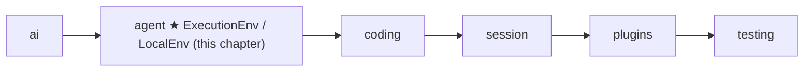
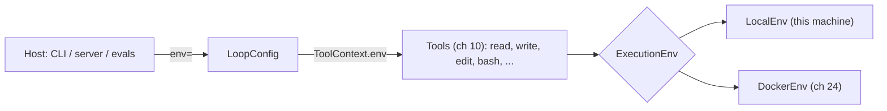
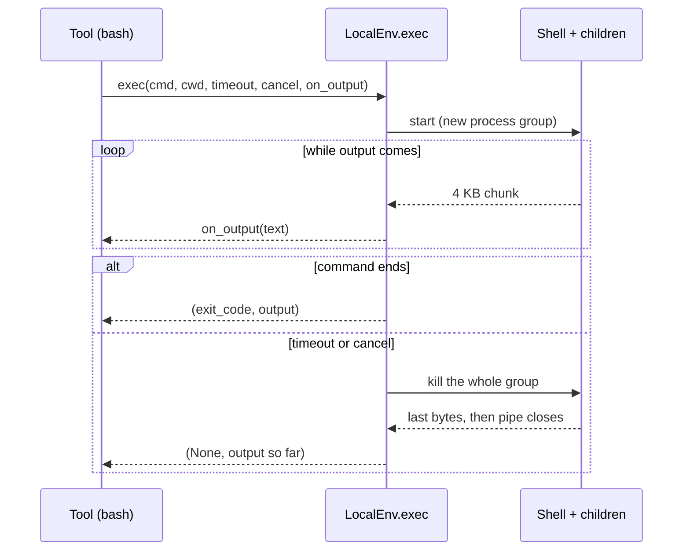

# 09 Part 3 · Execution environment

**Goal:** Give tools one safe place to touch files and run commands.

**Builds on:** [05 Agent loop](05-agent-loop.md#toolcontext-what-a-tool-gets) (tool context), [06 Events and abort](06-events-abort.md) (Stop) · **Previous:** [08 Hooks and approval](08-hooks-approval.md) · **Next:** [10 Coding tools](10-coding-tools.md)

## Where we are



**Builds:** blocks 5, 6 · **IN:** a path or a command · **OUT:** text, bytes, entries, or `(exit code, output)`

Take the running example: the user asks "What is in README.md?". In Part 2 the loop could call a tool, but the tool had nothing real to work with. To answer, a `read` tool must open `README.md` on disk; later a `bash` tool must run commands like `pytest`. This chapter builds the one object that does that work for every tool.

The `agent` box in the picture is the code folder: the env lives in `agent/env.py`, next to the loop, because the loop must hand it to every tool. Part 3 is about the *coding* tools that use it.

That object is the [execution environment](glossary.md#execution-environment): the `env` field of the [tool context](glossary.md#tool-context) from [05](05-agent-loop.md#toolcontext-what-a-tool-gets). All tools in [10](10-coding-tools.md) go through it.

Big picture of Part 3: [part-3-coding](09-0-part-3-coding.md).

Code in this chapter (commit `2fc2776`):

- `packages/simp_agent/src/simp_agent/agent/env.py` — `ExecutionEnv`, `LocalEnv`, `run_kill`
- `packages/simp_agent/src/simp_agent/testing/env_conformance.py` — `EnvConformance`, a test suite any env must pass
- `packages/simp_agent/tests/test_env.py` — the tests for `LocalEnv`

## Problem

If each tool touches the disk with `open()` and runs commands with `subprocess` on its own, there is no single place to swap. Later the server runs each session inside a Docker container ([24](24-docker-sandbox.md)), and with ten tools calling `subprocess` we would change ten tools. So we put one object between the tools and the world. A first, naive try at that object shows what else it must get right.

## Naive version

```text
CLASS NaiveEnv(root):
    FUNCTION read_file(path):
        RETURN open root + "/" + path and read it      // blocks the loop
    FUNCTION write_file(path, text):
        open root + "/" + path and write text          // fails if the folder is missing
    FUNCTION exec(command, cwd, timeout):
        p = START command in a shell
        WAIT for p to end, at most timeout              // blocks the loop
        IF timeout passed:
            KILL p                                      // kills the shell only
            RETURN (None, "")                           // output so far is lost
        RETURN (exit code, output)
```

This breaks in several ways. Nothing stops a bad path: `read_file("../secret")`, or a symlink inside the root that points out, reads outside the root. Every call blocks, and the loop is `async` ([05](05-agent-loop.md)), so while a one-minute command runs no events go out and the **Stop** button ([abort](glossary.md#abort)) from [06](06-events-abort.md) is not heard; only the timeout can end it. On timeout `p.kill()` kills the shell only, so a background child like `npm run dev &` keeps running, and we return `""`, so the model never learns how far the command got. And `write_file("src/new/a.py", ...)` fails if `src/new` does not exist.

## Real design

We follow two real requests from the running example, top-down: the model calls `read`, then `bash`. Each piece (contract, helper, class) comes in when the request needs it.

### Step 1: the tool asks `ctx.env`

The model sends the tool call `read(path="README.md")`. `run_tool` ([05](05-agent-loop.md)) runs the `read` tool and gives it a tool context. The tool does not open the file itself. It calls `await ctx.env.read_file(path)`. So the first question is: where does `ctx.env` come from?

A tool never builds its own env. It uses `ctx.env`. The host (CLI, server, eval runner) picks which env to pass in `LoopConfig.env`. If the host gives none, the default is `LocalEnv()`. The loop puts it into each tool's context: `ToolContext(cancel, config.env, config.cwd, on_update)`.

Real code: [packages/simp_agent/src/simp_agent/agent/__init__.py](../../packages/simp_agent/src/simp_agent/agent/__init__.py) (`LoopConfig`, `agent_loop`)



So to move all commands into Docker, the server swaps one object. No tool changes. [DockerEnv](24-docker-sandbox.md) is that second env, built in Part 5; here it only shows that a second one can exist.

#### The contract: `ExecutionEnv`

The tool does not know if `ctx.env` is a `LocalEnv` or a `DockerEnv`. To call it anyway, we need a contract: a list of methods every env has. `ExecutionEnv` is a `typing.Protocol`: any object with these methods counts, no need to inherit.

```text
ExecutionEnv (all async):
    read_file(path)          -> text
    write_file(path, text)
    read_bytes(path)         -> bytes
    write_bytes(path, data)
    list(path)               -> list of {name, is_dir, size}
    exec(command, cwd, timeout, cancel, on_output = none) -> (exit_code or None, output)
```

Real code: [packages/simp_agent/src/simp_agent/agent/env.py](../../packages/simp_agent/src/simp_agent/agent/env.py) (`ExecutionEnv`)

How the two are related: `ExecutionEnv` says WHAT an env can do; `LocalEnv` and `DockerEnv` are HOW one machine does it. The contract also says HOW the result comes back: text, bytes, entries, or `(exit code, output)`.

### Step 2: `LocalEnv` reads the file

The tool called `ctx.env.read_file("README.md")`. With the default host setup, `ctx.env` is a `LocalEnv`. What does it do with the call?

`LocalEnv` is the only env in the core library. It works on the machine where Python runs. It takes one optional argument, `root`: the folder the tools may use. With no root (the `LoopConfig` default), paths are used as they are, so a relative path depends on the folder the Python process runs in. That is why the tools in [10](10-coding-tools.md) first join the path to `ctx.cwd` themselves.

`read_file` is thin, and so are the other file methods. The loop is `async`, so to read without freezing it, we need a thread: each method sends the slow disk work to a thread with `asyncio.to_thread`, so the event loop keeps running and Stop is still heard:

```text
FUNCTION read_file(path):
    RETURN WAIT for (read text of _path(path)) in a thread

FUNCTION write_file(path, text):
    WAIT for write_bytes(path, text as bytes)     // one write path

FUNCTION write_bytes(path, data):
    p = _path(path)
    IN a thread:
        MAKE all missing parent folders of p      // "src/new/a.py" makes "src/new" first
        WRITE data to p

FUNCTION list(path):
    IN a thread:
        FOR EACH entry in folder _path(path), sorted by name:
            ADD {name, is_dir, size} to out       // size is 0 for a folder
        RETURN out
```

Real code: [packages/simp_agent/src/simp_agent/agent/env.py](../../packages/simp_agent/src/simp_agent/agent/env.py) (`LocalEnv.read_file`, `write_file`, `write_bytes`, `list`)

`write_file` calls `write_bytes`, so there is only one write path to check. Making the parent folders means the model needs no "make folder" tool. `list` sorts by name, so the output is the same every time, which helps tests and the model. Bytes exist next to text because images and the server's file download ([20](20-server-run.md)) are not text.

Every method starts with `_path(path)`. What does `_path` do with `"README.md"` before the disk is touched?

### Step 3: `_path` checks the path

[Path safety](glossary.md#path-safety) means: when `LocalEnv` has a `root`, a file path can never point outside it. This book uses only this one name for the idea.

A string check like `".." in path` is not enough: it misses symlinks and absolute paths. So `_path` first turns the path into its real, full form with `resolve()` (this removes `..` **and** follows symlinks), and only then asks "is this still inside the root?":

| Asked path | After `resolve()` | Result |
|---|---|---|
| `a/b.txt` | `<root>/a/b.txt` | ok |
| `../secret` | `<parent>/secret` | `PermissionError` |
| `link` (symlink to `<parent>/secret`) | `<parent>/secret` | `PermissionError` |
| `/etc/passwd` (absolute) | `/etc/passwd` (`root / "/etc/passwd"` drops the root) | `PermissionError` |

```text
FUNCTION _path(path):
    IF there is no root: RETURN path as it is
    root = resolve(root)
    p = resolve(root + path)
    IF p is not inside root: RAISE PermissionError "path escapes root: <path>"
    RETURN p
```

Real code: [packages/simp_agent/src/simp_agent/agent/env.py](../../packages/simp_agent/src/simp_agent/agent/env.py) (`LocalEnv._path`)

**Path safety is for files only.** `exec` does not check paths, so `cat ../secret` through bash still works on `LocalEnv`. Real isolation for commands is the Docker sandbox in [24](24-docker-sandbox.md). And with no root, every path is trusted. That is fine for a CLI on your own machine.

Now the result goes back. If `_path` is happy, the text of `README.md` returns to the tool, the tool returns it to `run_tool`, and the model reads it in the next turn. What happens to an error? The tool does not catch it. `run_tool` ([05](05-agent-loop.md)) turns any exception into an error tool result. So the model sees `PermissionError: path escapes root: ../secret` and can try another path. The loop does not crash.

### Step 4: a second request, `bash`

Reading a file is short. Now the model calls `bash(command="pytest")`. The `bash` tool calls `ctx.env.exec(...)`. This call can be long, print a lot, and the user may press Stop. What does `exec` do with it?

`exec(command, cwd, timeout, cancel, on_output)` runs a shell command. While it runs, output streams out. Three things can end it:

1. **It finishes.** We return `(exit code, all output)`.
2. **The user presses Stop.** The `cancel` event (from the tool context) is set.
3. **The timeout passes.**

In cases 2 and 3 we kill the command and return `(None, output so far)`. `None` means "we killed it"; a real exit code would be a lie, because the command never finished. Example: `echo start; sleep 30` with timeout 2 gives `(None, "start\n")`, so the model still learns how far it got.

```text
FUNCTION exec(command, cwd, timeout, cancel, on_output = none):
    proc = START command in a shell, in cwd,
           stderr merged into stdout,             // one stream, in the order it came
           in a NEW process group                 // so one kill reaches all children
    chunks = empty list

    FUNCTION pump():
        WHILE data = read next 4096 bytes of output:
            text = decode data                    // bad bytes become "�", no error
            ADD text to chunks
            IF on_output is given: WAIT for on_output(text)   // live output for the UI
        WAIT for proc to exit

    run  = START pump() as a task
    stop = START a task that WAITS for cancel to be set
    WAIT for the first of (run, stop), at most timeout
    STOP the stop task
    IF run is not done:                           // Stop or timeout
        WAIT for run_kill(proc.pid)
        WAIT for run                              // read the last bytes
        RETURN (None, all chunks joined)
    RETURN (proc exit code, all chunks joined)
```

Real code: [packages/simp_agent/src/simp_agent/agent/env.py](../../packages/simp_agent/src/simp_agent/agent/env.py) (`LocalEnv.exec`)

How to read it. stderr is merged into stdout so the model sees errors next to the line that caused them. Bad bytes are replaced, not raised, because one odd byte from a program must not crash the tool. `on_output` is what the `bash` tool passes as `ctx.on_update` ([05](05-agent-loop.md#toolcontext-what-a-tool-gets)), so each chunk becomes a `tool_execution_update` event for the UI.

The end is a race. Two tasks run at the same time: `run` reads output until the command exits, and `stop` just waits for the Stop button. We wait for whichever finishes first, but no longer than `timeout`. Then the `stop` task is cancelled, because nobody needs it now. If `run` is not done, Stop or the timeout won: we kill the whole process group with `run_kill` and then still wait for `run`. Why wait? The output pipe closes only when every process in the group is dead, so this wait also reads the last bytes. We keep every chunk in `chunks`, so even after a kill we can return what came so far.



### Step 5: Stop kills the whole group

`exec` called `run_kill(proc.pid)` when Stop or the timeout won. Why a group, and not just the process? Bash starts `npm test`, which starts `node`. If we kill only bash, `node` lives on and still holds port 3000.

So we start the shell with `start_new_session=True`. Now the shell and every child it starts share one **process group**, whose id is the shell's PID. A [process-group kill](glossary.md#process-group-kill) sends `SIGKILL` (a kill signal that cannot be caught) to the whole group at once. `run_kill(pgid)` does this; `pgid` is the process group id, which is why `exec` passes `proc.pid`.

Real code: [packages/simp_agent/src/simp_agent/agent/env.py](../../packages/simp_agent/src/simp_agent/agent/env.py) (`run_kill`)

> **Detail (OS):** `run_kill` calls `os.killpg(pgid, 9)` up to 100 times, 20 ms apart (about 2 s max). Why repeat? A child may be forked at the moment the first signal goes out, and miss it. It stops when `killpg` raises `ProcessLookupError` (group empty) or, on macOS, `PermissionError` (only zombies left: dead processes whose exit code nobody has read yet).

### Step 6: the rules every env must pass

We followed one `read` and one `bash` call through `LocalEnv`. How do we know a second env, like `DockerEnv`, does the same? The types say *which* methods exist, not *how* they must behave. For that there is `EnvConformance` in the `testing` [layer](glossary.md#layer): one shared test class that checks path safety, exec output, cancel, and the group kill. Any env passes it by giving one fixture, `make_env(root)`. `DockerEnv` uses it in [24](24-docker-sandbox.md).

Real code: [packages/simp_agent/src/simp_agent/testing/env_conformance.py](../../packages/simp_agent/src/simp_agent/testing/env_conformance.py) (`EnvConformance`)

## Test

`packages/simp_agent/tests/test_env.py` has two direct tests and a 4-line class that pulls in the whole suite:

```text
CLASS TestLocalEnvConformance(EnvConformance):
    FIXTURE make_env:
        RETURN a function: root -> LocalEnv(root)
```

Real code: [packages/simp_agent/tests/test_env.py](../../packages/simp_agent/tests/test_env.py) (`TestLocalEnvConformance`)

That is all `LocalEnv` needs to run the whole suite. The server does the same for Docker in `apps/server/tests/test_docker_sandbox.py` (`TestDockerEnvConformance`).

The most interesting check is the process-group kill:

```text
TEST test_exec_timeout_kills_tree(env):
    t = now
    (code, text) = run in env, timeout 2 s:
        "echo start; (sleep 6; sleep 1; echo late > late.txt) & sleep 30"
    CHECK code is None AND "start" is in text
    CHECK less than 10 s passed
    UNTIL 8 s after t:                          // slack for a loaded event loop
        CHECK late.txt does not exist           // background child was killed too
        WAIT 0.1 s
```

Real code: [packages/simp_agent/src/simp_agent/testing/env_conformance.py](../../packages/simp_agent/src/simp_agent/testing/env_conformance.py) (`test_exec_timeout_kills_tree`)

(`self.run` is a small helper in the suite: it calls `env.exec` with the root as `cwd` and a fresh cancel event.) The command starts a background child that would write `late.txt` after 7 seconds, then sleeps 30. The timeout is 2 seconds. The test checks: we got `None` and the early output `start`, we returned quickly, and for 8 seconds `late.txt` never appears. With the naive `p.kill()`, the background child would live and write the file.

No [FakeProvider](04-label-test.md) here: the env has nothing to do with models. It is tested on its own.

```bash
uv run pytest packages/simp_agent/tests/test_env.py
```

## Why this way

> **One object between tools and the world.** Tools call `ctx.env`, never `open()` or `subprocess`.
>
> **A Protocol, plus a test suite as the real rules.** Types say *which* methods exist. `EnvConformance` says *how* they must behave (path safety, kill tree, partial output). A new env proves itself by passing it.
>
> **Kill the group, not the process.** A coding agent runs builds, tests and servers that start children. Only a process-group kill, repeated until empty, really stops them.
>
> **Path safety has a clear limit.** `LocalEnv`'s root stops bad file paths, not shell commands. Isolation for commands is a separate job ([24](24-docker-sandbox.md)).

## Exercises

1. `test_containment` already checks the symlink `dirlink/secret`. Remove `resolve()` from `_path` in your copy and run it. Which bad paths still fail, and which now pass through? Why?
2. In `exec`, change the call to `run_kill` into a plain `os.kill` of the one process. Run `test_exec_timeout_kills_tree`. It fails. Explain why.
3. Write a `ReadOnlyEnv` that wraps another env and refuses `write_file`. Which `EnvConformance` tests can it still pass?

## Recap

- The [execution environment](glossary.md#execution-environment) (`ExecutionEnv`) is a Protocol of six async methods: `read_file`, `write_file`, `read_bytes`, `write_bytes`, `list`, `exec`. Tools reach it as `ctx.env`; the host picks it via `LoopConfig.env` (default `LocalEnv()`).
- `LocalEnv` runs file IO in a thread (`asyncio.to_thread`), makes parent folders on write, and sorts `list`.
- [Path safety](glossary.md#path-safety): with a `root`, `_path` resolves `..` and symlinks, then raises `PermissionError` if the path leaves the root. Files only; `exec` is not checked.
- `exec` streams output through `on_output`, races finish / cancel / timeout, and returns `(None, output so far)` when killed.
- [Process-group kill](glossary.md#process-group-kill): `start_new_session=True` + `run_kill` sends `SIGKILL` to the group until it is empty, so background children die too.
- `EnvConformance` is one shared test suite; `LocalEnv` and `DockerEnv` both pass it.

**Builds on:** [05 Agent loop](05-agent-loop.md#toolcontext-what-a-tool-gets) (tool context), [06 Events and abort](06-events-abort.md) (Stop) · **Previous:** [08 Hooks and approval](08-hooks-approval.md) · **Next:** [10 Coding tools](10-coding-tools.md) — `read`, `write`, `edit`, `ls`, `grep`, `find` and `bash`, all built on `ctx.env`.
