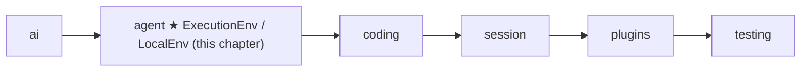
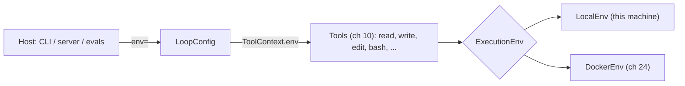

# 09 Part 3 · Execution environment

**Goal:** Give tools one safe place to touch files and run commands.

**Builds on:** [05 Agent loop](05-agent-loop.md#toolcontext-what-a-tool-gets) (tool context), [06 Events and abort](06-events-abort.md) (Stop) · **Previous:** [08 Hooks and approval](08-hooks-approval.md) · **Next:** [10 Coding tools](10-coding-tools.md)

## Where we are



**IN:** a path or a command · **OUT:** text, bytes, entries, or `(exit code, output)`

Take the running example: the user asks "What is in README.md?". In Part 2 the loop could call a tool, but the tool had nothing real to work with. To answer, a `read` tool must open `README.md` on disk; later a `bash` tool must run commands like `pytest`. This chapter builds the [execution environment](glossary.md#execution-environment): the one object, `ctx.env` in the [tool context](glossary.md#tool-context) from [05](05-agent-loop.md#toolcontext-what-a-tool-gets), that every tool in [10](10-coding-tools.md) uses to do that work.

Big picture of Part 3: [part-3-coding](09-0-part-3-coding.md).

Code in this chapter (commit `2fc2776`):

- `packages/simp_agent/src/simp_agent/agent/env.py` — `ExecutionEnv`, `LocalEnv`, `run_kill`
- `packages/simp_agent/src/simp_agent/testing/env_conformance.py` — `EnvConformance`, a test suite any env must pass
- `packages/simp_agent/tests/test_env.py` — the tests for `LocalEnv`

## Problem

If each tool touches the disk with `open()` and runs commands with `subprocess` on its own, there is no single place to swap. Later the server runs each session inside a Docker container ([24](24-docker-sandbox.md)), and with ten tools calling `subprocess` we would change ten tools. So we put one object between the tools and the world; the server then swaps that one object, and no tool changes. A first, naive try at that object shows four more things it must get right.

## Naive version

So every tool will ask one object, the env, instead of touching the disk itself. What must the env be able to do? Look at our story: the agent must read `README.md`, write `NOTES.md` and run `pytest`. Every coding tool in [10](10-coding-tools.md) comes down to one of these three: **read a file, write a file, run a command**. So the env needs three methods. The simplest way to write them is to call Python's own tools directly: `open()` to read and write a file, `subprocess` to run a command, with no checks and nothing else:

```text
CLASS NaiveEnv(root):                       // root = the project folder the tools may use
    FUNCTION read_file(path):   RETURN open root + "/" + path and read it
    FUNCTION write_file(path, text):   open root + "/" + path and write text
    FUNCTION exec(command, cwd, timeout):
        p = START command in a shell
        p.wait(timeout)                     // blocks until p ends or timeout passes
        IF timeout passed: p.kill(); RETURN (None, "")
        RETURN (exit code, output)
```

It works for the happy case. To see where it breaks, look at where an env call runs. Python's [event loop](glossary.md#event-loop) runs on one thread. The [agent loop](05-agent-loop.md) runs inside it, together with the task that watches for Stop ([06](06-events-abort.md)) and the sending of events to the UI. The agent loop calls a tool, and the tool calls the env:

```text
event loop (one thread)
└─ agent_loop → tool → env
                        ├─ read_file / write_file → open() → disk
                        └─ exec("pytest") → new process: sh (p) → pytest → test server (port 8000)
```

`sh` is the shell, the program that reads a command line (like the one in your Terminal). `exec` hands it the text `"pytest"`, and `sh` starts `pytest` as its child.

Every tool goes through the env, so whatever the env gets wrong, every tool gets wrong. `NaiveEnv` gets four things wrong, at four places on this path:

- **env → disk: a path can leave the project.** The env is the one place that can check a path, but `NaiveEnv` just joins `root + "/" + path` and opens it. If the model asks `read_file("../.ssh/id_rsa")` (by mistake, or because a file told it to), `..` walks up out of the project, and the tool reads the user's secret SSH key, which then goes into the history and to the model provider. `write_file("../.bashrc", …)` could even change files outside the project. A *symlink* (a file that points to another place) can do the same.
- **env waits: the whole agent freezes.** `pytest` runs in its own process, but `NaiveEnv` waits for it with `p.wait()`. That wait holds the event loop's one thread for the whole minute, so nothing else can run: no events reach the UI, and Stop does nothing. (A plain `open()` holds the thread too, only for a shorter time.) A wait that is `await`ed would let the event loop run the other jobs in the meantime.
- **env → process: a timeout leaves processes running and loses the output.** On timeout, `NaiveEnv` kills only `p`, the shell. Killing a parent does not kill its children, so `pytest` and the test server keep running, and the next `pytest` run fails because port 8000 is still taken. Also, `NaiveEnv` reads the output only when the command ends, so on timeout it returns `""`: the model never sees the lines `pytest` already printed, such as which tests failed.
- **env → disk: a missing folder makes write fail.** `NaiveEnv` writes only to folders that already exist. So when the model saves its notes with `write_file("notes/NOTES.md", …)` and `notes/` does not exist yet, the write fails, and the model must make the folder and try again: a wasted turn.

## Real design

We follow two real requests from the running example, top-down: the model calls `read`, then `bash`. Each piece (contract, helper, class) comes in when the request needs it.

### Step 1: the tool asks `ctx.env`

The model sends the tool call `read(path="README.md")`. `run_tool` ([05](05-agent-loop.md)) runs the `read` tool and gives it a tool context. The tool does not open the file itself. It calls `await ctx.env.read_file(path)`. So the first question is: where does `ctx.env` come from? The tool never builds its own env. The host (CLI, server, eval runner) picks which env to pass in `LoopConfig.env`. If the host gives none, the default is `LocalEnv()`. The loop puts it into each tool's context: `ToolContext(cancel, config.env, config.cwd, on_update)`.

Real code: [packages/simp_agent/src/simp_agent/agent/__init__.py](../../packages/simp_agent/src/simp_agent/agent/__init__.py) (`LoopConfig`, `agent_loop`)



[DockerEnv](24-docker-sandbox.md) is the second env, built in Part 5; here it only shows that a second one can exist.

#### The contract: `ExecutionEnv`

The tool does not know if `ctx.env` is a `LocalEnv` or a `DockerEnv`. To call it anyway, we need a contract: a list of methods every env has. `ExecutionEnv` is a `typing.Protocol`: any object with these methods counts, no need to inherit.

```text
ExecutionEnv (all async):
    read_file(path)          -> text
    write_file(path, text)
    read_bytes(path)         -> bytes
    write_bytes(path, data)
    list(path)               -> list of {name, is_dir, size}
    exec(command, cwd, timeout, cancel, on_output = none) -> (exit_code or None, output)
```

Real code: [packages/simp_agent/src/simp_agent/agent/env.py](../../packages/simp_agent/src/simp_agent/agent/env.py) (`ExecutionEnv`)

`ExecutionEnv` says what an env can do; `LocalEnv` and `DockerEnv` are how one kind of machine does it.

### Step 2: `LocalEnv` reads and writes files without freezing

The tool calls `ctx.env.read_file("README.md")`. By default, `ctx.env` is a `LocalEnv`, the env for the machine Python runs on. It fixes two breaks from the list.

**The freeze.** `NaiveEnv` called `open()` on the event loop's one thread, so that thread was busy until the disk answered. `LocalEnv` hands the disk work to a helper thread with `asyncio.to_thread`, and `await`s it. While it waits, the event loop's thread is free, so events still reach the UI and Stop is still heard:

```text
FUNCTION read_file(path):
    RETURN await (read text of _path(path)) in a helper thread
```

**The missing folder.** Before writing, `LocalEnv` makes every missing parent folder, so `write_file("notes/NOTES.md", …)` makes `notes/` first and does not fail:

```text
FUNCTION write_bytes(path, data):
    in a helper thread: make the missing parent folders, then write data
```

`write_file` only turns the text into bytes and calls `write_bytes`. `list`, `read_bytes` and `write_bytes` work the same way (see the real code).

Real code: [packages/simp_agent/src/simp_agent/agent/env.py](../../packages/simp_agent/src/simp_agent/agent/env.py) (`LocalEnv.read_file`, `write_bytes`)

Every method starts with `_path(path)`. What does it do with `"README.md"` before the disk is touched?

### Step 3: `_path` [keeps every path inside the project](glossary.md#path-safety)

Every file method starts with `_path(path)`. This fixes "a path can leave the project". `NaiveEnv` just joined `root + "/" + path`. `_path` checks the result first: it turns the path into its real, full form with `resolve()` (this removes `..` and follows symlinks), and refuses it if it is no longer inside `root`:

```text
FUNCTION _path(path):
    IF there is no root: RETURN path            // nothing to protect, see below
    p = resolve(root + path)
    IF p is not inside resolve(root): RAISE PermissionError "path escapes root: <path>"
    RETURN p
```

Real code: [packages/simp_agent/src/simp_agent/agent/env.py](../../packages/simp_agent/src/simp_agent/agent/env.py) (`LocalEnv._path`)

Why `resolve()`, and not a check like `".." in path`? Because a symlink or an absolute path escapes without any `..`:

| Asked path | After `resolve()` | Result |
|---|---|---|
| `README.md` | `<root>/README.md` | ok |
| `../.ssh/id_rsa` | `<home>/.ssh/id_rsa` | `PermissionError` |
| `link` (a symlink to `<home>/.ssh/id_rsa`) | `<home>/.ssh/id_rsa` | `PermissionError` |
| `/etc/passwd` (absolute) | `/etc/passwd` | `PermissionError` |

The error does not crash anything. `run_tool` ([05](05-agent-loop.md)) turns it into an error tool result, so the model reads `PermissionError: path escapes root: ../.ssh/id_rsa` and tries another path.

Two limits. `root` is optional: with no root, every path is used as it is. That is fine for a CLI on your own machine (the tools in [10](10-coding-tools.md) then join relative paths to `ctx.cwd`). And the check is for files only: `bash` can still run `cat ../.ssh/id_rsa`. Real isolation for commands is the Docker sandbox ([24](24-docker-sandbox.md)).

### Step 4: `exec` runs `pytest` without freezing, and keeps the output

Now the model calls `bash(command="pytest")`, and the tool calls `ctx.env.exec(...)`. `exec` starts the shell in a new process (Step 5 explains the "new group"), then fixes two breaks.

**The freeze.** The process is made the same way; only the *waiting* changes. `NaiveEnv` used `subprocess` and waited with `p.wait()`, which holds the event loop's thread until `pytest` ends. `exec` uses the asyncio version, and every wait is an `await`:

```python
proc = await asyncio.create_subprocess_shell("pytest", ...)   # same sh → pytest
data = await proc.stdout.read(4096)                            # wait for output
await proc.wait()                                              # wait for the end
```

`await` means "the event loop may do other work, and come back when there is news". So while `pytest` runs, the event loop still sends output to the UI and still watches for Stop. To be able to stop it, `exec` waits on two tasks at once, at most `timeout`: `run` reads the output until `pytest` exits, and `stop` waits for the Stop flag (the same race as `_stream` in [06](06-events-abort.md)).

**The lost output.** `NaiveEnv` read the output only at the end. `exec` starts the process with its output going into a *pipe*, a channel from `pytest` back to the agent. Whatever `pytest` prints flows into the pipe at once, and `await proc.stdout.read(4096)` returns as soon as some bytes are there, without waiting for the end. `run` reads it piece by piece as it comes, keeps every piece in `chunks`, and passes each one to `on_output`, which is `ctx.on_update`, so the UI shows it live. So if Stop or the timeout wins, `exec` kills the command and still returns what came so far: `(None, output so far)`. `None` means "killed", not a real exit code.

```text
FUNCTION exec(command, cwd, timeout, cancel, on_output):
    proc = START command in a shell, in a new process group
    run  = START task: read output piece by piece into chunks (and on_output) until proc exits
    stop = START task: wait for cancel
    WAIT for the first of (run, stop), at most timeout
    IF run is not done:                    // Stop or timeout won
        run_kill(proc.pid)                 // Step 5
        WAIT for run                       // reads the last bytes
        RETURN (None, chunks joined)
    RETURN (proc exit code, chunks joined)
```

Real code: [packages/simp_agent/src/simp_agent/agent/env.py](../../packages/simp_agent/src/simp_agent/agent/env.py) (`LocalEnv.exec`)

(Two small choices: stderr goes into the same stream as stdout, so an error sits next to the line that caused it; and a bad byte becomes `�` instead of crashing the tool.)

### Step 5: Stop kills the whole process group

`NaiveEnv` killed only the parent process, `sh`. `pytest`, which `sh` started, is a child process, and a child does not die with its parent: `pytest` and its test server keep running and keep port 8000. The fix is to put them all in one **[process group](glossary.md#process-group-kill)** and kill the group.

How: when `exec` starts `sh`, `exec` asks the operating system for a new process group (`start_new_session=True`). From then on, every process `sh` starts (`pytest`, the test server) belongs to that group. On Stop or timeout, `exec` kills the whole group with one call, `run_kill(proc.pid)`, which runs `os.killpg(group id, SIGKILL)`. All three die, and port 8000 is free.

Real code: [packages/simp_agent/src/simp_agent/agent/env.py](../../packages/simp_agent/src/simp_agent/agent/env.py) (`run_kill`)

(`run_kill` sends the kill a few times, because a new child may be started at the very moment of the first one.)

### Step 6: the rules every env must pass

We followed one `read` and one `bash` call through `LocalEnv`. How do we know a second env, like `DockerEnv`, does the same? The types say *which* methods exist, not *how* they must behave. For that there is `EnvConformance` in the `testing` [layer](glossary.md#layer): one shared test class that checks path safety, exec output, cancel, and the group kill. Any env passes it by giving one fixture, `make_env(root)`. `DockerEnv` uses it in [24](24-docker-sandbox.md).

Real code: [packages/simp_agent/src/simp_agent/testing/env_conformance.py](../../packages/simp_agent/src/simp_agent/testing/env_conformance.py) (`EnvConformance`)

## Test

`packages/simp_agent/tests/test_env.py` has two direct tests and a 4-line class that pulls in the whole suite:

```text
CLASS TestLocalEnvConformance(EnvConformance):
    FIXTURE make_env:
        RETURN a function: root -> LocalEnv(root)
```

Real code: [packages/simp_agent/tests/test_env.py](../../packages/simp_agent/tests/test_env.py) (`TestLocalEnvConformance`)

That is all `LocalEnv` needs to run the whole suite. The server does the same for Docker in `apps/server/tests/test_docker_sandbox.py` (`TestDockerEnvConformance`).

The most interesting check is the process-group kill. `self.run` is a small helper in the suite: it calls `env.exec` with the root as `cwd` and a fresh cancel event.

```text
TEST test_exec_timeout_kills_tree(env):
    t = now
    (code, text) = run in env, timeout 2 s:
        "echo start; (sleep 6; sleep 1; echo late > late.txt) & sleep 30"
    CHECK code is None AND "start" is in text
    CHECK less than 10 s passed
    UNTIL 8 s after t:                          // slack for a busy event loop
        CHECK late.txt does not exist           // background child was killed too
        WAIT 0.1 s
```

Real code: [packages/simp_agent/src/simp_agent/testing/env_conformance.py](../../packages/simp_agent/src/simp_agent/testing/env_conformance.py) (`test_exec_timeout_kills_tree`)

The command starts a background child that would write `late.txt` after 7 seconds, then sleeps 30. The timeout is 2 seconds. The test checks: we got `None` and the early output `start`, we returned quickly, and for 8 seconds `late.txt` never appears. With the naive `p.kill()`, the background child would live and write the file.

No [FakeProvider](04-label-test.md) here: the env has nothing to do with models. It is tested on its own.

```bash
uv run pytest packages/simp_agent/tests/test_env.py
```

## Why this way

> **One object between tools and the world.** Tools call `ctx.env`, never `open()` or `subprocess`.
>
> **A Protocol, plus a test suite as the real rules.** Types say *which* methods exist. `EnvConformance` says *how* they must behave (path safety, kill tree, partial output). A new env proves itself by passing it.
>
> **Kill the group, not the process.** A coding agent runs builds, tests and servers that start children. Only a process-group kill, repeated until empty, really stops them.
>
> **Path safety has a clear limit.** `LocalEnv`'s root stops bad file paths, not shell commands. Isolation for commands is a separate job ([24](24-docker-sandbox.md)).

## Exercises

1. `test_containment` already checks the symlink `dirlink/secret`. Remove `resolve()` from `_path` in your copy and run it. Which bad paths still fail, and which now pass through? Why?
2. In `exec`, change the call to `run_kill` into a plain `os.kill` of the one process. Run `test_exec_timeout_kills_tree`. It fails. Explain why.
3. Write a `ReadOnlyEnv` that wraps another env and refuses `write_file`. Which `EnvConformance` tests can it still pass?

## Recap

- The [execution environment](glossary.md#execution-environment) (`ExecutionEnv`) is a Protocol of six async methods: `read_file`, `write_file`, `read_bytes`, `write_bytes`, `list`, `exec`. Tools reach it as `ctx.env`; the host picks it via `LoopConfig.env` (default `LocalEnv()`).
- `LocalEnv` runs file IO in a thread (`asyncio.to_thread`), makes parent folders on write, and sorts `list`.
- [Path safety](glossary.md#path-safety): with a `root`, `_path` resolves `..` and symlinks, then raises `PermissionError` if the path leaves the root. Files only; `exec` is not checked.
- `exec` streams output through `on_output`, races finish / cancel / timeout, and returns `(None, output so far)` when killed.
- [Process-group kill](glossary.md#process-group-kill): `start_new_session=True` + `run_kill` sends `SIGKILL` to the group until it is empty, so background children die too.
- `EnvConformance` is one shared test suite; `LocalEnv` and `DockerEnv` both pass it.

**Builds on:** [05 Agent loop](05-agent-loop.md#toolcontext-what-a-tool-gets) (tool context), [06 Events and abort](06-events-abort.md) (Stop) · **Previous:** [08 Hooks and approval](08-hooks-approval.md) · **Next:** [10 Coding tools](10-coding-tools.md) — `read`, `write`, `edit`, `ls`, `grep`, `find` and `bash`, all built on `ctx.env`.
