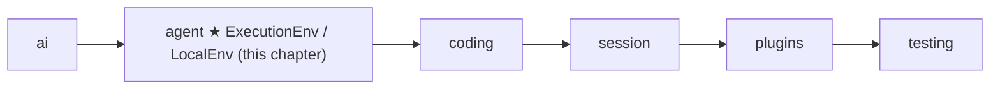
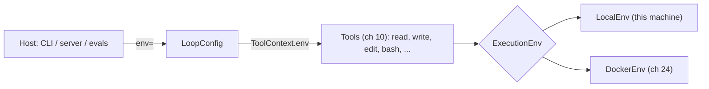
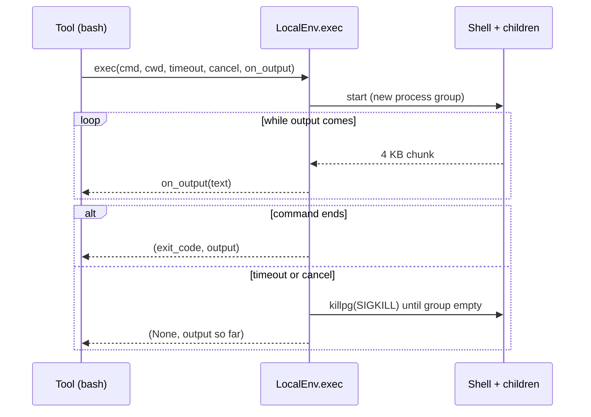

# 09 Part 3 · Execution environment

**Goal:** Give tools one safe place to touch files and run commands.

**Builds on:** [08 Hooks and approval](08-hooks-approval.md) · **Next:** [10 Coding tools](10-coding-tools.md)

## Where we are



In [05](05-agent-loop.md#toolcontext-what-a-tool-gets) every tool got a [tool context](glossary.md#tool-context), and one field of it was `env`. We said "this is where tools read files and run commands" and moved on. In [08](08-hooks-approval.md) we built a gate that can say "no" to a call. Now we build the thing behind the gate: the [execution environment](glossary.md#execution-environment).

The next chapter ([10](10-coding-tools.md)) writes the real coding tools: `read`, `write`, `edit`, `ls`, `grep`, `find`, `bash`. They will **all** go through this object. So this chapter is small, but everything after it stands on it.

Code in this chapter (commit `2fc2776`):

- `packages/simp_agent/src/simp_agent/agent/env.py` — `ExecutionEnv`, `LocalEnv`, `run_kill`
- `packages/simp_agent/src/simp_agent/testing/env_conformance.py` — `EnvConformance`, a test suite any env must pass
- `packages/simp_agent/tests/test_env.py` — the tests for `LocalEnv`

## Problem

A coding agent must touch the disk and run shell commands. If each tool does this on its own, with `open()` and `subprocess`, we get four problems:

1. **No single place to swap.** Later the server runs each session inside a Docker container ([24](24-docker-sandbox.md)). If ten tools each call `subprocess`, we must change ten tools. We want to change **one object**.
2. **No fence.** The model may ask to read `../../home/me/.ssh/id_rsa`. Nothing stops it.
3. **The loop freezes.** The agent loop is `async`: one event loop runs everything, one step at a time. A plain `open().read()` on a big file, or a `subprocess.run()` that takes a minute, blocks the event loop. The **Stop** button from [06](06-events-abort.md) cannot even be heard.
4. **Commands that never die.** A command like `npm run dev &` starts a child process in the background. If we kill only the shell, the child lives on, holding ports and files, long after the user pressed Stop.

## Naive version

```python
import subprocess

class NaiveEnv:
    def __init__(self, root):
        self.root = root

    def read_file(self, path):
        return open(f"{self.root}/{path}").read()     # blocks the loop

    def write_file(self, path, text):
        open(f"{self.root}/{path}", "w").write(text)  # fails if the folder is missing

    def exec(self, command, cwd, timeout):
        p = subprocess.Popen(command, shell=True, cwd=cwd,
                             stdout=subprocess.PIPE, stderr=subprocess.STDOUT)
        try:
            out, _ = p.communicate(timeout=timeout)   # blocks the loop
            return p.returncode, out.decode()
        except subprocess.TimeoutExpired:
            p.kill()                                  # kills the shell only
            return None, ""                           # output so far is lost
```

Where it breaks:

- **`root` is not a fence.** `read_file("../secret")` reads outside the root. So does a symlink inside the root that points out.
- **It blocks.** `open().read()` and `communicate()` stop the whole event loop. No events go out, no Stop is heard.
- **No cancel.** There is only a timeout. The user's Stop ([abort](glossary.md#abort)) cannot end a running command.
- **Children survive.** `p.kill()` kills the shell. `sleep 30 &` inside it keeps running.
- **Output is lost.** On timeout we return `""`. The model never learns how far the command got. And nothing streams while it runs.
- **No folders.** `write_file("src/new/a.py", ...)` fails if `src/new` does not exist.

## Real design

### `ExecutionEnv`: the contract

```python
class ExecutionEnv(Protocol):
    async def read_file(self, path: str) -> str: ...

    async def write_file(self, path: str, text: str) -> None: ...

    async def list(self, path: str) -> list[dict]: ...  # [{name, is_dir, size}]

    async def read_bytes(self, path: str) -> bytes: ...

    async def write_bytes(self, path: str, data: bytes) -> None: ...

    async def exec(
        self, command: str, cwd: str, timeout: float | None, cancel: asyncio.Event,
        on_output: Callable[[str], Awaitable[None]] | None = None,
    ) -> tuple[int | None, str]: ...  # exit code is None when killed (timeout or cancel); output = what came so far
```

Six methods. That is everything a tool may use to touch files and run commands.

- It is a `typing.Protocol`, not a base class. Any object with these six methods **is** an `ExecutionEnv`. No need to inherit.
- Every method is `async`, so a slow disk or a slow container never blocks the loop.
- Text **and** bytes: text for code files, bytes for images and for the server's file download ([20](20-server-run.md)).
- `list` returns plain dicts `{name, is_dir, size}`, easy to turn into JSON.
- `exec` takes the `cancel` event from the tool context, so Stop can end a command. It takes an optional `on_output` callback, so output can stream to the UI while the command runs. It returns `(exit_code, output)`. The exit code is `None` when **we** killed the command (timeout or cancel). The output is "what came so far", even after a kill.

Where does the env come from? `LoopConfig` has a field with a default:

```python
    env: ExecutionEnv = field(default_factory=LocalEnv)
```

and the loop puts it into each tool's context (`packages/simp_agent/src/simp_agent/agent/__init__.py`):

```python
                    ctx = ToolContext(cancel, config.env, config.cwd, on_update)
```

So a tool never builds its own env. It uses `ctx.env`. The host (CLI, server, eval runner) picks which env to pass.



### `LocalEnv`: this machine

`LocalEnv` is the only env in the core library. It works on the machine where Python runs.

```python
class LocalEnv:
    """This machine. File IO runs in a thread so the loop never blocks.
    With a root, file paths are relative to it and may not escape it (via .. or symlinks)."""

    root: str | None = None

    def __init__(self, root: str | None = None):
        self.root = root
```

`root` is optional. With no root (the default in `LoopConfig`), paths are used as they are. With a root, every file path is checked (next section).

File methods are thin. Each one sends the real work to a thread with `asyncio.to_thread`:

```python
    async def read_file(self, path: str) -> str:
        return await asyncio.to_thread(self._path(path).read_text)

    async def write_file(self, path: str, text: str) -> None:
        await self.write_bytes(path, text.encode())

    async def write_bytes(self, path: str, data: bytes) -> None:
        p = self._path(path)

        def w():
            p.parent.mkdir(parents=True, exist_ok=True)
            p.write_bytes(data)

        await asyncio.to_thread(w)
```

Three small choices here:

- **`to_thread`**: the event loop keeps running while the disk works.
- **`write_file` calls `write_bytes`**: one write path, so the fence is checked in one place.
- **`mkdir(parents=True)`**: writing `src/new/a.py` makes `src/new` first. The model does not need a separate "make folder" tool.

`list` sorts by name, so the output is the same every time (good for tests and for the model):

```python
    async def list(self, path: str) -> list[dict]:
        def ls():
            out = []
            for e in sorted(os.scandir(self._path(path)), key=lambda e: e.name):
                is_dir = e.is_dir()
                out.append({"name": e.name, "is_dir": is_dir, "size": 0 if is_dir else e.stat().st_size})
            return out

        return await asyncio.to_thread(ls)
```

### Path safety

[Path safety](glossary.md#path-safety) means a file path can never point outside the root. Every file method starts with `self._path(path)`:

```python
    def _path(self, path: str) -> Path:
        if self.root is None:
            return Path(path)
        root = Path(self.root).resolve()
        p = (root / path).resolve()
        if not p.is_relative_to(root):
            raise PermissionError(f"path escapes root: {path}")
        return p
```

The trick is `resolve()`. It turns a path into its real, absolute form: it removes `..` **and** follows symlinks. Only after that do we ask "is this still inside the root?".

| Asked path | After `resolve()` | Result |
|---|---|---|
| `a/b.txt` | `<root>/a/b.txt` | ok |
| `../secret` | `<parent>/secret` | `PermissionError` |
| `link` (symlink to `<parent>/secret`) | `<parent>/secret` | `PermissionError` |
| `/etc/passwd` (absolute) | `/etc/passwd` (`root / "/etc/passwd"` drops the root) | `PermissionError` |

A string check like `".." in path` would miss the symlink and the absolute path. `resolve()` + `is_relative_to` catches all three.

What happens to the error? The tool does not catch it. In [05](05-agent-loop.md) `run_tool` turns any exception into an error tool result. So the model sees `PermissionError: path escapes root: ../secret` and can try another path. The loop does not crash.

Two limits to know:

- **The fence is for files only.** `exec` does not check paths. A command like `cat ../secret` still works on `LocalEnv`. The root protects against tool *arguments*, not against a shell. Real isolation for commands is the Docker sandbox in [24](24-docker-sandbox.md). (The server's comment on its `LocalEnv` workspace says the same: "Not isolation: DockerSandbox replaces it.")
- **No root, no fence.** `LocalEnv()` with no root trusts every path. That is fine for a CLI on your own machine, where you already run the agent as yourself.

### `exec`: run, stream, stop

```python
    async def exec(self, command, cwd, timeout, cancel, on_output=None) -> tuple[int | None, str]:
        proc = await asyncio.create_subprocess_shell(
            command, cwd=cwd, stdout=asyncio.subprocess.PIPE, stderr=asyncio.subprocess.STDOUT, start_new_session=True
        )
        chunks = list()

        async def pump():
            while data := await proc.stdout.read(4096):
                text = data.decode(errors="replace")
                chunks.append(text)
                if on_output:
                    await on_output(text)
            await proc.wait()

        run = asyncio.ensure_future(pump())
        stop = asyncio.ensure_future(cancel.wait())
        done, _ = await asyncio.wait({run, stop}, timeout=timeout, return_when=asyncio.FIRST_COMPLETED)
        stop.cancel()
        if run not in done:
            await run_kill(proc.pid)
            await run
            return None, "".join(chunks)
        return proc.returncode, "".join(chunks)
```

Step by step:

1. **Start** the command in a shell. `stderr=STDOUT` merges errors into the same stream, in the order they came. `start_new_session=True` puts the shell in a **new process group** (more below).
2. **Pump**: read 4 KB at a time, decode (bad bytes become `�`, never an exception), keep each chunk, and pass it to `on_output` if given. When the stream ends, wait for the exit code.
3. **Race** three things: the pump finishes, `cancel` is set, or `timeout` passes. `asyncio.wait(..., FIRST_COMPLETED)` returns at the first one.
4. If the pump **did not** finish, we kill, then `await run` so the pump reads the last bytes and ends cleanly. Return `None` and the output so far.
5. Otherwise, return the real exit code and all the output.



### Process-group kill

A [process-group kill](glossary.md#process-group-kill) stops a command **and** every child it started. Why the new process group? A shell command can start children: `npm test` starts `node`, `make` starts `gcc`, `server &` runs in the background. Killing only the shell's PID leaves them alive.

With `start_new_session=True`, the shell and every child it starts share one **process group**, and its id is the shell's PID. Then one call kills them all:

```python
async def run_kill(pgid: int) -> None:
    """SIGKILL the whole process group (start_new_session) until it is empty: a child forked while the first
    signal is delivered can miss it."""
    for _ in range(100):
        try:
            os.killpg(pgid, 9)
        except (ProcessLookupError, PermissionError):  # group empty (macOS: EPERM once only zombies are left)
            return
        await asyncio.sleep(0.02)
```

- `os.killpg(pgid, 9)` sends `SIGKILL` (signal 9) to the whole group. `SIGKILL` cannot be caught or ignored.
- **Why a loop?** A child may be forked at the very moment the first signal goes out, and miss it. So we send again every 20 ms, until the group is empty.
- **How do we know it is empty?** `killpg` raises `ProcessLookupError`. On macOS it may raise `PermissionError` instead, once only zombie processes are left (a zombie is a dead process whose exit code nobody has read yet). Both mean "done".
- At most 100 tries (about 2 seconds), so a bad case cannot stop the tool forever.

### `EnvConformance`: one test suite for every env

`LocalEnv` is not the only env. The server has `DockerEnv` ([24](24-docker-sandbox.md)), which **inherits** `LocalEnv` for file IO and replaces `exec` with `docker exec` (it also maps `cwd` to `/work` inside the container). A future env might talk to a remote machine. How do we know they all behave the same?

We write the rules down **once**, as a test class, in the `testing` [layer](glossary.md#layer) (so apps can import it):

```python
class EnvConformance:
    @pytest.fixture
    async def env(self, make_env, tmp_path):
        self.root = tmp_path / f"root-{uuid.uuid4().hex[:8]}"  # unique: Docker names containers after it
        self.root.mkdir()
        env = make_env(self.root)
        return await env if inspect.isawaitable(env) else env
```

An env joins the suite by subclassing it and giving one fixture, `make_env(root) -> env`. The fixture may be sync or async (Docker needs to start a container). Then every `test_*` method in the class runs against that env:

| Test | Rule it checks |
|---|---|
| `test_text_and_bytes_round_trip` | Text (with `é`) and raw bytes come back the same; folders are made. |
| `test_list` | Sorted `{name, is_dir, size}` dicts; folders have size 0. |
| `test_containment` | On read, `..`, a file symlink, a folder symlink and an absolute path raise `PermissionError`; on write, `..` and a folder symlink; on list, `..`. Nothing is written outside. |
| `test_exec_exit_code_and_output` | Exit code comes back; stdout and stderr are both in the output; `on_output` saw exactly the same text. |
| `test_exec_sees_written_files` | A file written with `write_file` is visible to `exec` (matters for Docker, where files and commands live in two places). |
| `test_exec_cwd` | `cwd` is respected. |
| `test_exec_timeout_kills_tree` | Timeout returns `None` + output so far, **and** a background child is dead too. |
| `test_exec_cancel` | Setting `cancel` ends a `sleep 30` fast with `None`. |

The idea comes from `env-conformance.ts` in pi, the TypeScript agent that simp-agent copies ideas from (the docstring says so).

## Test

`packages/simp_agent/tests/test_env.py` has two direct tests and a 4-line class that pulls in the whole suite:

```python
class TestLocalEnvConformance(EnvConformance):
    @pytest.fixture
    def make_env(self):
        return lambda root: LocalEnv(str(root))
```

That is all `LocalEnv` needs to run the eight checks above. The server does the same for Docker in `apps/server/tests/test_docker_sandbox.py` (`TestDockerEnvConformance`).

The most interesting check is the process-group kill:

```python
    async def test_exec_timeout_kills_tree(self, env):
        t = time.monotonic()
        code, text = await self.run(env, "echo start; (sleep 6; sleep 1; echo late > late.txt) & sleep 30", timeout=2)
        assert code is None and "start" in text
        assert time.monotonic() - t < 10
        while time.monotonic() < t + 8:  # slack for a loaded event loop
            assert not (self.root / "late.txt").exists()  # background child was killed too
            await asyncio.sleep(0.1)
```

(`self.run` is a small helper in the suite: it calls `env.exec` with the root as `cwd` and a fresh cancel event.) The command starts a background child that would write `late.txt` after 7 seconds, then sleeps 30. The timeout is 2 seconds. The test checks: we got `None` and the early output `start`, we returned quickly, and for 8 seconds `late.txt` never appears. With the naive `p.kill()`, the background child would live and write the file.

No [FakeProvider](02-fake-provider.md) here: the env has nothing to do with models. It is tested on its own.

```bash
uv run pytest packages/simp_agent/tests/test_env.py
```

> **Why this way**
>
> **One object between tools and the world.** Tools call `ctx.env`, never `open()` or `subprocess`. To move all commands into Docker, the server swaps one object; no tool changes.
>
> **A Protocol, plus a test suite as the real rules.** Types say *which* methods exist. `EnvConformance` says *how* they must behave (fence, kill tree, partial output). A new env proves itself by passing it.
>
> **Kill the group, not the process.** A coding agent runs builds, tests and servers that start children. Only a process-group kill, repeated until empty, really stops them.
>
> **The fence has a clear limit.** `LocalEnv`'s root stops bad file paths, not shell commands. Isolation for commands is a separate job ([24](24-docker-sandbox.md)).

## Exercises

1. Make a symlink `dirlink` inside the root that points to a folder outside it. Write a test that `read_file("dirlink/secret")` raises `PermissionError`.
2. In `exec`, change the call to `run_kill` into a plain `os.kill` of the one process. Run `test_exec_timeout_kills_tree`. It fails. Explain why.
3. Write a `ReadOnlyEnv` that wraps another env and refuses `write_file`. Which `EnvConformance` tests can it still pass?

## Recap

- The [execution environment](glossary.md#execution-environment) (`ExecutionEnv`) is a Protocol of six async methods: `read_file`, `write_file`, `read_bytes`, `write_bytes`, `list`, `exec`. Tools reach it as `ctx.env`; the host picks it via `LoopConfig.env` (default `LocalEnv()`).
- `LocalEnv` runs file IO in a thread (`asyncio.to_thread`), makes parent folders on write, and sorts `list`.
- [Path safety](glossary.md#path-safety): with a `root`, `_path` resolves `..` and symlinks, then raises `PermissionError` if the path leaves the root. Files only; `exec` is not fenced.
- `exec` streams output through `on_output`, races finish / cancel / timeout, and returns `(None, output so far)` when killed.
- [Process-group kill](glossary.md#process-group-kill): `start_new_session=True` + `run_kill` sends `SIGKILL` to the group until it is empty, so background children die too.
- `EnvConformance` is one shared test suite; `LocalEnv` and `DockerEnv` both pass it.

**Builds on:** [08 Hooks and approval](08-hooks-approval.md) · **Next:** [10 Coding tools](10-coding-tools.md) — `read`, `write`, `edit`, `ls`, `grep`, `find` and `bash`, all built on `ctx.env`.
