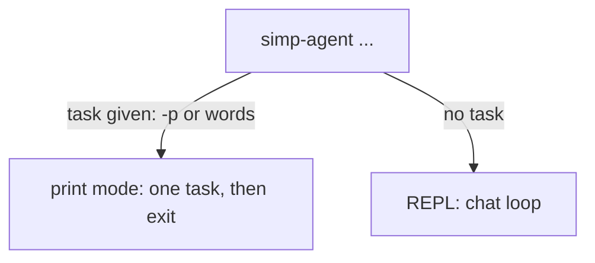

# 10 The CLI

**For:** Users who chat with the agent in a terminal.
**You need first:** [01 Quick start](01-quick-start.md) (Path A) and the terms in [00](00-introduction.md).
**You will learn:** the two modes (print and REPL), the REPL commands, how to write
[profiles](glossary.md#profile), how tool approval and `--yes` work, and where sessions are saved.
**Code covered:** `apps/cli/src/simp_cli/__init__.py`, `apps/cli/src/simp_cli/repl.py`.
Verified at commit `8efbd9c`.

## 1. Two modes



| You type | Mode |
|---|---|
| `simp-agent -p "task"` or `simp-agent "task"` | [print mode](glossary.md#print-mode) |
| `simp-agent` | [REPL](glossary.md#repl) |

Both build the same `AgentSession` (see [00](00-introduction.md#1-what-simp-agent-is)). Only the
outside differs. In these examples, add `uv run --project <repo>` in front, as in [01](01-quick-start.md#32-make-a-practice-folder).

## 2. Print mode

Print mode runs one task and exits. It prints the answer line by line, and a `> tool: detail`
line each time the agent uses a [tool](glossary.md#tool). Tool errors show as `  ! message`.
Only the session id goes to stderr (`[session 53cbd108]`). Everything else, including tool lines and thinking, goes to stdout.

The exit code is `0` on success and `1` if the run failed or was aborted. Bad flags give `2`.
Two errors you may meet:

```text
Error: no API key for provider anthropic          (exit 1: set ANTHROPIC_API_KEY)
simp-agent: error: unknown profile 'nope'; have []  (exit 2: see section 4)
```

The CLI has no fake mode, so it always needs a real key (for a test without a key, use the web path in [01](01-quick-start.md)). `simp-agent --help` lists every flag.

Use `--no-thinking` to hide the model's thinking lines (dim on a terminal, by default).

## 3. The REPL

Run `simp-agent` with no task. You see a prompt `> ` and a bottom bar with the model, the
session id, a token estimate and the state (`idle`, `running`, `compacting`, `retrying`).

**While the agent is idle**, Enter sends your message. **While it runs**, you can still type:

- plain text = [steer](glossary.md#steer): the agent reads it before its next step;
- `>> text` = [follow-up](glossary.md#follow-up): it waits until the agent is finished.

**Ctrl-C** aborts the current run. When idle, press Ctrl-C twice (within 2 seconds) or
Ctrl-D (on an empty line) to exit.

### Commands

| Command | What it does |
|---|---|
| `/help` | show the help text |
| `/new` | start a new session (the old one stays on disk) |
| `/sessions` | list sessions of this folder; type a number to open one |
| `/history` | show all messages of this session |
| `/compact` | [compact](glossary.md#compaction) the history by hand |
| `/exit` or `/quit` | leave |

`/new`, `/sessions` and `/compact` say `busy: Ctrl-C to abort first` while a run is active.
`/exit`, `/help` and `/history` work even while busy. An unknown `/word` gives `unknown command`. **Why `/compact`?** Long chats fill the model's
context window. Compaction replaces old messages with a short summary. It also happens
automatically when the history gets too big; `/compact` lets you do it early.

When you resume a session, the last 20 messages are shown; the rest can be seen with `/history`.

## 4. Settings and profiles

Without settings, the CLI uses `anthropic-messages` with `max_tokens` 8192, and the model
`claude-sonnet-5-5` (the library's default). To change this, create `~/.simp-agent/settings.json`:

```json
{
  "default_profile": "local",
  "bash_max_timeout_s": 120,
  "profiles": {
    "local": {
      "api": "openai-completions",
      "model": "qwen3",
      "base_url": "http://localhost:8000/v1",
      "context_window": 32768,
      "api_key_env": "LOCAL_KEY"
    },
    "claude": { "model": "claude-sonnet-5-5" }
  }
}
```

- `profiles` holds named [profiles](glossary.md#profile). `default_profile` is used when you
  do not pass `--profile` (a missing name there is ignored silently; only `--profile` checks it). `simp-agent --profile claude` picks one.
- `api` is `anthropic-messages`, `openai-completions` or `openai-responses`. For the two
  OpenAI kinds, `model` and `context_window` are required. If `base_url` is missing, the
  variable `OPENAI_BASE_URL` is used.
- `bash_max_timeout_s` (optional) caps how long one `bash` call can run. No limit by default.
- **Keys are never in the file.** A profile only names the variable (`api_key_env`). Without
  it, the CLI reads `ANTHROPIC_API_KEY` (Anthropic) or `OPENAI_API_KEY` (OpenAI; if unset, the
  word `dummy` is sent, which is fine for servers without a key). A literal `api_key` in a
  profile is ignored.

**Order of power:** built-in defaults, then the profile, then command-line flags. A flag always
wins: `--api`, `--model`, `--base-url`, `--context-window`, `--max-tokens`. Three flags set
`compat` options for odd servers: `--max-tokens-field`, `--reasoning-effort`
(for example `none`) and `--no-include-usage`.

An unknown `--profile` name stops with an error that lists the profiles you have.

## 5. Tool approval and `--yes`

Three tools can change your machine: `bash`, `write` and `edit`. Before each, the CLI asks:

```text
? bash: rm build/old.log
Allow? [y/N/a]
```

| Answer | Meaning |
|---|---|
| `y` or `yes` | allow this one call |
| `a` or `always` | allow this tool until the session object ends (see below) |
| anything else, or Enter | deny; the model is told it was denied |

See [tool approval](glossary.md#tool-approval). `read` and the other read-only tools never ask.
`a` is per tool name: after `a` for `edit`, every later `edit` runs, but `bash` still asks.
It lasts only while the program runs (a new REPL session with `/new` starts fresh).
Ctrl-C at the question denies and aborts the run.

`-y` / `--yes` turns the question off for everything. **Why this is risky:** the tools run
in your real folder with your rights. Use `--yes` only in a throwaway folder or for tasks
you trust. Print mode with no terminal to answer (a script, CI) also needs `--yes`, because an
end of input counts as "deny".

## 6. Sessions: where they are saved

Every finished message is written at once, one JSON line each, to:

```text
~/.simp-agent/sessions/<folder-name>/<session-id>.jsonl
```

`<folder-name>` is your current folder with `/` turned into `-` (`/tmp/try` becomes
`tmp-try`; on macOS `/tmp` is really `/private/tmp`). The id is 8 random hex characters.
**Why per folder?** The agent's tools work in the folder you started in, so a session belongs to it.
Compaction entries are saved in the same file.

| Flag | Effect |
|---|---|
| `-c`, `--continue` | continue the latest session of this folder |
| `--resume ID` | continue that session (this folder) |
| `-r` | open the REPL and show the session list at once |

Print mode with `-c` or `--resume` adds your new task to the old session. To delete a
session, delete its file. The server keeps sessions in SQLite instead (see [01](01-quick-start.md#4-path-b--chat-in-the-browser)).

## 7. Limits of the CLI

No sandbox: tools run on your machine. No budget limits. One user. For those, use the web UI
([11](11-web.md)) or the server (Part 2). The side-by-side list is in [12](12-cli-vs-web.md).

---

**Back:** [01 Quick start](01-quick-start.md).
**Next:** [11 The web UI](11-web.md).
**Built on by:** [12 CLI vs web feature table](12-cli-vs-web.md), 13 Working well with the agent, 21 Configuration reference.
