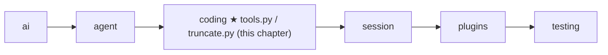

# 10 Part 3 · Coding tools

**Goal:** Build read, write, edit, ls, grep, find and bash.

**Builds on:** [05 Agent loop](05-agent-loop.md#tools-agenttool) (tool type, `run_tool`), [09 Execution environment](09-exec-env.md) (`ctx.env`) · **Previous:** [09](09-exec-env.md) · **Next:** [11 The system prompt](11-system-prompt.md)

## Where we are



**Builds:** blocks 1, 4, 7 of the [Part 3 map](09-0-part-3-coding.md#the-blocks) · **IN:** the model's tool arguments and a [tool context](glossary.md#tool-context) · **OUT:** one string for the model

Take the running example again. The user asks "What is in README.md?". In [09](09-exec-env.md) we built `LocalEnv`, which can open `README.md`. But the model cannot call `LocalEnv`. It can only call [agent tools](glossary.md#agent-tool) ([05](05-agent-loop.md#tools-agenttool)): a name, a description, an argument schema, and a function. So we still need a `read` tool that takes `{"path": "README.md"}`, asks the env for the text, and gives back a string.

A coding agent needs more than `read`. Take a bigger job: "the test for `area()` fails, fix it". The model would work like this:

1. `ls` — what files are here? It sees `shape.py` and `test_shape.py`.
2. `read shape.py` — it sees `return w * w`.
3. `bash pytest` — the end of the output shows the failure and `[exit code: 1]`.
4. `edit shape.py` — change `w * w` to `w * h`.
5. `bash pytest` — `[exit code: 0]`. Done.

This chapter builds the seven tools behind those steps. Each tool is a short `async` function `(args, ctx) -> str`, and it touches files and commands only through `ctx.env`.

Code in this chapter (commit `2fc2776`):

- `packages/simp_agent/src/simp_agent/coding/tools.py` — the seven tools and `make_tools`
- `packages/simp_agent/src/simp_agent/coding/truncate.py` — `truncate_head`, `truncate_tail`, `head`, `tail`
- `packages/simp_agent/tests/test_tools.py`, `test_bash.py`, `test_core.py` — the tests

## Problem

The tools must let a model look around (list folders, find files, search text), read a file, change a file, and run commands. That part is easy. The hard part is that the reader of every result is a **model**, not a person. A model has a limited [context](glossary.md#context). One `cat` of a log file, or one search over `node_modules`, can return megabytes. If we send all of it back, the next model call fails or costs a lot. So every tool must cut its output, and must **tell the model** that it cut and how to get the rest. A model also cannot look at the screen to check its work: if a tool says "ok" when nothing happened, the model believes it.

## Naive version

```text
// naive: no env, no limits, no checks
FUNCTION read(args, ctx):          // the execute(args, ctx) shape from 05
    RETURN the whole file at args.path            // opened directly, no ctx.env

FUNCTION write(args, ctx):
    WRITE args.content to args.path
    RETURN "ok"

FUNCTION edit(args, ctx):
    text = the whole file at args.path
    REPLACE every old_text in text with new_text  // 0 or many matches still "ok"
    WRITE text back
    RETURN "ok"

FUNCTION bash(args, ctx):
    RUN args.command in a shell, wait for it
    RETURN stdout + stderr                        // no exit code, no cut
```
Real code: [coding/tools.py](../../packages/simp_agent/src/simp_agent/coding/tools.py) — `read`, `write`, `edit`, `make_bash` (the fixed versions)

The naive version breaks in four ways. It opens files with `open` and `subprocess`, so it skips `ctx.env` and loses everything [09](09-exec-env.md#problem) fixed, and its paths are relative to the Python process, not to the session folder `ctx.cwd`. `read` returns the whole file, so a 5 MB file fills the context. `edit` replaces every match: if `old_text` is in the file three times, all three change, and if it is there zero times, the tool still says "ok". And `bash` returns all the output with no cut and hides the exit code, so a long test run fills the context and the model cannot tell pass from fail.

## Real design

We follow one call from start to end: the model calls `read` on `README.md`. Then we follow the other steps of the `shape.py` job (look around, change a file, run a command) and see what each one adds. Last, we see how the list of tools is built.

### One call: `read` on `README.md`

The model calls `read` with `{"path": "README.md"}`, and `run_tool` ([05](05-agent-loop.md)) calls the `read` tool with these args and the tool context `ctx`. `read` does four things:

1. It joins `README.md` to the working folder `ctx.cwd`. It does not check whether the path is allowed: that is the env's job ([09](09-exec-env.md)).
2. It asks the env for the text with `ctx.env.read_file(...)`, the same `LocalEnv` call as in 09.
3. It puts a line number and a tab before each line, so the model can say "line 42" and later read from there. By default it returns up to 2000 lines; the model can ask for another part with `offset` (the first line, counted from 1) and `limit`.
4. If the text is too long, it cuts the rest and adds a note with the exact next call, for example "[350 more lines; use offset=2001 to continue]".

The result goes back to `run_tool`, which wraps it in a tool result. If the env fails (no such file, path not allowed), `read` does not catch it: `run_tool` turns the error into an error result, as for every tool.

Real code: [coding/tools.py](../../packages/simp_agent/src/simp_agent/coding/tools.py) — `read`, `_path`

### When `README.md` is too big: truncation

Now say `README.md` has 9000 long lines. Sending all of it would fill the model's [context](glossary.md#context). This is where `read` needs `truncate_head`. The cutting rule lives in `coding/truncate.py`, and all tools share it:

Real code: [coding/truncate.py](../../packages/simp_agent/src/simp_agent/coding/truncate.py) — `_cut`, `truncate_head`, `truncate_tail`

```text
MAX_LINES = 2000
MAX_BYTES = 50 KB

FUNCTION _cut(lines, max_lines, max_bytes):
    kept = [], size = 0
    FOR EACH line in the first max_lines lines:
        ADD line bytes (+1 for the newline, if not the first) to size
        IF size > max_bytes:
            STOP                        // never keep half a line
        ADD line to kept
    RETURN kept

FUNCTION truncate_head(text):            // keep the start
    RETURN _cut(lines of text) joined, info

FUNCTION truncate_tail(text):            // keep the end
    RETURN _cut(lines in REVERSE order), reversed back and joined, info
```

[Truncation](glossary.md#truncation) keeps **whole lines** under **two** limits: 2000 lines and 50 KB. One limit is not enough: 2000 short lines are fine, but 10 lines of minified JavaScript can be 1 MB. A half line is never kept, so the model never sees a broken line. The price: if the first line alone is over 50 KB, zero lines are kept. The `info` dict says `truncated`, `total_lines`, `total_bytes` and `kept_lines`.

Back in `read`, the `end = smallest of ...` line works out where we **really** stopped. Three things can stop us: the `limit`, the end of the file, or the byte limit. With no offset, `start` is 0 and `end` is 2000. Say the byte limit cuts after 1200 lines. Then `end = min(2000, 9000, 0 + 1200) = 1200`, lines are left, and `read` adds `[7800 more lines; use offset=1201 to continue]`. This is not a vague "truncated": it tells the model the exact next call. `read` USES `truncate_head`: `read` picks which lines to show, `truncate_head` makes sure they fit.

### Looking around: `ls`, `grep`, `find`

In the `shape.py` job the model first looks around (step 1: `ls`). These tools never change anything. Their output is cut too, but they do not need `kept_lines` like `read` does, so they call a small wrapper that adds a note for the model:

Real code: [coding/truncate.py](../../packages/simp_agent/src/simp_agent/coding/truncate.py) — `head`

```text
FUNCTION head(text):
    out, info = truncate_head(text)
    IF cut AND zero lines kept:
        RETURN "[First line exceeds 50KB limit; use bash with head -c ...]"
    IF cut:
        ADD at the END "[Output truncated: showing first K of N lines]"
    RETURN out
```

The note is the important part. A model that sees "showing first 2000 of 9000 lines" knows the answer is not complete and can ask in a narrower way. A model that sees a silent cut thinks it saw everything.

Real code: [coding/tools.py](../../packages/simp_agent/src/simp_agent/coding/tools.py) — `list_dir`, `ls`

```text
FUNCTION list_dir(ctx, path):
    IF ctx.env has list_dir:
        RETURN WAIT for ctx.env.list_dir(path)
    code, out = WAIT for ctx.env.exec("ls -1Ap <quoted path>", ctx.cwd, ...)
    IF code != 0: ERROR (OSError) with the output
    RETURN non-empty lines of out        // folders end with "/"

FUNCTION ls(args, ctx):
    names = list_dir(ctx, _path(ctx, args.path (default "."))), sorted ignoring case
    out = first `limit` names (default 500) joined, or "(empty directory)"
    IF more names than limit:
        ADD "[limit of N entries shown; raise limit for more]"
    RETURN head(out)
```

An env may add its own `list_dir` method if it can list faster. `LocalEnv` does not (its method is `list`, and it returns dicts), so in practice `ls -1Ap` runs through `ctx.env.exec`: one name per line, dotfiles too, a `/` after folders. Because it goes through `exec`, the same code works in a Docker env ([24](24-docker-sandbox.md)). `shlex.quote` wraps the path in quotes, so a name with spaces or `;` cannot break the command. An empty folder says `(empty directory)`, so the model does not wonder if the tool failed.

`grep` searches text inside files; `find` searches file names. Each tool builds two **argv** lists (the program name plus its arguments): one for a fast program and one for the classic one. `grep` builds `rg ... -e <pattern> -- <path>` and `grep -rn ... -e <pattern> -- <path>`; `find` builds `fd --glob ... <pattern> <path>` and `find <path> -name <pattern>`. Then each calls three shared helpers: `_search_path` checks the path, `_run` runs the fast argv and falls back, and `_limited` shapes the output:

Real code: [coding/tools.py](../../packages/simp_agent/src/simp_agent/coding/tools.py) — `_run`, `_limited`, `_search_path`

```text
FUNCTION _run(ctx, primary, fallback):
    code, out = WAIT for ctx.env.exec(quoted primary, ...)
    IF code == 127:                      // 127 = "command not found"
        code, out = WAIT for ctx.env.exec(quoted fallback, ...)
    RETURN code, out

FUNCTION _limited(code, out, limit, empty):
    IF code is not 0 and not 1:          // 1 = "no matches", not an error
        ERROR (RuntimeError) with the output
    text = first `limit` non-empty lines joined, or `empty`
    IF more lines than limit:
        ADD "[LIMIT results limit reached; refine the pattern or raise limit]"
    RETURN head(text)

FUNCTION _search_path(args):
    path = args.path (default ".")
    IF path starts with "-": ERROR "path must not start with '-' ... (use ./path)"
    RETURN path
```

`grep` runs `rg` (ripgrep) if it is installed, else `grep -rn`; `find` runs `fd` if installed, else `find -name`. The fast tools respect `.gitignore`, so they skip `node_modules`; the fallbacks work everywhere but do not skip it. `grep` maps `ignore_case` to `-i`, `literal` to `-F` (else `grep` gets `-E`), `context` to `-C`, and `glob` to `--glob` for `rg` or `--include` for `grep`. The pattern goes after `-e` and the path after `--`. Default limits: 100 lines for `grep`, 1000 files for `find`; no results gives `No matches found` / `No files found`.

For `rg` and `grep`, exit code 1 means "no matches", so `_limited` accepts 0 and 1. One small gap: for `find` and `fd`, exit 1 **is** an error, but it is not raised; its message comes back as if it were the result. The model still sees the message, so the gap is not silent.

`_search_path` closes a hole that quoting leaves open. Quoting stops the **shell** from reading the path as code, but the **program** can still read it as an option: `rg --pre=CMD` runs CMD on every file, and `find ... -delete` deletes files. So a path may not start with `-`; `./-delete` is fine.

### Changing a file: `write` and `edit`

Step 4 changes `shape.py`. `write` makes a whole file; `edit` changes part of one.

Real code: [coding/tools.py](../../packages/simp_agent/src/simp_agent/coding/tools.py) — `write`, `edit`

```text
FUNCTION write(args, ctx):
    WAIT for ctx.env.write_file(_path(ctx, args.path), args.content)   // env makes parent folders
    RETURN "Wrote N chars to path"       // short: do not echo the content back

FUNCTION edit(args, ctx):
    edits = args.edits or [], with {old_text, new_text} FIRST if given
    IF edits is empty: ERROR "Give old_text/new_text or edits"
    text = WAIT for ctx.env.read_file(_path(ctx, args.path))
    FOR EACH edit i:
        n = how many times old_text is in text (0 if old_text is empty)
        IF n != 1: ERROR "edits[i].old_text must match exactly once ..., found n matches"
        ADD (start, end, new_text) to spans     // positions in the ORIGINAL text
    SORT spans; IF two overlap: ERROR "Edits overlap; merge them into one edit"
    FOR EACH span from LAST to FIRST:    // back to front, so earlier positions stay true
        REPLACE text[start:end] with new
    WAIT for ctx.env.write_file(p, text)   // one write, only after all checks
    RETURN "Successfully replaced K block(s) in path."
```

`write` is one line of work. The result is short on purpose: the model already knows what it sent.

`edit` is the most careful tool, because a wrong edit silently breaks code. **Each `old_text` must match exactly once.** Zero matches means the model's memory of the file is wrong; two or more means the tool cannot know which one is meant. The error gives the count, so the model can add more text around the match or `read` again. **All spans are found in the original text before any change,** so the model can plan many edits from one `read`, and overlapping edits are refused. **Spans are replaced from the back,** so a change near the end does not move the positions before it. Every check runs before the one `write_file`, so a bad edit leaves the file untouched.

Here is `shape.py`, with a second thing to change:

```python
def area(w, h):
    return w * w

def name():
    return "box"
```

The model calls `edit` with `old_text="return"`. `return` is in the file twice, so the model gets an error result and the file is not touched:

```text
ValueError: edits[0].old_text must match exactly once in shape.py, found 2 matches
```

It tries again with two edits, each long enough to be unique, and gets `Successfully replaced 2 block(s) in shape.py.`:

```json
{"path": "shape.py", "edits": [
  {"old_text": "return w * w", "new_text": "return w * h"},
  {"old_text": "\"box\"",      "new_text": "\"square\""}]}
```

### Running a command: `bash`

Steps 3 and 5 run `pytest`. `bash` runs any command, and it is built by a **factory**: `make_bash(max_timeout_s)` returns the `bash` function, which remembers `max_timeout_s`. The cap is set once by the [host](glossary.md#host) (the program that runs the agent; at this commit only the CLI sets one). The model only sends `args`, so it cannot change a value that lives inside the function.

Real code: [coding/tools.py](../../packages/simp_agent/src/simp_agent/coding/tools.py) — `make_bash`; [coding/truncate.py](../../packages/simp_agent/src/simp_agent/coding/truncate.py) — `tail`

```text
FUNCTION make_bash(max_timeout_s):       // no default timeout
    FUNCTION bash(args, ctx):
        timeout = args.timeout
        IF timeout is given AND not (finite and > 0):
            ERROR "timeout must be a positive number of seconds"
        IF max_timeout_s is set:
            timeout = min(timeout or max_timeout_s, max_timeout_s)   // host cap wins
        code, out = WAIT for ctx.env.exec(args.command, ctx.cwd, timeout, ctx.cancel, ctx.on_update)
        IF code is not None: RETURN tail(out + "\n[exit code: code]")
        IF ctx.cancel is set: RETURN tail(out + "\n[Command interrupted by the user after <elapsed>]")
        RETURN tail(out + "\n[Command timed out after <timeout> seconds]")
    RETURN bash

FUNCTION tail(text):
    out, info = truncate_tail(text)
    IF cut: ADD at the START "[Output truncated: showing last K of N lines]"
    RETURN out
```

By default there is no timeout: a long build is fine, and the user can press Stop ([06](06-events-abort.md)). The model may pass a `timeout`. With a host cap of 600 seconds, no timeout becomes 600, `timeout=30` stays 30, and `timeout=1000` becomes 600. The CLI reads the cap from the `bash_max_timeout_s` setting ([19](19-cli.md)).

The hard work (streaming, cancel, timeout, killing the process group) is in `exec` from [09](09-exec-env.md#step-4-exec-runs-pytest-without-freezing-and-keeps-the-output). `bash` passes `ctx.cancel` and `ctx.on_update` through, so the user sees output live. Then it always says how the command ended. A code means it finished, so `[exit code: 1]` tells the model the test failed. `None` means it was killed; if `ctx.cancel` is set the user pressed Stop, else the timeout did. The elapsed time comes from a [monotonic clock](glossary.md#monotonic-clock). In every case the output so far is kept, and `tail` keeps its **end**, where the failures and the summary are, with the note at the start, where the cut happened.

### How the list is built: `make_tools`

We followed calls to seven functions. But how does the model know a tool called `read` exists? It knows only what the loop sends it: a list of [agent tools](glossary.md#agent-tool). `make_tools` builds that list.

Real code: [coding/tools.py](../../packages/simp_agent/src/simp_agent/coding/tools.py) — `make_tools`, `_obj`, `TOOLS`

```python
def make_tools(bash_max_timeout_s: float | None = None) -> list:
    return [
        AgentTool("read", "Read a text file. Output has line numbers. Use offset/limit for big files.",
                  _obj({"path": _p("string", "File path, relative to cwd or absolute"),
                        "offset": _p("integer", "First line to read, 1-based (default 1)"),
                        "limit": _p("integer", f"Max lines to read (default {MAX_LINES})")}, ["path"]), read),
        ...
    ]


TOOLS = make_tools()
```

Each function is wrapped in an `AgentTool` with a name, a description and a [JSON Schema](glossary.md#json-schema) of its arguments, built by `_obj`. `_obj` sets `additionalProperties: False`, which tells the model not to invent extra fields. The order is `read, write, edit, bash, grep, find, ls`, and `bash` is `make_bash(bash_max_timeout_s)`. The model never sees the code, only these strings, so they are part of the tool's behaviour: "must match exactly once", "Dirs end with '/'". `make_tools` USES the tool functions: the function is HOW a call runs, the `AgentTool` is WHAT the model sees.

The host passes the list as `LoopConfig(model, tools=make_tools(), ...)` ([05](05-agent-loop.md#agent_loop-the-loop)). `_llm_turn` sends it to the model each turn, and `run_tool` finds a tool in it by name, which is where our `read` call started. `TOOLS` is the default list with no bash cap. The same names and descriptions also go into the system prompt ([11](11-system-prompt.md)).


**Builds on:** [09 Execution environment](09-exec-env.md) · **Next:** [11 The system prompt](11-system-prompt.md) — tell the model about these tools and the project.
