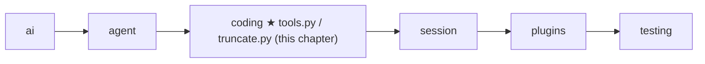

# 10 Part 3 · Coding tools

**Goal:** Build read, write, edit, ls, grep, find and bash.

**Builds on:** [05 Agent loop](05-agent-loop.md#tools-agenttool) (tool type, `run_tool`), [09 Execution environment](09-exec-env.md) (`ctx.env`) · **Previous:** [09](09-exec-env.md) · **Next:** [11 The system prompt](11-system-prompt.md)

## Where we are



**Builds:** blocks 1, 4, 7 of the [Part 3 map](09-0-part-3-coding.md#the-blocks) · **IN:** the model's tool arguments and a [tool context](glossary.md#tool-context) · **OUT:** one string for the model

Take the running example again. The user asks "What is in README.md?". In [09](09-exec-env.md) we built `LocalEnv`, which can open `README.md`. But the model cannot call `LocalEnv`. It can only call [agent tools](glossary.md#agent-tool) ([05](05-agent-loop.md#tools-agenttool)): a name, a description, an argument schema, and a function. So we still need a `read` tool that takes `{"path": "README.md"}`, asks the env for the text, and gives back a string.

A coding agent needs more than `read`. Take a bigger job: "the test for `area()` fails, fix it". The model would work like this:

1. `ls` — what files are here? It sees `shape.py` and `test_shape.py`.
2. `read shape.py` — it sees `return w * w`.
3. `bash pytest` — the end of the output shows the failure and `[exit code: 1]`.
4. `edit shape.py` — change `w * w` to `w * h`.
5. `bash pytest` — `[exit code: 0]`. Done.

This chapter builds the seven tools behind those steps. Each tool is a short `async` function `(args, ctx) -> str`, and it touches files and commands only through `ctx.env`.

Code in this chapter (commit `2fc2776`):

- `packages/simp_agent/src/simp_agent/coding/tools.py` — the seven tools and `make_tools`
- `packages/simp_agent/src/simp_agent/coding/truncate.py` — `truncate_head`, `truncate_tail`, `head`, `tail`
- `packages/simp_agent/tests/test_tools.py`, `test_bash.py`, `test_core.py` — the tests

## Problem

The tools must let a model look around (list folders, find files, search text), read a file, change a file, and run commands. That part is easy. The hard part is that the reader of every result is a **model**, not a person. A model has a limited [context](glossary.md#context). One `cat` of a log file, or one search over `node_modules`, can return megabytes. If we send all of it back, the next model call fails or costs a lot. So every tool must cut its output, and must **tell the model** that it cut and how to get the rest. A model also cannot look at the screen to check its work: if a tool says "ok" when nothing happened, the model believes it.

## Naive version

```text
// naive: no env, no limits, no checks
FUNCTION read(args, ctx):          // the execute(args, ctx) shape from 05
    RETURN the whole file at args.path            // opened directly, no ctx.env

FUNCTION write(args, ctx):
    WRITE args.content to args.path
    RETURN "ok"

FUNCTION edit(args, ctx):
    text = the whole file at args.path
    REPLACE every old_text in text with new_text  // 0 or many matches still "ok"
    WRITE text back
    RETURN "ok"

FUNCTION bash(args, ctx):
    RUN args.command in a shell, wait for it
    RETURN stdout + stderr                        // no exit code, no cut
```
Real code: [coding/tools.py](../../packages/simp_agent/src/simp_agent/coding/tools.py) — `read`, `write`, `edit`, `make_bash` (the fixed versions)

The naive version breaks in four ways. It opens files with `open` and `subprocess`, so it skips `ctx.env` and loses everything [09](09-exec-env.md#problem) fixed, and its paths are relative to the Python process, not to the session folder `ctx.cwd`. `read` returns the whole file, so a 5 MB file fills the context. `edit` replaces every match: if `old_text` is in the file three times, all three change, and if it is there zero times, the tool still says "ok". And `bash` returns all the output with no cut and hides the exit code, so a long test run fills the context and the model cannot tell pass from fail.

## Real design

We follow one call from start to end: the model calls `read` on `README.md`. Then we follow the other steps of the `shape.py` job (look around, change a file, run a command) and see what each one adds. Last, we see how the list of tools is built.

### One call: `read` on `README.md`

The model calls `read` with `{"path": "README.md"}`, and `run_tool` ([05](05-agent-loop.md)) calls the `read` tool with these args and the tool context `ctx`. `read` does four things:

1. It joins `README.md` to the working folder `ctx.cwd`. It does not check whether the path is allowed: that is the env's job ([09](09-exec-env.md)).
2. It asks the env for the text with `ctx.env.read_file(...)`, the same `LocalEnv` call as in 09.
3. It puts a line number and a tab before each line, so the model can say "line 42" and later read from there. By default it returns up to 2000 lines; the model can ask for another part with `offset` (the first line, counted from 1) and `limit`.
4. If the text is too long, it cuts the rest and adds a note with the exact next call, for example "[350 more lines; use offset=2001 to continue]".

The result goes back to `run_tool`, which wraps it in a tool result. If the env fails (no such file, path not allowed), `read` does not catch it: `run_tool` turns the error into an error result, as for every tool.

Real code: [coding/tools.py](../../packages/simp_agent/src/simp_agent/coding/tools.py) — `read`, `_path`

### When `README.md` is too big: truncation

Now say `README.md` has 9000 long lines. Sending all of it would fill the model's [context](glossary.md#context), so `read` [cuts](glossary.md#truncation) it with `truncate_head`, a small helper in `coding/truncate.py` that all tools share. It keeps lines from the top until one of two limits is hit: **2000 lines, or 50 KB**. Both are needed: 2000 short lines are small, but 10 lines of minified JavaScript can be 1 MB. It always stops before a line that would not fit, so the model never sees half a line. (If line 1 alone is over 50 KB, nothing is kept.)

Besides the cut text, `truncate_head` returns a small **info dict** that says how the cut went: `truncated` (was anything cut?), `kept_lines` (how many lines it kept), and `total_lines` / `total_bytes` (the size of the original). `read` needs `kept_lines` to know the last line it really sent, so it can tell the model where to continue.

That last line is the smallest of three stops: `read`'s own window (from `offset`, at most 2000 lines), the end of the file (9000), and the line where the 50 KB cut happened (1200). So it is `min(2000, 9000, 1200) = 1200`, and `read` adds "[7800 more lines; use offset=1201 to continue]". If this number were wrong, the model would skip lines or read some twice. (Both 2000s are the same constant, `MAX_LINES`.)

The same rule has a twin, `truncate_tail`, which keeps the **last** lines instead. `read`, `ls`, `grep` and `find` keep the top, because the start of a file or the first matches matter most. `bash` keeps the end (see below), because a command's result is at the end: `pytest` prints "3 failed, 10 passed" and the last error on its final lines.

Real code: [coding/truncate.py](../../packages/simp_agent/src/simp_agent/coding/truncate.py) — `truncate_head`, `truncate_tail`

### Looking around: `ls`, `grep`, `find`

Before it changes anything, the model often looks around: `ls` lists a folder, `grep` finds text inside files, `find` finds files by name (like `*.py`). They never change anything, and, like `read`, they join the path to `ctx.cwd`. They share four ideas:

1. **They run a command through the env.** `ls` runs `ls`, `grep` runs `rg` (or `grep`), and `find` runs `fd` (or `find`), all with `ctx.env.exec`. So the same tools work in a Docker env ([24](24-docker-sandbox.md)).
2. **Fast tool first, classic tool as backup.** `rg` and `fd` are fast and skip files in `.gitignore`, such as `node_modules`. If the machine does not have them, the tool runs `grep` or `find` instead.
3. **A cut always says so.** Each tool keeps a limited number of results (`ls` 500, `grep` 100, `find` 1000) and then cuts the text like `read`. When it cuts, it adds a note such as "[100 results limit reached; refine the pattern or raise limit]". With the note, the model knows the answer is incomplete and can search more narrowly. After a silent cut, it would think it saw everything. An empty result also says so ("No matches found"), so the model does not think the tool failed.
4. **A path may not start with `-`.** Otherwise the program would read it as an option: `rg --pre=CMD` runs any command on every file, and `find … -delete` deletes files. So `grep` and `find` refuse such a path and suggest `./…`.

Real code: [coding/tools.py](../../packages/simp_agent/src/simp_agent/coding/tools.py) — `ls`, `grep`, `find`

### Changing a file: `write` and `edit`

Step 4 changes `shape.py`. `write` makes a whole file; `edit` changes part of one.

The model calls `write` with a `path` and the full `content`. `write` asks the env to write it (the env makes parent folders) and returns `Wrote N chars to shape.py`. The result is short on purpose: the model already knows what it sent.

The model calls `edit` with a `path` and either one `old_text`/`new_text` pair or a list `edits` of such pairs (or both; the single pair goes first). `edit` is the most careful tool, because a wrong edit silently breaks code. It:

1. Stops with `Give old_text/new_text or edits` if there is nothing to do.
2. Reads the file once through the env.
3. For each edit, counts how often `old_text` is in the **original** text. It must be exactly once, else: `edits[i].old_text must match exactly once in shape.py, found n matches`. Zero means the model's memory of the file is wrong; two or more means the tool cannot know which one is meant. The count tells the model to add more text around the match or `read` again. Finding all places in the original text lets the model plan many edits from one `read`.
4. Sorts the places. If two overlap, it stops with `Edits overlap; merge them into one edit`.
5. Replaces them from the last to the first, so a change near the end does not move the places before it.
6. Writes the file once, after all checks, so a bad edit leaves the file untouched, and returns `Successfully replaced K block(s) in shape.py.`

Here is `shape.py`, with a second thing to change:

```python
def area(w, h):
    return w * w

def name():
    return "box"
```

The model calls `edit` with `old_text="return"`. `return` is in the file twice, so the model gets an error result and the file is not touched:

```text
ValueError: edits[0].old_text must match exactly once in shape.py, found 2 matches
```

It tries again with two edits, each long enough to be unique, and gets `Successfully replaced 2 block(s) in shape.py.`:

```json
{"path": "shape.py", "edits": [
  {"old_text": "return w * w", "new_text": "return w * h"},
  {"old_text": "\"box\"",      "new_text": "\"square\""}]}
```

Real code: [coding/tools.py](../../packages/simp_agent/src/simp_agent/coding/tools.py) — `write`, `edit`

### Running a command: `bash`

In the `shape.py` job, steps 3 and 5 run `pytest`. The model calls `bash` with `{"command": "pytest"}` and maybe a `timeout`. `bash` itself is thin: the hard work (streaming the output, Stop, the timeout, killing the process group) is `ctx.env.exec` from [09](09-exec-env.md). `bash` adds three things:

1. **A time limit the model cannot raise.** The host (the program that runs the agent; today only the CLI, [19](19-cli.md)) may set a cap, for example 600 seconds. Then no timeout becomes 600, `timeout=30` stays 30, and `timeout=1000` becomes 600. The cap is stored inside the `bash` function when the host builds it (with `make_bash`), and the model only sends args, so it cannot get around it. With no cap and no timeout there is no limit, and the user can still press Stop ([06](06-events-abort.md)).
2. **A line that says how the command ended**, so the model can react: `[exit code: 1]` (it finished; here the tests failed), `[Command interrupted by the user after 1m05s]` (the user pressed Stop), or `[Command timed out after 600 seconds]`.
3. **It keeps the end of long output** with `truncate_tail` ([truncation above](#when-readmemd-is-too-big-truncation)), because `pytest` prints its summary and the last error at the end.

So in every case the model gets the output so far, plus how the command ended.

Real code: [coding/tools.py](../../packages/simp_agent/src/simp_agent/coding/tools.py) — `make_bash`

### How the list is built: `make_tools`

We followed calls to seven functions. But how does the model know a tool called `read` exists? It knows only what the loop sends it: a list of [agent tools](glossary.md#agent-tool). The host calls `make_tools(bash_max_timeout_s)`, which:

1. Wraps each function in an `AgentTool` with a name, a description and a [JSON Schema](glossary.md#json-schema) of its arguments. The schema is built by `_obj`, which sets `additionalProperties: False` to tell the model not to invent extra fields.
2. Uses `make_bash(bash_max_timeout_s)` for `bash`, so the cap goes in here.
3. Returns the list in the order `read, write, edit, bash, grep, find, ls`.

The model never sees the code, only these strings, so they are part of the tool's behaviour: "must match exactly once", "Dirs end with '/'". `make_tools` USES the tool functions: the function is HOW a call runs, the `AgentTool` is WHAT the model sees.

The host passes the list as `LoopConfig(model, tools=make_tools(), ...)` ([05](05-agent-loop.md#agent_loop-the-loop)). `_llm_turn` sends it to the model each turn, and `run_tool` finds a tool in it by name, which is where our `read` call started. `TOOLS = make_tools()` is the default list with no bash cap. The same names and descriptions also go into the system prompt ([11](11-system-prompt.md)).

Real code: [coding/tools.py](../../packages/simp_agent/src/simp_agent/coding/tools.py) — `make_tools`, `_obj`, `TOOLS`

**Builds on:** [05 Agent loop](05-agent-loop.md#tools-agenttool) (tool type, `run_tool`), [09 Execution environment](09-exec-env.md) (`ctx.env`) · **Previous:** [09](09-exec-env.md) · **Next:** [11 The system prompt](11-system-prompt.md)
