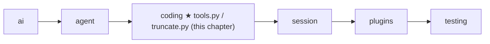
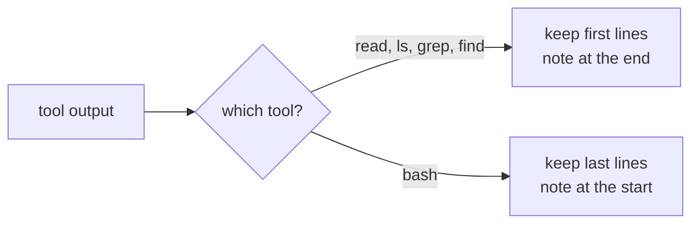
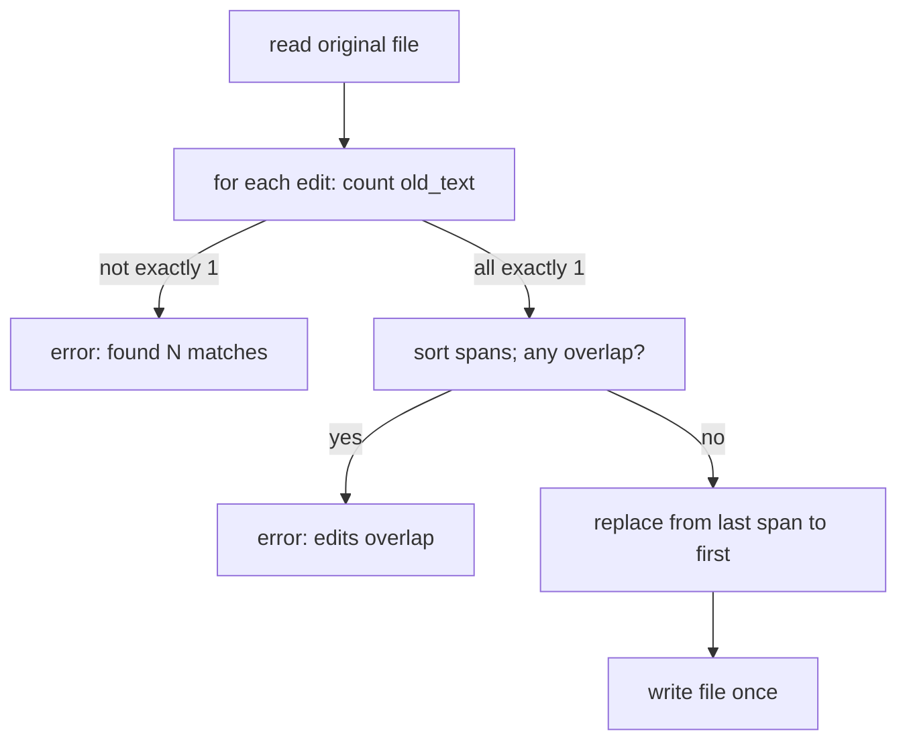

# 10 Part 3 · Coding tools

**Goal:** Build read, write, edit, ls, grep, find and bash.

**Builds on:** [09 Execution environment](09-exec-env.md) · **Next:** [11 The system prompt](11-system-prompt.md)

## Where we are



In [05](05-agent-loop.md#tools-agenttool) we built the [agent tool](glossary.md#agent-tool) type and `run_tool`. In [09](09-exec-env.md) we built the [execution environment](glossary.md#execution-environment), the one object that touches files and runs commands. Now we join the two: seven real tools that a coding agent needs. Each tool is a short `async` function that takes `(args, ctx)` and returns a string. Each one does its IO through `ctx.env` and nothing else.

Code in this chapter (commit `2fc2776`):

- `packages/simp_agent/src/simp_agent/coding/tools.py` — the seven tools and `make_tools`
- `packages/simp_agent/src/simp_agent/coding/truncate.py` — `truncate_head`, `truncate_tail`, `head`, `tail`
- `packages/simp_agent/tests/test_tools.py`, `packages/simp_agent/tests/test_bash.py` — the tests

## Problem

The loop from [05](05-agent-loop.md) can call tools, but it has none. To fix a bug, a model must be able to:

1. **look around** — list folders, find files by name, search text in files;
2. **read** a file;
3. **change** a file — write a new one, or edit part of an old one;
4. **run** things — tests, builds, `git`.

Each tool also has a hidden enemy: **size**. A model has a limited [context](glossary.md#context). One `cat` of a log file or one `grep` over `node_modules` can return megabytes. If we send all of it back, the next model call fails or costs a lot. So every tool must cut its output, and must **tell the model** that it cut, and how to get the rest.

## Naive version

```python
import subprocess

async def read(args, ctx):
    return open(args["path"]).read()

async def write(args, ctx):
    open(args["path"], "w").write(args["content"])
    return "ok"

async def edit(args, ctx):
    text = open(args["path"]).read()
    text = text.replace(args["old_text"], args["new_text"])
    open(args["path"], "w").write(text)
    return "ok"

async def bash(args, ctx):
    p = subprocess.run(args["command"], shell=True, capture_output=True, text=True)
    return p.stdout + p.stderr
```

Where it breaks:

- **It skips `ctx.env`.** It uses `open` and `subprocess` directly, so all the work of [09](09-exec-env.md) is lost: no fence, no Docker swap, a frozen event loop, no Stop.
- **Paths are relative to the Python process,** not to the session's working folder `ctx.cwd`.
- **`read` returns the whole file.** A 5 MB file fills the context.
- **`edit` replaces every match.** If `old_text` is `x = 1` and the file has it three times, all three change. If it has it zero times, the tool says "ok" and nothing happens. The model thinks it worked.
- **`bash` keeps the start of the output.** For a test run, the important part (the failures, the summary) is at the **end**.
- **`bash` hides the exit code,** so the model cannot tell pass from fail.

## Step by step: from naive to real

We fix the naive tools one problem at a time. Each step is small.

**Step 1 — all IO goes through `ctx.env`.** `open` and `subprocess` skip the fence, Docker and Stop from [09](09-exec-env.md). So every tool asks the env instead:

```python
lines = (await ctx.env.read_file(_path(ctx, args["path"]))).splitlines()
```

**Step 2 — paths start at `ctx.cwd`.** The Python process folder is not the session folder. `_path` joins the two; an absolute path stays as is:

```python
return os.path.join(ctx.cwd, path)  # absolute paths stay as is
```

**Step 3 — `read` cuts the file and says how to go on.** A 5 MB file must not fill the context. We cut with `truncate_head` and tell the model the next call:

```python
out += f"\n[{len(lines) - end} more lines; use offset={end + 1} to continue]"
```

**Step 4 — `edit` needs exactly one match.** Zero matches or many matches are errors, not a silent "ok". The model reads the count and fixes its call:

```python
if n != 1:
    raise ValueError(f"edits[{i}].old_text must match exactly once in {args['path']}, found {n} matches")
```

**Step 5 — `bash` keeps the end and shows the exit code.** Test failures and summaries are at the end, and the model must know pass from fail:

```python
return tail(f"{out}\n[exit code: {code}]")
```

The result is the real code below.

## Real design

### The shape of every tool

All tools live in `coding/tools.py`. Two tiny helpers set the pattern:

Real code: [coding/tools.py](../../packages/simp_agent/src/simp_agent/coding/tools.py) — `_obj`, `_path`

```text
FUNCTION _obj(props, required):
    RETURN schema {type "object", these props, these required, no extra fields}

FUNCTION _path(ctx, path):
    RETURN ctx.cwd joined with path     // an absolute path stays as is
```

Key idea: one schema shape and one path rule for all tools.

- `_obj` builds the JSON schema for a tool's arguments. `additionalProperties: False` tells the model not to invent extra fields.
- `_path` makes a path relative to `ctx.cwd`. If the model gives an absolute path, `os.path.join` keeps it as is. The fence is **not** here: it is in the env ([path safety](glossary.md#path-safety), [09](09-exec-env.md#path-safety)). A tool only joins; the env decides if the path is allowed.

Errors are plain exceptions. A tool raises `ValueError`, `OSError` or `RuntimeError` with a clear message, and `run_tool` ([05](05-agent-loop.md#tools-agenttool)) turns it into an error tool result. So the tools never build error objects by hand.

### Truncation: `truncate_head` and `truncate_tail`

All tools share one cutting rule, in `coding/truncate.py`:

Real code: [coding/truncate.py](../../packages/simp_agent/src/simp_agent/coding/truncate.py) — `_cut`

```text
MAX_LINES = 2000
MAX_BYTES = 50 KB

FUNCTION _cut(lines, max_lines, max_bytes):
    kept = [], size = 0
    FOR EACH line in the first max_lines lines:
        ADD line bytes (+1 for the newline, if not the first) to size
        IF size > max_bytes:
            STOP                        // never keep half a line
        ADD line to kept
    RETURN kept
```

Key idea: keep whole lines under two limits. Limit: one very long first line means zero lines kept.

[Truncation](glossary.md#truncation) keeps **whole lines** under **two** limits: at most 2000 lines and at most 50 KB. Two limits, because one is not enough: 2000 short lines are fine, but 10 lines of minified JavaScript can be 1 MB. The `+ 1` counts the newline between lines. A half line is never kept, so the model never sees a broken line.

There are two directions:

Real code: [coding/truncate.py](../../packages/simp_agent/src/simp_agent/coding/truncate.py) — `truncate_head`, `truncate_tail`

```text
FUNCTION truncate_head(text):            // read, ls, grep, find
    kept = _cut(lines of text)
    RETURN kept joined, _info(text, kept)

FUNCTION truncate_tail(text):            // bash: the end matters most
    kept = _cut(lines of text in REVERSE order), then REVERSE back
    RETURN kept joined, _info(text, kept)
```

Key idea: tail is just head on reversed lines.

`truncate_tail` just reverses the lines, cuts, and reverses back. Both return the text and an info dict: `truncated`, `total_lines`, `total_bytes`, `kept_lines`.

The tools do not call these two directly (except `read`). They call two small wrappers that also add a **note for the model**:

Real code: [coding/truncate.py](../../packages/simp_agent/src/simp_agent/coding/truncate.py) — `head`, `tail`

```text
FUNCTION head(text):
    out, info = truncate_head(text)
    IF cut AND zero lines kept:
        RETURN "[First line exceeds 50KB limit; use bash with head -c ...]"
    IF cut:
        ADD at the END "[Output truncated: showing first K of N lines]"
    RETURN out

FUNCTION tail(text):
    out, info = truncate_tail(text)
    IF cut:
        ADD at the START "[Output truncated: showing last K of N lines]"
    RETURN out
```

Key idea: every cut comes with a note for the model.

The note is the important part. A model that sees "showing first 2000 of 9000 lines" knows the answer is not complete and can ask again in a narrower way. A model that sees a silent cut thinks it saw everything. Note also the odd case in `head`: if the very first line is over 50 KB, zero lines fit, so `head` says so and suggests `head -c`.



### `read`

Real code: [coding/tools.py](../../packages/simp_agent/src/simp_agent/coding/tools.py) — `read`

```text
FUNCTION read(args, ctx):
    lines = WAIT for ctx.env.read_file(_path(ctx, path)), split into lines
    start = max(offset, 1) - 1          // offset is 1-based, default 1
    end = start + limit                  // limit default 2000
    out, info = truncate_head(lines[start:end], each as "number<TAB>line")
    end = smallest of: end, number of lines, start + kept lines
    IF end < number of lines:
        ADD "[N more lines; use offset=M to continue]"   // the exact next call
    RETURN out
```

Step by step:

1. Read the whole file through the env, split into lines.
2. `offset` is 1-based (line 1 is the first line), because the model sees 1-based numbers. Values below 1 become 1.
3. Take at most `limit` lines (default 2000), and put the line number and a tab before each one. The numbers let the model say "line 42" and then come back with `offset=42`.
4. Cut with `truncate_head`, so the 50 KB limit also holds.
5. Work out where we **really** stopped: the end of the slice, the end of the file, or where the byte limit cut — we stop at the first of these three.
6. If lines are left, add a **continue hint**: `[N more lines; use offset=M to continue]`. This is not a generic "truncated" note; it tells the model the exact next call.

### `write`

Real code: [coding/tools.py](../../packages/simp_agent/src/simp_agent/coding/tools.py) — `write`

```text
FUNCTION write(args, ctx):
    WAIT for ctx.env.write_file(_path(ctx, path), content)   // env makes parent folders
    RETURN "Wrote N chars to path"       // short: do not echo the content back
```

One line of work. The env already makes parent folders ([09](09-exec-env.md#localenv-this-machine)), so the tool description can promise "Makes parent dirs." The result is short on purpose: the model already knows the content it sent; echoing it back would only waste context.

### `edit`

`edit` changes part of a file. It is the most careful tool, because a wrong edit silently breaks code.

Real code: [coding/tools.py](../../packages/simp_agent/src/simp_agent/coding/tools.py) — `edit`

```text
FUNCTION edit(args, ctx):
    edits = args.edits or []
    IF args has old_text:
        PUT {old_text, new_text} FIRST in edits
    IF edits is empty: ERROR "Give old_text/new_text or edits"
    p = _path(ctx, path)
    text = WAIT for ctx.env.read_file(p)
    spans = []
    FOR EACH edit i:
        n = how many times old_text is in text (0 if old_text is empty)
        IF n != 1:
            ERROR "edits[i].old_text must match exactly once ..., found n matches"
        ADD (start, end, new_text) to spans     // positions in the ORIGINAL text
    SORT spans by start
    FOR EACH pair of neighbour spans:
        IF next starts before previous ends: ERROR "Edits overlap; merge them into one edit"
    FOR EACH span from LAST to FIRST:    // back to front, so earlier positions stay true
        REPLACE text[start:end] with new
    WAIT for ctx.env.write_file(p, text)   // one write, only after all checks
    RETURN "Successfully replaced K block(s) in path."
```

The rules, and why:

- **Two ways to call it.** One change: `old_text` + `new_text`. Many changes in one file: an `edits` list. Both can be given; the single one goes first. Many small edits in one call save turns.
- **Each `old_text` must match exactly once.** Zero matches means the model's memory of the file is wrong (maybe it changed). Two or more means the tool cannot know which one is meant. Both are errors with the count in the message, so the model can fix its call: add more lines of context to make the match unique, or `read` the file again. An empty `old_text` counts as zero matches.
- **All edits match the original text.** We find every span first, in the file **before** any change. So edit 2 does not depend on what edit 1 did. The model can plan all edits from one `read`.
- **Overlaps are an error.** After sorting the spans by start, if one starts before the previous one ends, two edits touch the same text. There is no safe answer, so the tool asks the model to merge them.
- **Apply from the back.** We replace spans from the last to the first. A change near the end does not move the positions of spans before it, so the saved positions stay true.
- **All or nothing.** Every check runs before the one `write_file`. If any edit is bad, the file is not touched.



### `ls`

Real code: [coding/tools.py](../../packages/simp_agent/src/simp_agent/coding/tools.py) — `list_dir`, `ls`

```text
FUNCTION list_dir(ctx, path):
    IF ctx.env has list_dir:
        RETURN WAIT for ctx.env.list_dir(path)
    code, out = WAIT for ctx.env.exec("ls -1Ap <quoted path>", ctx.cwd, ...)
    IF code != 0: ERROR (OSError) with the output
    RETURN non-empty lines of out        // folders end with "/"

FUNCTION ls(args, ctx):
    names = list_dir(ctx, _path(ctx, path or ".")), sorted ignoring case
    limit = args.limit or 500
    out = first `limit` names joined, or "(empty directory)"
    IF more names than limit:
        ADD "[limit of N entries shown; raise limit for more]"
    RETURN head(out)
```

`list_dir` uses an env method called `list_dir` if the env has one. `LocalEnv` from [09](09-exec-env.md) does not (its method is named `list`), so in practice it runs `ls -1Ap` through `ctx.env.exec`: one name per line (`-1`), dotfiles but not `.` and `..` (`-A`), a `/` after folders (`-p`). Running through `exec` means the same code works in a Docker env ([24](24-docker-sandbox.md)). The path goes through `shlex.quote`, so a name with spaces or `;` cannot break the command.

`ls` sorts case-insensitively, keeps `limit` entries (default 500), says how many were hidden, and finally passes through `head` for the byte limit. An empty folder says `(empty directory)` instead of an empty string, so the model does not wonder if the tool failed.

### `grep` and `find`

Both search tools follow the same plan: build an argv, try a fast modern program, fall back to the classic one.

Real code: [coding/tools.py](../../packages/simp_agent/src/simp_agent/coding/tools.py) — `_run`

```text
FUNCTION _run(ctx, primary, fallback):
    code, out = WAIT for ctx.env.exec(quoted primary, ...)
    IF code == 127:                      // 127 = "command not found"
        code, out = WAIT for ctx.env.exec(quoted fallback, ...)
    RETURN code, out
```

Exit code 127 is what a shell returns for "command not found". So: `rg` (ripgrep) if installed, else `grep`; `fd` if installed, else `find`. The fast tools respect `.gitignore`, so they skip `node_modules` and build folders. The fallbacks work everywhere, but do not skip those folders. `shlex.join` quotes every argument, so a pattern like `it's "x"` reaches the program as one safe argument.

The output goes through one shared helper:

Real code: [coding/tools.py](../../packages/simp_agent/src/simp_agent/coding/tools.py) — `_limited`

```text
FUNCTION _limited(code, out, limit, empty):
    IF code is not 0 and not 1:          // 1 = "no matches", not an error
        ERROR (RuntimeError) with the output
    lines = non-empty lines of out
    text = first `limit` lines joined, or `empty`
    IF more lines than limit:
        ADD "[limit results limit reached; refine the pattern or raise limit]"
    RETURN head(text)
```

For `grep` and `rg`, exit code 1 means "no matches", not "error". So 0 and 1 are both fine, and anything else (a bad regex, a missing folder) is raised. No results gives a clear text (`No matches found` / `No files found`). Too many results gives a note that asks the model to narrow the search.

One more guard, for both tools:

Real code: [coding/tools.py](../../packages/simp_agent/src/simp_agent/coding/tools.py) — `_search_path`

```text
FUNCTION _search_path(args):
    path = args.path or "."
    IF path starts with "-":             // rg --pre=, find -delete would read it as an option
        ERROR "path must not start with '-': path (use ./path)"
    RETURN path
```

Quoting stops the shell from reading the path as code, but the **program** can still read it as an option. A path of `--pre=evil` makes `rg` run a program; `-delete` makes `find` delete files. So a path may not start with `-`.

`grep` maps its arguments to flags for both programs.
The mapping is: `ignore_case` → `-i`, `literal` → `-F` (else plain `grep` gets `-E` for extended regex, like `rg`), `context` → `-C<n>`, `glob` → `--glob` or `--include=`. The pattern goes after `-e` and the path after `--`, so neither can be read as a flag. Default limit: 100 lines.

`find` runs `fd --glob --color=never --hidden -- <pattern> <path>`, or `find <path> -name <pattern>`. Default limit: 1000 files.

### `bash`

Real code: [coding/tools.py](../../packages/simp_agent/src/simp_agent/coding/tools.py) — `make_bash`

```text
FUNCTION make_bash(max_timeout_s):       // no default timeout
    FUNCTION bash(args, ctx):
        timeout = args.timeout
        IF timeout is given AND not (finite and > 0):
            ERROR "timeout must be a positive number of seconds"
        IF max_timeout_s is set:
            timeout = min(timeout or max_timeout_s, max_timeout_s)   // host cap wins
        start = monotonic clock now
        code, out = WAIT for ctx.env.exec(command, ctx.cwd, timeout, ctx.cancel, ctx.on_update)
        IF code is not None:
            RETURN tail(out + "[exit code: code]")
        IF ctx.cancel is set:
            RETURN tail(out + "[Command interrupted by the user after <elapsed>]")
        RETURN tail(out + "[Command timed out after <timeout> seconds]")
    RETURN bash
```

Key idea: exec does the hard work; bash only adds the ending note. Limit: no timeout unless the model or host sets one.

`start` uses a [monotonic clock](glossary.md#monotonic-clock) (a clock that only goes forward), so the time shown is right even if the system time changes.

`bash` is a **factory**: `make_bash` returns the tool function, and the function remembers one setting, `max_timeout_s`.

- **Timeout.** By default there is none: a long build is fine, and the user can press Stop ([06](06-events-abort.md)). The model may pass its own `timeout`; it must be a finite number above 0. The **host** (the program that runs the agent) may set `max_timeout_s`, a hard cap. Then a missing or bigger timeout becomes the cap. The model cannot raise it. At this commit the CLI reads it from the `bash_max_timeout_s` setting ([19](19-cli.md)); `None` means no cap.
- **All the hard work is in `exec`.** Streaming, cancel, timeout and the [process-group kill](glossary.md#process-group-kill) were built in [09](09-exec-env.md#exec-run-stream-stop). `bash` just passes `ctx.cancel` and `ctx.on_update` through, so the user sees output live while it runs.
- **Three endings, each with a note.** `exec` returns a code when the command finished, so we add `[exit code: N]` — the model needs it to know pass from fail. It returns `None` when killed; then `ctx.cancel` tells us if the user stopped it (`interrupted by the user after 1s`) or the timeout did (`timed out after 0.5 seconds`). In every case the output **so far** is kept.
- **`tail`, not `head`.** For tests and builds, the end of the output holds the result. The note goes at the **start**, where the cut happened.

### `make_tools`: names, descriptions, schemas

```python
def make_tools(bash_max_timeout_s: float | None = None) -> list:
    return [
        AgentTool("read", "Read a text file. Output has line numbers. Use offset/limit for big files.",
                  _obj({"path": _p("string", "File path, relative to cwd or absolute"),
                        "offset": _p("integer", "First line to read, 1-based (default 1)"),
                        "limit": _p("integer", f"Max lines to read (default {MAX_LINES})")}, ["path"]), read),
        ...
    ]


TOOLS = make_tools()
```

`make_tools` wraps each function in an `AgentTool` with a name, a one-line description and a schema. The order is `read, write, edit, bash, grep, find, ls`. **Every** argument has a description. The model only sees these strings, never the code, so they are part of the tool's behaviour: "must match exactly once", "no timeout by default", "Dirs end with '/'". `TOOLS` is the default list with no bash cap. The host passes `bash_max_timeout_s` when it wants one. The same descriptions also go into the system prompt in [11](11-system-prompt.md).

## Test

The tests call tools the way the loop does: through `run_tool` with a real `ToolContext`.

```python
async def call(tmp_path, name, env=None, **args):
    async def upd(text):
        pass

    c = ToolContext(asyncio.Event(), env or LocalEnv(), str(tmp_path), upd)
    return await run_tool(make_tools(), ToolCall("c", name, args), c)
```

**Truncation and the read hint** (`test_tools.py`):

```python
async def test_read_offset_hint(tmp_path):
    (tmp_path / "f").write_text("\n".join("x" * 100 for _ in range(1000)))
    r = await call(tmp_path, "read", path="f")
    assert "use offset=" in r.content and "to continue" in r.content and len(r.content.encode()) < 60_000
```

1000 lines of 100 bytes is about 100 KB: under the line limit, over the byte limit. The test checks that the byte limit wins and that the model gets the continue hint.

**Search fallback without installing anything.** To test "if `rg` is missing, use `grep`", we need a machine with no `rg`. `FakeEnv` (in `simp_agent.testing`) is a `LocalEnv` that records every command in `cmds`, returns exit 127 for programs listed in `missing`, and returns fixed output for programs in `canned`:

```python
async def test_grep_fallback(tmp_path):
    (tmp_path / "a.txt").write_text("hello world\nnope\nit's \"q\"\n")
    env = FakeEnv(missing=("rg",))
    r = await call(tmp_path, "grep", env=env, pattern="hello w")
    assert env.cmds[1].startswith("grep -rn") and r.content.endswith("a.txt:1:hello world")
    ...
    assert (await call(tmp_path, "grep", env=env, pattern="zzz")).content == "No matches found"
```

The first command (`rg`) "fails" with 127, the second one is real `grep`. The same trick tests `find` with `fd` missing, and `test_grep_rg_argv_quoting` uses `canned` to check that `it's "x"` is quoted correctly.

**Abort kills the whole tree and keeps output** (`test_bash.py`):

```python
async def test_abort_kills_tree_and_keeps_output(tmp_path):
    cancel = asyncio.Event()
    pidfile = tmp_path / "pid"
    # child shell + grandchild sleep; the grandchild writes its pid
    cmd = f"echo line1; echo line2; sh -c 'sleep 60 & echo $! > {pidfile}; wait'"
    task = asyncio.ensure_future(call(tmp_path, cancel, command=cmd))
    while not pidfile.exists() or not pidfile.read_text().strip():
        await asyncio.sleep(0.05)
    await asyncio.sleep(1.1)
    cancel.set()
    r = await asyncio.wait_for(task, 5)
    assert "line1" in r.content and "line2" in r.content
    assert "interrupted by the user after 1s" in r.content
    await asyncio.sleep(0.1)
    assert not alive(int(pidfile.read_text()))
```

(This file has its own `call` helper that always calls `bash`.) It checks all three promises at once: the early output is kept, the note says who stopped it and when, and the grandchild `sleep` is dead. Other tests in the file check that bad timeouts (`0`, `-1`, `inf`) are errors and that `max_timeout_s` clamps a model's `timeout=120000` down to 0.5 seconds.

No [FakeProvider](02-fake-provider.md) here: tools do not call models. The `edit` match rules (zero, one, many matches) are tested in `test_core.py` (`test_edit_matches`), next to the loop tests of [05](05-agent-loop.md).

```bash
uv run pytest packages/simp_agent/tests/test_tools.py packages/simp_agent/tests/test_bash.py
```

## Why this way

> **Small functions over one env.** Each tool is a plain `async` function that does IO only through `ctx.env`. Swap the env and every tool moves to Docker with no change.
>
> **Output is for a model, so every cut is announced.** Truncation keeps whole lines under a line and a byte limit, and always says what was cut and how to get more (`offset=`, "refine the pattern", `head -c`). Head for files and searches, tail for commands.
>
> **Edit is strict on purpose.** Exactly one match, all against the original, no overlaps, all or nothing. A loud error the model can fix is better than a quiet wrong edit.
>
> **Use the fast tool if it is there, never require it.** `rg` and `fd` when installed, `grep` and `find` when not, picked by exit code 127.

## Exercises

1. Call `edit` with an `old_text` that appears twice in the file. Read the error. Why does the tool refuse instead of changing the first match?
2. Use `FakeEnv(missing=("fd",))` and run `find`. Check which command was run instead (the fallback).
3. Run `bash` with `timeout=0.2` on `sleep 5`. Read the last line of the result.

## Recap

- Seven tools in `coding/tools.py`: `read`, `write`, `edit`, `bash`, `grep`, `find`, `ls`. Each is `async (args, ctx) -> str`, does IO only through `ctx.env`, and raises plain exceptions that `run_tool` turns into error results.
- `_path` joins paths to `ctx.cwd`; the fence is in the env, not the tool.
- [Truncation](glossary.md#truncation) (`coding/truncate.py`) keeps whole lines under 2000 lines and 50 KB. `head` keeps the start (read, ls, grep, find); `tail` keeps the end (bash). Both add a note.
- `read` adds line numbers and an `offset=` hint. `write` relies on the env to make folders.
- `edit` needs each `old_text` to match the original exactly once, rejects overlaps, applies from the back, and writes once.
- `grep` / `find` try `rg` / `fd`, fall back to `grep` / `find` on exit 127, quote with `shlex`, and refuse paths starting with `-`.
- `bash` has no default timeout, an optional host cap (`make_bash(max_timeout_s)`), keeps the tail, and always says how it ended.
- `make_tools(bash_max_timeout_s)` builds the `AgentTool` list; `TOOLS` is the default.

**Builds on:** [09 Execution environment](09-exec-env.md) · **Next:** [11 The system prompt](11-system-prompt.md) — tell the model about these tools and the project.
