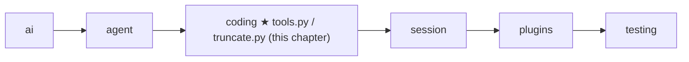
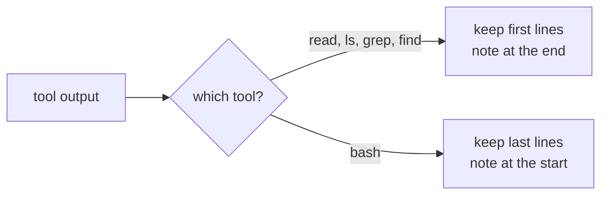
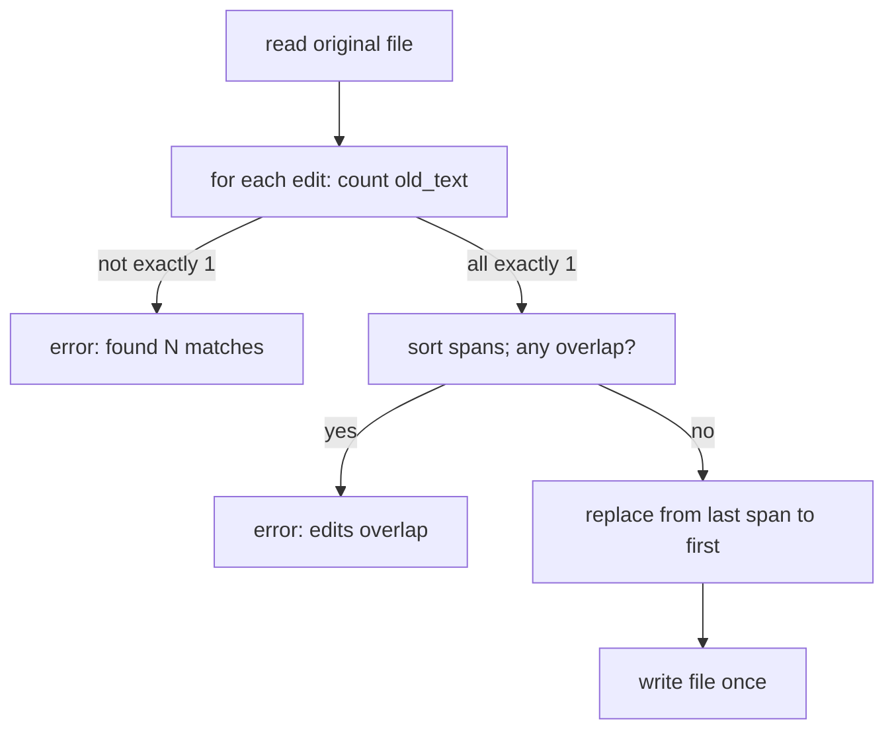

# 10 Part 3 · Coding tools

**Goal:** Build read, write, edit, ls, grep, find and bash.

**Builds on:** [05 Agent loop](05-agent-loop.md#tools-agenttool) (tool type, `run_tool`), [09 Execution environment](09-exec-env.md) (`ctx.env`) · **Previous:** [09](09-exec-env.md) · **Next:** [11 The system prompt](11-system-prompt.md)

## Where we are



**Builds:** blocks 1, 4, 7 of the [Part 3 map](09-0-part-3-coding.md#the-blocks) · **IN:** the model's tool arguments and a [tool context](glossary.md#tool-context) · **OUT:** one string for the model

Take the running example again. The user asks "What is in README.md?". In [09](09-exec-env.md) we built `LocalEnv`, which can open `README.md`. But the model cannot call `LocalEnv`. It can only call [agent tools](glossary.md#agent-tool) ([05](05-agent-loop.md#tools-agenttool)): a name, a description, and a function. So we still need a `read` tool that takes `{"path": "README.md"}`, asks the env for the text, and gives back a string.

A coding agent needs more than `read`. Take a bigger job: "the test for `area()` fails, fix it". The model would work like this:

1. `ls` — what files are here? It sees `shape.py` and `test_shape.py`.
2. `read shape.py` — it sees `return w * w`.
3. `bash pytest` — the end of the output shows the failure and `[exit code: 1]`.
4. `edit shape.py` — change `w * w` to `w * h`.
5. `bash pytest` — `[exit code: 0]`. Done.

This chapter builds the seven tools behind those steps. Each tool is a short `async` function `(args, ctx) -> str`, and it touches files and commands only through `ctx.env`. We come back to `shape.py` in [`edit`](#edit).

Code in this chapter (commit `2fc2776`):

- `packages/simp_agent/src/simp_agent/coding/tools.py` — the seven tools and `make_tools`
- `packages/simp_agent/src/simp_agent/coding/truncate.py` — `truncate_head`, `truncate_tail`, `head`, `tail`
- `packages/simp_agent/tests/test_tools.py`, `test_bash.py`, `test_core.py` — the tests

## Problem

The tools must let a model look around (list folders, find files, search text), read a file, change a file, and run commands. That part is easy. The hard part is that the reader of every result is a **model**, not a person. A model has a limited [context](glossary.md#context). One `cat` of a log file, or one search over `node_modules`, can return megabytes. If we send all of it back, the next model call fails or costs a lot. So every tool must cut its output, and must **tell the model** that it cut and how to get the rest. A model also cannot look at the screen to check its work: if a tool says "ok" when nothing happened, the model believes it.

## Naive version

```text
// naive: no env, no limits, no checks
FUNCTION read(args):
    RETURN the whole file at args.path            // opened directly, no ctx.env

FUNCTION write(args):
    WRITE args.content to args.path
    RETURN "ok"

FUNCTION edit(args):
    text = the whole file at args.path
    REPLACE every old_text in text with new_text  // 0 or many matches still "ok"
    WRITE text back
    RETURN "ok"

FUNCTION bash(args):
    RUN args.command in a shell, wait for it
    RETURN stdout + stderr                        // no exit code, no cut
```
Real code: [coding/tools.py](../../packages/simp_agent/src/simp_agent/coding/tools.py) — `read`, `write`, `edit`, `make_bash` (the fixed versions)

Where it breaks:

- **It skips `ctx.env`.** It uses `open` and `subprocess` directly, so everything [09](09-exec-env.md#problem) fixed is lost again.
- **Paths are relative to the Python process,** not to the session's working folder `ctx.cwd`.
- **`read` returns the whole file.** A 5 MB file fills the context.
- **`edit` replaces every match.** If `old_text` is `x = 1` and the file has it three times, all three change. If it has it zero times, the tool says "ok" and nothing happens.
- **`bash` keeps the start of the output.** For a test run, the important part (the failures, the summary) is at the **end**.
- **`bash` hides the exit code,** so the model cannot tell pass from fail.

| Problem | Fixed in |
|---|---|
| Skips `ctx.env`; wrong base folder | [The shape of every tool](#the-shape-of-every-tool) |
| `read` returns the whole file | [Truncation](#truncation-truncate_head-and-truncate_tail), [`read`](#read) |
| `edit` replaces every match | [`edit`](#edit) |
| `bash` keeps the start, hides the exit code | [`bash`](#group-3--run-bash) |

## Real design

### The shape of every tool

Every tool gets two things from the loop: `args`, the JSON object the model sent, and `ctx`, the [tool context](glossary.md#tool-context) from [05](05-agent-loop.md#toolcontext-what-a-tool-gets). Two tiny helpers in `coding/tools.py` are shared by all tools:

Real code: [coding/tools.py](../../packages/simp_agent/src/simp_agent/coding/tools.py) — `_obj`, `_path`

```text
FUNCTION _obj(props, required):
    RETURN schema {type "object", these props, these required, no extra fields}

FUNCTION _path(ctx, path):
    RETURN ctx.cwd joined with path     // an absolute path stays as is
```

`_obj` builds the [JSON Schema](glossary.md#json-schema) of a tool's arguments: which fields exist, which are required. It sets `additionalProperties: False`, which tells the model not to invent extra fields. `_path` joins the model's path to `ctx.cwd`; if the model gives an absolute path, `os.path.join` keeps it as is. Note what `_path` does **not** do: it does not check if the path is allowed. That is the env's job ([path safety](09-exec-env.md#path-safety)). A tool only joins; the env decides.

Errors are plain exceptions. A tool raises `ValueError`, `OSError` or `RuntimeError` with a clear message, and `run_tool` ([05](05-agent-loop.md#run_tool-one-call-never-raises)) turns it into an error tool result. So no tool builds error objects by hand.

### Truncation: `truncate_head` and `truncate_tail`

Before the tools, the one cutting rule they all share, in `coding/truncate.py`:

Real code: [coding/truncate.py](../../packages/simp_agent/src/simp_agent/coding/truncate.py) — `_cut`

```text
MAX_LINES = 2000
MAX_BYTES = 50 KB

FUNCTION _cut(lines, max_lines, max_bytes):
    kept = [], size = 0
    FOR EACH line in the first max_lines lines:
        ADD line bytes (+1 for the newline, if not the first) to size
        IF size > max_bytes:
            STOP                        // never keep half a line
        ADD line to kept
    RETURN kept
```

[Truncation](glossary.md#truncation) keeps **whole lines** under **two** limits: at most 2000 lines and at most 50 KB. One limit is not enough: 2000 short lines are fine, but 10 lines of minified JavaScript can be 1 MB. A half line is never kept, so the model never sees a broken line. The price: if the very first line is over 50 KB, zero lines are kept (`head` below handles this).

There are two directions:

Real code: [coding/truncate.py](../../packages/simp_agent/src/simp_agent/coding/truncate.py) — `truncate_head`, `truncate_tail`

```text
FUNCTION truncate_head(text):            // keep the start
    kept = _cut(lines of text)
    RETURN kept joined, _info(text, kept)

FUNCTION truncate_tail(text):            // keep the end
    kept = _cut(lines of text in REVERSE order), then REVERSE back
    RETURN kept joined, _info(text, kept)
```

`truncate_tail` just reverses the lines, cuts, and reverses back. Both return the text and an info dict: `truncated`, `total_lines`, `total_bytes`, `kept_lines`.

Most tools call two small wrappers instead, which also add a **note for the model**:

Real code: [coding/truncate.py](../../packages/simp_agent/src/simp_agent/coding/truncate.py) — `head`, `tail`

```text
FUNCTION head(text):
    out, info = truncate_head(text)
    IF cut AND zero lines kept:
        RETURN "[First line exceeds 50KB limit; use bash with head -c ...]"
    IF cut:
        ADD at the END "[Output truncated: showing first K of N lines]"
    RETURN out

FUNCTION tail(text):
    out, info = truncate_tail(text)
    IF cut:
        ADD at the START "[Output truncated: showing last K of N lines]"
    RETURN out
```

The note is the important part. A model that sees "showing first 2000 of 9000 lines" knows the answer is not complete and can ask again in a narrower way. A model that sees a silent cut thinks it saw everything. The note sits where the cut happened: at the end for `head`, at the start for `tail`.

Which direction a tool uses depends on where the useful part is. For a file or a list of matches, the start matters, so `ls`, `grep` and `find` use `head`. For a command, the end matters (test failures and the summary come last), so `bash` uses `tail`. `read` is the one tool that calls `truncate_head` directly: it needs the `kept_lines` number to write its own, more exact note, and `head` hides that number.



### Group 1 — look and read: `read`, `ls`, `grep`, `find`

These four tools never change anything. In our example they are steps 1 and 2: `ls` to see `shape.py`, `read` to see the bug.

#### `read`

Real code: [coding/tools.py](../../packages/simp_agent/src/simp_agent/coding/tools.py) — `read`

```text
FUNCTION read(args, ctx):
    lines = WAIT for ctx.env.read_file(_path(ctx, args.path)), split into lines
    start = max(offset, 1) - 1          // offset is 1-based, default 1
    end = start + limit                  // limit default 2000
    out, info = truncate_head(lines[start:end], each as "number<TAB>line")
    end = smallest of: end, number of lines, start + kept lines
    IF end < number of lines:
        ADD "[N more lines; use offset=M to continue]"   // the exact next call
    RETURN out
```

`read` gets the whole file through the env and splits it into lines. `offset` is 1-based (line 1 is the first line), because the model sees 1-based numbers; values below 1 become 1. It takes at most `limit` lines and puts the line number and a tab before each one. The numbers let the model say "line 42" and come back later with `offset=42`. Then `truncate_head` applies the 50 KB limit too.

The `end = smallest of ...` line works out where we **really** stopped. Three things can stop us: the `limit`, the end of the file, or the byte limit. Example: a file has 5000 lines and the model calls `read` with no offset. `start` is 0 and `end` is 2000. Say the lines are long, and the byte limit cuts after 1200 lines. Then `end = min(2000, 5000, 0 + 1200) = 1200`. Lines are left, so `read` adds `[3800 more lines; use offset=1201 to continue]`. This is not a generic "truncated" note: it tells the model the exact next call.

#### `ls`

Real code: [coding/tools.py](../../packages/simp_agent/src/simp_agent/coding/tools.py) — `list_dir`, `ls`

```text
FUNCTION list_dir(ctx, path):
    IF ctx.env has list_dir:
        RETURN WAIT for ctx.env.list_dir(path)
    code, out = WAIT for ctx.env.exec("ls -1Ap <quoted path>", ctx.cwd, ...)
    IF code != 0: ERROR (OSError) with the output
    RETURN non-empty lines of out        // folders end with "/"

FUNCTION ls(args, ctx):
    names = list_dir(ctx, _path(ctx, args.path (default "."))), sorted ignoring case
    limit = args.limit (default 500)
    out = first `limit` names joined, or "(empty directory)"
    IF more names than limit:
        ADD "[limit of N entries shown; raise limit for more]"
    RETURN head(out)
```

`list_dir` first asks: does the env have a method called `list_dir`? An env may add one if it can list faster. `LocalEnv` from [09](09-exec-env.md#localenv-this-machine) does not: its method is called `list`, and it returns dicts (`name`, `is_dir`, `size`), not the plain names with a `/` after folders that the model should see. So in practice `list_dir` runs `ls -1Ap` through `ctx.env.exec`: one name per line (`-1`), dotfiles but not `.` and `..` (`-A`), a `/` after folders (`-p`). Because it goes through `exec`, the same code works in a Docker env ([24](24-docker-sandbox.md)). The path goes through `shlex.quote`, which wraps it in quotes for the shell, so a name with spaces or `;` cannot break the command.

`ls` sorts case-insensitively, keeps `limit` entries, says how many were hidden, and passes through `head` for the byte limit. An empty folder says `(empty directory)` instead of an empty string, so the model does not wonder if the tool failed.

#### `grep` and `find`

`grep` searches text inside files; `find` searches file names. Both follow the same plan: build an **argv** (the program name plus its arguments, as a list), try a fast modern program, and fall back to the classic one.

Real code: [coding/tools.py](../../packages/simp_agent/src/simp_agent/coding/tools.py) — `_run`

```text
FUNCTION _run(ctx, primary, fallback):
    code, out = WAIT for ctx.env.exec(quoted primary, ...)
    IF code == 127:                      // 127 = "command not found"
        code, out = WAIT for ctx.env.exec(quoted fallback, ...)
    RETURN code, out
```

A shell returns exit code 127 when the program does not exist. So `grep` runs `rg` (ripgrep) if it is installed, else `grep`; `find` runs `fd` if installed, else `find`. The fast tools respect `.gitignore`, so they skip `node_modules` and build folders. The fallbacks work everywhere, but do not skip those folders. `shlex.join` quotes every argument, so a pattern like `it's "x"` reaches the program as one safe argument.

The output of both goes through one shared helper:

Real code: [coding/tools.py](../../packages/simp_agent/src/simp_agent/coding/tools.py) — `_limited`

```text
FUNCTION _limited(code, out, limit, empty):
    IF code is not 0 and not 1:          // 1 = "no matches", not an error
        ERROR (RuntimeError) with the output, or "exit code CODE" if empty
    lines = non-empty lines of out
    text = first `limit` lines joined, or `empty`
    IF more lines than limit:
        ADD "[LIMIT results limit reached; refine the pattern or raise limit]"
    RETURN head(text)
```

For `rg` and `grep`, exit code 1 means "no matches", not "error". So 0 and 1 are both fine, and anything else (a bad regex, a missing folder) is raised. No results gives a clear text (`No matches found` / `No files found`). Too many results gives a note that asks the model to narrow the search. One small catch: `find` uses the same helper, but for `find` and `fd` exit code 1 **is** an error. It is not raised; the error message (stderr is part of the output, see [09](09-exec-env.md#exec-run-stream-stop)) comes back as if it were the result. The model still sees the message, so this is a small gap, not a silent one.

Both tools also check the search path:

Real code: [coding/tools.py](../../packages/simp_agent/src/simp_agent/coding/tools.py) — `_search_path`

```text
FUNCTION _search_path(args):
    path = args.path (default ".")
    IF path starts with "-":
        ERROR "path must not start with '-': path (use ./path)"
    RETURN path
```

Quoting stops the **shell** from reading the path as code, but the **program** can still read it as an option. `rg --pre=CMD` runs CMD on every file before searching, so a path of `--pre=evil` would run a program. For `find`, `-delete` would delete files. So a path may not start with `-`; `./-delete` is fine.

`grep` maps its arguments to flags for each program:

| Argument | `rg` | `grep` (fallback) |
|---|---|---|
| `ignore_case` | `-i` | `-i` |
| `literal` | `-F` | `-F` (if not set: `-E`, extended regex) |
| `context` = n | `-Cn` | `-Cn` |
| `glob` | `--glob <glob>` | `--include=<glob>` |

The pattern goes after `-e` and the path after `--`, so a pattern like `-x` cannot be read as a flag. `rg` and `grep -E` read regex almost the same way, but not exactly; rare patterns can match differently after a fallback. Default limit: 100 lines.

`find` runs `fd --glob --color=never --hidden -- <pattern> <path>`, or `find <path> -name <pattern>`. Default limit: 1000 files.

### Group 2 — change: `write` and `edit`

These two change files: `write` makes a whole new file; `edit` changes part of an old one. In our example, `edit` is step 4.

#### `write`

Real code: [coding/tools.py](../../packages/simp_agent/src/simp_agent/coding/tools.py) — `write`

```text
FUNCTION write(args, ctx):
    WAIT for ctx.env.write_file(_path(ctx, args.path), args.content)   // env makes parent folders
    RETURN "Wrote N chars to path"       // short: do not echo the content back
```

One line of work. The env already makes parent folders ([09](09-exec-env.md#localenv-this-machine)), so the tool description can promise "Makes parent dirs." The result is short on purpose: the model already knows the content it sent, and echoing it back would only waste context.

#### `edit`

`edit` changes part of a file. It is the most careful tool, because a wrong edit silently breaks code. First the rules, then the example.

Real code: [coding/tools.py](../../packages/simp_agent/src/simp_agent/coding/tools.py) — `edit`

```text
FUNCTION edit(args, ctx):
    edits = args.edits or []
    IF args has old_text:
        PUT {old_text, new_text} FIRST in edits
    IF edits is empty: ERROR "Give old_text/new_text or edits"
    p = _path(ctx, args.path)
    text = WAIT for ctx.env.read_file(p)
    spans = []
    FOR EACH edit i:
        n = how many times old_text is in text (0 if old_text is empty)
        IF n != 1:
            ERROR "edits[i].old_text must match exactly once ..., found n matches"
        ADD (start, end, new_text) to spans     // positions in the ORIGINAL text
    SORT spans by start
    FOR EACH pair of neighbour spans:
        IF next starts before previous ends: ERROR "Edits overlap; merge them into one edit"
    FOR EACH span from LAST to FIRST:    // back to front, so earlier positions stay true
        REPLACE text[start:end] with new
    WAIT for ctx.env.write_file(p, text)   // one write, only after all checks
    RETURN "Successfully replaced K block(s) in path."
```



There are two ways to call it. For one change, the model sends `old_text` and `new_text`. For many changes in one file, it sends an `edits` list; many small edits in one call save turns. If both are given, the single one goes first.

**Each `old_text` must match exactly once.** Zero matches means the model's memory of the file is wrong (maybe the file changed). Two or more means the tool cannot know which one is meant. Both are errors with the count in the message, so the model can fix its call: add more text around the match to make it unique, or `read` the file again. An empty `old_text` counts as zero matches.

**All edits match the original text.** We find every span (start and end position) in the file **before** any change. So edit 2 does not depend on what edit 1 did, and the model can plan all edits from one `read`. If two spans overlap, two edits touch the same text; there is no safe answer, so the tool asks the model to merge them.

**Apply from the back, write once.** We replace spans from the last to the first. A change near the end does not move the positions of spans before it, so the saved positions stay true. Every check runs before the one `write_file`, so if any edit is bad, the file is not touched at all.

**Example.** Our `shape.py` from the start of the chapter, with a second thing to change:

```python
def area(w, h):
    return w * w

def name():
    return "box"
```

The model calls `edit` with `old_text="return"`, `new_text="x"`. `return` is in the file twice, so the tool refuses and the file is not touched. The model gets an error result:

```text
ValueError: edits[0].old_text must match exactly once in shape.py, found 2 matches
```

It tries again with two edits, each with enough text to be unique:

```json
{"path": "shape.py", "edits": [
  {"old_text": "return w * w", "new_text": "return w * h"},
  {"old_text": "\"box\"",      "new_text": "\"square\""}]}
```

Result, and the new file:

```text
Successfully replaced 2 block(s) in shape.py.
```

```python
def area(w, h):
    return w * h

def name():
    return "square"
```

### Group 3 — run: `bash`

`bash` runs any command: tests, builds, `git`. In our example it is steps 3 and 5, running `pytest`.

`bash` is made by a **factory**: a function that builds and returns the tool function. `make_bash(max_timeout_s)` returns `bash`, and `bash` remembers `max_timeout_s`. Why a factory? The cap is set once by the **[host](glossary.md#host)** (the program that runs the agent: the CLI, the server, the eval runner), not by the model. The model only sends `args`, so it cannot change a value that lives inside the function.

Real code: [coding/tools.py](../../packages/simp_agent/src/simp_agent/coding/tools.py) — `make_bash`

```text
FUNCTION make_bash(max_timeout_s):       // no default timeout
    FUNCTION bash(args, ctx):
        timeout = args.timeout
        IF timeout is given AND not (finite and > 0):
            ERROR "timeout must be a positive number of seconds"
        IF max_timeout_s is set:
            timeout = min(timeout or max_timeout_s, max_timeout_s)   // host cap wins
        start = monotonic clock now
        code, out = WAIT for ctx.env.exec(args.command, ctx.cwd, timeout, ctx.cancel, ctx.on_update)
        IF code is not None:
            RETURN tail(out + "\n[exit code: code]")
        IF ctx.cancel is set:
            RETURN tail(out + "\n[Command interrupted by the user after <elapsed>]")
        RETURN tail(out + "\n[Command timed out after <timeout> seconds]")
    RETURN bash
```

**Timeout.** By default there is none: a long build is fine, and the user can press Stop ([06](06-events-abort.md)). The model may pass its own `timeout`; it must be a finite number above 0. The host may set `max_timeout_s`, a hard cap. With a cap of 600 seconds:

| Model sends | Timeout used (no cap) | Timeout used (cap 600) |
|---|---|---|
| nothing | none | 600 |
| `timeout=30` | 30 | 30 |
| `timeout=1000` | 1000 | 600 |

At this commit the CLI reads the cap from the `bash_max_timeout_s` setting ([19](19-cli.md)); `None` means no cap.

**All the hard work is in `exec`.** Streaming, cancel, timeout and the process-group kill were built in [09](09-exec-env.md#exec-run-stream-stop). `bash` just passes `ctx.cancel` and `ctx.on_update` through, so the user sees output live while it runs. `start` uses a [monotonic clock](glossary.md#monotonic-clock), so the time shown is right even if the system time changes.

**Three endings, each with a note.** `exec` returns a code when the command finished, so we add `[exit code: N]`: the model needs it to tell pass from fail. `exec` returns `None` when the command was killed; then `ctx.cancel` tells us who killed it. If it is set, the user pressed Stop (`interrupted by the user after 1s`); if not, the timeout did (`timed out after 30 seconds`). In every case the output **so far** is kept, and `tail` keeps its end.

### `make_tools`: names, descriptions, schemas

```python
def make_tools(bash_max_timeout_s: float | None = None) -> list:
    return [
        AgentTool("read", "Read a text file. Output has line numbers. Use offset/limit for big files.",
                  _obj({"path": _p("string", "File path, relative to cwd or absolute"),
                        "offset": _p("integer", "First line to read, 1-based (default 1)"),
                        "limit": _p("integer", f"Max lines to read (default {MAX_LINES})")}, ["path"]), read),
        ...
    ]


TOOLS = make_tools()
```

`make_tools` wraps each function in an `AgentTool` with a name, a one-line description and a schema. The order is `read, write, edit, bash, grep, find, ls`. **Every** argument has a description. The model only sees these strings, never the code, so they are part of the tool's behaviour: "must match exactly once", "no timeout by default", "Dirs end with '/'". `TOOLS` is the default list with no bash cap; a host that wants a cap calls `make_tools(bash_max_timeout_s=...)`.

The same names and descriptions also go into the system prompt. In [11](11-system-prompt.md), `system_prompt` writes one line per tool, like `- read: Read a text file. Output has line numbers. ...`.

## Test

The tests call tools the way the loop does: through `run_tool` with a real `ToolContext` and a `ToolCall` ([05](05-agent-loop.md#run_tool-one-call-never-raises)).

```python
async def call(tmp_path, name, env=None, **args):
    async def upd(text):
        pass

    c = ToolContext(asyncio.Event(), env or LocalEnv(), str(tmp_path), upd)
    return await run_tool(make_tools(), ToolCall("c", name, args), c)
```

**Truncation and the read hint** (`test_tools.py`):

```python
async def test_read_offset_hint(tmp_path):
    (tmp_path / "f").write_text("\n".join("x" * 100 for _ in range(1000)))
    r = await call(tmp_path, "read", path="f")
    assert "use offset=" in r.content and "to continue" in r.content and len(r.content.encode()) < 60_000
```

1000 lines of 100 bytes is about 100 KB: under the 2000-line limit, over the 50 KB byte limit. The test checks that the byte limit wins and that the model gets the continue hint.

**Search fallback without installing anything.** To test "if `rg` is missing, use `grep`", we need a machine with no `rg`. `FakeEnv` (in `simp_agent.testing`, first named in [04](04-label-test.md#its-neighbour-fakeenv)) is a `LocalEnv` that records every command in `cmds`, returns exit 127 for programs listed in `missing`, and returns fixed output for programs in `canned`:

```python
async def test_grep_fallback(tmp_path):
    (tmp_path / "a.txt").write_text("hello world\nnope\nit's \"q\"\n")
    env = FakeEnv(missing=("rg",))
    r = await call(tmp_path, "grep", env=env, pattern="hello w")
    assert env.cmds[1].startswith("grep -rn") and r.content.endswith("a.txt:1:hello world")
    ...
    assert (await call(tmp_path, "grep", env=env, pattern="zzz")).content == "No matches found"
```

The first command (`rg`) "fails" with 127, the second one is real `grep`. The same trick tests `find` with `fd` missing, and `test_grep_rg_argv_quoting` uses `canned` to check that `it's "x"` is quoted correctly.

**Abort kills the whole tree and keeps output** (`test_bash.py`). This file has its own `call` helper that always calls `bash` and takes the cancel event:

```python
async def test_abort_kills_tree_and_keeps_output(tmp_path):
    cancel = asyncio.Event()
    pidfile = tmp_path / "pid"
    # child shell + grandchild sleep; the grandchild writes its pid
    cmd = f"echo line1; echo line2; sh -c 'sleep 60 & echo $! > {pidfile}; wait'"
    task = asyncio.ensure_future(call(tmp_path, cancel, command=cmd))
    while not pidfile.exists() or not pidfile.read_text().strip():
        await asyncio.sleep(0.05)
    await asyncio.sleep(1.1)
    cancel.set()
    r = await asyncio.wait_for(task, 5)
    assert "line1" in r.content and "line2" in r.content
    assert "interrupted by the user after 1s" in r.content
    await asyncio.sleep(0.1)
    assert not alive(int(pidfile.read_text()))
```

It checks three promises at once: the early output is kept, the note says who stopped it and when, and the grandchild `sleep` is dead. Other tests in the file check that bad timeouts (`0`, `-1`, `inf`) are errors and that `max_timeout_s` clamps a model's `timeout=120000` down to 0.5 seconds.

No [FakeProvider](04-label-test.md) here: tools do not call models. The `edit` match rules (zero, one, many matches) are tested in `test_core.py` (`test_edit_matches`), next to the loop tests of [05](05-agent-loop.md).

```bash
uv run pytest packages/simp_agent/tests/test_tools.py packages/simp_agent/tests/test_bash.py packages/simp_agent/tests/test_core.py
```

## Why this way

> **Small functions over one env.** Each tool is a plain `async` function that does IO only through `ctx.env`. Swap the env and every tool moves to Docker with no change.
>
> **Output is for a model, so every cut is announced.** The note always says what was cut and how to get more. Head for files and searches, tail for commands.
>
> **Edit is strict on purpose.** A loud error the model can fix is better than a quiet wrong edit.
>
> **Use the fast tool if it is there, never require it.** `rg` and `fd` when installed, `grep` and `find` when not, picked by exit code 127.

## Exercises

1. Call `edit` with an `old_text` that appears twice in the file. Read the error. Why does the tool refuse instead of changing the first match?
2. Use `FakeEnv(missing=("fd",))` and run `find`. Check which command was run instead (the fallback).
3. Run `bash` with `timeout=0.2` on `sleep 5`. Read the last line of the result.

## Recap

- Seven tools in `coding/tools.py`: `read`, `write`, `edit`, `bash`, `grep`, `find`, `ls`. Each is `async (args, ctx) -> str`, does IO only through `ctx.env`, and raises plain exceptions that `run_tool` turns into error results.
- `_path` joins paths to `ctx.cwd`; the fence is in the env, not the tool.
- [Truncation](glossary.md#truncation) (`coding/truncate.py`) keeps whole lines under 2000 lines and 50 KB. `head` keeps the start (read, ls, grep, find); `tail` keeps the end (bash). Both add a note.
- `read` adds line numbers and an `offset=` hint. `write` relies on the env to make folders.
- `edit` needs each `old_text` to match the original exactly once, rejects overlaps, applies from the back, and writes once.
- `grep` / `find` try `rg` / `fd`, fall back to `grep` / `find` on exit 127, quote with `shlex`, and refuse paths starting with `-`.
- `bash` has no default timeout, an optional host cap (`make_bash(max_timeout_s)`), keeps the tail, and always says how it ended.
- `make_tools(bash_max_timeout_s)` builds the `AgentTool` list; `TOOLS` is the default.

**Builds on:** [09 Execution environment](09-exec-env.md) · **Next:** [11 The system prompt](11-system-prompt.md) — tell the model about these tools and the project.
