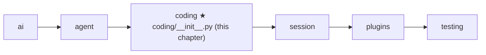
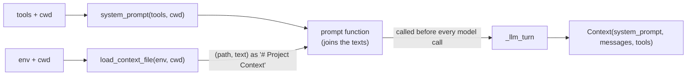

# 11 Part 3 · The system prompt

**Goal:** Tell the model who it is, what tools it has, where it works, and what this project wants.

**Builds on:** [05 Agent loop](05-agent-loop.md) (the loop sends a system prompt with every model call) · [09 Execution environment](09-exec-env.md) (all IO goes through the env) · [10 Coding tools](10-coding-tools.md) (the tools we will list) · **Next:** [12 Evals](12-evals.md)

## Where we are



Take the running example again. The user asks "What is in README.md?". After [10](10-coding-tools.md) the model has a `read` tool, so it *can* answer. But nobody has told it that it is a coding assistant, that `read` exists for exactly this, or that `README.md` means the file in `/work/app`. And if the team wrote "always answer in one short paragraph" in an `AGENTS.md` file, the model has never seen that either.

All of this goes in the [system prompt](glossary.md#system-prompt): the first, fixed text the model reads before the messages. Here is the one we will build, for two tools in `/work/app`:

```text
You are an expert coding assistant. You help the user by reading files, running commands, editing code, and writing new files.

Available tools:
- read: Read a file ...
- bash: Run a shell command ...

Be concise. Use read before edit. Paths are relative to the working directory.

Current date: 2026-10-13
Current working directory: /work/app
```

Big picture of Part 3: [part-3-coding](09-0-part-3-coding.md).

Code in this chapter (commit `2fc2776`):

- `packages/simp_agent/src/simp_agent/coding/__init__.py` — `system_prompt`, `CONTEXT_FILES`, `load_context_file`
- `packages/simp_agent/src/simp_agent/agent/__init__.py` — `_llm_turn`, which now accepts a prompt function
- `packages/simp_agent/tests/test_session.py` — `test_context_file_in_system_prompt`

## Problem

Every model call takes a [context](glossary.md#context): a system prompt, the messages, and the tools ([01](01-pick-clean.md)). Until now our tests passed a fixed string like `"s"`. A real coding agent needs four things in that text. It needs a **role**, so it acts instead of only chatting. It needs a short **tool list** in plain words; the schemas are already sent, but a schema says what arguments a tool takes, not when to use it, and one line per tool helps the model pick. It needs its **place and time**: tool paths are relative to the working folder ([10](10-coding-tools.md)), so the model must know that folder, and today's date helps with "latest version" questions. And it needs the **project rules**. Many teams already write these in a file like `AGENTS.md` or `CLAUDE.md`, and the agent should read that file so the user does not repeat the rules in every chat.

There is one more need. Tools and plugins can change during a session ([14](14-plugins.md)), so the prompt must be able to change too. It cannot be one string fixed at start.

## Naive version

```text
// naive sketch (not in the repo): one fixed string, built once
SYSTEM = "You are a helpful assistant."

FUNCTION main():
    rules = open("AGENTS.md").read()     // crash if missing
    prompt = SYSTEM + rules
    RUN the agent loop with prompt and the user message "What is in README.md?"
```

This breaks in five ways. The model gets no tool list, no folder and no date, so it guesses. `open` reads the host disk, but in the Docker sandbox ([24](24-docker-sandbox.md)) the project lives inside a container, so it reads the wrong place; this is exactly the mistake [09](09-exec-env.md) taught us to avoid. Most folders have no `AGENTS.md`, so the program crashes. Some teams name the file `CLAUDE.md`, which it never finds. And the prompt is built once, so a tool added later is never listed.

The real code fixes these one by one. A function builds the text from the real tools and folder. A list of file names is tried in order. Each name is read through the env, and a missing file just means "try the next name". Finally, the loop takes the prompt as a function and calls it before every model call.

## Real design

There are three small pieces. Two plain helpers in `coding/__init__.py` make text and keep no state: `system_prompt` builds the base text, and `load_context_file` finds the project file. The third piece is a small change in the loop: `_llm_turn` accepts a function in place of the string, so the text is rebuilt every turn.



Who owns the prompt function is the session, built in [13](13-session.md). In this chapter you only need to know that some function joins the two texts and the loop calls it.

### `system_prompt`: the base text

Real code: [coding/__init__.py](../../packages/simp_agent/src/simp_agent/coding/__init__.py) — `system_prompt`

```text
FUNCTION system_prompt(tools, cwd, context = None):
    tool_list = one line "- name: description" FOR EACH tool
    out = role sentence ("You are an expert coding assistant ...")
    ADD "Available tools:" + tool_list
    ADD "Be concise. Use read before edit. Paths are relative to the working directory."
    IF context is given:                 // (path, text) of the project file
        ADD "# Project Context", then "## <path>", then the text
    ADD "Current date: <today>" and "Current working directory: <cwd>"
    RETURN out
```

The role sentence says the assistant reads, runs, edits and writes, which pushes the model to act. The tool list is made from the `name` and `description` of the tools we pass in, the same ones `make_tools` built in [10](10-coding-tools.md#make_tools-names-descriptions-schemas). Because it is built and not written by hand, it can never name a tool that does not exist.

Each of the three rules has a reason. "Be concise" keeps answers short, which saves [context](glossary.md#context). "Use read before edit" matters because `edit` needs an exact text match ([10](10-coding-tools.md#edit)), and the model's memory of a file may be old. "Paths are relative to the working directory" matches how the tools join paths to `ctx.cwd`.

The date and the folder come last, after the optional project section. It is a plain function: the same input gives the same text (only the date changes), so it is easy to test and easy to replace.

The `context` argument is for hosts that call `system_prompt` directly. The session in [13](13-session.md) does not use it. It adds the same `# Project Context` text as a separate piece, because the file must be read through the env, which is async and is done once at start, while the base text is rebuilt cheaply every turn from the live tools and folder.

### `CONTEXT_FILES` and `load_context_file`: the project file

A [context file](glossary.md#context-file) is a Markdown file in the project that holds the team's rules for agents.

Real code: [coding/__init__.py](../../packages/simp_agent/src/simp_agent/coding/__init__.py) — `CONTEXT_FILES`, `load_context_file`

```text
CONTEXT_FILES = ["AGENTS.override.md", "AGENTS.md", "AGENTS.MD", "CLAUDE.md", "CLAUDE.MD"]

FUNCTION load_context_file(env, cwd):
    FOR EACH name in CONTEXT_FILES (in order):
        path = cwd joined with name
        TRY:
            RETURN path, WAIT for env.read_file(path)   // first file found wins
        IF OSError:
            go on to the next name
    RETURN None
```

The names are tried in priority order and only the first one found is loaded; files are not merged, so the model never gets two rule sets that disagree. `AGENTS.override.md` comes first, so one person can override the shared `AGENTS.md` without editing it. The upper-case `.MD` names are for case-sensitive disks such as Linux, where `AGENTS.md` and `AGENTS.MD` are two different files. (On a default macOS disk they are the same file.) The order follows pi, the project simp-agent learns from.

The file is read with `env.read_file`, not `open`, following the rule from [09](09-exec-env.md). So the same code reads the local disk or the inside of a container. The code catches `OSError`, not only `FileNotFoundError`, because each env may raise a different kind of error for a missing file. If no name works, the result is `None` and the prompt simply has no project section.

The result is the path *and* the text. The path becomes a heading in the prompt, so the model, and a person reading the log, can see where the rules came from.

There is one known limit: only `cwd` is searched. It does not walk up to parent folders and has no global file in the home folder ([27](27-limits-choices-extend.md)).

### The loop calls the prompt function every turn

In [05](05-agent-loop.md), `agent_loop` took `system_prompt` as a string. Inside it, `_llm_turn` is the step that makes one model call. At this commit it also accepts a function:

Real code: [agent/__init__.py](../../packages/simp_agent/src/simp_agent/agent/__init__.py) — `_llm_turn`

```text
INSIDE _llm_turn:
    IF system_prompt is a function:
        system_prompt = WAIT for system_prompt()    // the function may be sync or async
    ...
    FOR EACH event from _stream(..., Context(system_prompt, llm_msgs, tools), ...):
        ...
```

The loop does not know how the text is made; it only sees "a string, or something that gives a string". Calling a small function costs almost nothing, and the prompt is then never out of date when tools, plugins or modes change. Each provider puts the final string where its API wants it ([02](02-translate-send.md)): `system=` for Anthropic, a `system` (or `developer`) message for OpenAI.

The session builds this function from [prompt sections](glossary.md#prompt-section): `system_prompt` as section `coding` (order 0), the context file as section `context_file` (order 10), and plugin sections after them. If you pass your own `system_prompt` string to the session, it replaces both, and no context file is loaded. All of this is built in [13](13-session.md).

## Test

```python
# packages/simp_agent/tests/test_session.py
async def test_context_file_in_system_prompt(tmp_path):
    (tmp_path / "AGENTS.md").write_text("use tabs")
    prompts = []

    async def stream(model, ctx, api_key=None):
        prompts.append(ctx.system_prompt)
        yield {"type": "done", "message": DONE}

    await AgentSession(Model(), [], cwd=str(tmp_path), stream_fn=stream).prompt("hi")
    assert "use tabs" in prompts[0] and "AGENTS.md" in prompts[0]
```

The test puts a real `AGENTS.md` in a temp folder and starts a session there with **no** `system_prompt` argument, so the default coding prompt is used. The fake stream function plays the [provider](glossary.md#provider) ([04](04-label-test.md)); it answers nothing useful and only records the system prompt it got. The check is that both the file's text (`use tabs`) and its path (`AGENTS.md`) reached the model. So it tests the whole path at once: the file is found through the env, added to the prompt, and the loop's prompt function puts it into the `Context`.

Run it:

```bash
uv run pytest packages/simp_agent/tests/test_session.py -k context_file
```

## Why this way

The `coding` helpers only make text; the session decides when and in what order. So each part stays small and is tested alone. We read the files teams already have, `AGENTS.md` and `CLAUDE.md`, instead of inventing a new format. And the prompt stays short: a few lines of role and rules, while each tool's own description carries the details.

## Exercises

1. In `test_context_file_in_system_prompt`, rename `AGENTS.md` to `CLAUDE.md`. Does the test still pass?
2. Now create both files with different text. Which one is in the prompt, and why?

## Recap

The [system prompt](glossary.md#system-prompt) is a role, a tool list built from the real tools, three rules, an optional project section, and the date and folder, made by `coding.system_prompt(tools, cwd)`. The [context file](glossary.md#context-file) is the first name in `CONTEXT_FILES` found in `cwd`, read through `env.read_file`; a missing file is fine. `_llm_turn` accepts a prompt function and calls it before every model call, so the prompt is never out of date.

**Builds on:** [10 Coding tools](10-coding-tools.md) · **Next:** [12 Evals](12-evals.md): now that the agent has tools and a prompt, we measure how well it does real tasks.
