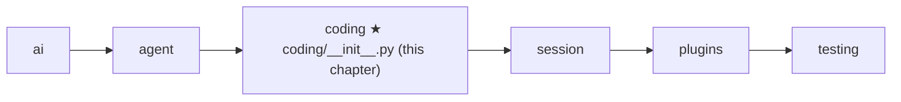
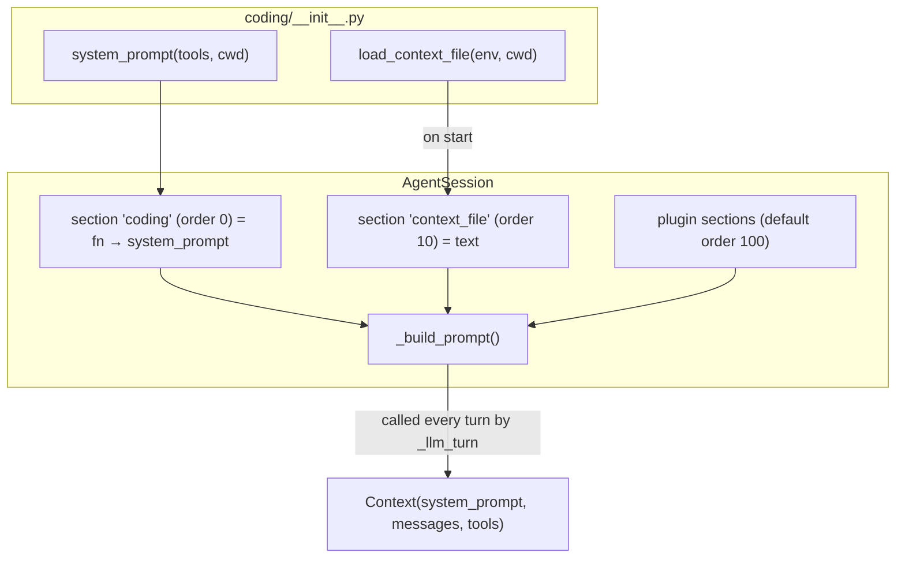

# 11 Part 3 · The system prompt

**Goal:** Tell the model who it is and what the project wants.

**Builds on:** [10 Coding tools](10-coding-tools.md) · **Next:** [12 Evals](12-evals.md)

## Where we are



In [10](10-coding-tools.md) we built seven tools. The model can now read, edit and run things. But the model does not know some things:

- **who it is**,
- **which tools exist and what they are for**,
- **where it is**,
- **what this project expects** (tabs or spaces? which test command?).

 The text that tells it these things is the [system prompt](glossary.md#system-prompt).

Code in this chapter (commit `2fc2776`):

- `packages/simp_agent/src/simp_agent/coding/__init__.py` — `system_prompt`, `CONTEXT_FILES`, `load_context_file`
- `packages/simp_agent/src/simp_agent/session/__init__.py` — where the session uses them (a short look ahead to [13](13-session.md))
- `packages/simp_agent/src/simp_agent/agent/__init__.py` — `_llm_turn`, which accepts a prompt function
- `packages/simp_agent/tests/test_session.py` — `test_context_file_in_system_prompt`

## Problem

Every model call takes a [context](glossary.md#context): a system prompt, the messages, and the tools ([01](01-messages.md)). Until now our tests passed a fixed string like `"s"`. For a real coding agent that is not enough:

1. **Role.** Without a role, the model may chat instead of acting.
2. **Tools.** The tool schemas are sent, but a short list with one line per tool, in plain words, helps the model choose well.
3. **Place and time.** Paths are relative to the working folder ([10](10-coding-tools.md)). The model should know that folder, and today's date.
4. **Project rules.** Each project has its own habits. Teams already write them down in a file like `AGENTS.md` or `CLAUDE.md`. The agent should read that file, so the user does not repeat the rules in every chat.

And one more need: the prompt must be able to **change during a session**. A plugin may add a rule ([14](14-plugins.md)); the tool list may change. So the prompt cannot be one string fixed at start.

## Naive version

```text
// naive: one fixed string, built once
SYSTEM = "You are a helpful assistant."

FUNCTION main():
    rules = the whole AGENTS.md, opened directly   // crash if missing
    prompt = SYSTEM + rules
    RUN the agent loop with prompt and the user message "fix the test"
```
Real code: [coding/__init__.py](../../packages/simp_agent/src/simp_agent/coding/__init__.py) — `system_prompt`, `load_context_file` (the fixed versions)

Where it breaks:

- **No tool list, no cwd, no date.** The model guesses.
- **`open` skips the [execution environment](glossary.md#execution-environment).** In the Docker sandbox ([24](24-docker-sandbox.md)) the project lives inside a container, not on the host. `open` reads the wrong disk.
- **Crash if the file is missing.** Most folders have no `AGENTS.md`.
- **Only one file name.** Some teams use `CLAUDE.md`, some `AGENTS.md`.
- **Built once.** If a plugin or a tool change happens later, the prompt is out of date.

## Step by step: from naive to real

We fix the naive version one problem at a time. Each step is small.

**Step 1 — build the tool list, cwd and date into the text.** The model should not guess. So the base text is made by a function from the real tools and the real folder:

```text
FUNCTION system_prompt(tools, cwd, context):
    tool_list = one line "- name: description" FOR EACH tool
    ...
    RETURN out + "Current date: TODAY" + "Current working directory: CWD"
```
Real code: [coding/__init__.py](../../packages/simp_agent/src/simp_agent/coding/__init__.py) — `system_prompt`

The list comes from the tools we pass in, so it can never name a tool that does not exist.

**Step 2 — read through the env, not `open`.** In Docker the project is inside a container. `env.read_file` reads from the right place:

```text
path = cwd joined with name
RETURN path, ASK env to read the file at path   // not open()
```
Real code: [coding/__init__.py](../../packages/simp_agent/src/simp_agent/coding/__init__.py) — `load_context_file`

**Step 3 — a missing file is normal.** Most folders have no `AGENTS.md`. We catch the error and go on:

```text
IF reading fails (file missing):
    SKIP to the next file name
```
Real code: [coding/__init__.py](../../packages/simp_agent/src/simp_agent/coding/__init__.py) — `load_context_file`

**Step 4 — more than one file name.** Teams use different names. We try a list in order, and the first file found wins:

```python
CONTEXT_FILES = ["AGENTS.override.md", "AGENTS.md", "AGENTS.MD", "CLAUDE.md", "CLAUDE.MD"]
```

**Step 5 — rebuild the prompt every turn.** Tools and plugins can change during a session. So the session stores the coding prompt as a function, and `_llm_turn` calls it before each model call:

```text
// in the session: store the prompt as a function, not a string
ADD prompt section "coding" = FUNCTION(ctx): system_prompt(ctx.tools, ctx.cwd)
...
// in _llm_turn, before each model call:
IF system_prompt is a function:
    system_prompt = CALL it now          // fresh text every turn
```
Real code: [session/__init__.py](../../packages/simp_agent/src/simp_agent/session/__init__.py) — `AgentSession.__init__`; [agent/__init__.py](../../packages/simp_agent/src/simp_agent/agent/__init__.py) — `_llm_turn`

The result is the real code below.

## Real design

The design has two layers:

- `coding/__init__.py` has two plain helpers: **build the base text** and **find the project file**. No state.
- The session ([13](13-session.md)) joins them with **prompt sections**, rebuilt before every model call.



### `system_prompt`: the base text

Real code: [coding/__init__.py](../../packages/simp_agent/src/simp_agent/coding/__init__.py) — `system_prompt`

```text
FUNCTION system_prompt(tools, cwd, context):
    tool_list = one line "- name: description" FOR EACH tool
    out = role sentence ("You are an expert coding assistant ...")
    ADD "Available tools:" + tool_list
    ADD the three rules ("Be concise. Use read before edit. Paths are relative ...")
    IF context is given:                 // (path, text) of the project file
        ADD "# Project Context", then "## <path>", then the text
    ADD "Current date: <today>" and "Current working directory: <cwd>"
    RETURN out
```

Key idea: the tool list is built from the real tools, so it is never wrong.

Read it top to bottom; each line has a job:

- **Role.** One sentence: an expert coding assistant that reads, runs, edits and writes. This pushes the model to act, not only talk.
- **Tool list.** Built from the tools we pass in, using `name` and `description` from `make_tools` ([10](10-coding-tools.md#make_tools-names-descriptions-schemas)). It is **built, not written by hand**, so it can never list a tool that does not exist.
- **Three rules.** "Be concise" (short output saves [context](glossary.md#context)). "Use read before edit" — `edit` needs an exact match ([10](10-coding-tools.md#edit)), and the model's memory of a file may be old. "Paths are relative to the working directory" — this matches how `_path` joins paths to `ctx.cwd`.
- **Project context** (optional, see below).
- **Date and cwd at the end.** The date helps with "latest version" questions. The cwd tells the model where relative paths start.

It is a plain function: same input, same text (except the date). That makes it easy to test and easy to replace.

Example output with two tools in `/work/app`:

```text
You are an expert coding assistant. You help the user by reading files, running commands, editing code, and writing new files.

Available tools:
- read: Read a file ...
- bash: Run a shell command ...

Be concise. Use read before edit. Paths are relative to the working directory.

Current date: 2026-10-13
Current working directory: /work/app
```

### `CONTEXT_FILES` and `load_context_file`: the project file

A [context file](glossary.md#context-file) is a Markdown file in the project that holds the team's rules for agents.

Real code: [coding/__init__.py](../../packages/simp_agent/src/simp_agent/coding/__init__.py) — `CONTEXT_FILES`, `load_context_file`

```text
CONTEXT_FILES = ["AGENTS.override.md", "AGENTS.md", "AGENTS.MD", "CLAUDE.md", "CLAUDE.MD"]

FUNCTION load_context_file(env, cwd):
    FOR EACH name in CONTEXT_FILES (in order):
        path = cwd joined with name
        TRY:
            RETURN path, WAIT for env.read_file(path)   // first file found wins
        IF OSError:
            go on to the next name        // missing file is normal
    RETURN None
```

Key idea: read through the env, first match wins. Limit: only `cwd`, no parent folders.

Why each part:

- **A list in priority order; the first file found wins.** Only one file is loaded. `AGENTS.override.md` comes first, so a person can override the shared `AGENTS.md` without editing it. Upper-case `.MD` names are there for case-sensitive file systems (where `AGENTS.md` and `AGENTS.MD` are two different files). The order follows pi, the project simp-agent learns from.
- **Reads through `env.read_file`.** This is the rule from [09](09-exec-env.md): all IO goes through the env. So the same code reads from the local disk or from inside a container.
- **Missing file is normal.** `OSError` (file not found, and so on) just means "try the next name". If none exists, it returns `None` and the prompt has no project section.
- **Returns the path too.** The path goes into the prompt as a heading, so the model (and a human reading the log) knows where the rules came from.
- **Only `cwd`.** It does not walk up to parent folders and has no global file in the home folder. The `ponytail:` comment marks this as a known limit ([27](27-limits-choices-extend.md)).

### Prompt sections: building the prompt every turn

The session does not call `system_prompt` once. It keeps a small table of **[prompt sections](glossary.md#prompt-section)**: each has an id, an order, and a value (a string or a function of `ctx`). Before every model call it sorts them, skips empty ones and joins them. In short:

- The default coding prompt is a section at order 0. Its value is a function that calls `system_prompt` with the **current** tools and cwd, so the tool list is never out of date.
- The context file is a section at order 10, read once in `start()`, before the first prompt.
- If the host passes its own `system_prompt` string, it replaces both. Our tests do this with `system_prompt="s"`.

> **Look ahead.** How the session stores, orders and rebuilds sections (`add_prompt_section`, `_build_prompt`, `start()`) is built in [13](13-session.md). Here we only need one fact: the prompt the loop gets can be a **function**.

### The loop calls the function every turn

How does a function reach the model? In [05](05-agent-loop.md) `agent_loop` took `system_prompt` as a string. At this commit `_llm_turn` also accepts a function:

Real code: [agent/__init__.py](../../packages/simp_agent/src/simp_agent/agent/__init__.py) — `_llm_turn`

```text
INSIDE _llm_turn:
    IF system_prompt is a function:
        system_prompt = WAIT for system_prompt()    // rebuilt before every model call
    ...
    FOR EACH event from _stream(..., Context(system_prompt, llm_msgs, tools), ...):
        ...
```

The session passes `self._build_prompt` to `Agent(...)`. So before **every** model call, the sections are rebuilt. The loop does not know about sections; it only sees "a string, or a thing that gives a string". Each provider then puts that string where its API wants it ([04](04-providers.md)): `system=` for Anthropic, a `system` (or `developer`) message for OpenAI.

## Test

```python
# packages/simp_agent/tests/test_session.py
async def test_context_file_in_system_prompt(tmp_path):
    (tmp_path / "AGENTS.md").write_text("use tabs")
    prompts = []

    async def stream(model, ctx, api_key=None):
        prompts.append(ctx.system_prompt)
        yield {"type": "done", "message": DONE}

    await AgentSession(Model(), [], cwd=str(tmp_path), stream_fn=stream).prompt("hi")
    assert "use tabs" in prompts[0] and "AGENTS.md" in prompts[0]
```

What it shows:

- A real `AGENTS.md` in a temp folder, a session with that `cwd`, and **no** `system_prompt` argument — so the default coding prompt is used.
- The fake stream function plays the role of the [provider](glossary.md#provider) ([02](02-fake-provider.md)). It does not answer anything useful; it just **records** the system prompt it got.
- The check: the file's text (`use tabs`) **and** its path (`AGENTS.md`) are in the prompt the model saw. This goes end to end: `start()` → `load_context_file` → section → `_build_prompt` → `_llm_turn` → `Context`.

Run it:

```bash
uv run pytest packages/simp_agent/tests/test_session.py -k context_file
```

## Why this way

> **Plain helpers + sections.** `coding` only knows how to make text; the session decides when and in what order. Each part stays small and testable.
>
> **Rebuild every turn.** A prompt function costs almost nothing to call, and it is never out of date when tools, plugins or modes change.
>
> **Read the team's file, don't invent a format.** `AGENTS.md` / `CLAUDE.md` already exist in many repos. Reading them through the env means it works in Docker too.
>
> **Short prompt.** A few lines of role and rules. The tools' own descriptions carry the details.

## Exercises

1. In `test_context_file_in_system_prompt`, rename `AGENTS.md` to `CLAUDE.md`. Does the test still pass?
2. Now create both files with different text. Which one is in the prompt, and why?

## Recap

- [System prompt](glossary.md#system-prompt) = role + tool list + three rules + optional project context + date and cwd, made by `coding.system_prompt(tools, cwd)`.
- [Context file](glossary.md#context-file): the first of `CONTEXT_FILES` found in `cwd`, read through `env.read_file`; missing is fine; only one, only `cwd`.
- The session keeps [prompt sections](glossary.md#prompt-section) (id, order, string or function) and joins them in `_build_prompt`. Coding text is order 0, the context file is order 10, added once in `start()`.
- Passing your own `system_prompt` string replaces both.
- `_llm_turn` accepts a function and calls it before each model call.

**Builds on:** [10 Coding tools](10-coding-tools.md) · **Next:** [12 Evals](12-evals.md) — now that the agent has tools and a prompt, measure how well it does real tasks.
