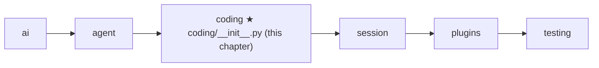
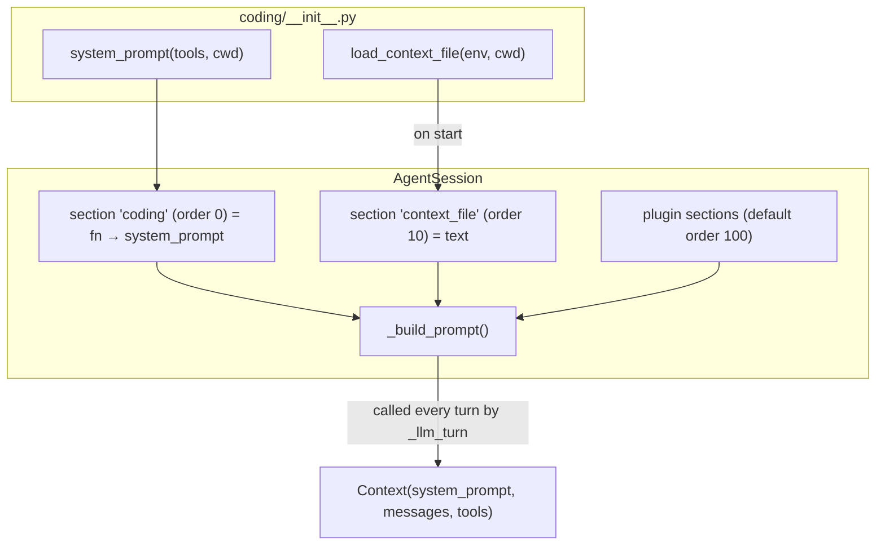

# 11 Part 3 · The system prompt

**Goal:** Tell the model who it is and what the project wants.

**Builds on:** [10 Coding tools](10-coding-tools.md) · **Next:** [12 Evals](12-evals.md)

## Where we are



In [10](10-coding-tools.md) we built seven tools. The model can now read, edit and run things. But the model does not know **who it is**, **which tools exist and what they are for**, **where it is**, or **what this project expects** (tabs or spaces? which test command?). The text that tells it these things is the [system prompt](glossary.md#system-prompt).

Code in this chapter (commit `2fc2776`):

- `packages/simp_agent/src/simp_agent/coding/__init__.py` — `system_prompt`, `CONTEXT_FILES`, `load_context_file`
- `packages/simp_agent/src/simp_agent/session/__init__.py` — where the session uses them (a short look ahead to [13](13-session.md))
- `packages/simp_agent/src/simp_agent/agent/__init__.py` — `_llm_turn`, which accepts a prompt function
- `packages/simp_agent/tests/test_session.py` — `test_context_file_in_system_prompt`

## Problem

Every model call takes a [context](glossary.md#context): a system prompt, the messages, and the tools ([01](01-messages.md)). Until now our tests passed a fixed string like `"s"`. For a real coding agent that is not enough:

1. **Role.** Without a role, the model may chat instead of acting.
2. **Tools.** The tool schemas are sent, but a short list with one line per tool, in plain words, helps the model choose well.
3. **Place and time.** Paths are relative to the working folder ([10](10-coding-tools.md)). The model should know that folder, and today's date.
4. **Project rules.** Each project has its own habits. Teams already write them down in a file like `AGENTS.md` or `CLAUDE.md`. The agent should read that file, so the user does not repeat the rules in every chat.

And one more need: the prompt must be able to **change during a session**. A plugin may add a rule ([14](14-plugins.md)); the tool list may change. So the prompt cannot be one string fixed at start.

## Naive version

```python
SYSTEM = "You are a helpful assistant."

async def main():
    rules = open("AGENTS.md").read()
    prompt = SYSTEM + "\n\n" + rules
    await agent_loop(prompt, messages, [UserMessage("fix the test")], cfg, emit, cancel)
```

Where it breaks:

- **No tool list, no cwd, no date.** The model guesses.
- **`open` skips the [execution environment](glossary.md#execution-environment).** In the Docker sandbox ([24](24-docker-sandbox.md)) the project lives inside a container, not on the host. `open` reads the wrong disk.
- **Crash if the file is missing.** Most folders have no `AGENTS.md`.
- **Only one file name.** Some teams use `CLAUDE.md`, some `AGENTS.md`.
- **Built once.** If a plugin or a tool change happens later, the prompt is stale.

## Real design

The design has two layers:

- `coding/__init__.py` has two plain helpers: **build the base text** and **find the project file**. No state.
- The session ([13](13-session.md)) joins them with **prompt sections**, rebuilt before every model call.



### `system_prompt`: the base text

```python
# packages/simp_agent/src/simp_agent/coding/__init__.py
def system_prompt(tools: list, cwd: str, context: tuple[str, str] | None = None) -> str:
    tool_list = "\n".join(f"- {t.name}: {t.description}" for t in tools)
    out = (
        "You are an expert coding assistant. You help the user by reading files, running commands, "
        "editing code, and writing new files.\n\n"
        f"Available tools:\n{tool_list}\n\n"
        "Be concise. Use read before edit. Paths are relative to the working directory.\n\n"
    )
    if context:
        out += f"# Project Context\n\n## {context[0]}\n\n{context[1]}\n\n"
    return out + f"Current date: {datetime.date.today()}\nCurrent working directory: {cwd}"
```

Read it top to bottom; each line has a job:

- **Role.** One sentence: an expert coding assistant that reads, runs, edits and writes. This pushes the model to act, not only talk.
- **Tool list.** Built from the tools we pass in, using `name` and `description` from `make_tools` ([10](10-coding-tools.md#make_tools-names-descriptions-schemas)). It is **built, not written by hand**, so it can never list a tool that does not exist.
- **Three rules.** "Be concise" (short output saves [context](glossary.md#context)). "Use read before edit" — `edit` needs an exact match ([10](10-coding-tools.md#edit)), and the model's memory of a file may be old. "Paths are relative to the working directory" — this matches how `_path` joins paths to `ctx.cwd`.
- **Project context** (optional, see below).
- **Date and cwd at the end.** The date helps with "latest version" questions. The cwd tells the model where relative paths start.

It is a plain function: same input, same text (except the date). That makes it easy to test and easy to replace.

Example output with two tools in `/work/app`:

```text
You are an expert coding assistant. You help the user by reading files, running commands, editing code, and writing new files.

Available tools:
- read: Read a file ...
- bash: Run a shell command ...

Be concise. Use read before edit. Paths are relative to the working directory.

Current date: 2026-10-13
Current working directory: /work/app
```

### `CONTEXT_FILES` and `load_context_file`: the project file

A [context file](glossary.md#context-file) is a Markdown file in the project that holds the team's rules for agents.

```python
# packages/simp_agent/src/simp_agent/coding/__init__.py
CONTEXT_FILES = ["AGENTS.override.md", "AGENTS.md", "AGENTS.MD", "CLAUDE.md", "CLAUDE.MD"]  # pi resource-loader.ts


async def load_context_file(env, cwd: str) -> tuple[str, str] | None:
    """First context file found in cwd -> (path, text). Reads through env, so it works on any ExecutionEnv.
    ponytail: cwd only, no parent dirs or ~/.pi-style global file."""
    for name in CONTEXT_FILES:
        path = os.path.join(cwd, name)
        try:
            return path, await env.read_file(path)
        except OSError:
            continue
    return None
```

Why each part:

- **A list in priority order; the first file found wins.** Only one file is loaded. `AGENTS.override.md` comes first, so a person can override the shared `AGENTS.md` without editing it. Upper-case `.MD` names are there for case-sensitive file systems. The order follows pi, the project simp-agent learns from.
- **Reads through `env.read_file`.** This is the rule from [09](09-exec-env.md): all IO goes through the env. So the same code reads from the local disk or from inside a container.
- **Missing file is normal.** `OSError` (file not found, and so on) just means "try the next name". If none exists, it returns `None` and the prompt has no project section.
- **Returns the path too.** The path goes into the prompt as a heading, so the model (and a human reading the log) knows where the rules came from.
- **Only `cwd`.** It does not walk up to parent folders and has no global file in the home folder. The `ponytail:` comment marks this as a known limit ([27](27-limits-choices-extend.md)).

### Prompt sections: building the prompt every turn

The session does not call `system_prompt` once. It keeps a small table of **[prompt sections](glossary.md#prompt-section)**. This is a look ahead to [13](13-session.md); here we only need the part that touches the prompt.

```python
# packages/simp_agent/src/simp_agent/session/__init__.py (AgentSession.__init__)
        if system_prompt is not None:
            self.add_prompt_section("base", system_prompt, 0)
        else:  # coding prompt; the context file section is added on start (needs env IO)
            self.add_prompt_section("coding", lambda ctx: system_prompt_for(ctx["tools"], ctx["cwd"]), 0)
        self._default_prompt = system_prompt is None
```

```python
    def add_prompt_section(self, id: str, value, order: int = 100) -> None:
        """value: str or fn(ctx) -> str (sync or async), rebuilt every turn. Sorted by (order, first add): stable."""
        seq = self._sections[id][1] if id in self._sections else next(self._seq)
        self._sections[id] = (order, seq, value)

    async def _build_prompt(self) -> str:
        a = self.agent
        ctx = {"tools": a.tools, "cwd": a.cwd, "model": a.model, "messages": a.messages}
        parts = list()
        for _, _, v in sorted(self._sections.values(), key=lambda x: x[:2]):
            text = await _maybe_await(v(ctx)) if callable(v) else v
            if text:
                parts.append(text)
        return "\n\n".join(parts)
```

- **A section has an id, a value, and an order.** The value is a string, or a function of `ctx` (sync or async). Adding the same id again replaces the value but keeps its first place, so the order is stable.
- **The default coding prompt is a function.** `system_prompt_for` is `coding.system_prompt`, called with the **current** tools and cwd. If the tools change, the list in the prompt changes on the next turn.
- **Empty sections are skipped.** A function can return `""` to switch itself off. Plugins can also add and remove whole sections: the plan-mode plugin ([18](18-profiles-plugins.md)) adds a `PLAN MODE` section at order 1000 and removes it when plan mode ends.
- **Caller can replace it.** If the host passes its own `system_prompt` string, it becomes the `"base"` section, and the coding prompt and context file are not added. Our tests use this with `system_prompt="s"`.

The context file is loaded in `start()`, the first time the user sends a prompt, because reading needs async env IO:

```python
    async def start(self) -> None:
        ...
        if self._default_prompt and (cf := await load_context_file(self.agent.env, self.agent.cwd)):
            self.add_prompt_section("context_file", f"# Project Context\n\n## {cf[0]}\n\n{cf[1]}", 10)
```

Order 10 puts it right after the coding text (order 0) and before plugin sections (default 100). It is read **once per session**, not every turn: editing `AGENTS.md` mid-session has no effect until a new session.

Note: the `context` argument of `system_prompt` is not used by the session. The session adds the same `# Project Context` text as its own section instead, so it can come and go on its own. The argument is there for a caller who wants one string in one call.

### The loop calls the function every turn

How does a function reach the model? In [05](05-agent-loop.md) `agent_loop` took `system_prompt` as a string. At this commit `_llm_turn` also accepts a function:

```python
# packages/simp_agent/src/simp_agent/agent/__init__.py (_llm_turn)
    if callable(system_prompt):
        system_prompt = await _maybe_await(system_prompt())
    ...
    async for ev in _stream(config.stream_fn, config.model, Context(system_prompt, llm_msgs, tools), cancel, opts):
```

The session passes `self._build_prompt` to `Agent(...)`. So before **every** model call, the sections are rebuilt. The loop does not know about sections; it only sees "a string, or a thing that gives a string". Each provider then puts that string where its API wants it ([04](04-providers.md)): `system=` for Anthropic, a `system` (or `developer`) message for OpenAI.

## Test

```python
# packages/simp_agent/tests/test_session.py
async def test_context_file_in_system_prompt(tmp_path):
    (tmp_path / "AGENTS.md").write_text("use tabs")
    prompts = []

    async def stream(model, ctx, api_key=None):
        prompts.append(ctx.system_prompt)
        yield {"type": "done", "message": DONE}

    await AgentSession(Model(), [], cwd=str(tmp_path), stream_fn=stream).prompt("hi")
    assert "use tabs" in prompts[0] and "AGENTS.md" in prompts[0]
```

What it shows:

- A real `AGENTS.md` in a temp folder, a session with that `cwd`, and **no** `system_prompt` argument — so the default coding prompt is used.
- The fake stream function plays the role of the [provider](glossary.md#provider) ([02](02-fake-provider.md)). It does not answer anything useful; it just **records** the system prompt it got.
- The check: the file's text (`use tabs`) **and** its path (`AGENTS.md`) are in the prompt the model saw. This goes end to end: `start()` → `load_context_file` → section → `_build_prompt` → `_llm_turn` → `Context`.

Run it:

```bash
uv run pytest packages/simp_agent/tests/test_session.py -k context_file
```

## Why this way

> **Plain helpers + sections.** `coding` only knows how to make text; the session decides when and in what order. Each part stays small and testable.
>
> **Rebuild every turn.** A prompt function costs almost nothing to call, and it is never stale when tools, plugins or modes change.
>
> **Read the team's file, don't invent a format.** `AGENTS.md` / `CLAUDE.md` already exist in many repos. Reading them through the env means it works in Docker too.
>
> **Short prompt.** A few lines of role and rules. The tools' own descriptions carry the details.

## Recap

- [System prompt](glossary.md#system-prompt) = role + tool list + three rules + optional project context + date and cwd, made by `coding.system_prompt(tools, cwd)`.
- [Context file](glossary.md#context-file): the first of `CONTEXT_FILES` found in `cwd`, read through `env.read_file`; missing is fine; only one, only `cwd`.
- The session keeps [prompt sections](glossary.md#prompt-section) (id, order, string or function) and joins them in `_build_prompt`. Coding text is order 0, the context file is order 10, added once in `start()`.
- Passing your own `system_prompt` string replaces both.
- `_llm_turn` accepts a function and calls it before each model call.

**Builds on:** [10 Coding tools](10-coding-tools.md) · **Next:** [12 Evals](12-evals.md) — now that the agent has tools and a prompt, measure how well it does real tasks.
