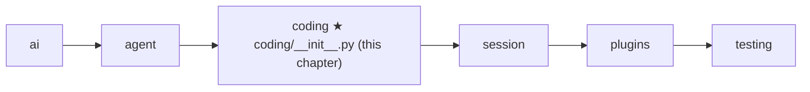

# 11 Part 3 · The system prompt

**Goal:** Tell the model who it is, what tools it has, where it works, and what this project wants.

**Builds on:** [05 Agent loop](05-agent-loop.md) (the loop sends a system prompt with every model call) · [09 Execution environment](09-exec-env.md) (all IO goes through the env) · [10 Coding tools](10-coding-tools.md) (the tools we will list) · **Next:** [12 Evals](12-evals.md)

## Where we are



Take the running example again. The user asks "What is in README.md?". After [10](10-coding-tools.md) the model has a `read` tool, so it *can* answer. But nobody has told it that it is a coding assistant, that `read` exists for exactly this, or that `README.md` means the file in `/work/app`. And if the team wrote "always answer in one short paragraph" in an `AGENTS.md` file, the model has never seen that either.

All of this goes in the [system prompt](glossary.md#system-prompt): the first, fixed text the model reads before the messages. Big picture of Part 3: [part-3-coding](09-0-part-3-coding.md). Building it means answering three questions.

## What does the model need to know?

Here is the prompt we will build, for two tools in `/work/app`:

```text
You are an expert coding assistant. You help the user by reading files, running commands, editing code, and writing new files.

Available tools:
- read: Read a text file. Output has line numbers. Use offset/limit for big files.
- bash: Run a shell command in cwd. Returns stdout+stderr (the tail if long) and exit code. Optional timeout in seconds; no timeout by default.

Be concise. Use read before edit. Paths are relative to the working directory.

Current date: 2026-10-13
Current working directory: /work/app
```

The **role** sentence says the assistant reads, runs, edits and writes, so the model acts instead of only chatting. The **tool list** repeats what the model already gets: the tools' names and descriptions are sent with every call in the `tools` parameter ([02](02-translate-send.md#the-tool-list)), and this line copies the same descriptions. simp-agent keeps it, as pi does, so the model sees its tools next to its role and rules. It is optional and costs a few tokens.

Each of the three **rules** has a reason. "Be concise" keeps answers short, which saves [context](glossary.md#context). "Use read before edit" matters because `edit` needs an exact text match ([10](10-coding-tools.md#changing-a-file-write-and-edit)), and the model's memory of a file may be old. "Paths are relative to the working directory" matches how the tools join paths to `ctx.cwd`. Last come the **date**, which helps with "latest version" questions, and the **folder**, so `README.md` means `/work/app/README.md`.

Real code: [coding/__init__.py](../../packages/simp_agent/src/simp_agent/coding/__init__.py) — `system_prompt(tools, cwd)`

## Where do the project rules come from?

Many teams write their rules for agents in a [context file](glossary.md#context-file), such as `AGENTS.md` or `CLAUDE.md`. If the agent reads it, the user does not have to repeat the rules in every chat. `load_context_file(env, cwd)` tries these names in order:

```text
CONTEXT_FILES = ["AGENTS.override.md", "AGENTS.md", "AGENTS.MD", "CLAUDE.md", "CLAUDE.MD"]
```

The first file found wins. Files are not merged, so the model never gets two rule sets that disagree. `AGENTS.override.md` comes first, so one person can change the shared `AGENTS.md` without editing it.

The file is read through the env ([09](09-exec-env.md)), not with `open`, so the same code works on the local disk and inside a Docker container ([24](24-docker-sandbox.md)). If no file exists, the prompt simply has no "# Project Context" part. When one is found, its path becomes a heading under "# Project Context", so the model, and a person reading the log, can see where the rules came from. One limit: only `cwd` is searched, not parent folders or the home folder ([27](27-limits-choices-extend.md)).

Real code: [coding/__init__.py](../../packages/simp_agent/src/simp_agent/coding/__init__.py) — `CONTEXT_FILES`, `load_context_file`

## Why is the prompt a function, not a fixed string?

Some parts of the prompt change while a session runs: the date and the folder, and in [13](13-session.md) the prompt sections that the session and plugins add. A string built once at the start would go stale. So instead of a string, the loop from [05](05-agent-loop.md) also takes a **function** that builds the prompt, and `_llm_turn` calls it before every model call. Each call then sends a fresh prompt.

Real code: [agent/__init__.py](../../packages/simp_agent/src/simp_agent/agent/__init__.py) — `_llm_turn`

[13](13-session.md) builds the real prompt function out of [prompt sections](glossary.md#prompt-section).


**Builds on:** [10 Coding tools](10-coding-tools.md) · **Next:** [12 Evals](12-evals.md): now that the agent has tools and a prompt, we measure how well it does real tasks.
