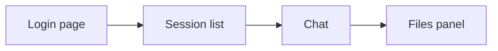

# 11 The web UI

**For:** Users whose operator gave them a URL and a token or a signup code.
**You need first:** [00](00-introduction.md) and, if you have not run the web UI yet, [01 Quick start](01-quick-start.md) (Path B).
**You will learn:** how to sign in, how sessions, files, plan mode, compact, Continue and notifications work, and how to read the spend display.
**Code covered:** `apps/web/src/App.tsx`, `Chat.tsx`, `Files.tsx`, `api.ts`, `state.ts`; `apps/server/src/simp_server/server.py` (usage, title, interrupted notice).
Verified at commit `9fdc61d`.

Your operator gave you a URL and either an [access token](glossary.md#access-token) or a signup code. This chapter starts there.

## 1. Sign in

Open the URL. You see a login page with three ways in.

| You have | What to do |
|---|---|
| An access token | Paste it in the **Token** box (under "Or paste an access token"). Press **Sign in**. Username and password can stay empty. |
| A username and password | Fill both. Press **Sign in**. |
| A signup code (one code for the whole team) | Press **Create account**. Fill username, password and **Invite code**. Press **Create account**. |

Signing in with a password or a signup gives you a new token. The page keeps it in your browser (`localStorage`), so a reload keeps you signed in. Any refused sign-in shows "That token was not accepted."; a wrong signup code shows the server message ("sign-up is closed or the invite code is wrong"). The Token box is hidden on the signup form. **Sign out** (bottom left) tells the server to stop that token and clears it from the browser.
If the server later says 401 (for example your operator rotated the token), you are sent back to the login page.
How operators make tokens and codes: 22 Users and accounts (not yet written).

## 2. Sessions

The left bar lists your [sessions](glossary.md#session). Each has a badge with the run state (idle, running, waiting approval, error).

- **New session** makes one. If the server has several [profiles](glossary.md#profile), pick one in the box above the button first.
- A new session shows its id. After the first answer, the server asks the model for a short title (3 to 6 words) and shows it instead.
- Click a session to open it. The address in your browser (`#<id>`) is the session id, so you can bookmark it or reload.
- **Delete:** click `×` once. It changes to **Delete?**. Click again to delete. Clicking elsewhere cancels. There is no undo.

Your sessions live on the server, not in the browser, so you can open them from another computer. Other apps (the CLI) keep sessions in a different place, see [10](10-cli.md#6-sessions-where-they-are-saved).

## 3. Chat

Type in the box at the bottom. **Enter** sends, **Shift+Enter** adds a new line.

While the agent runs, the same box has two uses (the same ideas as in the [REPL](10-cli.md#3-the-repl)):

- by default your text is a [steer](glossary.md#steer);
- tick **Queue as follow-up** to send a [follow-up](glossary.md#follow-up) instead.

**Stop** (or **Esc** while typing in the box) aborts the run. Tool calls appear as folded cards with a dot: running, done, error, or waiting for you.
When a tool needs [approval](glossary.md#tool-approval), a card asks **Allow**, **Always** or **Deny**. Unlike `--yes` in the CLI, the web has no switch that approves everything. **Always** is the same as in the CLI: it lasts for that tool in that session only.
The model's "thinking" is shown in a box that is open while it streams and folded after. Images in answers are never loaded; you see a link instead (so a bad prompt cannot leak data through an image address).

The small word next to the title (`live`, `reconnecting`) is the connection. If it drops, the page reconnects by itself and gets what it missed. Your run keeps going on the server meanwhile.

## 4. Plan mode

The **Plan** button turns on [plan mode](glossary.md#plan-mode): the agent can read and plan, but cannot edit files or run commands. Press it again to turn it off. A line in the chat says "plan mode on" or "off". The state is saved with the session. For a comparison with the CLI, see [12](12-cli-vs-web.md).

## 5. Compact

**Compact** asks the agent to summarize older messages now, to free room in the model's context. It is greyed out while the agent runs. When it is done the chat shows "Context compacted (N → M tokens)". What [compaction](glossary.md#compaction) is and when it also happens by itself: see the glossary.

## 6. Continue after an interruption

A **Continue** button appears in two cases:

- the run ended with an **error** (for example the provider failed);
- the server was restarted during your run. The chat shows "interrupted: the server restarted during this run".

It shows only while nothing newer is in the chat. Press it and the agent carries on from the saved history. It does not appear after you press Stop.

## 7. Files

**Files** opens a panel with the files of this session's [execution environment](glossary.md#execution-environment) (the sandbox folder, not your computer).

- Click a folder to open it, `..` to go up, `↻` to refresh.
- Click a file to download it. Sizes are shown.
- **Upload** puts one or more files into the folder you are looking at, so the agent can use them.

## 8. Notifications

**Notify** (it stays highlighted when on) shows a system notification when the agent finishes, fails, or needs your approval — but only while the browser tab is hidden. The first time, the browser asks for permission; if you say no, Notify stays off. The choice is remembered in the browser. Some browsers may not show it.

## 9. Spend display

The chat header (only when a session is open) shows `$spent / $limit`, for example `$0.42 / 5`. It is what **you** spent today against your daily limit, and it is refreshed after each run and every 30 seconds. `· paused` means the operator paused the server; new runs are refused (the chat shows "budget: server paused by the admin"; a reached limit gives a similar "budget:" message). "Today" is by the server clock. Titles also cost a little. Limits are set by the operator: 24 Money and limits (not yet written).

## 10. Themes

**Dark theme / Light theme** (bottom left; the name is the theme you will get, default light) switches the colours. The choice is remembered.

## 11. Try it with no key

No API key? Start the web with the [fake LLM](glossary.md#fake-llm); the steps are in [01](01-quick-start.md#4-path-b--chat-in-the-browser).

## 12. If something breaks

Tell your operator the exact message. Messages you may see: "That token was not accepted." (wrong or old token), "budget: server paused by the admin", or a connection word stuck on `reconnecting`. Fixes are in 27 Troubleshooting (not yet written).

---

**Back:** [10 The CLI](10-cli.md).
**Next:** [12 CLI vs web feature table](12-cli-vs-web.md).
**Built on by:** [12 CLI vs web feature table](12-cli-vs-web.md), 13 Working well with the agent, 22 Users and accounts, 24 Money and limits.
