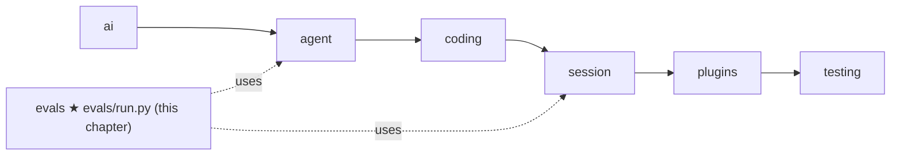
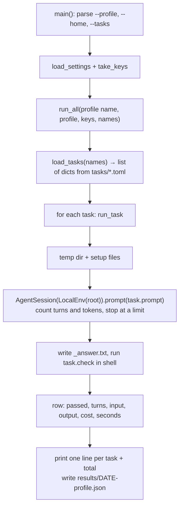

# 12 Part 3 · Evals

**Goal:** Measure the agent on real tasks; when you add a capability later, you can add a case for it.

**Builds on:** [05 Agent loop](05-agent-loop.md) · [06 Events and abort](06-events-abort.md) (we count by listening) · [09 Execution environment](09-exec-env.md) · [10 Coding tools](10-coding-tools.md) · [11 The system prompt](11-system-prompt.md) · **Next:** [13 Sessions](13-session.md)

## Where we are



Take the running example again. The user asks "What is in README.md?". After [11](11-system-prompt.md) the model has a `read` tool and a system prompt that says when to use it, so it should answer well. But *should* is not proof. Our unit tests use the [FakeProvider](04-label-test.md): they prove our code does what we wrote, but the fake model always says what we tell it to say. They cannot tell us if a **real** model, with our tools and our prompt, finds the file and gives the right answer.

To know that, we must run the real agent with a real model on a fixed job and let a program check the result. That is an [eval](glossary.md#eval). Our first eval task, `read_answer`, is a small cousin of the running example: "read `config.ini` and tell me the server port". The check is one command: is `8473` in the answer?

Why now, before [13 Sessions](13-session.md)? Because from here on, every chapter changes how the agent behaves (retry, compaction, plugins). With an eval in place, each change can be measured, not only guessed.

Big picture of Part 3: [part-3-coding](09-0-part-3-coding.md).

Code in this chapter (commit `2fc2776`):

- `evals/run.py` — the eval runner: `load_tasks`, `run_task`, `run_all`, `main`
- `evals/tasks/*.toml` — four [eval tasks](glossary.md#eval-task): `read_answer`, `fizzbuzz`, `fix_bug`, `refactor_rename`
- `evals/test_run.py` — tests for the eval runner itself, with the FakeProvider

## What you will get

One command runs every task and prints one line per task, then a total:

```bash
uv run python evals/run.py --profile sol
```

```text
read_answer     PASS     2 turns       300/30       $0.0004  1.2s
total           1/1      2 turns       300/30       $0.0004  1.2s
wrote /path/to/simp-agent/evals/results/20261013-101500-sol.json
```

(Shown with one task to keep it short; the real run has four lines plus the total.) The columns are: pass or fail, number of [turns](glossary.md#turn), input/output tokens, dollars, seconds.

Here `sol` is a [profile](glossary.md#profile): a name for one model plus its prices, written in the server's `settings.toml` file. It must be in your `settings.toml`; else the eval runner stops with `no profile 'sol'`.

## Problem

When you change the system prompt, a tool description, or the model, you want to know: **did the agent get better or worse?** Reading one chat by hand is not enough. The model is random; one good answer proves little. We need the **same tasks** every time, in a **fresh folder**, checked **by a program**. We also want the **cost** (turns, tokens, dollars, seconds), because a change that passes the same tasks at half the cost is a win too. And the numbers must be **saved**, so next week we can compare.

## Naive version

Here is the first thing you might write, for one bug-fix job. It is a sketch, not real code:

```text
FUNCTION main(model):
    d = a new temp folder
    WRITE calc.py into d                  // average() with a bug: divides by len + 1
    s = a new AgentSession on d           // LocalEnv(d)
    WAIT for s.prompt("Fix the bug in calc.py")
    ok = RUN "python -c '... assert average([2, 4]) == 3'" in d, exit code is 0
    PRINT "PASS" IF ok ELSE "FAIL"
```

It works once. But the task lives inside the Python code, so each new task means more code ([fixed by TOML files](#a-task-is-a-toml-file)). There is no limit: if the model loops forever, the script never ends and keeps spending money ([fixed by listening to events](#counting-and-limits-through-events)). It prints PASS but not whether that took 3 turns or 30 ([same section](#counting-and-limits-through-events)). `python` in the shell may not be the project's Python, so the check may fail for the wrong reason ([fixed in the check](#the-check)). Nothing is saved ([fixed in run_all](#run_all-the-table-and-the-file)). And it cannot be tested without a real model and key ([fixed in the test](#test)).

## Real design



### A task is a TOML file

Each file in `evals/tasks/` is one task. The file name is the task name. It has up to three keys:

- `prompt` — what we ask the agent.
- `check` — a shell command. Exit code 0 means pass.
- `[setup]` — optional. Each key is a file path, each value its text. These files are written into the empty folder before the agent starts.

Here is `evals/tasks/fix_bug.toml` (shortened):

```toml
prompt = "The tests in test_calc.py fail. Fix the bug in calc.py (do not change the tests). Run them with: python -m pytest -q"
check = '"$PYTHON" -m pytest -q -p no:cacheprovider test_calc.py && grep -q "assert average(\[2, 4\]) == 3" test_calc.py'

[setup]
"calc.py" = """
def average(xs):
    if not xs:
        return 0
    return sum(xs) / (len(xs) + 1)
...
"""
"test_calc.py" = """..."""
```

Look at the second half of the check. Inside a TOML single-quoted string the text is kept as is, so the backslashes reach `grep`: in a `grep` pattern `[` is special, and `\[` means a plain `[`. So the check looks for the line `assert average([2, 4]) == 3`. It makes sure the agent did **not** "fix" the test by changing the test. A good check tests the goal *and* blocks the easy cheat.

The four tasks grow in difficulty:

| Task | What the agent must do | How the check works |
|---|---|---|
| `read_answer` | Read `config.ini`, say the server port | `grep -q 8473 _answer.txt` |
| `fizzbuzz` | Write a new file from a spec | Import it and assert outputs |
| `fix_bug` | Find and fix an off-by-one | Run pytest; test file unchanged |
| `refactor_rename` | Rename `get_usr` to `get_user` in all files | No `get_usr` left in `*.py`; pytest passes |

`load_tasks` reads them:

Real code: [evals/run.py](../../evals/run.py) — `load_tasks`

```text
FUNCTION load_tasks(names):
    tasks = FOR EACH file in tasks/*.toml (sorted): name = file name, plus its TOML keys
    IF names is None:
        RETURN all tasks
    IF some names are not in tasks:
        STOP with "unknown tasks: ... (have: ...)"   // before any money is spent
    RETURN the tasks with these names
```

No names means all tasks, sorted by file name. A wrong name stops with the list of real names, before any task runs, so no money is spent.

### run_task: one task, one fresh folder

We now have a list of task dicts. What does the runner do with one of them? It gives the task a clean, empty folder, writes the `[setup]` files into it, and starts an agent there. The agent is an `AgentSession`, which [13](13-session.md) builds later: the [agent loop](05-agent-loop.md) with the [coding tools](10-coding-tools.md) and the [system prompt](11-system-prompt.md) already joined in one object. Here we only need three of its methods: `s.prompt(text)` runs the agent until it stops, `s.subscribe(fn)` calls `fn(event)` for every event, and `s.abort()` stops it now. `build_model(profile)`, from [18](18-profiles-plugins.md), turns the profile into the model object the session needs.

Real code: [evals/run.py](../../evals/run.py) — `run_task`

```text
INSIDE run_task:
    WITH a new temp folder d:
        root = real path of d            // macOS: /tmp is a symlink
        FOR EACH (rel, text) in task.setup:
            make parent folders, WRITE text to root/rel
        s = AgentSession(model, env=LocalEnv(root), cwd=root, stream_fn,
                         get_api_key = the profile key, max_retries=1)
```

Each line has a reason. The temp folder means every task starts clean and is deleted at the end, so runs do not affect each other. "Real path" is `Path(d).resolve()`: on macOS `/tmp` is a symlink (a link to another folder) to `/private/tmp`, and using the real path as both root and cwd keeps it the same everywhere, including `LocalEnv`'s path checks ([09](09-exec-env.md)). `LocalEnv` is the same [execution environment](glossary.md#execution-environment) the CLI uses, so we measure the real tools, not a copy.

`stream_fn` is by default `ai.stream`, the real [provider](glossary.md#provider) call ([02](02-translate-send.md)); the test passes a FakeProvider here instead. `max_retries=1` retries a failed model call only once ([15](15-retry.md)): an eval should show problems, not hide them behind long waits. The key comes from the profile's `api_key_env`, or else `OPENAI_API_KEY` / `ANTHROPIC_API_KEY` by the API type.

### Counting and limits through events

The agent now runs in its folder. How do we know how many turns it took, and how do we stop it if it never ends? The eval runner does not change the loop. It only **listens** to [events](glossary.md#event) ([06](06-events-abort.md)), with `s.subscribe(on_event)`:

Real code: [evals/run.py](../../evals/run.py) — `run_task` (inner `on_event`)

```text
// r is the result row of this task; s is the session from above
FUNCTION on_event(e):
    IF e is message_end AND the message is from the assistant:
        ADD 1 to r.turns
        ADD usage input / output to r.input / r.output
        r.answer = message text          // keep the last text
        IF message has error: r.error = it
        IF r.turns >= MAX_TURNS:
            r.error = "hit {MAX_TURNS} turns"   // MAX_TURNS = 25
            s.abort()                    // stop a runaway agent
```

Each assistant message is one [turn](glossary.md#turn), so on each `message_end` from the assistant we add one turn, add its [usage](glossary.md#usage), and keep its text as the answer so far.

Two limits stop a runaway agent. The first is turns: when the 25th assistant message ends, we call `s.abort()` ([abort](glossary.md#abort)); that turn is still counted and paid for. The second is time: `asyncio.wait_for(s.prompt(...), TIMEOUT_S)` gives up after 300 seconds, aborts, and sets the error `timeout after 300s`. Both live in one line of `run.py`: `MAX_TURNS, TIMEOUT_S, CHECK_TIMEOUT_S = 25, 300, 120`.

A task that hits a limit is not a crash. The row gets an `error`, and the check still runs (it will usually fail).

### The check

When the agent stops, by itself or by a limit, we must decide: pass or fail? `run_task` saves the answer, then runs the task's `check` command in the same folder:

Real code: [evals/run.py](../../evals/run.py) — `run_task`

```text
WRITE the last answer to root/_answer.txt
chk = RUN task.check in a shell, in root,
      with timeout CHECK_TIMEOUT_S and env PYTHON = this Python
r.passed = (chk exit code == 0)
r.check_output = last 2000 chars of stdout + stderr
```

The last answer goes to `_answer.txt`, so a check can test **what the agent said**, not only the files; `read_answer` uses this. `PYTHON` is set to the Python that runs the eval runner, and checks write `"$PYTHON" -m pytest`, so pytest runs from the project's own Python, not whatever `python` the shell finds. The check has its own limit, `CHECK_TIMEOUT_S` (120 seconds); a timeout means fail. Only the last 2000 characters of output are kept: enough to see why it failed.

Last, `run_task` adds the cost: `(input * price_in + output * price_out) / 1e6`, because prices in the profile are dollars per million tokens.

### run_all: the table and the file

`run_all` runs the tasks **one by one** and prints one line each, then a total (the output in [What you will get](#what-you-will-get)). A task that hit a limit gets its error at the end of its line, like `(hit 25 turns)`.

It then writes `evals/results/<date-time>-<profile>.json` with every row and the total. That folder is in `.gitignore`: results are yours, not the repo's. If the profile has no `price_in` / `price_out`, it warns that cost will show `$0`.

### main: reuse the server's settings

`run_all` needs a profile and API keys. Where does `main` get them? It reads the same settings file the server uses, with `load_settings`, and gets the keys with `take_keys`:

Real code: [evals/run.py](../../evals/run.py) — `main`

```text
settings = load_settings(--home folder)
STOP with "no profile ..." IF --profile is not in settings
keys = take_keys(settings)
RUN run_all(profile name, that profile, keys, task names from --tasks or all)
```

The eval runner reads the same `settings.toml` as the server ([22](22-store-auth.md)), from `--home` (default `$SIMP_SERVER_HOME` or `~/.simp-server`). So you eval exactly the profiles you serve. Run it like this:

```bash
uv run python evals/run.py --profile sol
uv run python evals/run.py --profile sol --tasks fix_bug,refactor_rename
```

### Writing an eval case

To add a task, add one file. No Python. A good task:

1. **Is small and fixed.** Put every file it needs in `[setup]`. Do not depend on the network or on your machine.
2. **Has a check a program can run**, exit code 0 for pass.
3. **Blocks the cheat.** If the agent could pass by editing the test or hard-coding output, check for that (like `fix_bug`'s `grep`).
4. **Uses `"$PYTHON"`**, not `python`, and `-p no:cacheprovider` so pytest leaves no cache files.
5. **Tests one skill.** If it fails, you should know why.

The book ships only these four tasks: three code edits and one read-and-answer. When you add a capability in a later chapter, you can add a task that needs it, using these five rules.

### Host-shell warning

> ⚠️ **Evals run on your own machine, with no sandbox.** `LocalEnv` runs the agent's `bash` tool on your host, as you ([09](09-exec-env.md)). The temp folder is only the *starting* folder; a command like `rm -rf ~` or `curl ... | sh` is not blocked. The `check` also runs with `shell=True` on your host. Only run tasks you trust, with models you trust, ideally in a spare VM you can delete, or container. The [Docker sandbox](24-docker-sandbox.md) is not used here.

One thing protects you a little: `take_keys` reads the keys from `<data_dir>/.env` and from the environment, and removes the known key variables (each profile's `api_key_env`, `OPENAI_API_KEY`, `ANTHROPIC_API_KEY`) from `os.environ` before the agent runs. Commands the agent starts do not see those keys. Other secrets in your environment are still visible.

## Test

Tests must not call a real model. `evals/test_run.py` loads `run.py` as a module and passes a FakeProvider as `stream_fn`:

```python
# evals/test_run.py
async def test_read_answer_passes_with_fake_provider(tmp_path):
    fake = FakeProvider(
        AssistantMessage([ToolCall("c1", "read", {"path": "config.ini"})], stop_reason="tool_use",
                         usage={"input": 100, "output": 10}),
        AssistantMessage([TextContent("The port is 8473.")], usage={"input": 200, "output": 20}))
    profile = {"model": "fake", "price_in": 1.0, "price_out": 2.0}
    rows = await run.run_all("p", profile, {}, ["read_answer"], stream_fn=fake, out_dir=tmp_path)
    assert rows[0]["name"] == "read_answer" and rows[0]["passed"]
    assert rows[0]["turns"] == 2 and rows[0]["input"] == 300 and rows[0]["output"] == 30
    # ... (shortened) then it checks the cost and reads back the JSON file
```

This runs the **whole path**: real task file, real temp folder, real `read` tool, real check (`grep` on `_answer.txt`), cost math and the JSON file. Only the model is fake. A second test, `test_tasks_load`, checks that all four task files parse.

```bash
uv run pytest -q evals            # 2 passed
uv run python evals/run.py --help # shows --profile, --home, --tasks
```

`evals` is in `testpaths` in `pyproject.toml`, so a plain `uv run pytest` runs these too.

## Why this way

> **Tasks are data, checks are shell.** A new case is one TOML file. Shell checks can use pytest, grep, or anything else.
>
> **Listen, don't change.** Counting and limits use events and `abort()`. The agent under test is the real one.
>
> **Cost is a result.** Turns, tokens, dollars and seconds sit next to PASS/FAIL, because a cheaper agent is a better agent.
>
> **Small on purpose.** Four tasks, run in order, no scoring model. It is a quick signal after a change, not a benchmark.

## Exercises

1. Add `evals/tasks/count_lines.toml`. In `[setup]` put a file with 7 lines. Ask the agent how many lines it has, and check with `grep -q 7 _answer.txt`. Run `uv run pytest -q evals`: which test must you update, and why?
2. Run `--tasks fix_bug,nope` (one real task, one wrong name). What happens, and how much money was spent?

## Recap

- An [eval](glossary.md#eval) runs the real agent with a real model on fixed tasks and checks the result with a program.
- An [eval task](glossary.md#eval-task) is a TOML file: `prompt`, `check`, optional `[setup]` files.
- `run_task` makes a temp folder, runs `AgentSession` with `LocalEnv`, counts turns and usage from `message_end` events, stops at 25 turns or 300 s, then runs the check with `$PYTHON` set.
- `run_all` prints a table and saves JSON in `evals/results/`.
- It runs on your host with no sandbox: only trusted tasks and models.
- Tests use the FakeProvider, so no key is needed.

**Builds on:** [05 Agent loop](05-agent-loop.md) · [06 Events and abort](06-events-abort.md) · [10 Coding tools](10-coding-tools.md) · [11 The system prompt](11-system-prompt.md) · **Next:** [13 Sessions](13-session.md) — we have been using `AgentSession`; now we build it. Later, [15 Retry](15-retry.md) and [16 Compaction](16-compaction.md) change how the agent behaves; run these evals after each change.
