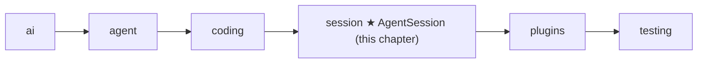

# 13 Part 4 · Sessions

**Goal:** Keep a conversation across turns and save it.

**Builds on:** [12 Evals](12-evals.md) · **Next:** [14 Plugins](14-plugins.md)

## Where we are



This chapter starts the `session` layer.

**Builds:** blocks 2, 5, 7 · **IN:** a `Model`, a store, old messages · **OUT:** one saved line per finished message

Big picture of Part 4: [part-4-session](13-0-part-4-session.md).

Code in this chapter (commit `2fc2776`):

- `packages/simp_agent/src/simp_agent/session/__init__.py` — `SessionStore`, `AgentSession`
- `apps/cli/src/simp_cli/__init__.py` — `JsonlStore`, `session_dir`
- `packages/simp_agent/tests/test_session.py` — `ListStore`, the store test and `test_context_file_in_system_prompt`

## Problem

Yesterday the user asked the agent to write `fizzbuzz.py`. Today they open the app and type "now add tests". At the end of Part 3 we have an `Agent` ([06](06-events-abort.md)) with coding tools ([10](10-coding-tools.md)) and a system prompt ([11](11-system-prompt.md)), but all its history lives in memory. When the program stopped yesterday, the conversation was gone, so today the agent has no idea what `fizzbuzz.py` is.

We need one object that owns the agent for a whole conversation and saves each message as soon as it is final. That object is the **[session](glossary.md#session)**.

### The goal: what is saved

Here is the OUT first. The user says `hi`. The model calls a tool `nope` that does not exist, gets an error back, then answers `ok`. The session saves exactly these 4 lines, one per finished message:

```text
{"content": "hi", "role": "user"}
{"content": [{"id": "c1", "name": "nope", "arguments": {}, "type": "tool_call"}], "stop_reason": "tool_use", "usage": {"input": 0, "output": 0}, "error": null, "error_kind": null, "api": "", "provider": "", "model": "", "role": "assistant"}
{"tool_call_id": "c1", "tool_name": "nope", "content": "Tool nope not found", "is_error": true, "role": "tool_result"}
{"content": [{"text": "ok", "signature": null, "type": "text"}], "stop_reason": "stop", "usage": {"input": 0, "output": 0}, "error": null, "error_kind": null, "api": "", "provider": "", "model": "", "role": "assistant"}
```

This is a **[JSONL](glossary.md#jsonl)** file: one JSON object per line. (Real output of the [test](#test) at the end of this chapter, with the fake model, so `usage` and `model` are empty.) Each line is written the moment its message ends. To resume, we read the lines back into messages.

## Starting point: the Part 3 Agent, kept only in memory

We do not write a new agent. We keep the `Agent` of [06](06-events-abort.md#the-agent-class-state-on-top-of-the-loop), which runs the `agent_loop` of [05](05-agent-loop.md), with the tools of [10](10-coding-tools.md) and the prompt of [11](11-system-prompt.md). The simplest way to save it: run that agent, then dump all messages to a file at the end.

```text
FUNCTION run(task, path):
    IF the file at path exists:
        old = each line of the file, read back as a message
    ELSE:
        old = empty list
    agent = a new Agent with the coding tools and messages = old
    WAIT for agent.prompt(task)
    REWRITE the file: one JSON line per message    // save everything at the end
```

It works for one happy run of the fizzbuzz task, but it has three breaks. **The lost run**: if the process dies mid-run, the model may already have written `fizzbuzz.py` (a real side effect) while the file of messages was never saved, so on resume the model does not know it wrote the file. **The fixed file**: the server wants a database ([22](22-store-auth.md)) and tests want a list in memory, but the path is fixed inside the code. **The repeated wiring**: the CLI and the server both need the same setup code.

We fix them in the order a user meets them: the user opens a session, asks and each message is saved, closes the app and reopens it. Last, we look at what the session does before its first run: it builds the system prompt.

## Real design

### One class that owns the agent

The user opens a session. It must not need the repeated wiring, so **[AgentSession](glossary.md#agentsession)** builds the `Agent` with good defaults, connects the store, and gives apps one place to `subscribe`, `prompt` and `continue_`. It does not copy the loop. It *owns* one `Agent` and plugs into its hooks.

Real code: [session/\_\_init\_\_.py](../../packages/simp_agent/src/simp_agent/session/__init__.py) — `AgentSession.__init__`

```text
CLASS AgentSession:
    FUNCTION __init__(model, tools, store, env, cwd, system_prompt, messages):
                                     // more arguments (plugins, retries, compaction...) come in 14–18
        self.agent = NEW Agent(
            prompt   = self._build_prompt,          // a function that builds the system prompt
            tools    = TOOLS if tools is None, else tools,
            env      = env or LocalEnv(),  cwd = cwd or the current folder,
            messages = messages,                    // the app passes loaded history
            prepare_next_turn = self._prepare,
            before_tool_call  = self._before_tool_call,
            after_tool_call   = self._after_tool_call)
        self.agent.subscribe(self._on_agent_event)  // saves each message
```

The session fills the agent's three hooks from [08](08-hooks-approval.md) with its own methods. Why: later chapters (plugins, compaction) add features inside those methods, and the loop never changes. The defaults keep the call short: no `tools` means the coding tools (`TOOLS`), no `env` means `LocalEnv()` ([09](09-exec-env.md)), and no `system_prompt` means the coding prompt from [11](11-system-prompt.md). `session.messages` simply returns `self.agent.messages`, so there is one list, not two copies that could drift apart.

The session also passes through `steer`, `follow_up` ([07](07-steering.md)) and `abort` ([06](06-events-abort.md)).

### Save each message when it ends

The session owns the agent. What happens to each message when the user asks? Saving only at the end gives the lost run. But the agent already sends a `message_end` event for every finished message ([06](06-events-abort.md)): the user message, each assistant reply, each tool result. So the session listens to the agent's events and saves right there.

Real code: [session/\_\_init\_\_.py](../../packages/simp_agent/src/simp_agent/session/__init__.py) — `_on_agent_event`

```text
self.agent.subscribe(self._on_agent_event)       // in __init__
...
FUNCTION _on_agent_event(e):
    IF e is message_end AND there is a store:
        WAIT for store.append(e.message)   // save right away: crash safe
    WAIT for self._emit(e)                 // pass it on to the session's subscribers
```

Now a crash loses at most the message that was still streaming. Streaming deltas are not saved; only final messages are.

Why `append` and not "rewrite the whole list"? Because history is **[append-only](glossary.md#append-only-history)**: a finished message never changes. So we write it once and never touch it again. Adding one line is cheap; rewriting the file every time is not.

After saving, the session forwards the event with `_emit`. Apps subscribe to the **session**, not to the agent:

Real code: [session/\_\_init\_\_.py](../../packages/simp_agent/src/simp_agent/session/__init__.py) — `subscribe`

```text
FUNCTION subscribe(fn):
    ADD fn to self._subs
    RETURN a function that removes fn    // call it to unsubscribe
```

### Hide the storage behind two methods

The session calls `store.append`. But what is `store`? To avoid the fixed file, the session only knows two methods: `append`, which saving needs now, and `load`, which we need when the user comes back. That is the `SessionStore` protocol:

```python
class SessionStore(Protocol):
    # a message, CompactionEntry or CustomEntry, called right away (crash safe). May be async (awaited).
    def append(self, entry) -> Any: ...

    def load(self) -> list: ...  # used by the app: AgentSession(messages=store.load())
```

A **[SessionStore](glossary.md#sessionstore)** has only `append` (save one entry) and `load` (give back the list). The library does not know about files or databases. That keeps the `session` layer free of IO choices (see the layer rule in [00](00-overview.md)).

A list in memory is now a full store. The tests use this one:

```python
class ListStore:
    def __init__(self, items=()):
        self.items = list(items)

    def append(self, entry):
        self.items.append(entry)

    def load(self):
        return list(self.items)
```

A database store needs `await`, a list does not. So the session calls `await _maybe_await(self.store.append(...))`, using the same **[`_maybe_await`](glossary.md#_maybe_await)** helper as the hooks in [08](08-hooks-approval.md): both kinds of store work.

The comment in the protocol says `append` can also get two entries that are not messages: a `CompactionEntry` ([16](16-compaction.md)) and a plugin's `CustomEntry` ([14](14-plugins.md)). You can ignore them for now; they are saved the same way but never sent to the model.

### JsonlStore: the real store in the CLI

Where do the lines go on a real computer? The library has no file store. The CLI has one, and it is where yesterday's fizzbuzz conversation is written, in `apps/cli/src/simp_cli/__init__.py`. It makes the 4 lines from [the goal](#the-goal-what-is-saved):

Real code: [simp_cli/\_\_init\_\_.py](../../apps/cli/src/simp_cli/__init__.py) — `JsonlStore`

```text
CLASS JsonlStore:                         // one finished entry per line
    FUNCTION append(entry):
        make the parent folder
        OPEN the file in "a" mode, WRITE json of to_dict(entry) + newline, CLOSE
                                          // close = flush: on disk right away
    FUNCTION load():
        IF no file: RETURN []
        RETURN from_dict(json of line) FOR EACH non-empty line
```

Mode `"a"` adds at the end and never rewrites, so a crash can lose at most the line being written. `to_dict` / `from_dict` ([ref-objects](ref-objects.md#going-to-json-and-back)) turn entries into plain dicts and back; the `role` field picks the class. The files live at `~/.simp-agent/sessions/<cwd-slug>/<id>.jsonl`, where `session_dir(cwd)` makes the slug from the project path (`/home/me/project` becomes `home-me-project`). The server keeps its history in a database instead ([22](22-store-auth.md)), with the same two methods.

### Let the app load

Today the user closes the app and opens it again. Who calls `load`? The session does not load by itself. The app does it and passes the list in:

```python
AgentSession(model, store=store, messages=store.load())
```

Why? The app decides *which* session to resume: a session id the user typed, the latest one, or a new one. The CLI, for example, has `latest_session(cwd)`, which picks the newest `.jsonl` file in the folder for this project. The library does not need to know any of this; it just takes a list.

### prompt, continue_ and start()

The history is back in the agent. What does the session do when the user types the next message?

Real code: [session/\_\_init\_\_.py](../../packages/simp_agent/src/simp_agent/session/__init__.py) — `prompt`, `continue_`, `start`

```text
FUNCTION prompt(text):
    WAIT for start()
    RETURN WAIT for _run(agent.prompt with text)

FUNCTION continue_():
    WAIT for start()
    RETURN WAIT for _run(agent.continue_)       // run again, no new message

FUNCTION start():
    IF already started: RETURN                  // runs only once
    mark as started
    IF default prompt AND (path, text = WAIT for load_context_file(env, cwd)) is found:
        add_prompt_section("context_file", "# Project Context\n\n## <path>\n\n<text>", 10)
    ...                                         // more setup in later chapters
```

`prompt(text)` adds a user message and runs. `continue_()` runs again without a new message, for example after a resume where the last saved message was a tool result. `_run` wraps the agent run; in the real code it already holds the retry loop of [15](15-retry.md), but for now read it as "run the agent".

Why a separate `start()`? Reading the [context file](glossary.md#context-file) (`AGENTS.md`, [11](11-system-prompt.md)) goes through the env, which is async, and `__init__` cannot `await`. So the work moves into `start()`, which `prompt` and `continue_` call first, and the `_started` flag makes it run only once. One result to know: `AGENTS.md` is read **once per session**. If you edit it mid-session, the change shows up only in a new session.

`start()` adds the file with `add_prompt_section`. What is a prompt section, and how does it reach the model?

### Prompt sections: how the system prompt is built

**The goal.** With the default prompt and an `AGENTS.md` that says `use tabs`, the model gets one system prompt made of 2 sections, joined by a blank line:

```text
You are an expert coding assistant. ... <- section "coding", order 0
                                       
# Project Context                      <- section "context_file", order 10

## /home/me/project/AGENTS.md

use tabs
```

(The header holds the full path that `load_context_file` returns.) Later, plugins add their own sections (default order 100) after these.

**The table.** The session keeps a small table of **[prompt sections](glossary.md#prompt-section)**. Each section has an id, an order and a value.

Real code: [session/\_\_init\_\_.py](../../packages/simp_agent/src/simp_agent/session/__init__.py) — `AgentSession.__init__`, `add_prompt_section`, `_build_prompt`

```text
// in __init__
IF system_prompt is given:
    add_prompt_section("base", system_prompt, 0)
ELSE:
    add_prompt_section("coding", fn(ctx) -> system_prompt_for(ctx.tools, ctx.cwd), 0)

FUNCTION add_prompt_section(id, value, order = 100):
    seq = old seq IF id is already there, ELSE next counter value
    self._sections[id] = (order, seq, value)

FUNCTION _build_prompt():
    ctx = {tools, cwd, model, messages} of the agent
    parts = []
    FOR EACH section, sorted by (order, seq):
        text = WAIT for value(ctx) IF value is a function, ELSE value
        IF text is not empty: ADD text to parts
    RETURN parts joined with a blank line
```

Sections are sorted by order, then by `seq`, the moment the id was first added, so two sections with the same order still come out in a fixed order. Adding the same id again replaces the value but keeps its place, so a plugin can update its text without moving around. A value can be a function of `ctx`: the coding section calls `system_prompt_for` ([11](11-system-prompt.md)) with the **current** tools and cwd, so if the tools change, the prompt follows. (`ctx` also carries `model` and `messages`, for plugins in [14](14-plugins.md).) Empty text is skipped, so a function can return `""` to switch itself off; `remove_prompt_section(id)` removes a section for good. `AGENTS.md` gets its own section for the same reason: it can come and go without touching the coding text.

The app can also replace the default. If it passes its own `system_prompt` string, that becomes the `"base"` section, and no coding text or context file is added. Our tests do this with `system_prompt="s"`.

Because `self._build_prompt` is the prompt function the `Agent` gets, the loop calls it before **every** model call ([11](11-system-prompt.md)): the system prompt is rebuilt every turn, so any section change shows up on the next turn.

`test_session.py::test_context_file_in_system_prompt` checks this: it writes `AGENTS.md` with `use tabs` and checks that the first system prompt contains it.

## Test

`packages/simp_agent/tests/test_session.py::test_store_gets_every_message_in_order`:

```python
async def test_store_gets_every_message_in_order():
    stream = FakeProvider(AssistantMessage([ToolCall("c1", "nope", {})], stop_reason="tool_use"), DONE)
    store = ListStore()
    s = session(stream, store=store)
    await s.prompt("hi")
    assert store.items == s.messages and [m.role for m in store.items] == ["user", "assistant", "tool_result", "assistant"]
    assert AgentSession(Model(), [], store=store, messages=store.load()).messages == store.items  # app restores
```

The helper `session(...)` builds an `AgentSession` with `tools=[]` and `system_prompt="s"`, so `nope` is unknown because the session has no tools at all. `FakeProvider` ([04](04-label-test.md)) answers with that tool call, then `ok`. The unknown tool still makes a tool result (an error), so the run has four messages: the 4 lines of [the goal](#the-goal-what-is-saved). The first assert checks that the store got **every** message, **in order**, and equals the session history. The last line is a resume: a new session built from `store.load()` has the same history.

Run it:

```sh
uv run pytest packages/simp_agent/tests/test_session.py::test_store_gets_every_message_in_order -q
```

## Why this way

> **Own the agent, save on every message.** `AgentSession` wraps `Agent` instead of growing it. The loop stays small and testable ([05](05-agent-loop.md)); the session adds the "long-lived" features on top through the agent's hooks. Saving on each `message_end` with a two-method `SessionStore` makes history crash safe and lets each app pick its own storage. The cost: the app must call `store.load()` and pass `messages=` itself.

## Exercises

1. Write a `PrintStore` whose `append` prints `entry.role` and keeps the entry in a list. Run a session with `FakeProvider` (copy `session(...)` from `test_session.py`) and check the printed order is `user, assistant, tool_result, assistant`. Hint: reuse the `FakeProvider(...)` call from the test above.
2. Make an async store: `async def append(self, entry)`. Does the session still save every message? Hint: look at `_maybe_await` in `agent/__init__.py`.

## Recap

`AgentSession` owns one `Agent` and connects to its hooks and events. On each `message_end` it appends the finished message to a `SessionStore`, which has only `append` and `load`; in the CLI that store is `JsonlStore`, one JSON line per entry. To resume, the app passes `messages=store.load()`. Before the first run, `start()` runs once and adds the context file as a prompt section, and `_build_prompt` joins the sections before every model call.

**Builds on:** [12 Evals](12-evals.md) · **Next:** [14 Plugins](14-plugins.md) — plugins use the session's hooks and prompt sections.
